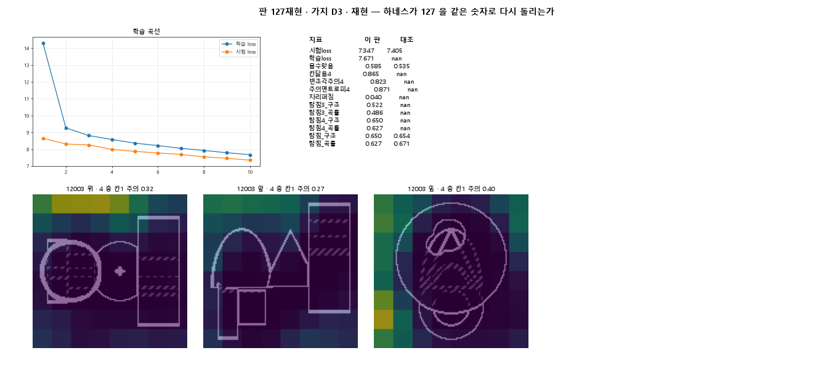
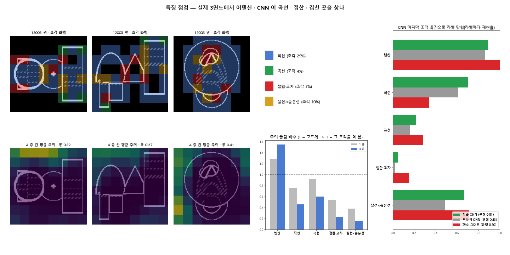

# 판 127재현 — 하네스가 127 을 같은 숫자로 다시 돌리는가

| 가지 | 종류 | 바탕 | 바꾼 손잡이 | 에폭 | git | 날짜 |
|---|---|---|---|---|---|---|
| D3 | 재현 | 127 (하네스/conf/바탕.yaml) | 없음(재현) | 10 | `4403585` | 2026-10-22 15:59 |

## 1. 판정: **통과**

| 지표 | 식 | 문턱 | 이 판 | 대조(127) | 통과 |
|---|---|---|---|---|---|
| 시험loss | <= | 7.555 | 7.347 | 7.405 | ✓ |
| 시험loss | >= | 7.255 | 7.347 | 7.405 | ✓ |
| 몸수맞음 | >= | 0.485 | 0.585 | 0.535 | ✓ |
| 탐침_구조 | >= | 0.598 | 0.650 | 0.654 | ✓ |
| 탐침_곡률 | >= | 0.615 | 0.627 | 0.671 | ✓ |

## 2. 숫자 — 이 판 대 대조

| 지표 | 이 판 | 대조 |
|---|---|---|
| 시험loss | 7.347 | 7.405 |
| 학습loss | 7.671 | — |
| 몸수맞음 | 0.585 | 0.535 |
| 칸닮음4 | 0.865 | — |
| 빈조각주의4 | 0.823 | — |
| 주의엔트로피4 | 0.871 | — |
| 자리퍼짐 | 0.040 | — |
| 탐침3_구조 | 0.522 | — |
| 탐침3_곡률 | 0.486 | — |
| 탐침4_구조 | 0.650 | — |
| 탐침4_곡률 | 0.627 | — |
| 탐침_구조 | 0.650 | 0.654 |
| 탐침_곡률 | 0.627 | 0.671 |

## 모델 구조
### 구성
3면도 → **CNN 백본** → 조각 토큰 192 → **트랜스포머 디코더**(칸 쿼리가 토큰에 교차 주의) → **예측 머리**(칸마다 숫자) → 덩어리 사양 → CadQuery

### 하이퍼파라미터
| 항목 | 값 |
|---|---|
| 입력 | 3면도 3 장 × 128×128 · 회색 1 채널 |
| 백본 | CNN 4 블록(3×3 합성곱 · GroupNorm · GELU) · 그림마다 같은 가중치 |
| 토큰 | 그림마다 8×8 = 64 · 세 장 192 · 조각 위치 표시(학습) + 그림 표시 |
| 모델 차원 d | 256 |
| 디코더 층 | 4 |
| 어텐션 헤드 | 8 |
| FFN 크기 | 1,024 |
| 칸 쿼리(덩어리 최대) | 6 |
| 칸마다 출력 | 41 숫자(있음 1 · 종류 7 · 치수 9 · 축 3 · 자리 3 · 특징 2×8 · 필렛 2) |
| 짝 방식 | 부피 순 고정(칸 k ↔ 부피 k 번째) |
| 총 파라미터 | 5,416,585 |

### 층 (torchinfo 꼴 · 입력 1 × 3 × 128 × 128 을 흘려 잼)
| 층 | 종류 | 출력 모양 | 파라미터 |
|---|---|---|---|
| cnn | Sequential | [3, 256, 8, 8] | 1,173,600 |
| 　cnn.0 | Sequential | [3, 32, 64, 64] | 9,696 |
| 　cnn.1 | Sequential | [3, 64, 32, 32] | 55,680 |
| 　cnn.2 | Sequential | [3, 128, 16, 16] | 221,952 |
| 　cnn.3 | Sequential | [3, 256, 8, 8] | 886,272 |
| dec | TransformerDecoder | [1, 6, 256] | 4,213,760 |
| 　dec.layers.0 | TransformerDecoderLayer | [1, 6, 256] | 1,053,440 |
| 　dec.layers.1 | TransformerDecoderLayer | [1, 6, 256] | 1,053,440 |
| 　dec.layers.2 | TransformerDecoderLayer | [1, 6, 256] | 1,053,440 |
| 　dec.layers.3 | TransformerDecoderLayer | [1, 6, 256] | 1,053,440 |
| 출 | Linear | [1, 6, 41] | 10,537 |

### 목표와 학습
- loss = 칸마다 항목 10 개의 합 — 있음(BCE) · 종류(CE) · 치수(L1 × 4) · 축(CE) · 자리(L1 × 4) · 특징 있음 · 종류 · 수치 · 필렛 있음 · 크기 · 없는 칸은 「있음」만
- AdamW 학습률 0.0003 · 감쇠 0.0001 · 배치 128 · 10 에폭 · 학습률 일정 없음

## 3. 학습 곡선

| 에폭 | 학습 loss | 시험 loss | 덩어리 수 맞음 |
|---|---|---|---|
| 1 | 14.322 | 8.649 | 0.161 |
| 2 | 9.266 | 8.310 | 0.177 |
| 3 | 8.809 | 8.251 | 0.234 |
| 4 | 8.577 | 7.991 | 0.341 |
| 5 | 8.361 | 7.870 | 0.468 |
| 6 | 8.214 | 7.776 | 0.482 |
| 7 | 8.053 | 7.689 | 0.512 |
| 8 | 7.924 | 7.544 | 0.555 |
| 9 | 7.792 | 7.461 | 0.548 |
| 10 | 7.671 | 7.347 | 0.585 |

## 4. 점검

### 4.1 연기 판
첫 loss 35.058 → 배치 하나 40 걸음 10.459 · VRAM 3.21 GB

### 4.2 층보기 (시험 64 · 4 층)
칸끼리 닮음 0.865 (1 = 6 칸 같음) · 빈 조각 주의 몫 0.823 (빈 조각 비율 0.54) · 주의 엔트로피 0.871 · 출력 자리 퍼짐 0.040 (정답 0.148)

### 4.3 탐침 — 합성 그림 (블록 4 · 128)
구조 6 종 0.650 · 곡률 R² 0.627 · (블록 3: 0.522 · 0.486)

### 4.4 특징 — 실제 도면 (조각 라벨 · 하네스/특징.py)
| | 빈칸 | 직선 | 곡선 | 접합·교차 | 실선×숨은선 |
|---|---|---|---|---|---|
| 조각 비율 | 0.53 | 0.29 | 0.04 | 0.05 | 0.10 |
| 주의 쏠림 1 층 (배) | 1.29 | 0.76 | 0.92 | 0.55 | 0.38 |
| 주의 쏠림 4 층 (배) | 1.55 | 0.46 | 0.60 | 0.23 | 0.15 |
| 학습 CNN 재현율 (균형 0.51) | 0.89 | 0.70 | 0.21 | 0.05 | 0.67 |
| 무작위 CNN 재현율 (균형 0.43) | 0.86 | 0.61 | 0.16 | 0.02 | 0.49 |
| 화소 그대로 재현율 (균형 0.50) | 1.00 | 0.34 | 0.28 | 0.15 | 0.71 |

## 쇼츠
편 89_판127재현 · 58.2 초 · 16 줄 · 서재용 업로드 대기

[쇼츠 영상](쇼츠.mp4)

| 누구 | 말 |
|---|---|
| AI | 실제 도면을 넣었더니 모델이 빈 곳만 쳐다봐요. |
| AI | 이 모델은 3면도를 보고 CAD 설계를 짜요. |
| AI | 빈 곳엔 1.55배, 선이 만나는 곳엔 0.23배만 봐요. |
| AI | 선이 겹친 곳은 0.15배라 거의 안 봐요. |
| 나 | 이거 하네스로 다시 돌린 모델이잖아. |
| 나 | 다시 돌리다가 뭔가 망가진 거네. |
| AI | 원래 127 판이랑 숫자를 나란히 놨어요. |
| AI | 시험 오차가 7.347 대 7.405, 거의 같아요. |
| AI | 구조 맞히기도 0.650 대 0.654예요. |
| 나 | 망가진 게 아니라 원래부터 이렇게 보던 거네. |
| 나 | 그럼 그림 화소 그대로랑 비교해 봐. |
| AI | 선이 만나는 곳을 얼마나 찾아내는지 쟀어요. |
| AI | 모델은 0.05, 화소 그대로는 0.15예요. |
| 나 | 학습한 게 화소만도 못하네. |
| AI | 다시 돌리기는 통과, 특징 찾기는 실패예요. |
| AI | 선이 만나고 겹치는 곳을 모델이 피해서 봐요. |

## 5. 해석
<!-- 사람 칸: 아래를 채운다 · 보고서를 다시 만들어도 남는다 -->
- **하네스(가지 D3): 된다.** 127 의 10 에폭 숫자가 다시 나왔다(시험 loss 7.347 대 7.405 · 탐침 구조 0.650 대 0.654). 곡률 0.627 은 127 8 · 12 에폭(0.665 · 0.677)보다 조금 낮지만 문턱 안.
- **CNN 이 곡선 · 겹친 곳을 찾나(가지 A3): 안 된다.** 실제 도면에서 4 층 주의가 빈칸에 1.55 배 몰리고 접합 0.23 배 · 실선×숨은선 0.15 배로 특징을 피한다. CNN 조각 특징의 접합 재현율 0.05 는 화소 그대로(0.15)보다 낮다.
- 곡선 라벨은 규칙이 엄격해(조각 4 %) 곡선 숫자는 약한 증거 · 접합 · 겹친 곳 숫자가 더 믿을 만하다.

## 6. 다음 가지 (사람이 고름 · claudedocs/문제트리.md)
<!-- 사람 칸: 아래를 채운다 · 보고서를 다시 만들어도 남는다 -->
(비어 있음)

## 7. 재현
`python 하네스/하네스.py --config-name 판_127재현` · 설정 [설정.yaml](설정.yaml) · 판정 [판정.json](판정.json) · 산출 `G:/art2real/out/하네스/127재현/`
