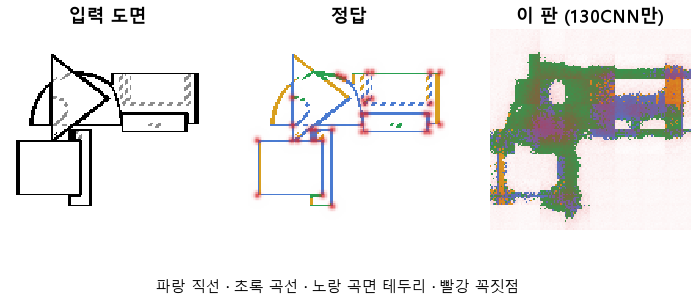
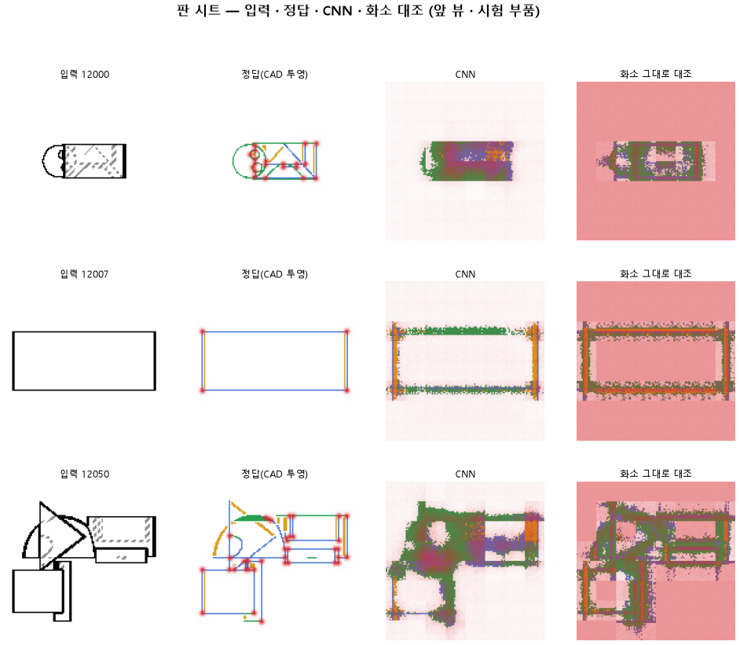

# CNN 만 학습해서 도면의 곡선과 꼭짓점을 찾는지 본다

## 분석
<!-- 사람 칸: 하네스 분석 단계 초안(claude -p) · 고치면 다시 만들어도 남는다 -->
### 한 줄로

**물음**: CAD 모델의 앞단 CNN만 떼어 도면의 선을 찾게 학습하면, 곡선과 꼭짓점을 찾아낼까?

**답**: 곡선은 열에 여덟쯤 맞히지만 직선은 절반도 못 맞히고, 곡면 테두리는 거의 못 잡는다. 선이 없는 곳에도 많이 그린다. 목표선 7개 중 1개만 넘겨 판정은 실패다.

### 왜 이 판을 했나

우리 모델(127)은 부품 도면을 보고 CAD 설계를 짠다. 그 첫 단계가 CNN, 즉 그림에서 특징을 뽑는 부분이다. 설계 전체를 맞히게 학습하면 CNN이 선을 제대로 읽는지 따로 알 수 없다. 그래서 CNN만 떼어, 화소마다 선이 있는지와 무슨 선인지를 맞히게 했다. 선은 넷으로 나눈다. 직선, 곡선, 곡면 테두리(원통 옆면처럼 둥근 면이 꺾여 보이는 선), 숨은선(점선)이다.

### 바꾼 것 하나

학습 목표를 CAD 설계에서 **선 찾기**로 바꿨다. CNN 구조는 127과 같다. 학습 10바퀴, 학습 부품 3,000개, 시험 부품 299개다. 부품마다 위 · 앞 · 옆 도면 세 장을 128×128로 넣었다. 대조는 CNN을 빼고, 화소를 그대로 같은 마지막 판단 층에 넣어 똑같이 10바퀴 학습했다.

### 결과

| | 이 판 (130) | 대조 (화소) | 목표 | 넘었나 |
|---|---|---|---|---|
| 곡선을 곡선으로 | 0.78 | 0.76 | 0.90 | ✗ |
| 직선을 직선으로 | 0.47 | 0.33 | 0.90 | ✗ |
| 곡면 테두리를 제 종류로 | 0.23 | 0.15 | 0.70 | ✗ |
| 선 없는 곳에 잘못 그림 | 19.62 % | 22.10 % | 2 % 아래 | ✗ |
| 꼭짓점 (F1) | 0.27 | 0.05 | 0.75 | ✗ |
| 곡선, 대조보다 나음 | +0.03 | — | +0.15 | ✗ |
| 꼭짓점, 대조보다 나음 | +0.22 | — | +0.20 | ✓ |

*선 줄은 정답이 그 종류인 곳을 그 종류로 칠한 비율이다. F1은 「찍은 점 중 맞은 비율」과 「정답 점 중 찾은 비율」을 함께 본 점수로, 1이면 완벽하다.*

### 왜 이렇게 나왔나

**확인한 것**

- 곡선은 CNN 덕이 거의 없었다. 화소를 그대로 넣어도 0.76이라 차이가 0.03뿐이다.
- 꼭짓점은 CNN이 확실히 도왔다(0.05 → 0.27). 다만 정답 점은 0.59를 찾았는데, 찍은 점 중 맞은 것은 0.17이다. 너무 많이 찍는다.
- 숨은선은 목표선이 없지만 0.85로 네 종류 중 가장 잘 맞았다.
- 학습이 덜 끝났다. 시험 오차가 10바퀴 내내 줄었고(3.20 → 1.95), 학습 오차(1.99)가 시험 오차보다 높으니 외운 것도 아니다.

**짐작 (아직 확인 안 함)**

- 더 오래 돌리면 점수가 더 오를 것 같다. 다만 종류별 점수를 바퀴마다 재지 않아서, 어느 종류가 오를지는 모른다.
- 숨은선이 잘 된 것은 점선 모양이 뚜렷해서일 수 있다.

### 한계

- 시험 부품 299개로 한 번만 돌렸다. 다시 돌렸을 때의 흔들림은 재지 않았다.
- 오차가 아직 줄던 중에 끊었다. 실패가 CNN 구조 탓인지 학습량 탓인지 이 판만으로는 가를 수 없다.
- 대조(화소 그대로)도 10바퀴 내내 시험 오차가 4.79에서 4.31로 계속 내려가고 있었다. 대조도 덜 배운 상태에서 비교한 것이다.

### 배운 것과 다음

다섯 목표선 모두 못 넘었다. 가장 먼 것은 **곡면 테두리, 직선, 헛선**이고, 곡선도 목표에 못 미쳤다. CNN이 화소보다 확실히 더해 준 것은 꼭짓점 하나뿐이다.

1. 같은 설정으로 바퀴 수만 늘리고, 종류별 점수를 바퀴마다 잰다.
2. 헛선이 그려지는 자리를 그림으로 모아 확인한다.
3. CNN의 어느 층이 선의 자리를, 어느 층이 종류를 아는지 따로 읽어 본다.

명제: 127 과 같은 CNN 을 선 정답으로 10 에폭 학습하면 곡선 · 직선 화소를 0.90 넘게 · 곡면 테를 0.70 넘게 맞히고 헛선은 2 % 아래 · 꼭짓점 F1 이 0.75 를 넘으며, 같은 머리에 화소를 그대로 넣은 대조보다 곡선은 0.15 · 꼭짓점 F1 은 0.20 넘게 낫다

| 가지 | 종류 | 바탕 | 바꾼 손잡이 | 에폭 | git | 날짜 |
|---|---|---|---|---|---|---|
| A3 | 비교 | 127 (하네스/conf/바탕.yaml) | 목표: CAD → 선지도 | 10 | `103ce8c` | 2026-10-22 19:31 |

## 1. 판정: **실패**

| 지표 | 식 | 문턱 | 이 판 | 대조(같은 판 화소 그대로(같은 머리 · 같은 10 에폭)) | 통과 |
|---|---|---|---|---|---|
| 선_곡선 | >= | 0.9 | 0.783 | — | ✗ |
| 선_직선 | >= | 0.9 | 0.467 | — | ✗ |
| 선_곡면테 | >= | 0.7 | 0.234 | — | ✗ |
| 선_헛선 | <= | 0.02 | 0.196 | — | ✗ |
| 점_F1 | >= | 0.75 | 0.270 | — | ✗ |
| 선_곡선_차 | >= | 0.15 | 0.027 | — | ✗ |
| 점_F1_차 | >= | 0.2 | 0.221 | — | ✓ |

## 2. 숫자 — 이 판 대 대조

| 지표 | 이 판 | 대조 |
|---|---|---|
| 시험loss | 1.945 | — |
| 학습loss | 1.991 | — |
| 선_직선 | 0.467 | — |
| 선_곡선 | 0.783 | — |
| 선_곡면테 | 0.234 | — |
| 선_숨음 | 0.852 | — |
| 선_헛선 | 0.196 | — |
| 점_정밀 | 0.175 | — |
| 점_재현 | 0.595 | — |
| 점_F1 | 0.270 | — |
| 선_직선_화소 | 0.330 | — |
| 선_곡선_화소 | 0.756 | — |
| 선_곡면테_화소 | 0.149 | — |
| 선_숨음_화소 | 0.733 | — |
| 선_헛선_화소 | 0.221 | — |
| 점_정밀_화소 | 0.026 | — |
| 점_재현_화소 | 0.700 | — |
| 점_F1_화소 | 0.050 | — |
| 선_곡선_차 | 0.027 | — |
| 선_직선_차 | 0.137 | — |
| 선_곡면테_차 | 0.086 | — |
| 점_F1_차 | 0.221 | — |

## 모델 구조
(이 판은 구조를 안 잼)

## 3. 학습 곡선

| 에폭 | 학습 loss | 시험 loss | 맞음(CAD 덩어리 수 · 선지도 선 종류) |
|---|---|---|---|
| 1 | 3.967 | 3.202 | 0.112 |
| 2 | 2.950 | 2.743 | 0.219 |
| 3 | 2.682 | 2.578 | 0.316 |
| 4 | 2.547 | 2.469 | 0.410 |
| 5 | 2.450 | 2.376 | 0.421 |
| 6 | 2.342 | 2.277 | 0.473 |
| 7 | 2.238 | 2.164 | 0.482 |
| 8 | 2.146 | 2.092 | 0.491 |
| 9 | 2.066 | 2.006 | 0.552 |
| 10 | 1.991 | 1.945 | 0.566 |

## 4. 점검

### 4.1 연기 판
첫 loss 5.192 → 배치 하나 40 걸음 2.525 · VRAM 4.54 GB

### 4.2 층보기 (시험 64 · 4 층)
칸끼리 닮음 — (1 = 6 칸 같음) · 빈 조각 주의 몫 — (빈 조각 비율 0.54) · 주의 엔트로피 — · 출력 자리 퍼짐 — (정답 0.148)

### 4.3 탐침 — 합성 그림 (블록 4 · 128)
구조 6 종 — · 곡률 R² — · (블록 3: — · —)

### 4.4 특징 — 실제 도면 (조각 라벨 · 하네스/특징.py)
(이 판은 특징 점검을 안 함)

## 쇼츠
편 91_판130CNN만 · 55.9 초 · 14 줄 · 서재용 공개 10-23 Xksww4e8ERY

[쇼츠 영상](쇼츠.mp4)

| 누구 | 말 |
|---|---|
| AI | 학습시킨 모델이 찾은 선이 군데군데 끊겼어요. |
| AI | 이건 모델에 넣은 그림, 부품을 앞에서 본 모습이에요. |
| AI | 설계도를 그리려면 여기서 모서리 선부터 찾아야 해요. |
| AI | 곧은 모서리도 있고 둥근 테두리도 있어요. |
| AI | 왼쪽이 정답 선, 오른쪽이 모델이 찾은 선이에요. |
| 나 | 선이 너무 가늘어서 놓친 거네. |
| AI | 둥근 테두리를 봐요. 똑같이 가는데 꽤 찾았어요. |
| AI | 끊긴 데는 주로 곧은 모서리예요. |
| 나 | 가늘어서 놓친 게 아니었네. |
| 나 | 곧은 선이랑 둥근 선을 나눠서 채점해 봐. |
| AI | 정답 선을 얼마나 찾았나 종류별로 셌어요. |
| AI | 다 찾으면 1인데, 둥근 선 0.783, 곧은 선 0.467이에요. |
| 나 | 곧은 선을 절반도 못 찾는 거였네. |
| AI | 이번엔 실패예요. 곧은 모서리를 제일 많이 놓쳤어요. |

## 5. 해석
<!-- 사람 칸: 아래를 채운다 · 보고서를 다시 만들어도 남는다 -->
(비어 있음)

## 6. 다음 가지 (사람이 고름 · claudedocs/문제트리.md)
<!-- 사람 칸: 아래를 채운다 · 보고서를 다시 만들어도 남는다 -->
(비어 있음)

## 7. 재현
`python 하네스/하네스.py --config-name 판_130CNN만` · 설정 [설정.yaml](설정.yaml) · 판정 [판정.json](판정.json) · 산출 `G:/art2real/out/하네스/130CNN만/`

## 링크
- 쇼츠: https://youtube.com/shorts/Xksww4e8ERY
- GitHub 이슈: https://github.com/sigongjoa/art2real/issues/2
