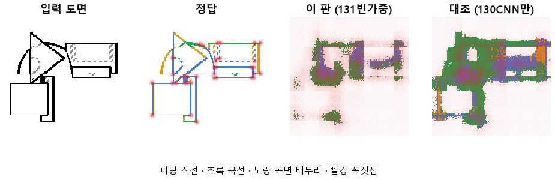
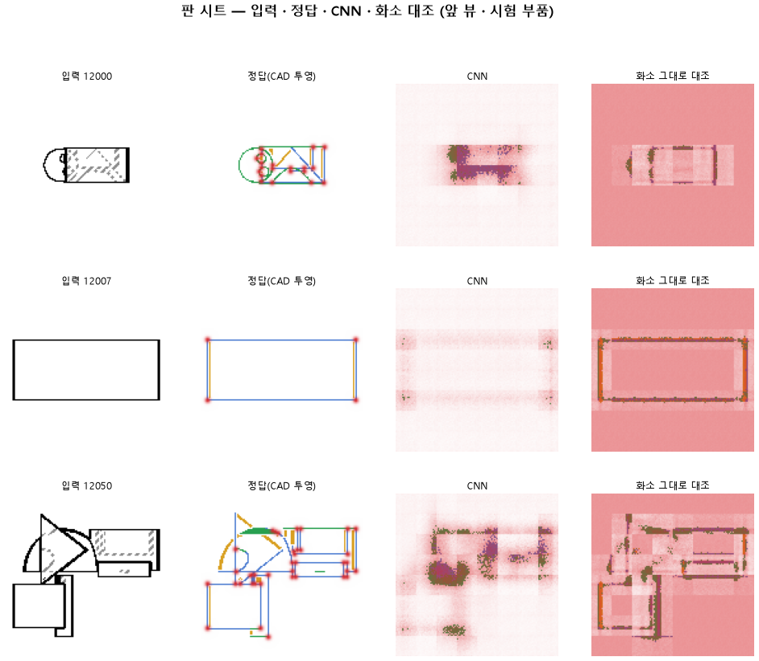

# 선 없는 곳을 칠하면 벌점을 더 줘서 선을 가늘게 그리게 한다

## 분석
<!-- 사람 칸: 하네스 분석 단계 초안(claude -p) · 고치면 다시 만들어도 남는다 -->
### 한 줄로

**물음**: 선이 없는 곳을 잘못 칠했을 때 벌점을 더 주면, 헛선은 줄고 선 종류는 지킬 수 있을까?

**답**: 헛선은 크게 줄었지만 목표에는 못 미쳤다. 선 종류를 맞히는 힘은 무너졌다. 곡선은 0.78에서 0.22로 떨어졌다. 목표선 7개 중 1개만 넘겼는데, 그 1개는 130도 이미 넘긴 것이다. 판정은 실패다.

### 왜 이 판을 했나

우리 CAD 모델(127)은 부품 도면을 보고 CAD 설계를 짠다. 맨 앞에서 그림의 특징을 뽑는 부분이 CNN이다. 130부터는 이 CNN만 떼어 내서, 화소마다 이름표 다섯 가지 중 하나를 붙이도록 학습시킨다. 선 없음, 직선, 곡선, 곡면 테두리, 숨은선(점선)이다.

130은 선이 없는 화소의 20 % 가까이에 선을 그렸다. 선 없는 화소를 틀렸을 때 주는 벌점 무게가 0.05로 아주 작았다. 그래서 대충 칠해도 손해가 적었을 것으로 봤다.

### 바꾼 것 하나

그 무게만 0.05에서 **0.3**으로 올렸다. CNN 구조, 학습 10바퀴, 학습 부품 3,000개, 시험 부품 299개는 130과 같다. 비교용 「화소 모델」도 같은 무게로 다시 돌렸다. 화소 모델은 CNN을 빼고, 화소를 그대로 같은 마지막 판단 층에 넣은 모델이다.

### 결과

| | 이 판 (131) | 대조 (130) | 목표 | 넘었나 |
|---|---|---|---|---|
| 선 없는 곳에 잘못 그림 | **3.35 %** | 19.62 % | 2 % 아래 | ✗ |
| 곡선을 곡선으로 | 0.22 | 0.78 | 0.90 | ✗ |
| 직선을 직선으로 | 0.28 | 0.47 | 0.90 | ✗ |
| 곡면 테두리를 제 종류로 | 0.00 | 0.23 | 0.70 | ✗ |
| 숨은선을 숨은선으로 | 0.85 | 0.85 | — | — |
| 꼭짓점 (F1) | 0.28 | 0.27 | 0.75 | ✗ |
| 곡선, 화소 모델과의 차 | −0.17 | +0.03 | +0.15 | ✗ |
| 꼭짓점, 화소 모델과의 차 | +0.24 | +0.22 | +0.20 | ✓ |

*종류 줄은 정답이 그 종류인 화소 중 그 종류로 칠한 비율이다. 「차」는 CNN 모델 점수에서 화소 모델 점수를 뺀 값이다. F1은 「찍은 점 중 맞은 비율」과 「정답 점 중 찾은 비율」을 함께 본 점수로, 1이면 완벽하다.*

### 왜 이렇게 나왔나

**확인한 것**

- 무게를 올리자 CNN이 있든 없든 같은 쪽으로 움직였다. 화소 모델도 헛선이 22.10 %에서 5.13 %로 줄었고, 곡선은 0.76에서 0.39로 떨어졌다.
- 곡선은 이제 CNN 모델이 화소 모델보다 못하다(0.22 대 0.39).
- 학습이 덜 끝났다. 시험 오차, 즉 학습이 줄이려는 벌점은 10바퀴 내내 줄었다(2.74 → 1.65).

**짐작 (아직 확인 안 함)**

- 선 위의 화소까지 「선 없음」으로 칠해서 종류 점수가 떨어졌을 것 같다. 그 비율은 따로 재지 않았다.
- 0.3은 너무 셌을 수 있다. 0.05와 0.3 사이에 헛선과 종류가 함께 버티는 값이 있을지 모른다.

### 한계

- 시험 부품 299개로 한 번만 돌렸다. 다시 돌렸을 때 얼마나 흔들리는지는 재지 않았다.
- 오차가 아직 줄던 10바퀴에서 끊었다. 같은 무게로 더 배우면 종류 점수가 돌아올지는 모른다.
- 숨은선만 무게에 흔들리지 않은 이유를 아직 모른다.
- 벌점 무게가 달라서, 이 판의 오차 1.65를 130의 1.95와 견줄 수 없다.

### 배운 것과 다음

무게 하나로 헛선은 줄일 수 있었다. 하지만 **그 값을 선 종류로 치렀다.** 적어도 10바퀴, 0.3에서는 둘이 함께 풀리지 않았다.

1. 선 위의 화소가 「선 없음」으로 칠해진 비율을 잰다.
2. 무게를 0.05와 0.3 사이 값으로 돌려 본다.
3. 바퀴 수를 늘리고, 종류별 점수를 바퀴마다 잰다.

명제: 130 과 같은 CNN 과 10 에폭에서 선 없는 화소 가중만 0.3 으로 올리면 헛선이 2 % 아래로 내려가고 곡선 · 직선은 0.90 · 곡면 테 0.70 · 꼭짓점 F1 0.75 를 넘으며, 화소 그대로 대조보다 곡선 +0.15 · 꼭짓점 F1 +0.20 낫다

| 가지 | 종류 | 바탕 | 바꾼 손잡이 | 에폭 | git | 날짜 |
|---|---|---|---|---|---|---|
| A3 | 비교 | 127 (하네스/conf/바탕.yaml) | 선지도.빈가중: None → 0.3 | 10 | `1133e15` | 2026-10-22 19:50 |

## 1. 판정: **실패**

| 지표 | 식 | 문턱 | 이 판 | 대조(130CNN만) | 통과 |
|---|---|---|---|---|---|
| 선_곡선 | >= | 0.9 | 0.218 | 0.783 | ✗ |
| 선_직선 | >= | 0.9 | 0.276 | 0.467 | ✗ |
| 선_곡면테 | >= | 0.7 | 0.002 | 0.234 | ✗ |
| 선_헛선 | <= | 0.02 | 0.034 | 0.196 | ✗ |
| 점_F1 | >= | 0.75 | 0.285 | 0.270 | ✗ |
| 선_곡선_차 | >= | 0.15 | -0.172 | 0.027 | ✗ |
| 점_F1_차 | >= | 0.2 | 0.235 | 0.221 | ✓ |

## 2. 숫자 — 이 판 대 대조

| 지표 | 이 판 | 대조 |
|---|---|---|
| 시험loss | 1.648 | — |
| 학습loss | 1.700 | — |
| 선_직선 | 0.276 | 0.467 |
| 선_곡선 | 0.218 | 0.783 |
| 선_곡면테 | 0.002 | 0.234 |
| 선_숨음 | 0.854 | — |
| 선_헛선 | 0.034 | 0.196 |
| 점_정밀 | 0.192 | — |
| 점_재현 | 0.554 | — |
| 점_F1 | 0.285 | 0.270 |
| 선_직선_화소 | 0.186 | — |
| 선_곡선_화소 | 0.391 | — |
| 선_곡면테_화소 | 0.080 | — |
| 선_숨음_화소 | 0.733 | — |
| 선_헛선_화소 | 0.051 | — |
| 점_정밀_화소 | 0.026 | — |
| 점_재현_화소 | 0.700 | — |
| 점_F1_화소 | 0.050 | — |
| 선_곡선_차 | -0.172 | 0.027 |
| 선_직선_차 | 0.090 | — |
| 선_곡면테_차 | -0.078 | — |
| 점_F1_차 | 0.235 | 0.221 |

## 모델 구조
(이 판은 구조를 안 잼)

## 3. 학습 곡선

| 에폭 | 학습 loss | 시험 loss | 맞음(CAD 덩어리 수 · 선지도 선 종류) |
|---|---|---|---|
| 1 | 3.719 | 2.742 | 0.051 |
| 2 | 2.429 | 2.221 | 0.080 |
| 3 | 2.171 | 2.093 | 0.062 |
| 4 | 2.091 | 2.037 | 0.076 |
| 5 | 2.036 | 1.986 | 0.090 |
| 6 | 1.982 | 1.930 | 0.100 |
| 7 | 1.918 | 1.860 | 0.126 |
| 8 | 1.845 | 1.789 | 0.111 |
| 9 | 1.770 | 1.718 | 0.177 |
| 10 | 1.699 | 1.648 | 0.195 |

## 4. 점검

### 4.1 연기 판
첫 loss 5.197 → 배치 하나 40 걸음 2.102 · VRAM 4.54 GB

### 4.2 층보기 (시험 64 · 4 층)
칸끼리 닮음 — (1 = 6 칸 같음) · 빈 조각 주의 몫 — (빈 조각 비율 0.54) · 주의 엔트로피 — · 출력 자리 퍼짐 — (정답 0.148)

### 4.3 탐침 — 합성 그림 (블록 4 · 128)
구조 6 종 — · 곡률 R² — · (블록 3: — · —)

### 4.4 특징 — 실제 도면 (조각 라벨 · 하네스/특징.py)
(이 판은 특징 점검을 안 함)

## 쇼츠
편 92_판131빈가중 · 51.0 초 · 13 줄 · 서재용 업로드 대기

[쇼츠 영상](쇼츠.mp4)

| 누구 | 말 |
|---|---|
| AI | 왼쪽 정답엔 곡선이 많은데, 오른쪽엔 거의 없어요. |
| AI | 오른쪽은 모델이 도면을 보고 따라 그린 선이에요. |
| AI | 이번엔 정답에 없는 자리에 그린 선, 헛선을 줄이려 했어요. |
| AI | 빈 자리에 선을 그리면 더 크게 틀린 걸로 쳤어요. |
| 나 | 도면에 곡선이 흐리게 들어가서 못 본 거겠지. |
| AI | 모델에 넣은 도면이에요. 곡선이 또렷하게 있어요. |
| 나 | 그럼 도면 탓은 아니네. |
| 나 | 바꾸기 전 모델에도 같은 도면을 넣어 봐. |
| AI | 두 모델에 같은 도면을 넣고 곡선을 몇 개 찾는지 셌어요. |
| AI | 곡선을 찾은 몫이 0.783에서 0.218로 줄었어요. |
| AI | 헛선은 줄었는데, 곡선도 같이 지워졌어요. |
| 나 | 헛선 지우려다 곡선까지 지웠네. |
| AI | 이번 학습은 실패예요. |

## 5. 해석
<!-- 사람 칸: 아래를 채운다 · 보고서를 다시 만들어도 남는다 -->
(비어 있음)

## 6. 다음 가지 (사람이 고름 · claudedocs/문제트리.md)
<!-- 사람 칸: 아래를 채운다 · 보고서를 다시 만들어도 남는다 -->
(비어 있음)

## 7. 재현
`python 하네스/하네스.py --config-name 판_131빈가중` · 설정 [설정.yaml](설정.yaml) · 판정 [판정.json](판정.json) · 산출 `G:/art2real/out/하네스/131빈가중/`

## 링크
- 쇼츠: 서재용 업로드 대기
- GitHub 이슈: https://github.com/sigongjoa/art2real/issues/3
