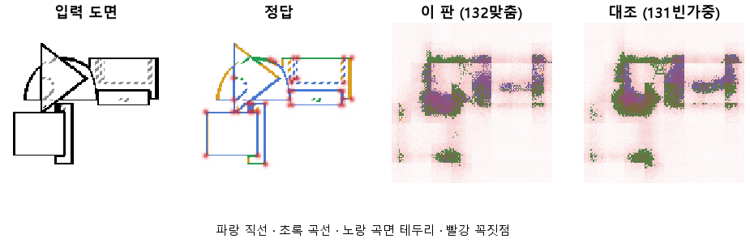
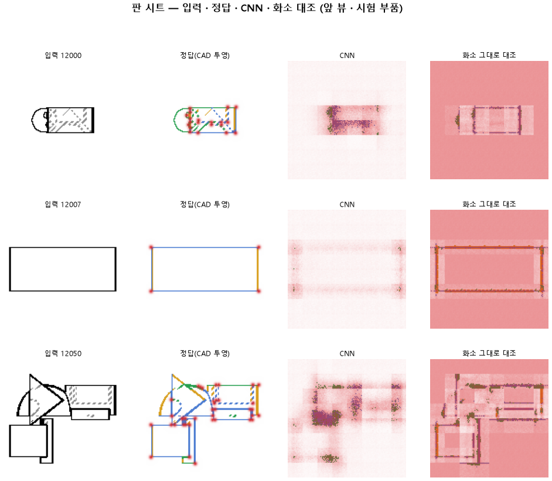

# 정답 선을 입력 선 화소에 맞춰 붙여서 다시 배운다

## 분석
<!-- 사람 칸: 하네스 분석 단계 초안(claude -p) · 고치면 다시 만들어도 남는다 -->
### 한 줄로

**물음**: 정답 선을 그림 속 선 화소에 맞춰 옮겨 주면, 헛선(선 없는 곳에 잘못 그린 선)과 선 종류가 함께 나아질까?

**답**: 헛선은 줄었지만 목표에는 조금 못 미쳤다. 곡선은 오히려 0.22에서 0.11로 떨어졌다. 목표선 6개 중 1개만 넘겼고, 그 1개는 131도 넘긴 것이다. 판정은 실패다.

### 왜 이 판을 했나

131에서는 선 없는 곳을 틀렸을 때 주는 벌점 무게를 0.05에서 0.3으로 올렸다. 헛선은 줄었지만 선 종류를 맞히는 힘이 무너졌다. 우리는 모델이 선 위의 화소까지 「선 없음」으로 칠해서 그렇다고 짐작했다.

그렇다면 정답 쪽이 의심스러웠다. 정답 선이 그림 속 선과 조금 어긋나 있으면, 진짜 선 위의 화소가 정답에서는 「선 없음」이 된다. 무게가 세면 모델은 선 위를 비우라고 더 세게 배운다.

### 바꾼 것 하나

정답을 새로 만들었다. 입력 그림에서 선이 그려진 화소마다 바로 곁의 정답 선 종류를 붙였다. 곁에 정답 선이 없으면 「선 없음」이 된다. 정답 선이 입력 선 위로 옮겨 앉는 셈이다. CNN 구조, 무게 0.3, 학습 10바퀴, 학습 부품 3,000개, 시험 부품 299개는 131과 같다. 비교용 화소 모델(CNN 없이 화소를 바로 판단하는 모델)도 새 정답으로 다시 돌렸다.

### 결과

| | 이 판 (132맞춤) | 대조 (131) | 목표 | 넘었나 |
|---|---|---|---|---|
| 선 없는 곳에 잘못 그림 | 2.28 % | 3.35 % | 2 % 아래 | ✗ |
| 곡선을 곡선으로 | 0.11 | 0.22 | 0.90 | ✗ |
| 직선을 직선으로 | 0.26 | 0.28 | 0.90 | ✗ |
| 꼭짓점 (F1) | 0.29 | 0.28 | 0.75 | ✗ |
| 곡선, 화소 모델과의 차 | −0.20 | −0.17 | +0.15 | ✗ |
| 꼭짓점, 화소 모델과의 차 | +0.24 | +0.24 | +0.20 | ✓ |

*종류 줄은 정답이 그 종류인 화소 중 그 종류로 칠한 비율이다. 「차」는 CNN 모델 점수에서 화소 모델 점수를 뺀 값이다. 반올림 전 값으로 뺐기 때문에 표의 숫자끼리 빼면 0.01쯤 다를 수 있다. F1은 찍은 점이 맞는 정도와 정답 점을 빠짐없이 찾은 정도를 함께 본 점수다. 1이면 완벽하다.*

### 왜 이렇게 나왔나

**확인한 것**

- 맞춤은 두 모델 모두에서 헛선을 줄였다. CNN 모델은 3.35 %에서 2.28 %로, 화소 모델은 5.13 %에서 3.19 %로 줄었다.
- 직선은 화소 모델만 좋아졌다(0.19 → 0.38). CNN 모델은 0.28에서 0.26으로 거의 그대로다.
- 곡선은 두 모델 모두 떨어졌다(CNN 0.22 → 0.11, 화소 0.39 → 0.32). 이제 직선과 곡선 모두 화소 모델이 CNN 모델보다 낫다.
- 학습이 덜 끝났다. 시험 오차는 10바퀴 내내 줄었다(2.70 → 1.56).

**짐작 (아직 확인 안 함)**

- CNN은 그림을 줄여 가며 읽는다. 그래서 화소 단위로 맞춘 효과가 잘 닿지 않았을 수 있다. 화소 모델만 직선이 오른 것과도 맞는다.
- 선 위가 비는 원인은 정답의 어긋남보다 무게 0.3 쪽이 더 클 수 있다.
- 곡선이 떨어진 이유는 모른다.

### 한계

- 시험 부품 299개로 한 번만 돌렸다. 흔들림은 재지 않았다.
- 오차가 아직 줄던 10바퀴에서 끊었다.
- 정답을 바꿨으니 이 판의 오차 1.56을 131의 1.65와 견줄 수 없다.
- 화소 모델의 꼭짓점 점수가 두 판에서 똑같다(0.05). 맞춤이 꼭짓점 정답에도 닿았는지는 확인하지 않았다.

### 배운 것과 다음

정답을 선에 맞춰도 선 종류는 돌아오지 않았다. **지금 CNN 모델은 화소 모델보다도 선 종류를 못 읽는다.** 다만 131에서 무너진 원인이 정답의 어긋남인지는 아직 가를 수 없다. 학습이 덜 끝났고, 출발 짐작(선 위를 「선 없음」으로 칠함)도 아직 재지 않았다.

1. 선 위의 화소가 「선 없음」으로 칠해진 비율을 잰다.
2. 맞춤은 그대로 두고, 무게를 0.05와 0.3 사이 값으로 돌려 본다.
3. 바퀴 수를 늘려서 종류 점수가 따라오는지 본다.

명제: 131 과 같은 CNN · 가중 · 10 에폭에서 정답 선만 입력 선 화소에 붙이면 헛선이 2 % 아래 · 곡선 · 직선이 0.90 · 꼭짓점 F1 이 0.75 를 넘고, 화소 그대로 대조보다 곡선 +0.15 · 꼭짓점 F1 +0.20 낫다

| 가지 | 종류 | 바탕 | 바꾼 손잡이 | 에폭 | git | 날짜 |
|---|---|---|---|---|---|---|
| A3 | 비교 | 127 (하네스/conf/바탕.yaml) | 선지도.맞춤: None → True | 10 | `ff02905` | 2026-10-22 20:16 |

## 1. 판정: **실패**

| 지표 | 식 | 문턱 | 이 판 | 대조(131빈가중) | 통과 |
|---|---|---|---|---|---|
| 선_곡선 | >= | 0.9 | 0.113 | 0.218 | ✗ |
| 선_직선 | >= | 0.9 | 0.257 | 0.276 | ✗ |
| 선_헛선 | <= | 0.02 | 0.023 | 0.034 | ✗ |
| 점_F1 | >= | 0.75 | 0.291 | 0.285 | ✗ |
| 선_곡선_차 | >= | 0.15 | -0.205 | -0.172 | ✗ |
| 점_F1_차 | >= | 0.2 | 0.242 | 0.235 | ✓ |

## 2. 숫자 — 이 판 대 대조

| 지표 | 이 판 | 대조 |
|---|---|---|
| 시험loss | 1.563 | — |
| 학습loss | 1.616 | — |
| 선_직선 | 0.257 | 0.276 |
| 선_곡선 | 0.113 | 0.218 |
| 선_곡면테 | 0.001 | 0.002 |
| 선_숨음 | 0.885 | — |
| 선_헛선 | 0.023 | 0.034 |
| 점_정밀 | 0.195 | — |
| 점_재현 | 0.576 | — |
| 점_F1 | 0.291 | 0.285 |
| 선_직선_화소 | 0.383 | — |
| 선_곡선_화소 | 0.317 | — |
| 선_곡면테_화소 | 0.089 | — |
| 선_숨음_화소 | 0.804 | — |
| 선_헛선_화소 | 0.032 | — |
| 점_정밀_화소 | 0.026 | — |
| 점_재현_화소 | 0.700 | — |
| 점_F1_화소 | 0.050 | — |
| 선_곡선_차 | -0.205 | -0.172 |
| 선_직선_차 | -0.126 | — |
| 선_곡면테_차 | -0.088 | — |
| 점_F1_차 | 0.242 | 0.235 |

## 모델 구조
(이 판은 구조를 안 잼)

## 3. 학습 곡선

| 에폭 | 학습 loss | 시험 loss | 맞음(CAD 덩어리 수 · 선지도 선 종류) |
|---|---|---|---|
| 1 | 3.695 | 2.703 | 0.037 |
| 2 | 2.382 | 2.172 | 0.045 |
| 3 | 2.117 | 2.040 | 0.048 |
| 4 | 2.029 | 1.981 | 0.032 |
| 5 | 1.971 | 1.937 | 0.034 |
| 6 | 1.917 | 1.861 | 0.067 |
| 7 | 1.849 | 1.795 | 0.063 |
| 8 | 1.770 | 1.708 | 0.078 |
| 9 | 1.693 | 1.653 | 0.159 |
| 10 | 1.616 | 1.563 | 0.143 |

## 4. 점검

### 4.1 연기 판
첫 loss 5.198 → 배치 하나 40 걸음 2.026 · VRAM 4.54 GB

### 4.2 층보기 (시험 64 · 4 층)
칸끼리 닮음 — (1 = 6 칸 같음) · 빈 조각 주의 몫 — (빈 조각 비율 0.54) · 주의 엔트로피 — · 출력 자리 퍼짐 — (정답 0.148)

### 4.3 탐침 — 합성 그림 (블록 4 · 128)
구조 6 종 — · 곡률 R² — · (블록 3: — · —)

### 4.4 특징 — 실제 도면 (조각 라벨 · 하네스/특징.py)
(이 판은 특징 점검을 안 함)

## 쇼츠
편 93_판132맞춤 · 57.4 초 · 14 줄 · 서재용 공개 10-23 obXHR6znpAE

[쇼츠 영상](쇼츠.mp4)

| 누구 | 말 |
|---|---|
| AI | 모델이 그린 오른쪽 선에서 둥근 데가 통째로 비었어요. |
| AI | 이게 모델에 넣은 도면이에요. 부품을 앞에서 본 그림이에요. |
| AI | 그림에는 선이 곧은지 둥근지 안 적혀 있어요. |
| AI | 그래서 모델이 선마다 곧은지 둥근지 골라 다시 그려요. |
| AI | 왼쪽 정답은 3D 부품에서 바로 뽑은 선이에요. |
| AI | 모델은 이런 정답을 잔뜩 보고 배웠어요. |
| 나 | 3D에서 뽑은 정답이라 도면 선이랑 살짝 어긋나겠지. |
| 나 | 어긋난 정답으로 배워서 헷갈린 거야. |
| 나 | 정답 선을 도면 선에 딱 붙여서 다시 배우게 해 봐. |
| AI | 정답 선을 도면 선 위로 옮겨 붙였어요. |
| AI | 붙여서 배운 뒤 그린 선이에요. 둥근 데가 더 비었어요. |
| AI | 다 찾으면 1인데, 둥근 선은 0.218에서 0.113이 됐어요. |
| 나 | 어긋난 게 문제가 아니었네. |
| AI | 이번엔 실패예요. 곧은 선도 조금 더 놓쳤어요. |

## 5. 해석
<!-- 사람 칸: 아래를 채운다 · 보고서를 다시 만들어도 남는다 -->
(비어 있음)

## 6. 다음 가지 (사람이 고름 · claudedocs/문제트리.md)
<!-- 사람 칸: 아래를 채운다 · 보고서를 다시 만들어도 남는다 -->
(비어 있음)

## 7. 재현
`python 하네스/하네스.py --config-name 판_132맞춤` · 설정 [설정.yaml](설정.yaml) · 판정 [판정.json](판정.json) · 산출 `G:/art2real/out/하네스/132맞춤/`

## 링크
- 쇼츠: https://youtube.com/shorts/obXHR6znpAE
- GitHub 이슈: https://github.com/sigongjoa/art2real/issues/4
