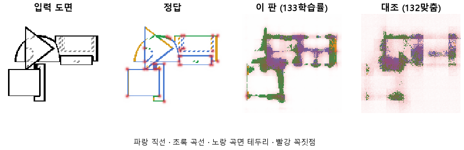
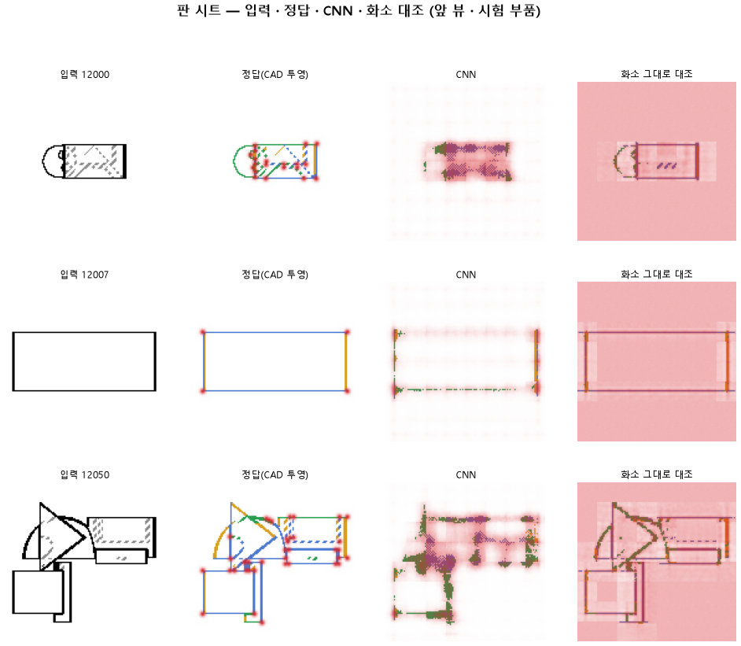

# 학습률을 열 배 올려 같은 에폭 안에 더 배우게 한다

## 분석
<!-- 사람 칸: 하네스 분석 단계 초안(claude -p) · 고치면 다시 만들어도 남는다 -->
### 한 줄로

**물음**: 학습률(한 번 배울 때 고치는 폭)을 열 배 올리면, 같은 10바퀴 안에 선 종류와 꼭짓점을 더 잘 배울까?

**답**: 곡선은 0.11에서 0.30으로 올랐지만 목표 0.90에는 한참 못 미친다. 헛선(선이 없는 곳에 그은 선)은 두 배로 늘었다. 목표선 6개를 다 넘어야 성공인데 1개만 넘었다. 판정은 실패다.

### 왜 이 판을 했나

우리 모델은 부품 도면(위·앞·옆 세 장)을 받아 화소마다 선이 있는지 정한다. 선이 있으면 직선·곡선·숨은선(점선)·곡면 테두리 중 무엇인지 칠한다. 꼭짓점은 점으로 찍는다. 그림을 읽는 부분은 CNN(그림을 줄여 가며 특징을 뽑는 신경망)이다.

132에서는 정답 선을 입력 그림의 선 화소 위로 옮겨 앉혔다. 그래도 곡선은 131보다 떨어졌다(0.22 → 0.11). 다만 시험 오차(정답과 다른 정도, 낮을수록 좋음)가 10바퀴 내내 줄고 있었다. 학습이 덜 끝난 것이다. 그래서 한 바퀴에 더 많이 배우게 해 보았다.

### 바꾼 것 하나

학습률을 0.0003에서 0.003으로 올렸다. 132의 정답, 10바퀴, 학습 부품 3,000개, 시험 부품 299개는 그대로다.

### 결과

| | 이 판 (133) | 대조 (132) | 목표 | 넘었나 |
|---|---|---|---|---|
| 선 없는 곳에 잘못 그림 | 4.67 % | 2.28 % | 2 % 아래 | ✗ |
| 곡선을 곡선으로 | 0.30 | 0.11 | 0.90 | ✗ |
| 직선을 직선으로 | 0.29 | 0.26 | 0.90 | ✗ |
| 꼭짓점 (F1) | 0.31 | 0.29 | 0.75 | ✗ |
| 곡선, 화소 모델과의 차 | −0.24 | −0.20 | +0.15 | ✗ |
| 꼭짓점, 화소 모델과의 차 | +0.25 | +0.24 | +0.20 | ✓ |

*종류 줄은 정답이 그 종류인 화소 중 그 종류로 칠한 비율이다. 화소 모델은 CNN 없이 화소마다 바로 판단하는 비교용 모델이다. 「차」는 CNN 점수에서 화소 모델 점수를 뺀 값이다. F1은 찍은 점이 맞는 정도와 정답 점을 빠짐없이 찾은 정도를 함께 본 점수로, 1이면 완벽하다. 숨은선은 미리 정한 목표가 없어 표에서 뺐다.*

### 왜 이렇게 나왔나

**확인한 것**

- 더 멀리 배우긴 했다. 시험 오차가 1.56에서 1.41로 내려갔다. 마지막 바퀴에도 줄고 있었다(1.47 → 1.41).
- 곡선이 가장 많이 올랐지만 화소 모델은 더 올랐다(0.32 → 0.54). 그래서 차는 벌어졌다. 직선도 화소 모델이 0.53으로 CNN의 0.29보다 낫다.
- 헛선은 CNN에서만 늘었다. 화소 모델은 3.19 %에서 1.27 %로 줄었다.
- 꼭짓점이 거의 그대로인 건 두 변화가 상쇄돼서다. 찍은 점이 맞는 비율은 0.19에서 0.24로 올랐다. 정답 점을 찾은 비율은 0.58에서 0.43으로 내려갔다.

**짐작 (아직 확인 안 함)**

- 학습률이 커지자 CNN이 선을 더 과감하게 긋고, 그 선이 선 밖으로 번진 것 같다.
- CNN은 그림을 줄였다가 다시 키우므로 선 둘레가 번질 수 있다. 헛선이 CNN에서만 늘어난 것과 맞는다.

### 한계

- 시험 부품 299개로 한 번만 돌렸다. 흔들림은 재지 않았다.
- 오차가 아직 줄던 10바퀴에서 끊었다. 학습률 덕인지, 같은 바퀴 안에서 더 멀리 간 것뿐인지 가를 수 없다.
- 화소 모델도 이 판에서 같은 학습률로 다시 학습했기 때문에 점수가 바뀌었다. 그래서 「차」 줄은 비교 대상도 같이 움직인 값이다.
- 숨은선은 0.92인데 직선·곡선은 0.3 언저리다. 왜 이렇게 벌어지는지는 설명하지 못했다.

### 배운 것과 다음

학습률만 올려서는 부족했다. **선 종류는 여전히 화소 모델이 CNN보다 잘 읽는다.** 그림 전체를 보는 CNN의 장점을 아직 못 살리고 있다.

1. 학습률 0.003에서 오차가 더 줄지 않을 때까지 바퀴를 늘린다.
2. 늘어난 헛선이 어디에 생기는지 그림으로 모아 본다.
3. 꼭짓점을 놓친 자리를 따로 센다.

명제: 132 와 같은 설정 · 10 에폭에서 학습률만 3e-3 으로 올리면 헛선이 2 % 아래 · 곡선 · 직선이 0.90 · 꼭짓점 F1 이 0.75 를 넘고, 화소 그대로 대조보다 곡선 +0.15 · 꼭짓점 F1 +0.20 낫다

| 가지 | 종류 | 바탕 | 바꾼 손잡이 | 에폭 | git | 날짜 |
|---|---|---|---|---|---|---|
| A3 | 비교 | 127 (하네스/conf/바탕.yaml) | 학습.학습률: 0.0003 → 0.003 | 10 | `de47832` | 2026-10-22 20:27 |

## 1. 판정: **실패**

| 지표 | 식 | 문턱 | 이 판 | 대조(132맞춤) | 통과 |
|---|---|---|---|---|---|
| 선_곡선 | >= | 0.9 | 0.301 | 0.113 | ✗ |
| 선_직선 | >= | 0.9 | 0.290 | 0.257 | ✗ |
| 선_헛선 | <= | 0.02 | 0.047 | 0.023 | ✗ |
| 점_F1 | >= | 0.75 | 0.307 | 0.291 | ✗ |
| 선_곡선_차 | >= | 0.15 | -0.242 | -0.205 | ✗ |
| 점_F1_차 | >= | 0.2 | 0.255 | 0.242 | ✓ |

## 2. 숫자 — 이 판 대 대조

| 지표 | 이 판 | 대조 |
|---|---|---|
| 시험loss | 1.413 | — |
| 학습loss | 1.469 | — |
| 선_직선 | 0.290 | 0.257 |
| 선_곡선 | 0.301 | 0.113 |
| 선_곡면테 | 0.071 | 0.001 |
| 선_숨음 | 0.916 | — |
| 선_헛선 | 0.047 | 0.023 |
| 선_자리 | 0.730 | — |
| 선_자리헛선 | 0.095 | — |
| 선_종류 | 0.523 | — |
| 점_정밀 | 0.237 | — |
| 점_재현 | 0.435 | — |
| 점_F1 | 0.307 | 0.291 |
| 선_직선_화소 | 0.534 | — |
| 선_곡선_화소 | 0.544 | — |
| 선_곡면테_화소 | 0.231 | — |
| 선_숨음_화소 | 0.927 | — |
| 선_헛선_화소 | 0.013 | — |
| 선_자리_화소 | 0.897 | — |
| 선_자리헛선_화소 | 0.031 | — |
| 선_종류_화소 | 0.566 | — |
| 점_정밀_화소 | 0.027 | — |
| 점_재현_화소 | 0.689 | — |
| 점_F1_화소 | 0.052 | — |
| 선_곡선_차 | -0.242 | -0.205 |
| 선_직선_차 | -0.244 | — |
| 선_곡면테_차 | -0.159 | — |
| 점_F1_차 | 0.255 | 0.242 |

## 모델 구조
(이 판은 구조를 안 잼)

## 3. 학습 곡선

| 에폭 | 학습 loss | 시험 loss | 맞음(CAD 덩어리 수 · 선지도 선 종류) |
|---|---|---|---|
| 1 | 2.680 | 2.173 | 0.001 |
| 2 | 2.107 | 2.015 | 0.051 |
| 3 | 1.986 | 1.905 | 0.059 |
| 4 | 1.902 | 1.833 | 0.087 |
| 5 | 1.820 | 1.759 | 0.097 |
| 6 | 1.748 | 1.689 | 0.176 |
| 7 | 1.686 | 1.635 | 0.161 |
| 8 | 1.622 | 1.559 | 0.199 |
| 9 | 1.542 | 1.470 | 0.194 |
| 10 | 1.469 | 1.413 | 0.252 |

## 4. 점검

### 4.1 연기 판
첫 loss 5.198 → 배치 하나 40 걸음 2.026 · VRAM 4.54 GB

### 4.2 층보기 (시험 64 · 4 층)
칸끼리 닮음 — (1 = 6 칸 같음) · 빈 조각 주의 몫 — (빈 조각 비율 0.54) · 주의 엔트로피 — · 출력 자리 퍼짐 — (정답 0.148)

### 4.3 탐침 — 합성 그림 (블록 4 · 128)
구조 6 종 — · 곡률 R² — · (블록 3: — · —)

### 4.4 특징 — 실제 도면 (조각 라벨 · 하네스/특징.py)
(이 판은 특징 점검을 안 함)

## 쇼츠
편 94_판133학습률 · 54.2 초 · 13 줄 · 서재용 업로드 대기

[쇼츠 영상](쇼츠.mp4)

| 누구 | 말 |
|---|---|
| AI | 부품을 앞에서 본 도면이에요. 이걸 모델에 넣어요. |
| AI | 모델은 선마다 곧은 모서리인지, 둥근 모서리인지 골라 칠해요. |
| AI | 왼쪽 정답엔 둥근 모서리가 많은데, 오른쪽은 거의 비었어요. |
| 나 | 곧은 모서리는 칠했는데, 둥근 데만 비었네. |
| AI | 학습이 끝나는 순간까지도 틀리는 게 계속 줄고 있었어요. |
| 나 | 배우는 속도가 느렸던 거야. 끝나기 전에 다 못 배운 거지. |
| 나 | 그럼 틀릴 때마다 한 번에 더 크게 고치게 바꿔. |
| AI | 학습 시간은 그대로 두고, 한 번에 고치는 폭만 키웠어요. |
| AI | 둥근 모서리를 몇 개 중 몇 개 찾았나 셌어요. |
| AI | 100개 중 11개에서 30개로 늘었지만, 목표는 90개예요. |
| AI | 이번 오른쪽엔 정답에 없는 선도 처음보다 더 생겼어요. |
| 나 | 느리게 배워서 생긴 문제가 아니었네. |
| AI | 크게 고쳐도 둥근 모서리는 대부분 비어요. 실패예요. |

## 5. 해석
<!-- 사람 칸: 아래를 채운다 · 보고서를 다시 만들어도 남는다 -->
(비어 있음)

## 6. 다음 가지 (사람이 고름 · claudedocs/문제트리.md)
<!-- 사람 칸: 아래를 채운다 · 보고서를 다시 만들어도 남는다 -->
(비어 있음)

## 7. 재현
`python 하네스/하네스.py --config-name 판_133학습률` · 설정 [설정.yaml](설정.yaml) · 판정 [판정.json](판정.json) · 산출 `G:/art2real/out/하네스/133학습률/`

## 링크
- 쇼츠: 서재용 업로드 대기
- GitHub 이슈: https://github.com/sigongjoa/art2real/issues/5
