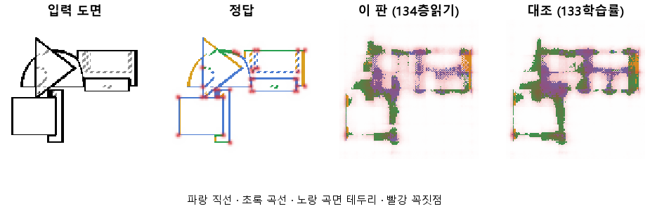
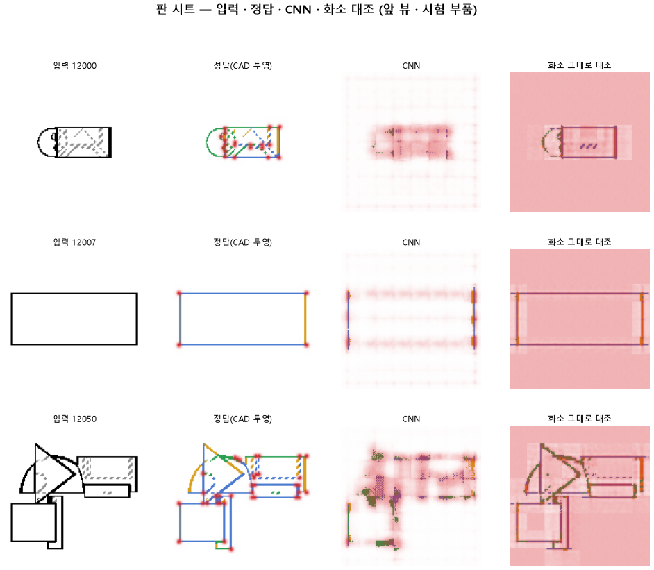

# CNN 의 층마다 같은 머리를 붙여 선 정보가 어디서 사라지는지 본다

## 분석
<!-- 사람 칸: 하네스 분석 단계 초안(claude -p) · 고치면 다시 만들어도 남는다 -->
### 한 줄로

**물음**: CNN의 층마다 같은 읽기 머리를 붙이면, 선 정보가 어느 층에서 사라지는지 보일까?

**답**: 짐작은 반만 맞았다. 맨 뒤 블록 4가 선 자리를 잘 못 찾는다는 짐작은 맞았다. 하지만 가장 못 찾은 곳은 가운데 블록 2·3이었다. 맨 앞 블록 1도 목표에 못 미쳤다. 목표선 4개 중 1개만 넘어서 판정은 실패다.

### 왜 이 판을 했나

우리 모델은 부품 도면(위·앞·옆 세 장)을 본다. 그리고 화소마다 선이 있는지, 있으면 무슨 선인지 칠한다. 그림을 읽는 부분은 CNN, 즉 그림을 줄여 가며 특징을 뽑는 신경망이다. 그 끝에 붙은 읽기 머리가 특징을 받아 선과 꼭짓점을 칠한다.

133에서 학습률을 올렸지만 곡선을 곡선으로 맞힌 비율은 0.30이었다. 목표 0.90에 한참 모자란다. 학습이 덜 된 건지, CNN이 그림을 줄이면서 선을 잃는 건지 가를 수 없었다. 그래서 층마다 따로 읽어 보기로 했다. 미리 적어 둔 짐작은 이랬다. 덜 줄인 블록 1·2는 선 자리를 잘 찾고, 16배로 줄인 블록 4는 못 찾는다.

### 바꾼 것 하나

CNN의 블록 1~4 뒤에 **똑같이 생긴 읽기 머리를 하나씩** 붙였다. 학습 설정은 133과 같다. 10바퀴, 학습 부품 3,000개, 시험 부품 299개.

### 결과

| | 이 판 (134) | 대조 (133) | 목표 | 넘었나 |
|---|---|---|---|---|
| 블록 1, 선이 있는 자리를 찾음 | 0.82 | — | 0.90 이상 | ✗ |
| 블록 2, 선이 있는 자리를 찾음 | 0.53 | — | 0.85 이상 | ✗ |
| 블록 2, 곡선을 곡선으로 | 0.11 | — | 0.60 이상 | ✗ |
| 블록 4, 선이 있는 자리를 찾음 | 0.62 | 0.73 | 0.80 아래 | ✓ |

*점수는 0~1이고 높을수록 좋다. 블록 4 줄만 목표가 거꾸로다. 「블록 4는 못 찾는다」는 짐작을 확인하는 줄이라서 0.80 아래여야 넘는다. 블록 1~3은 이번에 처음 읽어서 대조 값이 없다.*

### 왜 이렇게 나왔나

**확인한 것**

- 선 자리 점수는 층을 지날수록 고르게 줄지 않았다. 블록 1부터 0.82, 0.53, 0.44, 0.62 순이다.
- 블록 1과 블록 4의 자리 차이는 0.20이다. 아래 한계에 적은 흔들림 0.11보다 크다.
- 선 종류 전체 점수는 블록 1이 0.50, 블록 4가 0.52로 거의 같다. 곡선만 보면 0.33 대 0.19다.
- 꼭짓점은 블록 2가 가장 잘 찍었다(F1 0.32, 블록 1은 0.20). F1은 점을 맞게 찍었는지와 빠짐없이 찍었는지를 함께 본 점수다.
- 학습은 덜 끝났다. 마지막 바퀴에도 시험 오차가 6.70에서 6.39로 줄고 있었다.

**짐작 (아직 확인 안 함)**

- 블록 4가 가운데 블록보다 나은 것은 원래 머리가 붙어 있던 자리라서일 수 있다. 학습 내내 선을 칠하도록 다듬어졌다는 뜻이다.
- 블록 4는 133보다 떨어졌다(자리 0.73 → 0.62, 곡선 0.30 → 0.19). 새로 붙인 머리들의 오차가 CNN까지 같이 끌어당겼기 때문으로 본다.

### 한계

- 시험 부품 299개로 한 번만 돌렸다. 같은 설정을 다시 돌렸을 때의 흔들림은 재지 않았다.
- 블록 4는 133과 같아야 하는데 자리가 0.73 대 0.62로 0.11 어긋났다. 원인을 아직 모른다. 그래서 0.1 안팎의 차이는 믿지 않는 게 좋다. 곡선의 0.33 대 0.19도 이 경계에 가깝다.
- 오차가 아직 줄던 10바퀴에서 끊었다. 더 배우면 층 순위가 바뀔 수 있다.

### 배운 것과 다음

선 정보는 깊은 층으로 갈수록 고르게 사라진다고 봤지만 아니었다. **선 자리는 맨 앞 블록이 가장 많이 들고 있었다.** 지금 구조는 맨 뒤 층만 읽으니 이 자리 정보를 버리고 있을 수 있다. 선 종류와 꼭짓점은 어느 층이 나은지 아직 가를 수 없다.

1. 맨 앞 블록과 맨 뒤 블록을 이어 붙여 읽게 한다.
2. 새 머리의 오차가 CNN으로 흐르지 않게 막고 다시 돌린다. 그래서 블록 4가 왜 떨어졌는지 가린다.
3. 오차가 더 줄지 않을 때까지 바퀴를 늘려 층 순위가 그대로인지 본다.

명제: 133 과 같은 학습에 층별 탐침만 붙이면 덜 줄인 블록 1 · 2 는 선 자리를 0.90 · 0.85 넘게 찾고 블록 2 는 곡선을 0.60 넘게 맞히지만, 16 배로 줄인 블록 4 는 선 자리가 0.80 아래에 머문다

| 가지 | 종류 | 바탕 | 바꾼 손잡이 | 에폭 | git | 날짜 |
|---|---|---|---|---|---|---|
| A3 | 비교 | 127 (하네스/conf/바탕.yaml) | 선지도.탐침층: None → True | 10 | `84c4c67` | 2026-10-22 21:02 |

## 1. 판정: **실패**

| 지표 | 식 | 문턱 | 이 판 | 대조(133학습률) | 통과 |
|---|---|---|---|---|---|
| 층1_선_자리 | >= | 0.9 | 0.822 | — | ✗ |
| 층2_선_자리 | >= | 0.85 | 0.530 | — | ✗ |
| 층2_선_곡선 | >= | 0.6 | 0.113 | — | ✗ |
| 층4_선_자리 | <= | 0.8 | 0.619 | — | ✓ |

## 2. 숫자 — 이 판 대 대조

| 지표 | 이 판 | 대조 |
|---|---|---|
| 시험loss | 6.386 | — |
| 학습loss | 6.603 | — |
| 선_직선 | 0.162 | 0.290 |
| 선_곡선 | 0.188 | 0.301 |
| 선_곡면테 | 0.072 | — |
| 선_숨음 | 0.911 | — |
| 선_헛선 | 0.026 | — |
| 선_자리 | 0.619 | 0.730 |
| 선_자리헛선 | 0.076 | — |
| 선_종류 | 0.522 | 0.523 |
| 점_정밀 | 0.199 | — |
| 점_재현 | 0.414 | — |
| 점_F1 | 0.268 | 0.307 |
| 층1_선_직선 | 0.367 | — |
| 층1_선_곡선 | 0.332 | — |
| 층1_선_자리 | 0.822 | — |
| 층1_선_자리헛선 | 0.032 | — |
| 층1_선_종류 | 0.502 | — |
| 층1_점_F1 | 0.200 | — |
| 층2_선_직선 | 0.160 | — |
| 층2_선_곡선 | 0.113 | — |
| 층2_선_자리 | 0.530 | — |
| 층2_선_자리헛선 | 0.047 | — |
| 층2_선_종류 | 0.477 | — |
| 층2_점_F1 | 0.322 | — |
| 층3_선_직선 | 0.140 | — |
| 층3_선_곡선 | 0.082 | — |
| 층3_선_자리 | 0.437 | — |
| 층3_선_자리헛선 | 0.078 | — |
| 층3_선_종류 | 0.477 | — |
| 층3_점_F1 | 0.252 | — |
| 층4_선_자리 | 0.619 | — |
| 층4_선_자리헛선 | 0.076 | — |
| 층4_선_종류 | 0.522 | — |
| 층4_선_직선 | 0.162 | — |
| 층4_선_곡선 | 0.188 | — |
| 층4_점_F1 | 0.268 | — |
| 선_직선_화소 | 0.534 | — |
| 선_곡선_화소 | 0.544 | — |
| 선_곡면테_화소 | 0.231 | — |
| 선_숨음_화소 | 0.927 | — |
| 선_헛선_화소 | 0.013 | — |
| 선_자리_화소 | 0.897 | — |
| 선_자리헛선_화소 | 0.031 | — |
| 선_종류_화소 | 0.566 | — |
| 점_정밀_화소 | 0.027 | — |
| 점_재현_화소 | 0.690 | — |
| 점_F1_화소 | 0.052 | — |
| 선_곡선_차 | -0.355 | — |
| 선_직선_차 | -0.372 | — |
| 선_곡면테_차 | -0.158 | — |
| 점_F1_차 | 0.216 | — |

## 모델 구조
(이 판은 구조를 안 잼)

## 3. 학습 곡선

| 에폭 | 학습 loss | 시험 loss | 맞음(CAD 덩어리 수 · 선지도 선 종류) |
|---|---|---|---|
| 1 | 13.630 | 10.856 | 0.009 |
| 2 | 10.259 | 9.581 | 0.044 |
| 3 | 9.209 | 8.791 | 0.055 |
| 4 | 8.444 | 8.053 | 0.106 |
| 5 | 7.884 | 7.548 | 0.112 |
| 6 | 7.354 | 7.093 | 0.105 |
| 7 | 7.080 | 6.871 | 0.153 |
| 8 | 6.951 | 7.173 | 0.149 |
| 9 | 6.808 | 6.705 | 0.165 |
| 10 | 6.603 | 6.386 | 0.156 |

## 4. 점검

### 4.1 연기 판
첫 loss 5.253 → 배치 하나 40 걸음 2.118 · VRAM 2.89 GB

### 4.2 층보기 (시험 64 · 4 층)
칸끼리 닮음 — (1 = 6 칸 같음) · 빈 조각 주의 몫 — (빈 조각 비율 0.54) · 주의 엔트로피 — · 출력 자리 퍼짐 — (정답 0.148)

### 4.3 탐침 — 합성 그림 (블록 4 · 128)
구조 6 종 — · 곡률 R² — · (블록 3: — · —)

### 4.4 특징 — 실제 도면 (조각 라벨 · 하네스/특징.py)
(이 판은 특징 점검을 안 함)

## 쇼츠
편 95_판134층읽기 · 49.2 초 · 12 줄 · 서재용 공개 10-23 -QmSXSYdOKs

[쇼츠 영상](쇼츠.mp4)

| 누구 | 말 |
|---|---|
| AI | 왼쪽은 정답, 오른쪽은 모델이 만든 부품이에요. |
| AI | 오른쪽엔 모서리가 군데군데 빠졌어요. |
| AI | 모델은 이 도면을 보고 부품을 만들어요. |
| AI | 도면의 선 하나하나가 부품 모서리예요. |
| AI | 모델은 도면을 네 번에 걸쳐 작게 줄여 가며 봐요. |
| AI | 작게 볼수록 큰 덩어리가 한눈에 들어오거든요. |
| 나 | 마지막엔 너무 작아져서 선이 뭉개진 거네. |
| 나 | 단계마다 정답 선을 몇 개 찾는지 세게 해 봐. |
| AI | 100개 중 첫 단계 82, 둘째 53, 셋째 44, 끝 62개. |
| AI | 처음 한 번 줄이자마자 선이 확 줄었어요. |
| 나 | 끝이 아니라 처음 줄일 때 잃은 거였네. 내 짐작이 틀렸어. |
| AI | 그때 잃은 선들이 결과에서 빈 모서리가 됐어요. |

## 5. 해석
<!-- 사람 칸: 아래를 채운다 · 보고서를 다시 만들어도 남는다 -->
(비어 있음)

## 6. 다음 가지 (사람이 고름 · claudedocs/문제트리.md)
<!-- 사람 칸: 아래를 채운다 · 보고서를 다시 만들어도 남는다 -->
(비어 있음)

## 7. 재현
`python 하네스/하네스.py --config-name 판_134층읽기` · 설정 [설정.yaml](설정.yaml) · 판정 [판정.json](판정.json) · 산출 `G:/art2real/out/하네스/134층읽기/`

## 링크
- 쇼츠: https://youtube.com/shorts/-QmSXSYdOKs
- GitHub 이슈: https://github.com/sigongjoa/art2real/issues/6
