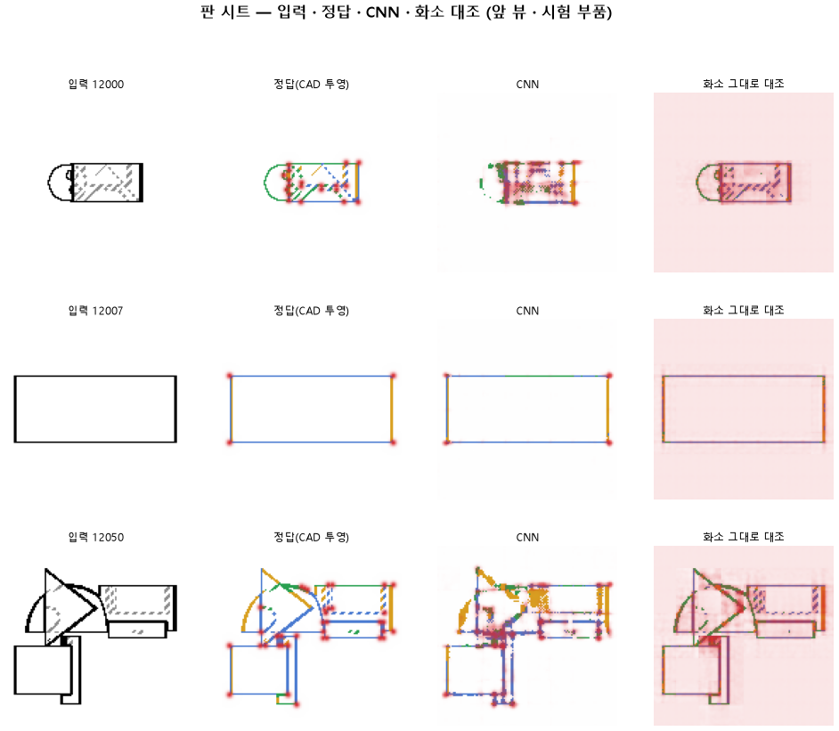

# 같은 설정으로 여섯 배 오래 학습해 결국 배우는지 본다

명제: 134 와 같은 설정에서 에폭만 60 으로 늘리면 블록 4 머리가 선 자리 0.90 · 곡선 · 직선 0.90 · 꼭짓점 F1 0.75 를 넘고 헛선은 2 % 아래이며, 같은 60 에폭 화소 대조보다 곡선 +0.15 · 꼭짓점 F1 +0.20 낫다

| 가지 | 종류 | 바탕 | 바꾼 손잡이 | 에폭 | git | 날짜 |
|---|---|---|---|---|---|---|
| A3 | 비교 | 127 (하네스/conf/바탕.yaml) | 학습.에폭: 10 → 60 | 60 | `80056bf` | 2026-10-22 21:43 |

## 1. 판정: **실패**

| 지표 | 식 | 문턱 | 이 판 | 대조(같은 판 화소 그대로 60 에폭) | 통과 |
|---|---|---|---|---|---|
| 선_자리 | >= | 0.9 | 0.889 | — | ✗ |
| 선_곡선 | >= | 0.9 | 0.633 | — | ✗ |
| 선_직선 | >= | 0.9 | 0.614 | — | ✗ |
| 선_헛선 | <= | 0.02 | 0.035 | — | ✗ |
| 점_F1 | >= | 0.75 | 0.484 | — | ✗ |
| 선_곡선_차 | >= | 0.15 | 0.013 | — | ✗ |
| 점_F1_차 | >= | 0.2 | 0.207 | — | ✓ |

## 2. 숫자 — 이 판 대 대조

| 지표 | 이 판 | 대조 |
|---|---|---|
| 시험loss | 4.115 | — |
| 학습loss | 3.845 | — |
| 선_직선 | 0.614 | — |
| 선_곡선 | 0.633 | — |
| 선_곡면테 | 0.609 | — |
| 선_숨음 | 0.974 | — |
| 선_헛선 | 0.035 | — |
| 선_자리 | 0.889 | — |
| 선_자리헛선 | 0.043 | — |
| 선_종류 | 0.720 | — |
| 점_정밀 | 0.385 | — |
| 점_재현 | 0.653 | — |
| 점_F1 | 0.484 | — |
| 층1_선_직선 | 0.576 | — |
| 층1_선_곡선 | 0.582 | — |
| 층1_선_자리 | 0.956 | — |
| 층1_선_자리헛선 | 0.015 | — |
| 층1_선_종류 | 0.557 | — |
| 층1_점_F1 | 0.216 | — |
| 층2_선_직선 | 0.485 | — |
| 층2_선_곡선 | 0.559 | — |
| 층2_선_자리 | 0.868 | — |
| 층2_선_자리헛선 | 0.044 | — |
| 층2_선_종류 | 0.609 | — |
| 층2_점_F1 | 0.371 | — |
| 층3_선_직선 | 0.502 | — |
| 층3_선_곡선 | 0.523 | — |
| 층3_선_자리 | 0.829 | — |
| 층3_선_자리헛선 | 0.053 | — |
| 층3_선_종류 | 0.640 | — |
| 층3_점_F1 | 0.361 | — |
| 층4_선_자리 | 0.889 | — |
| 층4_선_자리헛선 | 0.043 | — |
| 층4_선_종류 | 0.720 | — |
| 층4_선_직선 | 0.614 | — |
| 층4_선_곡선 | 0.633 | — |
| 층4_점_F1 | 0.484 | — |
| 선_직선_화소 | 0.617 | — |
| 선_곡선_화소 | 0.620 | — |
| 선_곡면테_화소 | 0.288 | — |
| 선_숨음_화소 | 0.974 | — |
| 선_헛선_화소 | 0.002 | — |
| 선_자리_화소 | 0.983 | — |
| 선_자리헛선_화소 | 0.004 | — |
| 선_종류_화소 | 0.573 | — |
| 점_정밀_화소 | 0.175 | — |
| 점_재현_화소 | 0.664 | — |
| 점_F1_화소 | 0.277 | — |
| 선_곡선_차 | 0.013 | — |
| 선_직선_차 | -0.003 | — |
| 선_곡면테_차 | 0.321 | — |
| 점_F1_차 | 0.207 | — |

## 모델 구조
(이 판은 구조를 안 잼)

## 3. 학습 곡선

| 에폭 | 학습 loss | 시험 loss | 맞음(CAD 덩어리 수 · 선지도 선 종류) |
|---|---|---|---|
| 1 | 13.630 | 10.856 | 0.009 |
| 2 | 10.259 | 9.581 | 0.044 |
| 3 | 9.209 | 8.791 | 0.055 |
| 4 | 8.444 | 8.053 | 0.106 |
| 5 | 7.883 | 7.546 | 0.111 |
| 6 | 7.428 | 7.187 | 0.145 |
| 7 | 7.144 | 6.936 | 0.157 |
| 8 | 6.938 | 6.755 | 0.166 |
| 9 | 6.873 | 7.476 | 0.072 |
| 10 | 7.437 | 7.239 | 0.165 |
| 11 | 7.060 | 6.901 | 0.185 |
| 12 | 6.825 | 6.576 | 0.185 |
| 13 | 6.510 | 6.309 | 0.255 |
| 14 | 6.284 | 6.147 | 0.255 |
| 15 | 6.077 | 5.889 | 0.261 |
| 16 | 5.887 | 5.715 | 0.350 |
| 17 | 5.729 | 5.594 | 0.351 |
| 18 | 5.580 | 5.448 | 0.368 |
| 19 | 5.446 | 5.338 | 0.394 |
| 20 | 5.338 | 5.247 | 0.444 |
| 21 | 5.241 | 5.152 | 0.357 |
| 22 | 5.179 | 5.056 | 0.466 |
| 23 | 5.087 | 5.020 | 0.423 |
| 24 | 5.020 | 4.953 | 0.481 |
| 25 | 4.983 | 4.909 | 0.444 |
| 26 | 4.913 | 4.855 | 0.523 |
| 27 | 4.881 | 4.806 | 0.512 |
| 28 | 4.790 | 4.781 | 0.471 |
| 29 | 4.756 | 4.738 | 0.497 |
| 30 | 4.690 | 4.639 | 0.534 |
| 31 | 4.637 | 4.620 | 0.520 |
| 32 | 4.580 | 4.552 | 0.553 |
| 33 | 4.547 | 4.518 | 0.538 |
| 34 | 4.509 | 4.481 | 0.550 |
| 35 | 4.452 | 4.434 | 0.563 |
| 36 | 4.399 | 4.405 | 0.566 |
| 37 | 4.355 | 4.371 | 0.555 |
| 38 | 4.389 | 4.359 | 0.565 |
| 39 | 4.295 | 4.322 | 0.602 |
| 40 | 4.264 | 4.311 | 0.590 |
| 41 | 4.235 | 4.296 | 0.553 |
| 42 | 4.194 | 4.254 | 0.583 |
| 43 | 4.176 | 4.254 | 0.561 |
| 44 | 4.140 | 4.208 | 0.601 |
| 45 | 4.117 | 4.189 | 0.607 |
| 46 | 4.097 | 4.198 | 0.583 |
| 47 | 4.072 | 4.157 | 0.606 |
| 48 | 4.041 | 4.157 | 0.608 |
| 49 | 4.026 | 4.157 | 0.585 |
| 50 | 4.018 | 4.126 | 0.623 |
| 51 | 4.002 | 4.115 | 0.611 |
| 52 | 3.965 | 4.200 | 0.593 |
| 53 | 3.952 | 4.098 | 0.620 |
| 54 | 3.941 | 4.090 | 0.614 |
| 55 | 3.921 | 4.109 | 0.608 |
| 56 | 3.894 | 4.137 | 0.622 |
| 57 | 3.892 | 4.096 | 0.620 |
| 58 | 3.856 | 4.120 | 0.608 |
| 59 | 3.866 | 4.139 | 0.579 |
| 60 | 3.846 | 4.115 | 0.621 |

## 4. 점검

### 4.1 연기 판
첫 loss 5.253 → 배치 하나 40 걸음 2.118 · VRAM 2.89 GB

### 4.2 층보기 (시험 64 · 4 층)
칸끼리 닮음 — (1 = 6 칸 같음) · 빈 조각 주의 몫 — (빈 조각 비율 0.54) · 주의 엔트로피 — · 출력 자리 퍼짐 — (정답 0.148)

### 4.3 탐침 — 합성 그림 (블록 4 · 128)
구조 6 종 — · 곡률 R² — · (블록 3: — · —)

### 4.4 특징 — 실제 도면 (조각 라벨 · 하네스/특징.py)
(이 판은 특징 점검을 안 함)

## 쇼츠
편 96_판135오래 · 57.0 초 · 15 줄 · 서재용 업로드 대기

[쇼츠 영상](쇼츠.mp4)

| 누구 | 말 |
|---|---|
| AI | 모델이 부품 도면의 선을 다시 그렸는데 왼쪽 정답이랑 달라요. |
| AI | 기계 부품을 앞에서 본 도면을 모델에 넣어요. |
| AI | 모델은 선마다 둥근 선인지 곧은 선인지 이름을 붙여요. |
| AI | 곧은 선은 평평한 면, 둥근 선은 구멍이나 원통이거든요. |
| AI | 이걸 알아야 이 부품의 CAD 설계를 짤 수 있어요. |
| AI | 왼쪽이 정답, 오른쪽이 모델이 그린 거예요. |
| AI | 둥근지 곧은지를 자꾸 틀려요. |
| 나 | 학습이 짧아서 아직 덜 배운 거야. |
| 나 | 같은 도면들로 여섯 배 오래 학습해 봐. |
| AI | 여섯 배 오래 가르친 모델로 다시 그렸어요. |
| AI | 둥근 선, 곧은 선을 맞힌 개수는 확실히 늘었어요. |
| AI | 맞힌 비율이 0.17에서 0.62로 올랐는데, 목표는 0.9예요. |
| AI | 그런데 끝으로 갈수록 거의 안 올랐어요. |
| 나 | 오래 한다고 끝까지 오르는 건 아니었네. |
| AI | 둥근 선, 곧은 선 가리기는 이번에도 실패예요. |

## 5. 해석
<!-- 사람 칸: 아래를 채운다 · 보고서를 다시 만들어도 남는다 -->
(비어 있음)

## 6. 다음 가지 (사람이 고름 · claudedocs/문제트리.md)
<!-- 사람 칸: 아래를 채운다 · 보고서를 다시 만들어도 남는다 -->
(비어 있음)

## 7. 재현
`python 하네스/하네스.py --config-name 판_135오래` · 설정 [설정.yaml](설정.yaml) · 판정 [판정.json](판정.json) · 산출 `G:/art2real/out/하네스/135오래/`

## 링크
- 쇼츠: 서재용 업로드 대기
- GitHub 이슈: https://github.com/sigongjoa/art2real/issues/7
