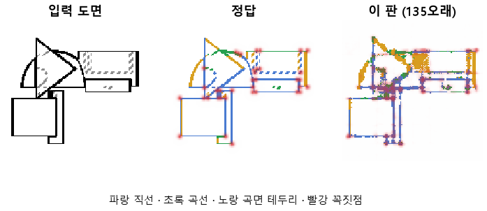

# 같은 설정으로 여섯 배 오래 학습해 결국 배우는지 본다

## 분석
<!-- 사람 칸: 하네스 분석 단계 초안(claude -p) · 고치면 다시 만들어도 남는다 -->
### 한 줄로

**물음**: 134와 같은 설정으로 여섯 배 오래 학습하면, CNN 맨 뒤 층에 붙인 판독기가 도면의 선을 결국 배울까?

**답**: 배우지 못했다. 시험 성적은 50바퀴 무렵에 멈췄다. 목표 7개 중 1개만 넘겨서 판정은 실패다.

### 왜 이 판을 했나

CNN은 그림에서 특징을 뽑는 부분이다. 우리는 CNN의 층 위에 작은 판독기를 붙이고, 그 판독기가 도면의 선을 그려 내도록 학습시킨다. 판독기가 선을 잘 그리면 그 층에 선 정보가 들어 있다는 뜻이다. 134에서는 맨 뒤 층에 판독기를 붙여 10바퀴 학습했는데 성적이 낮았다. 학습량이 모자랐는지, 구조가 문제인지는 알 수 없었다. 그래서 학습량부터 지워 보기로 했다.

### 바꾼 것 하나

학습 바퀴 수만 10에서 60으로 늘렸다. 한 바퀴는 데이터 전체를 한 번 도는 것이다. 학습 부품 3,000개, 시험 부품 299개, 부품마다 위·앞·옆 도면 세 장은 134와 같다. 대조는 CNN 없이 그림 화소를 바로 읽는 판독기로, 똑같이 60바퀴 돌렸다.

### 결과

| | 이 판 | 대조 | 목표 | 넘었나 |
|---|---|---|---|---|
| 선이 있는 자리를 찾음 | 0.89 | 0.98 | 0.90 | ✗ |
| 선 없는 곳에 잘못 그림 | 3.53 % | 0.20 % | 2 % 아래 | ✗ |
| 곡선을 곡선으로 | 0.63 | 0.62 | 0.90 | ✗ |
| 직선을 직선으로 | 0.61 | 0.62 | 0.90 | ✗ |
| 꼭짓점 (F1) | 0.48 | 0.28 | 0.75 | ✗ |
| 곡선, 대조보다 | +0.01 | | +0.15 | ✗ |
| 꼭짓점, 대조보다 | **+0.21** | | +0.20 | ✓ |

*점수는 모두 1이면 완벽이다. F1은 「찍은 점 중 맞은 비율」과 「정답 점 중 찾은 비율」을 함께 본 점수다. 아래 두 줄은 CNN이 화소만 읽을 때보다 얼마나 보태는지 보려고 둔 목표다.*

### 왜 이렇게 나왔나

**확인한 것**

- 오래 돌려도 시험 성적은 오르지 않았다. 시험 오차는 1바퀴 10.86에서 50바퀴 4.13까지 내려온 뒤, 마지막 열 바퀴 동안 0.02도 움직이지 않았다. 같은 기간에 학습 오차는 4.02에서 3.85로 계속 내려갔다. 학습 부품에서만 나아진 것이다.
- 선의 자리는 앞 층이 더 잘 안다. 맨 앞 층에 판독기를 붙이면 자리가 0.96으로 목표를 넘는다. 같은 방식으로 재면 선 없는 곳에 그리는 비율도 앞 층은 1.45 %, 맨 뒤 층은 4.33 %다.
- 선마다 직선·곡선·곡면 테두리·숨은선 중 무엇인지 맞힌 종합 점수는 맨 뒤 층 0.72, 맨 앞 층 0.56, 화소 대조 0.57이다. 다만 직선과 곡선만 떼어 보면 뒤 층도 화소와 같다. 뒤 층이 앞선 곳은 꼭짓점(0.48 대 0.28)과 곡면 테두리(0.61 대 0.29)뿐이다.

**짐작 (아직 확인 안 함)**

- 맨 뒤 층은 그림을 많이 줄인 상태라 선이 지나는 화소를 잃는다고 본다. 그래서 오래 돌려도 자리가 오르지 않았을 수 있다.
- 꼭짓점은 정답 점의 0.65를 찾았는데, 찍은 점 중 맞은 것은 0.38뿐이다. 자리가 흐려서 점을 넓게 번지게 찍는 듯하다.
- 직선과 곡선이 0.6대에 묶인 까닭은 아직 모른다.

### 한계

- 시험 부품 299개로 한 번만 돌렸다. 다시 돌렸을 때 오차와 점수가 얼마나 흔들리는지는 재지 않았다. 그래서 「멈췄다」도 그 흔들림 안의 일인지 모른다.
- 유일하게 넘은 꼭짓점 차이는 목표를 0.01 차로 넘었다. 우연일 수 있다.
- 직선과 곡선이 왜 화소 대조와 같은 수준인지 설명하지 못했다.

### 배운 것과 다음

학습량은 범인이 아니었다. 50바퀴를 넘기면 시험 성적이 그대로다. 대신 선의 자리는 앞 층이 더 잘 안다는 것을 봤다. 그런데 우리는 뒤 층만 읽고 있었다. 뒤 층이 종류를 더 안다는 근거는 꼭짓점과 곡면 테두리뿐이라 아직 약하다.

1. 맨 앞 층과 맨 뒤 층을 이어 붙여 판독기에 넘긴다.
2. 학습은 50바퀴에서 끊는다.
3. 직선을 곡선으로 읽은 자리를 그림으로 모아 본다.

명제: 134 와 같은 설정에서 에폭만 60 으로 늘리면 블록 4 머리가 선 자리 0.90 · 곡선 · 직선 0.90 · 꼭짓점 F1 0.75 를 넘고 헛선은 2 % 아래이며, 같은 60 에폭 화소 대조보다 곡선 +0.15 · 꼭짓점 F1 +0.20 낫다

| 가지 | 종류 | 바탕 | 바꾼 손잡이 | 에폭 | git | 날짜 |
|---|---|---|---|---|---|---|
| A3 | 비교 | 127 (하네스/conf/바탕.yaml) | 학습.에폭: 10 → 60 | 60 | `80056bf` | 2026-10-22 21:43 |

## 1. 판정: **실패**

| 지표 | 식 | 문턱 | 이 판 | 대조(같은 판 화소 그대로 60 에폭) | 통과 |
|---|---|---|---|---|---|
| 선_자리 | >= | 0.9 | 0.889 | — | ✗ |
| 선_곡선 | >= | 0.9 | 0.633 | — | ✗ |
| 선_직선 | >= | 0.9 | 0.614 | — | ✗ |
| 선_헛선 | <= | 0.02 | 0.035 | — | ✗ |
| 점_F1 | >= | 0.75 | 0.484 | — | ✗ |
| 선_곡선_차 | >= | 0.15 | 0.013 | — | ✗ |
| 점_F1_차 | >= | 0.2 | 0.207 | — | ✓ |

## 2. 숫자 — 이 판 대 대조

| 지표 | 이 판 | 대조 |
|---|---|---|
| 시험loss | 4.115 | — |
| 학습loss | 3.845 | — |
| 선_직선 | 0.614 | — |
| 선_곡선 | 0.633 | — |
| 선_곡면테 | 0.609 | — |
| 선_숨음 | 0.974 | — |
| 선_헛선 | 0.035 | — |
| 선_자리 | 0.889 | — |
| 선_자리헛선 | 0.043 | — |
| 선_종류 | 0.720 | — |
| 점_정밀 | 0.385 | — |
| 점_재현 | 0.653 | — |
| 점_F1 | 0.484 | — |
| 층1_선_직선 | 0.576 | — |
| 층1_선_곡선 | 0.582 | — |
| 층1_선_자리 | 0.956 | — |
| 층1_선_자리헛선 | 0.015 | — |
| 층1_선_종류 | 0.557 | — |
| 층1_점_F1 | 0.216 | — |
| 층2_선_직선 | 0.485 | — |
| 층2_선_곡선 | 0.559 | — |
| 층2_선_자리 | 0.868 | — |
| 층2_선_자리헛선 | 0.044 | — |
| 층2_선_종류 | 0.609 | — |
| 층2_점_F1 | 0.371 | — |
| 층3_선_직선 | 0.502 | — |
| 층3_선_곡선 | 0.523 | — |
| 층3_선_자리 | 0.829 | — |
| 층3_선_자리헛선 | 0.053 | — |
| 층3_선_종류 | 0.640 | — |
| 층3_점_F1 | 0.361 | — |
| 층4_선_자리 | 0.889 | — |
| 층4_선_자리헛선 | 0.043 | — |
| 층4_선_종류 | 0.720 | — |
| 층4_선_직선 | 0.614 | — |
| 층4_선_곡선 | 0.633 | — |
| 층4_점_F1 | 0.484 | — |
| 선_직선_화소 | 0.617 | — |
| 선_곡선_화소 | 0.620 | — |
| 선_곡면테_화소 | 0.288 | — |
| 선_숨음_화소 | 0.974 | — |
| 선_헛선_화소 | 0.002 | — |
| 선_자리_화소 | 0.983 | — |
| 선_자리헛선_화소 | 0.004 | — |
| 선_종류_화소 | 0.573 | — |
| 점_정밀_화소 | 0.175 | — |
| 점_재현_화소 | 0.664 | — |
| 점_F1_화소 | 0.277 | — |
| 선_곡선_차 | 0.013 | — |
| 선_직선_차 | -0.003 | — |
| 선_곡면테_차 | 0.321 | — |
| 점_F1_차 | 0.207 | — |

## 모델 구조
(이 판은 구조를 안 잼)

## 3. 학습 곡선

| 에폭 | 학습 loss | 시험 loss | 맞음(CAD 덩어리 수 · 선지도 선 종류) |
|---|---|---|---|
| 1 | 13.630 | 10.856 | 0.009 |
| 2 | 10.259 | 9.581 | 0.044 |
| 3 | 9.209 | 8.791 | 0.055 |
| 4 | 8.444 | 8.053 | 0.106 |
| 5 | 7.883 | 7.546 | 0.111 |
| 6 | 7.428 | 7.187 | 0.145 |
| 7 | 7.144 | 6.936 | 0.157 |
| 8 | 6.938 | 6.755 | 0.166 |
| 9 | 6.873 | 7.476 | 0.072 |
| 10 | 7.437 | 7.239 | 0.165 |
| 11 | 7.060 | 6.901 | 0.185 |
| 12 | 6.825 | 6.576 | 0.185 |
| 13 | 6.510 | 6.309 | 0.255 |
| 14 | 6.284 | 6.147 | 0.255 |
| 15 | 6.077 | 5.889 | 0.261 |
| 16 | 5.887 | 5.715 | 0.350 |
| 17 | 5.729 | 5.594 | 0.351 |
| 18 | 5.580 | 5.448 | 0.368 |
| 19 | 5.446 | 5.338 | 0.394 |
| 20 | 5.338 | 5.247 | 0.444 |
| 21 | 5.241 | 5.152 | 0.357 |
| 22 | 5.179 | 5.056 | 0.466 |
| 23 | 5.087 | 5.020 | 0.423 |
| 24 | 5.020 | 4.953 | 0.481 |
| 25 | 4.983 | 4.909 | 0.444 |
| 26 | 4.913 | 4.855 | 0.523 |
| 27 | 4.881 | 4.806 | 0.512 |
| 28 | 4.790 | 4.781 | 0.471 |
| 29 | 4.756 | 4.738 | 0.497 |
| 30 | 4.690 | 4.639 | 0.534 |
| 31 | 4.637 | 4.620 | 0.520 |
| 32 | 4.580 | 4.552 | 0.553 |
| 33 | 4.547 | 4.518 | 0.538 |
| 34 | 4.509 | 4.481 | 0.550 |
| 35 | 4.452 | 4.434 | 0.563 |
| 36 | 4.399 | 4.405 | 0.566 |
| 37 | 4.355 | 4.371 | 0.555 |
| 38 | 4.389 | 4.359 | 0.565 |
| 39 | 4.295 | 4.322 | 0.602 |
| 40 | 4.264 | 4.311 | 0.590 |
| 41 | 4.235 | 4.296 | 0.553 |
| 42 | 4.194 | 4.254 | 0.583 |
| 43 | 4.176 | 4.254 | 0.561 |
| 44 | 4.140 | 4.208 | 0.601 |
| 45 | 4.117 | 4.189 | 0.607 |
| 46 | 4.097 | 4.198 | 0.583 |
| 47 | 4.072 | 4.157 | 0.606 |
| 48 | 4.041 | 4.157 | 0.608 |
| 49 | 4.026 | 4.157 | 0.585 |
| 50 | 4.018 | 4.126 | 0.623 |
| 51 | 4.002 | 4.115 | 0.611 |
| 52 | 3.965 | 4.200 | 0.593 |
| 53 | 3.952 | 4.098 | 0.620 |
| 54 | 3.941 | 4.090 | 0.614 |
| 55 | 3.921 | 4.109 | 0.608 |
| 56 | 3.894 | 4.137 | 0.622 |
| 57 | 3.892 | 4.096 | 0.620 |
| 58 | 3.856 | 4.120 | 0.608 |
| 59 | 3.866 | 4.139 | 0.579 |
| 60 | 3.846 | 4.115 | 0.621 |

## 4. 점검

### 4.1 연기 판
첫 loss 5.253 → 배치 하나 40 걸음 2.118 · VRAM 2.89 GB

### 4.2 층보기 (시험 64 · 4 층)
칸끼리 닮음 — (1 = 6 칸 같음) · 빈 조각 주의 몫 — (빈 조각 비율 0.54) · 주의 엔트로피 — · 출력 자리 퍼짐 — (정답 0.148)

### 4.3 탐침 — 합성 그림 (블록 4 · 128)
구조 6 종 — · 곡률 R² — · (블록 3: — · —)

### 4.4 특징 — 실제 도면 (조각 라벨 · 하네스/특징.py)
(이 판은 특징 점검을 안 함)

## 쇼츠
편 96_판135오래 · 57.0 초 · 15 줄 · 서재용 업로드 대기

[쇼츠 영상](쇼츠.mp4)

| 누구 | 말 |
|---|---|
| AI | 모델이 부품 도면의 선을 다시 그렸는데 왼쪽 정답이랑 달라요. |
| AI | 기계 부품을 앞에서 본 도면을 모델에 넣어요. |
| AI | 모델은 선마다 둥근 선인지 곧은 선인지 이름을 붙여요. |
| AI | 곧은 선은 평평한 면, 둥근 선은 구멍이나 원통이거든요. |
| AI | 이걸 알아야 이 부품의 CAD 설계를 짤 수 있어요. |
| AI | 왼쪽이 정답, 오른쪽이 모델이 그린 거예요. |
| AI | 둥근지 곧은지를 자꾸 틀려요. |
| 나 | 학습이 짧아서 아직 덜 배운 거야. |
| 나 | 같은 도면들로 여섯 배 오래 학습해 봐. |
| AI | 여섯 배 오래 가르친 모델로 다시 그렸어요. |
| AI | 둥근 선, 곧은 선을 맞힌 개수는 확실히 늘었어요. |
| AI | 맞힌 비율이 0.17에서 0.62로 올랐는데, 목표는 0.9예요. |
| AI | 그런데 끝으로 갈수록 거의 안 올랐어요. |
| 나 | 오래 한다고 끝까지 오르는 건 아니었네. |
| AI | 둥근 선, 곧은 선 가리기는 이번에도 실패예요. |

## 5. 해석
<!-- 사람 칸: 아래를 채운다 · 보고서를 다시 만들어도 남는다 -->
(비어 있음)

## 6. 다음 가지 (사람이 고름 · claudedocs/문제트리.md)
<!-- 사람 칸: 아래를 채운다 · 보고서를 다시 만들어도 남는다 -->
(비어 있음)

## 7. 재현
`python 하네스/하네스.py --config-name 판_135오래` · 설정 [설정.yaml](설정.yaml) · 판정 [판정.json](판정.json) · 산출 `G:/art2real/out/하네스/135오래/`

## 링크
- 쇼츠: 서재용 업로드 대기
- GitHub 이슈: https://github.com/sigongjoa/art2real/issues/7
