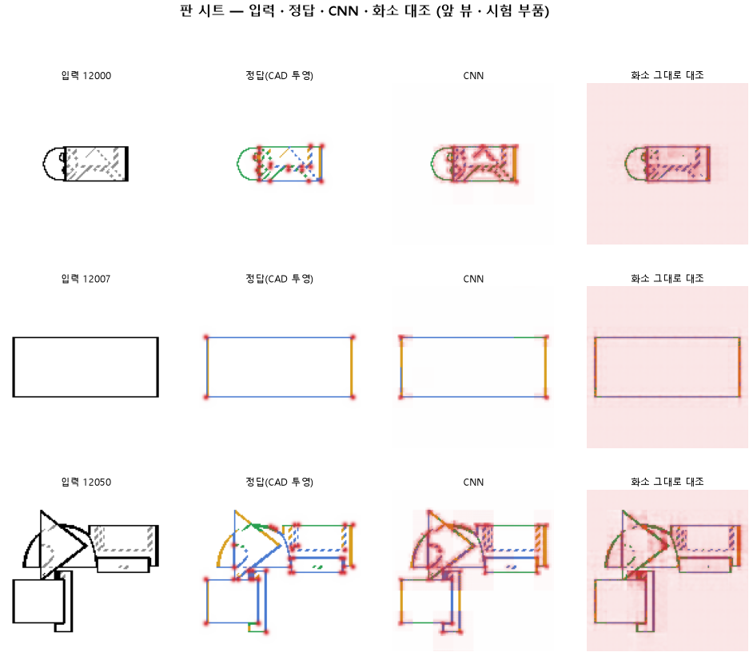

# 얕은 층의 자리 정보와 깊은 층의 종류 정보를 합쳐 읽는다

명제: 135 와 같은 60 에폭에서 머리가 블록 1 과 블록 4 를 같이 읽으면 선 자리가 0.95 를 넘고 종류는 0.72 · 꼭짓점 F1 은 0.48 이상을 지킨다. 목표선(곡선 · 직선 0.90 · 헛선 2 % 아래 · 꼭짓점 F1 0.75)도 같이 잰다

| 가지 | 종류 | 바탕 | 바꾼 손잡이 | 에폭 | git | 날짜 |
|---|---|---|---|---|---|---|
| A3 | 비교 | 127 (하네스/conf/바탕.yaml) | 선지도.합침: None → 블록1 | 60 | `62aac26` | 2026-10-22 22:34 |

## 1. 판정: **실패**

| 지표 | 식 | 문턱 | 이 판 | 대조(135오래) | 통과 |
|---|---|---|---|---|---|
| 선_자리 | >= | 0.95 | 0.999 | 0.889 | ✓ |
| 선_종류 | >= | 0.72 | 0.744 | 0.720 | ✓ |
| 점_F1 | >= | 0.48 | 0.449 | 0.484 | ✗ |
| 선_자리헛선 | <= | 0.02 | 0.000 | 0.043 | ✓ |
| 선_곡선 | >= | 0.9 | 0.816 | 0.633 | ✗ |
| 선_직선 | >= | 0.9 | 0.686 | 0.614 | ✗ |
| 선_헛선 | <= | 0.02 | 0.000 | 0.035 | ✓ |
| 점_F1 | >= | 0.75 | 0.449 | 0.484 | ✗ |

## 2. 숫자 — 이 판 대 대조

| 지표 | 이 판 | 대조 |
|---|---|---|
| 시험loss | 4.176 | — |
| 학습loss | 4.119 | — |
| 선_직선 | 0.686 | 0.614 |
| 선_곡선 | 0.816 | 0.633 |
| 선_곡면테 | 0.684 | — |
| 선_숨음 | 0.999 | — |
| 선_헛선 | 0.000 | 0.035 |
| 선_자리 | 0.999 | 0.889 |
| 선_자리헛선 | 0.000 | 0.043 |
| 선_종류 | 0.744 | 0.720 |
| 점_정밀 | 0.313 | — |
| 점_재현 | 0.789 | — |
| 점_F1 | 0.449 | 0.484 |
| 층1_선_직선 | 0.639 | — |
| 층1_선_곡선 | 0.625 | — |
| 층1_선_자리 | 0.997 | — |
| 층1_선_자리헛선 | 0.001 | — |
| 층1_선_종류 | 0.602 | — |
| 층1_점_F1 | 0.345 | — |
| 층2_선_직선 | 0.508 | — |
| 층2_선_곡선 | 0.510 | — |
| 층2_선_자리 | 0.834 | — |
| 층2_선_자리헛선 | 0.042 | — |
| 층2_선_종류 | 0.637 | — |
| 층2_점_F1 | 0.308 | — |
| 층3_선_직선 | 0.349 | — |
| 층3_선_곡선 | 0.374 | — |
| 층3_선_자리 | 0.619 | — |
| 층3_선_자리헛선 | 0.067 | — |
| 층3_선_종류 | 0.689 | — |
| 층3_점_F1 | 0.344 | — |
| 층4_선_자리 | 0.999 | — |
| 층4_선_자리헛선 | 0.000 | — |
| 층4_선_종류 | 0.744 | — |
| 층4_선_직선 | 0.686 | — |
| 층4_선_곡선 | 0.816 | — |
| 층4_점_F1 | 0.449 | — |
| 선_직선_화소 | 0.617 | — |
| 선_곡선_화소 | 0.620 | — |
| 선_곡면테_화소 | 0.288 | — |
| 선_숨음_화소 | 0.974 | — |
| 선_헛선_화소 | 0.002 | — |
| 선_자리_화소 | 0.983 | — |
| 선_자리헛선_화소 | 0.004 | — |
| 선_종류_화소 | 0.573 | — |
| 점_정밀_화소 | 0.175 | — |
| 점_재현_화소 | 0.664 | — |
| 점_F1_화소 | 0.277 | — |
| 선_곡선_차 | 0.196 | — |
| 선_직선_차 | 0.069 | — |
| 선_곡면테_차 | 0.396 | — |
| 점_F1_차 | 0.171 | — |

## 모델 구조
(이 판은 구조를 안 잼)

## 3. 학습 곡선

| 에폭 | 학습 loss | 시험 loss | 맞음(CAD 덩어리 수 · 선지도 선 종류) |
|---|---|---|---|
| 1 | 13.019 | 9.542 | 0.283 |
| 2 | 8.590 | 7.632 | 0.395 |
| 3 | 7.436 | 6.980 | 0.477 |
| 4 | 6.727 | 6.357 | 0.533 |
| 5 | 6.301 | 6.104 | 0.554 |
| 6 | 6.108 | 5.934 | 0.568 |
| 7 | 5.963 | 5.863 | 0.588 |
| 8 | 5.826 | 5.732 | 0.596 |
| 9 | 5.679 | 5.538 | 0.618 |
| 10 | 5.561 | 5.389 | 0.616 |
| 11 | 5.426 | 5.298 | 0.616 |
| 12 | 5.277 | 5.159 | 0.650 |
| 13 | 5.165 | 5.071 | 0.657 |
| 14 | 5.099 | 5.013 | 0.638 |
| 15 | 5.051 | 4.939 | 0.641 |
| 16 | 5.051 | 4.900 | 0.670 |
| 17 | 4.939 | 4.874 | 0.679 |
| 18 | 4.924 | 4.841 | 0.673 |
| 19 | 4.841 | 4.880 | 0.668 |
| 20 | 4.834 | 4.745 | 0.679 |
| 21 | 4.769 | 4.682 | 0.689 |
| 22 | 4.704 | 4.622 | 0.692 |
| 23 | 4.656 | 4.600 | 0.689 |
| 24 | 4.625 | 4.563 | 0.688 |
| 25 | 4.575 | 4.516 | 0.701 |
| 26 | 4.550 | 4.494 | 0.705 |
| 27 | 4.528 | 4.475 | 0.709 |
| 28 | 4.513 | 4.485 | 0.698 |
| 29 | 4.473 | 4.470 | 0.709 |
| 30 | 4.526 | 4.425 | 0.714 |
| 31 | 4.441 | 4.375 | 0.720 |
| 32 | 4.417 | 4.369 | 0.720 |
| 33 | 4.398 | 4.395 | 0.721 |
| 34 | 4.392 | 4.346 | 0.723 |
| 35 | 4.364 | 4.309 | 0.728 |
| 36 | 4.354 | 4.299 | 0.726 |
| 37 | 4.341 | 4.295 | 0.730 |
| 38 | 4.298 | 4.317 | 0.724 |
| 39 | 4.295 | 4.255 | 0.736 |
| 40 | 4.279 | 4.257 | 0.733 |
| 41 | 4.272 | 4.254 | 0.735 |
| 42 | 4.258 | 4.231 | 0.739 |
| 43 | 4.243 | 4.248 | 0.740 |
| 44 | 4.266 | 4.313 | 0.731 |
| 45 | 4.255 | 4.227 | 0.739 |
| 46 | 4.217 | 4.208 | 0.740 |
| 47 | 4.196 | 4.196 | 0.741 |
| 48 | 4.188 | 4.237 | 0.738 |
| 49 | 4.211 | 4.177 | 0.740 |
| 50 | 4.158 | 4.181 | 0.745 |
| 51 | 4.150 | 4.168 | 0.740 |
| 52 | 4.165 | 4.152 | 0.743 |
| 53 | 4.163 | 4.163 | 0.744 |
| 54 | 4.151 | 4.179 | 0.742 |
| 55 | 4.158 | 4.165 | 0.740 |
| 56 | 4.141 | 4.168 | 0.745 |
| 57 | 4.135 | 4.215 | 0.742 |
| 58 | 4.149 | 4.193 | 0.744 |
| 59 | 4.121 | 4.182 | 0.743 |
| 60 | 4.118 | 4.176 | 0.743 |

## 4. 점검

### 4.1 연기 판
첫 loss 4.999 → 배치 하나 40 걸음 1.590 · VRAM 3.30 GB

### 4.2 층보기 (시험 64 · 4 층)
칸끼리 닮음 — (1 = 6 칸 같음) · 빈 조각 주의 몫 — (빈 조각 비율 0.54) · 주의 엔트로피 — · 출력 자리 퍼짐 — (정답 0.148)

### 4.3 탐침 — 합성 그림 (블록 4 · 128)
구조 6 종 — · 곡률 R² — · (블록 3: — · —)

### 4.4 특징 — 실제 도면 (조각 라벨 · 하네스/특징.py)
(이 판은 특징 점검을 안 함)

## 쇼츠
편 97_판136합침 · 굽기 실패(코드 1): subprocess.CalledProcessError: Command '['G:/art2real/out/tts/chatterbox/Scripts/python.exe', 'G:\\art2real\\원화3d\\과정\\영상05\\tts\\굽기_chatterbox.py', 'G:/art2real/out/영상05/대화/97_판136합침/_cb일감.json']' re · 업로드 대기

| 누구 | 말 |
|---|---|
| AI | 선은 정답에 딱 겹치는데, 꼭짓점 표시가 너무 많아요. |
| AI | 이 모델은 앞에서 본 도면을 보고 선과 꼭짓점을 다시 그려요. |
| AI | 왼쪽이 정답, 오른쪽이 모델이 그린 거예요. |
| AI | 이번엔 가까이 보는 눈과 멀리 보는 눈을 같이 썼어요. |
| AI | 가까이 보면 선 자리를, 멀리 보면 선 종류를 알아요. |
| 나 | 선이 딱 맞잖아. 꼭짓점도 많이 찍었으니 더 좋아진 거네. |
| AI | 진짜 꼭짓점은 대부분 찾았어요. |
| AI | 그런데 꼭짓점이 아닌 데에도 점을 잔뜩 찍었어요. |
| 나 | 마구 찍어서 맞힌 거였네. |
| 나 | 진짜 꼭짓점이랑 헛찍은 점을 나눠서 비교해 봐. |
| AI | 찍은 점 대부분이 헛점이에요. |
| AI | 꼭짓점은 전 0.484에서 0.449로 내려갔어요. |
| AI | 꼭짓점이 전보다 떨어졌으니 이번은 실패예요. |
| 나 | 선은 얻고 꼭짓점은 잃었네. |

## 5. 해석
<!-- 사람 칸: 아래를 채운다 · 보고서를 다시 만들어도 남는다 -->
(비어 있음)

## 6. 다음 가지 (사람이 고름 · claudedocs/문제트리.md)
<!-- 사람 칸: 아래를 채운다 · 보고서를 다시 만들어도 남는다 -->
(비어 있음)

## 7. 재현
`python 하네스/하네스.py --config-name 판_136합침` · 설정 [설정.yaml](설정.yaml) · 판정 [판정.json](판정.json) · 산출 `G:/art2real/out/하네스/136합침/`

## 링크
- 쇼츠: 업로드 대기
- GitHub 이슈: https://github.com/sigongjoa/art2real/issues/8
