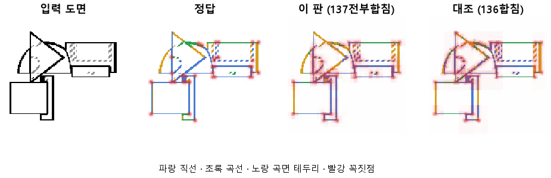
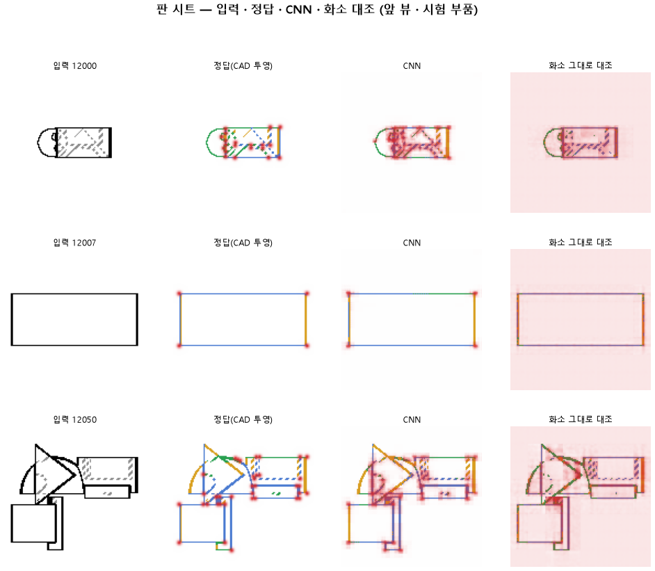

# 가운데 층까지 모두 합쳐 곡선 옆 직선의 번짐을 줄인다

## 분석
<!-- 사람 칸: 하네스 분석 단계 초안(claude -p) · 고치면 다시 만들어도 남는다 -->
### 한 줄로

**물음**: 그림 특징을 뽑는 CNN의 가운데 층까지 다 넘겨주면, 곡선 바로 옆에 있는 직선을 곡선으로 잘못 읽는 일이 줄어들까?

**답**: 그 실수는 0.40에서 0.24로 줄었다. 대신 곡선을 맞히는 비율은 0.82에서 0.76으로 떨어졌다. 기준 8개 중 3개만 넘어서 판정은 실패다.

### 왜 이 판을 했나

이 모델은 부품 도면 한 장(128×128)을 받는다. 그리고 화소마다 선이 있는지, 있으면 직선·곡선·곡면 테두리·숨은선 중 무엇인지를 고른다. 꼭짓점도 따로 찍는다. CNN은 네 층(블록 1~4)으로 되어 있다. 이 고르는 부분이 그중 어느 층의 특징을 받느냐가 실험 대상이다.

앞 판(136)에서는 맨 앞 층과 맨 뒤 층만 받았다. 선 자리는 거의 완벽했지만, 곡선에서 3화소 안에 있는 직선은 0.40을 곡선으로 읽었다. 가운데 두 층은 위치와 종류를 반씩 알 것으로 보았다. 그래서 이 둘까지 넣으면 덜 섞일 거라고 예상했다.

### 바꾼 것 하나

두 층만 받던 것을 **네 층 전부 받게** 했다. 학습 60바퀴, 학습 부품 3,000개, 시험 부품 299개는 136과 같다.

### 결과

기준은 8개고, 다 넘어야 성공이다. 이 판에서 미리 예측한 값 다섯 개와, 판마다 재는 최종 목표 세 개(곡선·직선 0.90, 꼭짓점 0.75)가 있다.

| | 이 판 (137) | 대조 (136) | 목표 | 넘었나 |
|---|---|---|---|---|
| 곡선 옆 직선을 곡선으로 틀림 | **0.24** | 0.40 | 0.25 아래 | ✓ |
| 선이 있는 자리를 찾음 | 0.999 | 0.999 | 0.95 | ✓ |
| 선 없는 곳에 잘못 그림 | 0.01 % | 0.01 % | 2 % 아래 | ✓ |
| 곡선을 곡선으로 (예측) | 0.76 | 0.82 | 0.85 | ✗ |
| 직선을 직선으로 (예측) | 0.78 | 0.69 | 0.80 | ✗ |
| 곡선을 곡선으로 (최종) | 0.76 | 0.82 | 0.90 | ✗ |
| 직선을 직선으로 (최종) | 0.78 | 0.69 | 0.90 | ✗ |
| 꼭짓점 (F1) | 0.51 | 0.45 | 0.75 | ✗ |

*F1은 「찾은 점 중 맞은 비율」과 「정답 점 중 찾은 비율」을 함께 본 점수다. 1이면 완벽하다.*

### 왜 이렇게 나왔나

**확인한 것**

- 곡선 옆 직선을 틀리는 비율은 0.16 줄었다. 직선 전체도 0.69에서 0.78로 올랐다.
- 대신 곡선이 0.82에서 0.76으로 떨어졌다. 모든 선 화소에서 종류를 맞힌 비율은 0.74에서 0.76으로 조금만 올랐다.
- 선 자리와 헛선은 136과 같다. 가운데 층을 넣어도 위치는 망가지지 않았다.
- 45바퀴 뒤로 학습 쪽 손실은 3.83에서 3.73으로 계속 내려갔지만, 시험 쪽은 3.88~3.90에 머물렀다.

**짐작 (아직 확인 안 함)**

- 실제로 더 잘 구분하게 됐다기보다, 애매한 화소를 「직선」이라고 부르는 쪽으로 기울었을 수 있다. 직선이 오르고 곡선이 내린 모양이 그렇다.

### 한계

- 시험 부품 299개로 한 번만 돌렸다. 다시 돌렸을 때의 흔들림은 재지 않았다.
- 같은 학습끼리 0.1 넘게 어긋난 적이 있다(133·134). 그래서 곡선 −0.06, 직선 +0.09, 꼭짓점 +0.06은 모두 흔들림 안쪽일 수 있다. 0.24도 목표를 0.01 차이로 넘었을 뿐이다.
- 곡선이 떨어진 이유는 짐작만 있고 확인하지 못했다.

### 배운 것과 다음

가운데 층을 넣자 곡선 옆 직선의 실수는 줄었다. 하지만 **곡선 쪽 정답을 내주고 직선 쪽을 얻은 것**에 가깝다. 층을 더 넘겨주는 것만으로는 둘을 함께 올리지 못한다.

1. 곡선을 직선으로 새로 틀린 자리를 그림으로 모아, 쏠림인지 구분이 나아진 건지 가린다.
2. 같은 설정으로 한 번 더 돌려 흔들림 크기를 잰다.
3. 꼭짓점을 앞 층에서 바로 찍게 해 본다.

명제: 136 과 같은 60 바퀴에서 블록 2 · 3 까지 합쳐 읽으면 곡선 옆 직선을 곡선으로 읽는 비율이 0.40 에서 0.25 아래로 내려가고 곡선 0.85 · 직선 0.80 을 넘으며 선 자리 0.95 · 헛선 2 % 아래를 지킨다. 목표선(곡선 · 직선 0.90 · 꼭짓점 0.75)도 같이 잰다

| 가지 | 종류 | 바탕 | 바꾼 손잡이 | 에폭 | git | 날짜 |
|---|---|---|---|---|---|---|
| A3 | 비교 | 127 (하네스/conf/바탕.yaml) | 선지도.합침: 블록1 → 전부 | 60 | `6d47827` | 2026-10-23 13:44 |

## 1. 판정: **실패**

| 지표 | 식 | 문턱 | 이 판 | 대조(136합침) | 통과 |
|---|---|---|---|---|---|
| 선_곡선옆직선오류 | <= | 0.25 | 0.235 | 0.400 | ✓ |
| 선_곡선 | >= | 0.85 | 0.758 | 0.816 | ✗ |
| 선_직선 | >= | 0.8 | 0.776 | 0.686 | ✗ |
| 선_자리 | >= | 0.95 | 0.999 | 0.999 | ✓ |
| 선_헛선 | <= | 0.02 | 0.000 | 0.000 | ✓ |
| 선_곡선 | >= | 0.9 | 0.758 | 0.816 | ✗ |
| 선_직선 | >= | 0.9 | 0.776 | 0.686 | ✗ |
| 점_F1 | >= | 0.75 | 0.510 | 0.449 | ✗ |

## 2. 숫자 — 이 판 대 대조

| 지표 | 이 판 | 대조 |
|---|---|---|
| 시험loss | 3.889 | — |
| 학습loss | 3.729 | — |
| 선_직선 | 0.776 | 0.686 |
| 선_곡선 | 0.758 | 0.816 |
| 선_곡면테 | 0.754 | — |
| 선_숨음 | 0.999 | — |
| 선_헛선 | 0.000 | 0.000 |
| 선_곡선옆직선오류 | 0.235 | 0.400 |
| 선_자리 | 0.999 | 0.999 |
| 선_자리헛선 | 0.000 | — |
| 선_종류 | 0.764 | — |
| 점_정밀 | 0.378 | — |
| 점_재현 | 0.781 | — |
| 점_F1 | 0.510 | 0.449 |
| 층1_선_직선 | 0.666 | — |
| 층1_선_곡선 | 0.619 | — |
| 층1_선_자리 | 0.998 | — |
| 층1_선_자리헛선 | 0.001 | — |
| 층1_선_종류 | 0.578 | — |
| 층1_점_F1 | 0.263 | — |
| 층2_선_직선 | 0.552 | — |
| 층2_선_곡선 | 0.506 | — |
| 층2_선_자리 | 0.838 | — |
| 층2_선_자리헛선 | 0.049 | — |
| 층2_선_종류 | 0.676 | — |
| 층2_점_F1 | 0.434 | — |
| 층3_선_직선 | 0.430 | — |
| 층3_선_곡선 | 0.345 | — |
| 층3_선_자리 | 0.658 | — |
| 층3_선_자리헛선 | 0.084 | — |
| 층3_선_종류 | 0.721 | — |
| 층3_점_F1 | 0.340 | — |
| 층4_선_자리 | 0.999 | — |
| 층4_선_자리헛선 | 0.000 | — |
| 층4_선_종류 | 0.764 | — |
| 층4_선_직선 | 0.776 | — |
| 층4_선_곡선 | 0.758 | — |
| 층4_점_F1 | 0.510 | — |
| 선_직선_화소 | 0.617 | — |
| 선_곡선_화소 | 0.620 | — |
| 선_곡면테_화소 | 0.288 | — |
| 선_숨음_화소 | 0.974 | — |
| 선_헛선_화소 | 0.002 | — |
| 선_곡선옆직선오류_화소 | 0.398 | — |
| 선_자리_화소 | 0.983 | — |
| 선_자리헛선_화소 | 0.004 | — |
| 선_종류_화소 | 0.573 | — |
| 점_정밀_화소 | 0.175 | — |
| 점_재현_화소 | 0.664 | — |
| 점_F1_화소 | 0.277 | — |
| 선_곡선_차 | 0.139 | — |
| 선_직선_차 | 0.159 | — |
| 선_곡면테_차 | 0.466 | — |
| 점_F1_차 | 0.232 | — |

## 모델 구조
(이 판은 구조를 안 잼)

## 3. 학습 곡선

| 에폭 | 학습 loss | 시험 loss | 맞음(CAD 덩어리 수 · 선지도 선 종류) |
|---|---|---|---|
| 1 | 12.206 | 8.952 | 0.272 |
| 2 | 7.946 | 7.206 | 0.391 |
| 3 | 6.870 | 6.403 | 0.467 |
| 4 | 6.266 | 6.056 | 0.529 |
| 5 | 5.938 | 5.711 | 0.583 |
| 6 | 5.623 | 5.400 | 0.596 |
| 7 | 5.371 | 5.146 | 0.628 |
| 8 | 5.166 | 5.260 | 0.605 |
| 9 | 5.057 | 4.893 | 0.637 |
| 10 | 4.920 | 4.850 | 0.654 |
| 11 | 4.830 | 4.703 | 0.667 |
| 12 | 4.740 | 4.577 | 0.666 |
| 13 | 4.650 | 4.587 | 0.673 |
| 14 | 4.576 | 4.469 | 0.679 |
| 15 | 4.506 | 4.463 | 0.693 |
| 16 | 4.478 | 4.369 | 0.693 |
| 17 | 4.414 | 4.382 | 0.677 |
| 18 | 4.379 | 4.278 | 0.707 |
| 19 | 4.304 | 4.290 | 0.705 |
| 20 | 4.270 | 4.220 | 0.708 |
| 21 | 4.272 | 4.435 | 0.693 |
| 22 | 4.323 | 4.185 | 0.716 |
| 23 | 4.188 | 4.211 | 0.706 |
| 24 | 4.182 | 4.117 | 0.721 |
| 25 | 4.139 | 4.113 | 0.731 |
| 26 | 4.104 | 4.084 | 0.731 |
| 27 | 4.087 | 4.074 | 0.740 |
| 28 | 4.039 | 4.040 | 0.740 |
| 29 | 4.046 | 4.037 | 0.736 |
| 30 | 4.043 | 4.051 | 0.741 |
| 31 | 4.005 | 3.998 | 0.745 |
| 32 | 3.985 | 4.011 | 0.741 |
| 33 | 3.969 | 3.978 | 0.746 |
| 34 | 3.948 | 3.995 | 0.745 |
| 35 | 3.961 | 3.971 | 0.736 |
| 36 | 3.937 | 3.942 | 0.750 |
| 37 | 3.905 | 3.943 | 0.744 |
| 38 | 3.897 | 3.977 | 0.748 |
| 39 | 3.899 | 3.942 | 0.754 |
| 40 | 3.889 | 3.929 | 0.754 |
| 41 | 3.851 | 3.949 | 0.757 |
| 42 | 3.884 | 3.958 | 0.748 |
| 43 | 3.857 | 3.924 | 0.748 |
| 44 | 3.846 | 3.913 | 0.756 |
| 45 | 3.832 | 3.885 | 0.760 |
| 46 | 3.827 | 3.933 | 0.755 |
| 47 | 3.813 | 3.894 | 0.761 |
| 48 | 3.809 | 3.906 | 0.757 |
| 49 | 3.802 | 3.899 | 0.760 |
| 50 | 3.775 | 3.905 | 0.751 |
| 51 | 3.776 | 3.909 | 0.762 |
| 52 | 3.780 | 3.870 | 0.761 |
| 53 | 3.764 | 3.917 | 0.756 |
| 54 | 3.760 | 3.913 | 0.759 |
| 55 | 3.753 | 3.901 | 0.760 |
| 56 | 3.758 | 3.900 | 0.762 |
| 57 | 3.750 | 3.954 | 0.762 |
| 58 | 3.775 | 3.921 | 0.758 |
| 59 | 3.739 | 3.906 | 0.763 |
| 60 | 3.729 | 3.889 | 0.764 |

## 4. 점검

### 4.1 연기 판
첫 loss 5.216 → 배치 하나 40 걸음 1.568 · VRAM 3.82 GB

### 4.2 층보기 (시험 64 · 4 층)
칸끼리 닮음 — (1 = 6 칸 같음) · 빈 조각 주의 몫 — (빈 조각 비율 0.54) · 주의 엔트로피 — · 출력 자리 퍼짐 — (정답 0.148)

### 4.3 탐침 — 합성 그림 (블록 4 · 128)
구조 6 종 — · 곡률 R² — · (블록 3: — · —)

### 4.4 특징 — 실제 도면 (조각 라벨 · 하네스/특징.py)
(이 판은 특징 점검을 안 함)

## 쇼츠
편 98_판137전부합침 · 53.6 초 · 14 줄 · 서재용 업로드 대기

[쇼츠 영상](쇼츠.mp4)

| 누구 | 말 |
|---|---|
| AI | 모델은 이 도면의 선마다 직선인지 곡선인지 골라요. |
| AI | 고른 대로 색을 칠해요. 왼쪽이 정답, 오른쪽이 모델이에요. |
| AI | 곡선 바로 옆에 붙은 직선을 곡선 색으로 칠했어요. |
| 나 | 붙어 있어서 그 직선을 아예 못 찾은 거네. |
| AI | 아니에요. 선 자리는 맞았어요. 종류만 헷갈렸어요. |
| 나 | 찾긴 했는데 이름을 잘못 붙인 거네. |
| AI | 모델은 이 도면을 네 번에 걸쳐 차례로 읽어요. |
| AI | 색을 고를 땐 첫 번째와 마지막에 읽은 것만 봐요. |
| 나 | 가운데 두 번 읽은 것도 넣어 봐. |
| AI | 곡선 옆 직선이 이제 직선 색으로 많이 돌아왔어요. |
| AI | 대신 원래 맞히던 곡선을 몇 군데 틀렸어요. |
| AI | 틀린 직선 0.40→0.24, 맞힌 곡선 0.82→0.76 |
| 나 | 직선을 얻고 곡선을 내준 거네. |
| AI | 둘 다 좋아지진 않았어요. 이번엔 실패예요. |

## 5. 해석
<!-- 사람 칸: 아래를 채운다 · 보고서를 다시 만들어도 남는다 -->
(비어 있음)

## 6. 다음 가지 (사람이 고름 · claudedocs/문제트리.md)
<!-- 사람 칸: 아래를 채운다 · 보고서를 다시 만들어도 남는다 -->
(비어 있음)

## 7. 재현
`python 하네스/하네스.py --config-name 판_137전부합침` · 설정 [설정.yaml](설정.yaml) · 판정 [판정.json](판정.json) · 산출 `G:/art2real/out/하네스/137전부합침/`

## 링크
- 쇼츠: 서재용 업로드 대기
- GitHub 이슈: https://github.com/sigongjoa/art2real/issues/9
