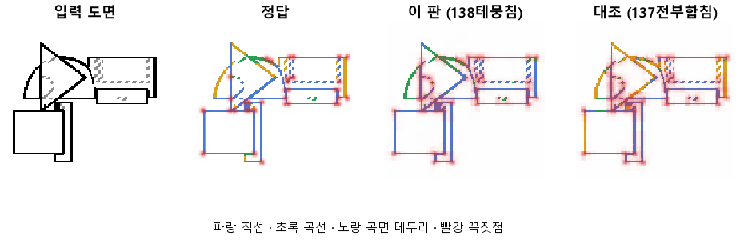
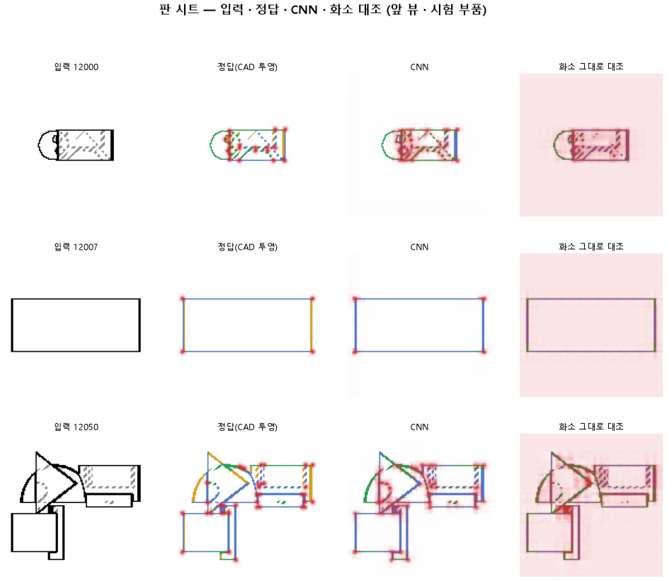

# 사람도 못 가르는 곡면 테두리를 직선과 곡선 중에 고르라고 하지 않는다

## 분석
<!-- 사람 칸: 하네스 분석 단계 초안(claude -p) · 고치면 다시 만들어도 남는다 -->
### 한 줄로

**물음**: 도면만 봐서는 답이 없는 곡면 테두리를 종류까지 맞히라고 하지 않으면, 직선과 곡선을 둘 다 더 잘 맞힐까?

**답**: 곡선은 0.76에서 0.84로 올랐다. 하지만 직선은 0.78에서 0.76으로 내렸다. 곡선 옆 직선을 곡선으로 틀리는 비율도 0.24에서 0.39로 늘었다. 기준 7개 중 2개만 넘어서 판정은 실패다.

### 왜 이 판을 했나

이 모델은 부품 도면의 화소마다 선이 있는지 본다. 선이 있으면 직선·곡선·곡면 테두리·숨은선 중 무엇인지 고른다. 곡면 테두리는 원통 옆면처럼 둥근 면이 꺾여 보이는 선이다. 도면에는 곧게 그려진다. 그래서 한 장만 봐서는 사람도 상자 모서리(직선)인지 원통 옆인지 모른다.

앞 판(137)에서는 CNN 네 층의 특징을 모두 받게 했다. 그러자 곧은 선을 곡면 테두리로 칠한 곳이 새로 생겼다. 우리는 답이 없는 이 문제가 직선과 곡선 사이를 흔든다고 봤다.

### 바꾼 것 하나

학습할 때 곡면 테두리 화소는 **선으로 칠하기만 하면 종류와 상관없이 정답**으로 쳤다. 나머지는 137과 같다. 학습 60바퀴, 학습 부품 3,000개, 시험 부품 299개.

### 결과

「이 판 목표」는 이 판을 하기 전에 적어 둔 예측이다. 「최종 목표」는 판마다 재는 목표다. 같은 값을 다른 선에 대 본다.

| | 이 판 (138) | 대조 (137) | 목표 | 넘었나 |
|---|---|---|---|---|
| 곡선을 곡선으로 (이 판 목표) | **0.84** | 0.76 | 0.80 | ✓ |
| 선이 있는 자리를 찾음 | 1.00 | 1.00 | 0.95 | ✓ |
| 직선을 직선으로 (이 판 목표) | 0.76 | 0.78 | 0.80 | ✗ |
| 곡선에서 3화소 안의 직선을 곡선으로 틀림 | 0.39 | **0.24** | 0.25 아래 | ✗ |
| 곡선을 곡선으로 (최종 목표) | 0.84 | 0.76 | 0.90 | ✗ |
| 직선을 직선으로 (최종 목표) | 0.76 | 0.78 | 0.90 | ✗ |
| 꼭짓점 | 0.52 | 0.51 | 0.75 | ✗ |

*꼭짓점은 「찾은 점 중 맞은 비율」과 「정답 점 중 찾은 비율」을 함께 본 점수다. 1이면 완벽하다.*

### 왜 이렇게 나왔나

**확인한 것**

- 곡선이 오른 만큼 곡선 옆 직선의 실수가 늘었다. 두 판 전인 136(앞 층과 뒤 층만 받음)은 곡선 0.82, 직선 0.69, 실수 0.40이었다. 곡선과 실수는 그 자리로 돌아갔다. 직선만 136보다 높다.
- 모델은 곡면 테두리를 한 번도 고르지 않았다(0.00).
- 선 자리와 꼭짓점은 137과 거의 같다.

**짐작 (아직 확인 안 함)**

- 애매한 화소를 다시 곡선이라고 부르게 된 것 같다. 137에서 직선 쪽으로 기울었던 것이 반대로 기운 셈이다.
- 기준에는 없지만, 모든 선 화소에서 종류를 맞힌 비율이 0.76에서 0.65로 떨어졌다. 이 계산은 곡면 테두리도 종류를 맞혀야 맞은 것으로 세는 듯하다. 그렇다면 학습에서 봐준 화소가 여기서는 전부 틀린 것으로 잡힌다.

### 한계

- 시험 부품 299개로 한 번만 돌렸다.
- 같은 학습끼리 0.1 넘게 어긋난 적이 있다(133·134). 그래서 곡선 +0.08, 직선 −0.02, 꼭짓점 +0.01은 모두 흔들림 안쪽일 수 있다. 그보다 큰 변화는 실수가 0.16 늘어난 것 하나다.
- 시험 손실은 45~50바퀴에 가장 낮았다. 60바퀴 끝 값으로 쟀으니 가장 좋을 때의 점수는 아니다.

### 배운 것과 다음

답 없는 문제를 빼도 직선과 곡선이 같이 오르지는 않았다. 136·137·138은 모두 **한쪽을 내주고 다른 쪽을 얻은** 모양이다. 곡면 테두리는 이 시소의 주된 원인이 아닌 것 같다. 다만 한 번 돌린 결과라 단정하기는 이르다.

1. 곡선 옆 직선을 틀린 자리를 그림으로 모아, 두 선 사이 몇 화소에서 틀리는지 센다.
2. 종류 비율을 셀 때 곡면 테두리를 빼고 다시 잰다.
3. 같은 설정으로 한 번 더 돌려 흔들림 크기를 잰다.

명제: 137 과 같은 설정 · 60 바퀴에서 곡면 테 화소를 선이기만 하면 정답으로 두면, 곧은 선과 굽은 선 사이를 흔들던 칸이 빠져 곡선 0.80 · 직선 0.80 을 둘 다 넘고 곡선 옆 직선 오류 0.25 아래 · 선 자리 0.95 를 지킨다. 목표선(곡선 · 직선 0.90 · 꼭짓점 0.75)도 같이 잰다

| 가지 | 종류 | 바탕 | 바꾼 손잡이 | 에폭 | git | 날짜 |
|---|---|---|---|---|---|---|
| A3 | 비교 | 127 (하네스/conf/바탕.yaml) | 선지도.테: None → 뭉침 | 60 | `391e5ed` | 2026-10-23 14:27 |

## 1. 판정: **실패**

| 지표 | 식 | 문턱 | 이 판 | 대조(137전부합침) | 통과 |
|---|---|---|---|---|---|
| 선_곡선 | >= | 0.8 | 0.835 | 0.758 | ✓ |
| 선_직선 | >= | 0.8 | 0.763 | 0.776 | ✗ |
| 선_곡선옆직선오류 | <= | 0.25 | 0.394 | 0.235 | ✗ |
| 선_자리 | >= | 0.95 | 1.000 | 0.999 | ✓ |
| 선_곡선 | >= | 0.9 | 0.835 | 0.758 | ✗ |
| 선_직선 | >= | 0.9 | 0.763 | 0.776 | ✗ |
| 점_F1 | >= | 0.75 | 0.524 | 0.510 | ✗ |

## 2. 숫자 — 이 판 대 대조

| 지표 | 이 판 | 대조 |
|---|---|---|
| 시험loss | 3.707 | — |
| 학습loss | 3.507 | — |
| 선_직선 | 0.763 | 0.776 |
| 선_곡선 | 0.835 | 0.758 |
| 선_곡면테 | 0.000 | — |
| 선_숨음 | 0.999 | — |
| 선_헛선 | 0.000 | — |
| 선_곡선옆직선오류 | 0.394 | 0.235 |
| 선_자리 | 1.000 | 0.999 |
| 선_자리헛선 | 0.000 | — |
| 선_종류 | 0.645 | — |
| 점_정밀 | 0.395 | — |
| 점_재현 | 0.776 | — |
| 점_F1 | 0.524 | 0.510 |
| 층1_선_직선 | 0.739 | — |
| 층1_선_곡선 | 0.622 | — |
| 층1_선_자리 | 0.998 | — |
| 층1_선_자리헛선 | 0.001 | — |
| 층1_선_종류 | 0.544 | — |
| 층1_점_F1 | 0.288 | — |
| 층2_선_직선 | 0.596 | — |
| 층2_선_곡선 | 0.552 | — |
| 층2_선_자리 | 0.816 | — |
| 층2_선_자리헛선 | 0.048 | — |
| 층2_선_종류 | 0.602 | — |
| 층2_점_F1 | 0.440 | — |
| 층3_선_직선 | 0.444 | — |
| 층3_선_곡선 | 0.470 | — |
| 층3_선_자리 | 0.661 | — |
| 층3_선_자리헛선 | 0.086 | — |
| 층3_선_종류 | 0.623 | — |
| 층3_점_F1 | 0.342 | — |
| 층4_선_자리 | 1.000 | — |
| 층4_선_자리헛선 | 0.000 | — |
| 층4_선_종류 | 0.645 | — |
| 층4_선_직선 | 0.763 | — |
| 층4_선_곡선 | 0.835 | — |
| 층4_점_F1 | 0.524 | — |
| 선_직선_화소 | 0.647 | — |
| 선_곡선_화소 | 0.665 | — |
| 선_곡면테_화소 | 0.000 | — |
| 선_숨음_화소 | 0.974 | — |
| 선_헛선_화소 | 0.002 | — |
| 선_곡선옆직선오류_화소 | 0.436 | — |
| 선_자리_화소 | 0.984 | — |
| 선_자리헛선_화소 | 0.004 | — |
| 선_종류_화소 | 0.543 | — |
| 점_정밀_화소 | 0.175 | — |
| 점_재현_화소 | 0.664 | — |
| 점_F1_화소 | 0.277 | — |
| 선_곡선_차 | 0.170 | — |
| 선_직선_차 | 0.116 | — |
| 선_곡면테_차 | 0.000 | — |
| 점_F1_차 | 0.246 | — |

## 모델 구조
(이 판은 구조를 안 잼)

## 3. 학습 곡선

| 에폭 | 학습 loss | 시험 loss | 맞음(CAD 덩어리 수 · 선지도 선 종류) |
|---|---|---|---|
| 1 | 11.885 | 8.691 | 0.319 |
| 2 | 7.626 | 6.910 | 0.398 |
| 3 | 6.495 | 6.048 | 0.485 |
| 4 | 5.909 | 5.704 | 0.508 |
| 5 | 5.582 | 5.360 | 0.548 |
| 6 | 5.268 | 5.233 | 0.550 |
| 7 | 5.042 | 4.842 | 0.565 |
| 8 | 4.861 | 4.740 | 0.551 |
| 9 | 4.728 | 4.656 | 0.582 |
| 10 | 4.622 | 4.535 | 0.575 |
| 11 | 4.538 | 4.413 | 0.591 |
| 12 | 4.449 | 4.434 | 0.594 |
| 13 | 4.392 | 4.298 | 0.598 |
| 14 | 4.297 | 4.228 | 0.601 |
| 15 | 4.238 | 4.174 | 0.590 |
| 16 | 4.197 | 4.130 | 0.609 |
| 17 | 4.140 | 4.071 | 0.611 |
| 18 | 4.087 | 4.035 | 0.611 |
| 19 | 4.144 | 4.214 | 0.604 |
| 20 | 4.098 | 3.988 | 0.603 |
| 21 | 3.998 | 3.980 | 0.621 |
| 22 | 3.949 | 3.919 | 0.622 |
| 23 | 3.924 | 4.001 | 0.623 |
| 24 | 3.955 | 3.891 | 0.627 |
| 25 | 3.883 | 3.855 | 0.628 |
| 26 | 3.849 | 3.833 | 0.627 |
| 27 | 3.848 | 3.854 | 0.624 |
| 28 | 3.811 | 3.807 | 0.633 |
| 29 | 3.795 | 3.837 | 0.629 |
| 30 | 3.799 | 3.831 | 0.630 |
| 31 | 3.768 | 3.764 | 0.635 |
| 32 | 3.735 | 3.766 | 0.633 |
| 33 | 3.736 | 3.777 | 0.632 |
| 34 | 3.747 | 3.736 | 0.636 |
| 35 | 3.694 | 3.725 | 0.642 |
| 36 | 3.694 | 3.689 | 0.641 |
| 37 | 3.662 | 3.712 | 0.640 |
| 38 | 3.653 | 3.728 | 0.643 |
| 39 | 3.642 | 3.713 | 0.638 |
| 40 | 3.659 | 3.710 | 0.641 |
| 41 | 3.615 | 3.702 | 0.641 |
| 42 | 3.627 | 3.716 | 0.644 |
| 43 | 3.604 | 3.696 | 0.635 |
| 44 | 3.600 | 3.700 | 0.644 |
| 45 | 3.600 | 3.666 | 0.643 |
| 46 | 3.587 | 3.662 | 0.646 |
| 47 | 3.579 | 3.666 | 0.631 |
| 48 | 3.578 | 3.687 | 0.643 |
| 49 | 3.575 | 3.683 | 0.646 |
| 50 | 3.546 | 3.670 | 0.643 |
| 51 | 3.553 | 3.718 | 0.647 |
| 52 | 3.551 | 3.660 | 0.646 |
| 53 | 3.552 | 3.680 | 0.645 |
| 54 | 3.540 | 3.692 | 0.649 |
| 55 | 3.511 | 3.679 | 0.647 |
| 56 | 3.533 | 3.674 | 0.642 |
| 57 | 3.552 | 3.710 | 0.644 |
| 58 | 3.513 | 3.682 | 0.644 |
| 59 | 3.490 | 3.734 | 0.648 |
| 60 | 3.507 | 3.707 | 0.645 |

## 4. 점검

### 4.1 연기 판
첫 loss 5.161 → 배치 하나 40 걸음 1.402 · VRAM 3.82 GB

### 4.2 층보기 (시험 64 · 4 층)
칸끼리 닮음 — (1 = 6 칸 같음) · 빈 조각 주의 몫 — (빈 조각 비율 0.54) · 주의 엔트로피 — · 출력 자리 퍼짐 — (정답 0.148)

### 4.3 탐침 — 합성 그림 (블록 4 · 128)
구조 6 종 — · 곡률 R² — · (블록 3: — · —)

### 4.4 특징 — 실제 도면 (조각 라벨 · 하네스/특징.py)
(이 판은 특징 점검을 안 함)

## 쇼츠
편 99_판138테뭉침 · 61.5 초 · 14 줄 · 서재용 공개 10-23 6sU7KMCbVTA

[쇼츠 영상](쇼츠.mp4)

| 누구 | 말 |
|---|---|
| AI | 모델이 곡선 옆 곧은 선을 또 곡선으로 칠했어요. |
| AI | 이 모델은 도면을 보고 선마다 직선인지 곡선인지 골라요. |
| AI | 왼쪽이 정답, 오른쪽이 모델 거예요. 초록이 곡선이에요. |
| AI | 곡선 옆 직선을 곡선으로 칠하는 게 원래 골칫거리예요. |
| AI | 여기 원통 옆 테두리요. 둥근 면인데 곧게 그려져요. |
| AI | 상자 모서리랑 똑같아서 이 한 장으론 사람도 못 골라요. |
| 나 | 이 테두리가 직선이랑 곡선을 헷갈리게 하는 거네. |
| 나 | 이 테두리는 직선이라 하든 곡선이라 하든 맞다고 쳐. |
| 나 | 그렇게 다시 학습해 봐. |
| AI | 여기 봐요. 곡선 옆 직선이 더 초록으로 번졌어요. |
| AI | 선 종류를 몇 개 중 몇 개 맞혔나 쟀어요. |
| AI | 곡선 0.76→0.84, 직선 0.78→0.76이에요. |
| 나 | 테두리 탓이 아니었네. |
| AI | 이번엔 실패예요. 곡선을 얻은 만큼 직선을 내줬어요. |

## 5. 해석
<!-- 사람 칸: 아래를 채운다 · 보고서를 다시 만들어도 남는다 -->
(비어 있음)

## 6. 다음 가지 (사람이 고름 · claudedocs/문제트리.md)
<!-- 사람 칸: 아래를 채운다 · 보고서를 다시 만들어도 남는다 -->
(비어 있음)

## 7. 재현
`python 하네스/하네스.py --config-name 판_138테뭉침` · 설정 [설정.yaml](설정.yaml) · 판정 [판정.json](판정.json) · 산출 `G:/art2real/out/하네스/138테뭉침/`

## 링크
- 쇼츠: https://youtube.com/shorts/6sU7KMCbVTA
- GitHub 이슈: https://github.com/sigongjoa/art2real/issues/10
