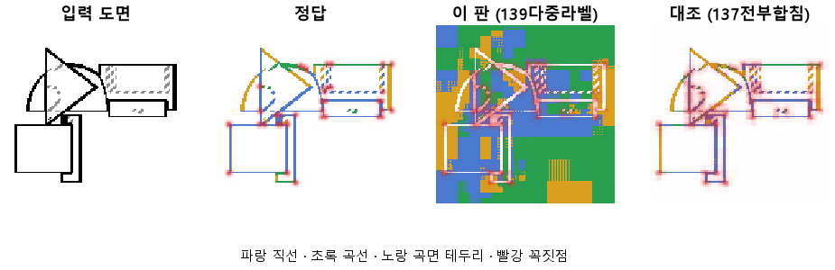
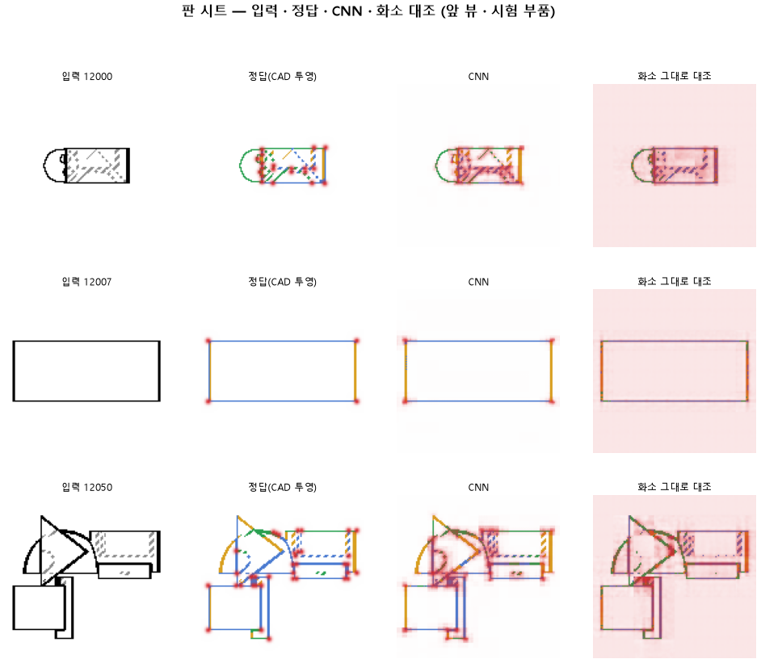

# 직선과 곡선이 닿은 화소는 둘 다 정답으로 둔다

## 분석
<!-- 사람 칸: 하네스 분석 단계 초안(claude -p) · 고치면 다시 만들어도 남는다 -->
### 한 줄로

**물음**: 직선과 곡선이 맞닿은 화소를 둘 다 정답으로 두면, 곡선 옆 직선을 곡선으로 잘못 읽는 일이 줄어들까?

**답**: 줄지 않았다. 오히려 0.24에서 0.37로 늘었다. 곡선은 0.83으로 올랐지만 직선은 0.70으로 내려갔다. 기준 7개 중 2개만 넘어서 판정은 실패다.

### 왜 이 판을 했나

앞 판(137)에서는 곡선에서 3화소 안에 있는 직선을 곡선으로 읽는 실수가 0.24까지 줄었다. 대신 곡선을 맞히는 비율이 떨어졌다. 우리는 원인을 정답을 매기는 방식에서 찾았다. 직선과 곡선이 닿는 화소는 실제로 둘 다다. 그런데도 모델에게 하나만 고르라고 시켰다. 그러면 그 근처에서 한쪽으로 기울 수밖에 없다고 보았다.

### 바꾼 것 하나

화소마다 종류 하나를 고르게 하던 것을 바꿨다. 이제는 **종류마다 따로 「이것이 맞나」를 묻는다**. 닿은 화소는 직선과 곡선이 둘 다 정답이다. 학습 60바퀴, 학습 부품 3,000개, 시험 부품 299개는 137과 같다.

### 결과

곡선과 직선에는 목표가 둘 있다. 이 판에서 미리 예측한 값(0.80)과 판마다 재는 최종 목표(0.90)다.

| | 이 판 (139) | 대조 (137) | 목표 | 넘었나 |
|---|---|---|---|---|
| 곡선 옆 직선을 곡선으로 틀림 | 0.37 | **0.24** | 0.15 아래 | ✗ |
| 곡선을 곡선으로 | **0.83** | 0.76 | 예측 0.80 · 최종 0.90 | ✓ · ✗ |
| 직선을 직선으로 | 0.70 | **0.78** | 예측 0.80 · 최종 0.90 | ✗ · ✗ |
| 선이 있는 자리를 찾음 | 0.999 | 0.999 | 0.95 | ✓ |
| 꼭짓점 (F1) | 0.50 | 0.51 | 0.75 | ✗ |

*F1은 「찾은 점 중 맞은 비율」과 「정답 점 중 찾은 비율」을 함께 본 점수다. 1이면 완벽하다.*

### 왜 이렇게 나왔나

**확인한 것**

- 직선과 곡선은 자리만 바꿨다. 곡선은 0.07 오르고 직선은 0.08 내렸다. 모든 선 화소에서 종류를 맞힌 비율은 0.77 대 0.76으로 거의 같다.
- 이 판의 곡선 0.83, 직선 0.70, 곡선 옆 실수 0.37은 136(CNN의 맨 앞 층과 맨 뒤 층만 읽던 판)의 0.82, 0.69, 0.40과 거의 같다. 137이 가운데 층을 더해서 얻은 것을 도로 내놓은 셈이다.
- 표의 숫자는 선이 조금 어긋나도 맞은 것으로 봐주고 센 값이다. 화소를 하나하나 엄격하게 맞춰 세면 곡선 옆 실수는 0.39 대 0.40으로 두 판이 같다.
- 시험 쪽 손실은 45바퀴에서 가장 낮았다. 그 뒤로는 학습 쪽만 계속 내려갔다.

**짐작 (아직 확인 안 함)**

- 둘 다 켜진 화소는 마지막에 확률을 비교해서 하나로 정한다. 곡선 근처에서는 곡선 확률이 늘 조금 높아서, 닿은 자리를 곡선이 가져갔을 수 있다.

### 한계

- 시험 부품 299개로 한 번만 돌렸다. 같은 학습끼리 0.1 넘게 어긋난 적이 있다(133·134). 그래서 0.07~0.08 차이는 흔들림 안쪽일 수 있다.
- 손실 식이 바뀌었다. 그래서 두 판의 손실 값은 서로 비교할 수 없다.
- 두 셈법에서 결과가 왜 갈리는지는 아직 설명하지 못했다.

### 배운 것과 다음

정답을 「둘 다」로 풀어 줘도 곡선 옆 실수는 줄지 않았다. 136, 137, 139 세 판은 직선과 곡선 사이에서 시소만 탔다. 정답을 매기는 방식만 바꿔서는 풀리지 않는다. 마지막에 하나를 고르는 규칙이 의심되지만, 아직 짐작이다.

1. 둘 다 켜진 화소가 어느 쪽으로 정해지는지 세어서 위의 짐작을 확인한다.
2. 같은 설정으로 다시 돌려 흔들림 크기를 잰다.
3. 꼭짓점을 CNN 맨 앞 층(선의 위치를 잘 아는 층)에서 바로 찍게 해 본다.

명제: 137 과 같은 설정 · 60 바퀴에서 종류를 화소마다 하나만 고르게 하지 않고 종류마다 따로 묻고 닿은 화소는 둘 다 정답으로 두면, 곡선 옆 직선을 곡선으로 읽는 비율이 0.24 에서 0.15 아래로 내려가고 곡선 · 직선 0.80 을 넘으며 선 자리 0.95 를 지킨다. 목표선(곡선 · 직선 0.90 · 꼭짓점 0.75)도 같이 잰다

| 가지 | 종류 | 바탕 | 바꾼 손잡이 | 에폭 | git | 날짜 |
|---|---|---|---|---|---|---|
| A3 | 비교 | 127 (하네스/conf/바탕.yaml) | 선지도.다중: False → True | 60 | `d741f9a` | 2026-10-23 19:38 |

## 1. 판정: **실패**

| 지표 | 식 | 문턱 | 이 판 | 대조(137전부합침) | 통과 |
|---|---|---|---|---|---|
| 선_곡선옆직선오류 | <= | 0.15 | 0.369 | 0.235 | ✗ |
| 선_곡선 | >= | 0.8 | 0.827 | 0.758 | ✓ |
| 선_직선 | >= | 0.8 | 0.696 | 0.776 | ✗ |
| 선_자리 | >= | 0.95 | 0.999 | 0.999 | ✓ |
| 선_곡선 | >= | 0.9 | 0.827 | 0.758 | ✗ |
| 선_직선 | >= | 0.9 | 0.696 | 0.776 | ✗ |
| 점_F1 | >= | 0.75 | 0.504 | 0.510 | ✗ |

## 2. 숫자 — 이 판 대 대조

| 지표 | 이 판 | 대조 |
|---|---|---|
| 시험loss | 8.545 | — |
| 학습loss | 7.874 | — |
| 선_직선 | 0.696 | 0.776 |
| 선_곡선 | 0.827 | 0.758 |
| 선_곡면테 | 0.753 | — |
| 선_숨음 | 0.999 | — |
| 선_헛선 | 0.000 | — |
| 선_곡선옆직선오류 | 0.369 | 0.235 |
| 선_자리 | 0.999 | 0.999 |
| 선_자리헛선 | 0.000 | — |
| 선_종류 | 0.765 | — |
| 점_정밀 | 0.374 | — |
| 점_재현 | 0.775 | — |
| 점_F1 | 0.504 | 0.510 |
| 층1_선_직선 | 0.662 | — |
| 층1_선_곡선 | 0.627 | — |
| 층1_선_자리 | 0.997 | — |
| 층1_선_자리헛선 | 0.001 | — |
| 층1_선_종류 | 0.601 | — |
| 층1_점_F1 | 0.263 | — |
| 층2_선_직선 | 0.538 | — |
| 층2_선_곡선 | 0.591 | — |
| 층2_선_자리 | 0.857 | — |
| 층2_선_자리헛선 | 0.049 | — |
| 층2_선_종류 | 0.708 | — |
| 층2_점_F1 | 0.425 | — |
| 층3_선_직선 | 0.315 | — |
| 층3_선_곡선 | 0.367 | — |
| 층3_선_자리 | 0.577 | — |
| 층3_선_자리헛선 | 0.066 | — |
| 층3_선_종류 | 0.742 | — |
| 층3_점_F1 | 0.330 | — |
| 층4_선_자리 | 0.999 | — |
| 층4_선_자리헛선 | 0.000 | — |
| 층4_선_종류 | 0.765 | — |
| 층4_선_직선 | 0.696 | — |
| 층4_선_곡선 | 0.827 | — |
| 층4_점_F1 | 0.504 | — |
| 선_직선_화소 | 0.602 | — |
| 선_곡선_화소 | 0.607 | — |
| 선_곡면테_화소 | 0.255 | — |
| 선_숨음_화소 | 0.974 | — |
| 선_헛선_화소 | 0.004 | — |
| 선_곡선옆직선오류_화소 | 0.394 | — |
| 선_자리_화소 | 0.970 | — |
| 선_자리헛선_화소 | 0.008 | — |
| 선_종류_화소 | 0.571 | — |
| 점_정밀_화소 | 0.175 | — |
| 점_재현_화소 | 0.664 | — |
| 점_F1_화소 | 0.277 | — |
| 선_곡선_차 | 0.220 | — |
| 선_직선_차 | 0.093 | — |
| 선_곡면테_차 | 0.499 | — |
| 점_F1_차 | 0.227 | — |

## 모델 구조
(이 판은 구조를 안 잼)

## 3. 학습 곡선

| 에폭 | 학습 loss | 시험 loss | 맞음(CAD 덩어리 수 · 선지도 선 종류) |
|---|---|---|---|
| 1 | 19.319 | 15.926 | 0.277 |
| 2 | 15.061 | 14.170 | 0.427 |
| 3 | 13.674 | 13.014 | 0.524 |
| 4 | 12.674 | 12.109 | 0.565 |
| 5 | 11.909 | 11.548 | 0.613 |
| 6 | 11.369 | 11.387 | 0.624 |
| 7 | 10.994 | 10.695 | 0.660 |
| 8 | 10.630 | 10.488 | 0.676 |
| 9 | 10.425 | 10.263 | 0.677 |
| 10 | 10.175 | 9.999 | 0.690 |
| 11 | 9.988 | 9.906 | 0.697 |
| 12 | 9.892 | 9.759 | 0.709 |
| 13 | 9.667 | 9.542 | 0.716 |
| 14 | 9.535 | 9.461 | 0.716 |
| 15 | 9.426 | 9.346 | 0.725 |
| 16 | 9.302 | 9.227 | 0.729 |
| 17 | 9.215 | 9.608 | 0.684 |
| 18 | 9.266 | 9.102 | 0.739 |
| 19 | 9.039 | 8.976 | 0.748 |
| 20 | 8.961 | 8.946 | 0.745 |
| 21 | 8.941 | 8.931 | 0.743 |
| 22 | 8.824 | 8.801 | 0.752 |
| 23 | 8.768 | 8.833 | 0.751 |
| 24 | 8.775 | 8.764 | 0.754 |
| 25 | 8.657 | 8.695 | 0.759 |
| 26 | 8.601 | 8.696 | 0.758 |
| 27 | 8.721 | 8.803 | 0.758 |
| 28 | 8.593 | 8.622 | 0.762 |
| 29 | 8.502 | 8.673 | 0.760 |
| 30 | 8.499 | 8.569 | 0.769 |
| 31 | 8.484 | 8.574 | 0.769 |
| 32 | 8.420 | 8.530 | 0.767 |
| 33 | 8.418 | 8.545 | 0.763 |
| 34 | 8.392 | 8.523 | 0.773 |
| 35 | 8.338 | 8.470 | 0.772 |
| 36 | 8.302 | 8.467 | 0.772 |
| 37 | 8.306 | 8.501 | 0.772 |
| 38 | 8.258 | 8.443 | 0.775 |
| 39 | 8.283 | 8.504 | 0.771 |
| 40 | 8.240 | 8.488 | 0.773 |
| 41 | 8.216 | 8.527 | 0.771 |
| 42 | 8.208 | 8.478 | 0.774 |
| 43 | 8.174 | 8.518 | 0.767 |
| 44 | 8.189 | 8.438 | 0.772 |
| 45 | 8.127 | 8.464 | 0.770 |
| 46 | 8.104 | 8.591 | 0.761 |
| 47 | 8.133 | 8.493 | 0.770 |
| 48 | 8.081 | 8.525 | 0.768 |
| 49 | 8.073 | 8.485 | 0.771 |
| 50 | 8.042 | 8.502 | 0.768 |
| 51 | 8.011 | 8.518 | 0.768 |
| 52 | 7.977 | 8.515 | 0.768 |
| 53 | 7.969 | 8.504 | 0.769 |
| 54 | 7.946 | 8.547 | 0.769 |
| 55 | 8.045 | 8.558 | 0.767 |
| 56 | 7.985 | 8.533 | 0.767 |
| 57 | 7.940 | 8.552 | 0.766 |
| 58 | 7.903 | 8.559 | 0.766 |
| 59 | 7.870 | 8.581 | 0.767 |
| 60 | 7.874 | 8.545 | 0.765 |

## 4. 점검

### 4.1 연기 판
첫 loss 6.648 → 배치 하나 40 걸음 3.121 · VRAM 3.82 GB

### 4.2 층보기 (시험 64 · 4 층)
칸끼리 닮음 — (1 = 6 칸 같음) · 빈 조각 주의 몫 — (빈 조각 비율 0.54) · 주의 엔트로피 — · 출력 자리 퍼짐 — (정답 0.148)

### 4.3 탐침 — 합성 그림 (블록 4 · 128)
구조 6 종 — · 곡률 R² — · (블록 3: — · —)

### 4.4 특징 — 실제 도면 (조각 라벨 · 하네스/특징.py)
(이 판은 특징 점검을 안 함)

## 쇼츠
편 100_판139다중라벨 · 굽기 실패(코드 1): subprocess.CalledProcessError: Command '['G:/art2real/out/tts/chatterbox/Scripts/python.exe', 'G:\\art2real\\원화3d\\과정\\영상05\\tts\\굽기_chatterbox.py', 'G:/art2real/out/영상05/대화/100_판139다중라벨/_cb일감.json']' · 업로드 대기

| 누구 | 말 |
|---|---|
| AI | 모델이 그린 삼각형에 초록 선이 섞였어요. |
| AI | 모델은 이 도면을 보고 선마다 색을 칠해요. |
| AI | 직선이냐 곡선이냐로요. 초록은 곡선이에요. |
| AI | 왼쪽 정답 삼각형엔 초록이 없어요. |
| AI | 직선과 곡선이 맞닿는 점은 사실 둘 다예요. |
| AI | 전엔 하나만 고르게 했는데, 이번엔 둘 다 정답으로 쳤어요. |
| AI | 곡선 옆 직선을 곡선으로 칠하는 실수를 줄이려고요. |
| 나 | 맞닿은 점에 초록이 묻은 거네. 끝자락만 그렇겠지. |
| AI | 끝자락만이 아니에요. 반원 둘레의 곧은 선도 초록이에요. |
| 나 | 곡선 옆 직선만 따로 확인해 봐. |
| AI | 전엔 24%, 이번엔 37%를 곡선으로 잘못 칠했어요. |
| AI | 곡선은 더 잘 맞히는데, 직선은 덜 맞혀요. |
| 나 | 둘 다 정답으로 줬더니 곡선 쪽으로 기울었네. |
| AI | 곡선 옆 실수는 줄기는커녕 오히려 늘었어요. 실패예요. |

## 5. 해석
<!-- 사람 칸: 아래를 채운다 · 보고서를 다시 만들어도 남는다 -->
(비어 있음)

## 6. 다음 가지 (사람이 고름 · claudedocs/문제트리.md)
<!-- 사람 칸: 아래를 채운다 · 보고서를 다시 만들어도 남는다 -->
(비어 있음)

## 7. 재현
`python 하네스/하네스.py --config-name 판_139다중라벨` · 설정 [설정.yaml](설정.yaml) · 판정 [판정.json](판정.json) · 산출 `G:/art2real/out/하네스/139다중라벨/`

## 링크
- 쇼츠: 업로드 대기
- GitHub 이슈: https://github.com/sigongjoa/art2real/issues/11
