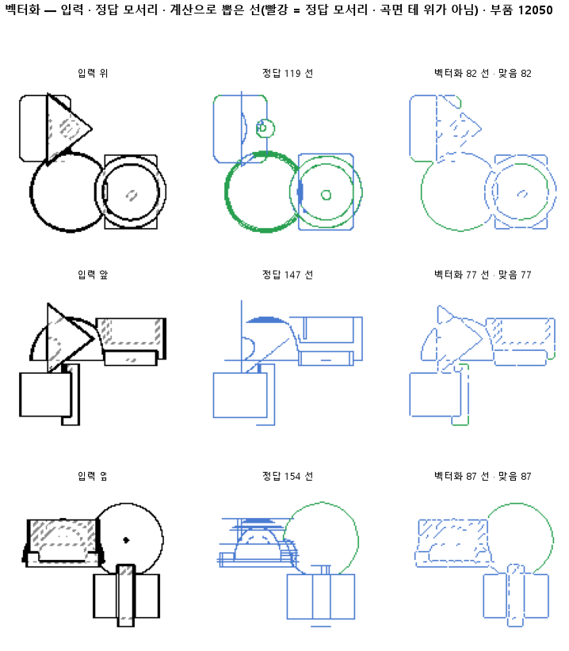
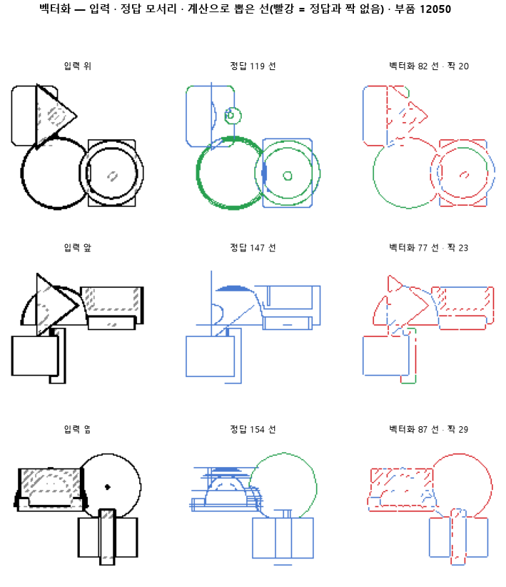

# 칠한 선 화소를 꼭짓점에서 끊어 선 목록으로 바꾼다

## 분석
<!-- 사람 칸: 하네스 분석 단계 초안(claude -p) · 고치면 다시 만들어도 남는다 -->
### 한 줄로

**물음**: 판 137이 칠한 선 화소를 학습 없이 계산만으로 선 목록으로 바꾸면, 정답 모서리와 맞을까?

**답**: 맞지 않는다. 직선과 원호는 90 % 맞게 갈랐다. 하지만 정답 모서리를 넷에 하나꼴로 놓쳤고, 모서리 하나를 3조각 넘게 쪼갰다. 기준 넷 가운데 하나만 넘어 판정은 실패다.

### 왜 이 판을 했나

판 137은 도면에서 선이 지나는 화소에 칠을 한다. 그런데 다음 단계인 CAD 설계에는 화소가 아니라 「여기서 저기까지 직선 하나」 같은 선 목록이 필요하다. 그래서 칠한 화소를 선 목록으로 바꾸는 계산을 붙였다. 순서는 이렇다. 먼저 칠한 화소 띠를 1화소 굵기의 줄로 깎는다(뼈대). 그 줄을 꼭짓점과 갈림길에서 끊는다. 끊은 토막이 곧은 줄에서 2화소 넘게 벗어나면 원호, 아니면 직선으로 본다.

### 바꾼 것 하나

판 137의 칠 뒤에 이 계산을 새로 붙였다. 학습은 하지 않았다. 계산이 믿을 만한지 보려고 정답 선지도에도 같은 계산을 돌렸다. 시험 부품은 299개이고, 부품마다 위·앞·옆 도면 세 장(128×128)을 쓴다.

### 결과

| | 이 판 (칠한 지도) | 대조 (정답 지도) | 목표 | 넘었나 |
|---|---|---|---|---|
| ① 정답 모서리와 맞음 (F1) | 0.85 | 0.84 | 0.90 | ✗ |
| ② 정답 지도에서 계산 점검 (F1) | — | 0.84 | 0.95 | ✗ |
| 정답 모서리 중 찾은 비율 | 0.74 | 0.73 | — | |
| 그린 선 중 맞은 비율 | 1.00 | 1.00 | — | |
| ③ 직선·원호를 맞게 가름 | 0.90 | 0.90 | 0.90 | ✓ |
| ④ 모서리 하나당 조각 수 | 3.41 | 3.19 | 1.2 이하 | ✗ |

*기준은 ①~④ 넷이고, 판 전에 정했다. 정답 모서리에서 2화소 안에 있으면 맞은 선으로 센다. 원호를 가르는 2화소와는 따로 정한 값이 같을 뿐이다. F1은 찾은 비율과 맞은 비율을 함께 본 점수이고, 1이면 완벽하다.*

### 왜 이렇게 나왔나

**확인한 것**

- 잃는 곳은 칠이 아니라 계산이다. 정답 지도를 넣어도 F1이 0.84로, 칠한 지도(0.85)와 거의 같다.
- 조각은 하나하나가 정답 모서리 위에 놓인다. 맞은 선은 「조각이 정답 모서리를 덮느냐」로 세기 때문에, 쪼개져도 헛선이 되지 않고 맞은 비율은 1.00으로 남는다. 쪼개짐은 ④에서 따로 센다. 점수를 깎는 것은 아예 선이 그려지지 않은 모서리(26~27 %)다.
- 쪼개짐도 계산 탓이다. 정답 지도에서도 모서리 하나가 3.19조각으로 나뉜다.

**짐작 (아직 확인 안 함)**

- 끊는 자리가 너무 많은 것 같다. 뼈대 줄 끝에 곁가지처럼 삐져나온 짧은 토막이 가짜 갈림길이 될 수 있다.
- 놓친 모서리는 도면에서 다른 모서리와 포개진 것이거나, 아주 짧아서 뼈대를 뽑을 때 사라진 것일 수 있다.

### 한계

- 시험 부품 299개로, 한 번만 돌렸다.
- 원호를 가르는 문턱은 2화소 하나만 써 봤다.
- 계산을 점검하는 기준(②)을 넘지 못했다. 그래서 0.85를 칠의 실력으로 읽으면 안 된다.

### 배운 것과 다음

판 137이 칠한 지도는 정답 지도만큼 쓸 만하다. **막힌 곳은 선을 끊고 잇는 계산이다.** 정답이 있는 계산이니 학습에 맡길 일도 아니다.

1. 정답 지도에서 쪼개진 자리와 놓친 모서리를 그림으로 모아 원인을 확인한다.
2. 곁가지 자르기와 토막 다시 잇기를 넣어, 정답 지도에서 0.95를 먼저 넘긴다.
3. 그다음에 칠한 지도로 돌아온다.

명제: 판 137 이 칠한 시험 부품 299 개의 선 화소를 뼈대 · 꼭짓점 · 가지 · 휨 계산만으로 선 목록으로 바꾸면, 정답 모서리(CAD 투영)의 90 % 이상과 2 화소 안에서 짝이 맞고(정밀도 함께 F1 0.90) 짝 맞은 선의 종류(눈 기준 · 2 화소 이상 휨 = 원호)가 90 % 이상 맞으며 한 모서리를 1.2 조각 넘게 쪼개지 않는다. 같은 계산을 정답 선지도에 돌리면 F1 0.95 를 넘어 계산 자체는 믿을 만하다

| 가지 | 종류 | 바탕 | 바꾼 손잡이 | 에폭 | git | 날짜 |
|---|---|---|---|---|---|---|
| A4 | 탐색 | 127 (하네스/conf/바탕.yaml) | 벡터화.휨문턱: None → 2.0, 목표: CAD → 벡터화, 벡터화.입력판: None → 137전부합침 | 10 | `7e1cf5f` | 2026-10-24 10:49 |

## 1. 판정: **탐색 — 이김 판정 없음 · 기준 못 넘음**

| 지표 | 식 | 문턱 | 이 판 | 대조(정답선지도) | 통과 |
|---|---|---|---|---|---|
| 벡_F1 | >= | 0.9 | 0.850 | — | ✗ |
| 벡_종류 | >= | 0.9 | 0.902 | — | ✓ |
| 벡_조각 | <= | 1.2 | 3.406 | — | ✗ |
| 벡_F1_정답 | >= | 0.95 | 0.842 | — | ✗ |

## 2. 숫자 — 이 판 대 대조

| 지표 | 이 판 | 대조 |
|---|---|---|
| 벡_재현 | 0.740 | — |
| 벡_정밀 | 0.998 | — |
| 벡_F1 | 0.850 | — |
| 벡_종류 | 0.902 | — |
| 벡_조각 | 3.406 | — |
| 벡_한선 | 0.601 | — |
| 벡_재현_정답 | 0.727 | — |
| 벡_정밀_정답 | 1.000 | — |
| 벡_F1_정답 | 0.842 | — |
| 벡_종류_정답 | 0.903 | — |
| 벡_조각_정답 | 3.187 | — |
| 벡_한선_정답 | 0.645 | — |

## 모델 구조
(이 판은 구조를 안 잼)

## 3. 학습 곡선

| 에폭 | 학습 loss | 시험 loss | 맞음(CAD 덩어리 수 · 선지도 선 종류) |
|---|---|---|---|

## 4. 점검

### 4.1 연기 판
첫 loss — → 배치 하나 40 걸음 — · VRAM — GB

### 4.2 층보기 (시험 64 · 4 층)
칸끼리 닮음 — (1 = 6 칸 같음) · 빈 조각 주의 몫 — (빈 조각 비율 0.54) · 주의 엔트로피 — · 출력 자리 퍼짐 — (정답 0.148)

### 4.3 탐침 — 합성 그림 (블록 4 · 128)
구조 6 종 — · 곡률 R² — · (블록 3: — · —)

### 4.4 특징 — 실제 도면 (조각 라벨 · 하네스/특징.py)
(이 판은 특징 점검을 안 함)

## 쇼츠
편 101_판140벡터화 · 50.0 초 · 14 줄 · 서재용 업로드 대기

[쇼츠 영상](쇼츠.mp4)

| 누구 | 말 |
|---|---|
| AI | 오른쪽은 변 하나가 여러 토막으로 끊겼어요. |
| AI | 도면은 그냥 그림이라 CAD에 바로 못 써요. |
| AI | CAD엔 「여기서 저기까지 직선」 목록이 필요해요. |
| AI | 먼저 학습시킨 모델이 도면 위 테두리에 색을 칠해요. |
| AI | 그다음 프로그램이 그 칠을 귀퉁이에서 끊어요. |
| AI | 그러면 변 하나가 선 하나가 돼야 해요. |
| 나 | 모델이 칠을 덜 해서 끊긴 거네. |
| 나 | 원래 설계 파일로 정답 칠을 만들어서 넣어 봐. |
| AI | 설계 파일로 빈틈없이 칠해서 똑같이 끊었어요. |
| AI | 여기 봐요. 정답 칠인데도 변이 토막 났어요. |
| AI | 변 하나가 평균 3.41조각, 정답 칠도 3.19조각이에요. |
| 나 | 칠이 아니라 끊는 프로그램이 문제였네. |
| AI | 이번 선 뽑기는 실패예요. |
| AI | 이 프로그램으론 모델 칠이 좋은지도 못 재요. |

## 5. 해석
<!-- 사람 칸: 아래를 채운다 · 보고서를 다시 만들어도 남는다 -->
(비어 있음)

## 6. 다음 가지 (사람이 고름 · claudedocs/문제트리.md)
<!-- 사람 칸: 아래를 채운다 · 보고서를 다시 만들어도 남는다 -->
(비어 있음)

## 7. 재현
`python 하네스/하네스.py --config-name 판_140벡터화` · 설정 [설정.yaml](설정.yaml) · 판정 [판정.json](판정.json) · 산출 `G:/art2real/out/하네스/140벡터화/`

## 링크
- 쇼츠: 서재용 업로드 대기
- GitHub 이슈: https://github.com/sigongjoa/art2real/issues/12
