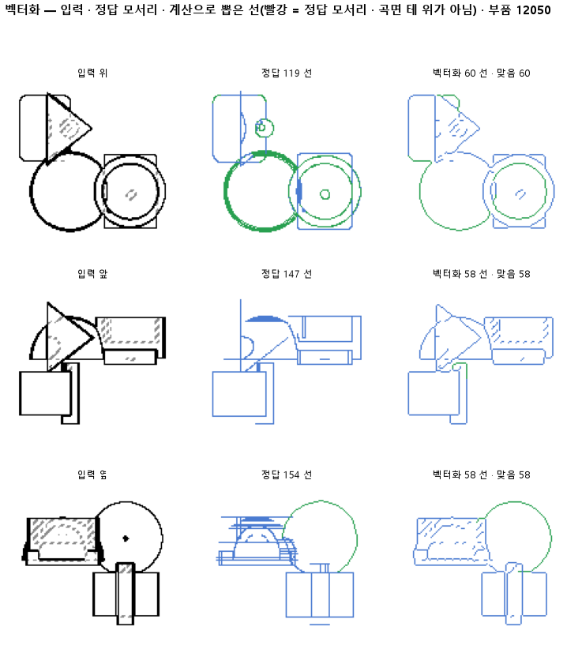

# 끊긴 점선과 쪼개진 원호를 한 선으로 잇는다

## 분석
<!-- 사람 칸: 하네스 분석 단계 초안(claude -p) · 고치면 다시 만들어도 남는다 -->
### 한 줄로

**물음**: 끊긴 점선과 쪼개진 원호를 한 선으로 이으면, 정답 모서리와 맞는 선 목록이 나올까?

**답**: 전보다 많이 맞는다. 정답 모서리를 찾는 비율이 0.74에서 0.83으로 올랐다. 하지만 한 선으로 뽑힌 모서리는 0.71에 그쳤고, 직선과 원호를 가르는 정확도는 오히려 떨어졌다. 기준 넷 중 하나만 넘었으니 판정은 실패다.

### 왜 이 판을 했나

판 137 모델은 도면의 화소마다 선인지 아닌지, 선이면 무슨 선인지를 찍는다. 이 결과를 **칠한 지도**라 부른다. 부품 모양에서 바로 그린 정답 선 그림은 **정답 지도**라 부른다. 판 140은 칠한 지도를 계산만으로 선 목록으로 바꿨다. 그런데 정답 지도를 넣어도 점수가 똑같이 낮았다. 그러니 문제는 칠이 아니라, 선을 끊고 잇는 계산에 있었다. 모서리 하나가 세 토막 넘게 쪼개졌고, 넷에 하나는 선이 아예 그려지지 않았다.

### 바꾼 것 하나

선을 잇는 단계를 넣었다. 먼저 선이 갈리거나 만나는 마디를 한 화소로 줄인다. 숨은선을 나타내는 점선처럼 같은 방향으로 끊겨 놓인 직선 토막은 하나로 잇는다. 같은 원 위에 놓인 조각들도 하나로 합친다. 입력은 140과 같은 판 137의 칠한 지도이고, 시험 부품은 299개다. 이번에도 학습은 없다.

### 결과

| | 이 판 (141) | 대조 (140) | 목표 | 넘었나 |
|---|---|---|---|---|
| ① 정답 모서리와 맞음 (F1) | **0.91** | 0.85 | 0.90 | ✓ |
| ② 한 선으로 뽑힌 모서리 | 0.71 | 0.60 | 0.80 | ✗ |
| ③ 직선·원호를 맞게 가름 | 0.88 | 0.90 | 0.90 | ✗ |
| ④ 정답 지도에서 계산 점검 (F1) | 0.91 | 0.84 | 0.95 | ✗ |
| 정답 지도: 한 선으로 뽑힌 모서리 | 0.72 | 0.65 | — | |
| 정답 지도: 직선·원호 가름 | 0.87 | 0.90 | — | |
| 정답 모서리 중 찾은 비율 | 0.83 | 0.74 | — | |
| 그린 선 중 맞은 비율 | 1.00 | 1.00 | — | |
| 모서리 하나당 조각 수 | 3.06 | 3.41 | — | |

*정답 모서리에서 2화소 안에 있는 선은 맞은 선으로 센다. 여러 조각으로 쪼개져도 정답 모서리 위에 있으면 맞은 선이다. 그래서 맞은 비율은 높게 나오고, 쪼개진 정도는 ②와 조각 수로 따로 본다. F1은 찾은 비율과 맞은 비율을 함께 본 점수이고, 1이면 완벽하다.*

### 왜 이렇게 나왔나

**확인한 것**

- F1이 오른 것은 찾은 비율이 올라서다(0.74 → 0.83). 맞은 비율은 그대로 1.00이다. 잇기는 헛선을 만들지 않고, 놓쳤던 모서리를 채웠다.
- 점수를 잃는 곳은 여전히 계산이다. 정답 지도를 넣어도 F1(0.91)과 한 선 비율(0.72)이 칠한 지도와 거의 같다.
- 직선·원호 가름이 떨어진 것도 잇는 계산 때문이다. 정답 지도에서도 0.90에서 0.87로 내려갔다.

**짐작 (아직 확인 안 함)**

- 원 하나에 맞는 조각을 합칠 때 직선 토막까지 원호에 끌려 들어간 것 같다.
- 조각 수는 3.06인데 한 선 비율은 0.71이다. 몇몇 모서리가 아주 잘게 쪼개져 평균을 끌어올렸을 수 있다.

### 한계

- 시험 부품 299개로 한 번만 돌렸다.
- 정답 지도가 칠한 지도보다 나아야 하는데 그렇지 않다. 이 판은 둘 다 F1이 0.91이고, 140에서도 정답 0.84, 칠 0.85였다. 두 판 연달아 같은 꼴인데 까닭을 아직 모른다.
- 잇는 문턱(방향이 얼마나 같아야 잇는지, 원에서 얼마나 벗어나도 되는지)은 한 값씩만 써 봤다.

### 배운 것과 다음

잇기만으로도 놓친 모서리를 꽤 되찾았다. 판 137이 칠한 지도는 여전히 정답 지도만큼 쓸 만하다. **남은 문제는 계산 쪽이다. 덜 이어진 모서리와 잘못 합친 원호가 남았다.**

1. 정답 지도에서 한 선이 못 된 모서리와 종류가 바뀐 선을 그림으로 모아 원인을 확인한다.
2. 원호를 합치기 전에 직선 토막은 따로 떼어 둔다.
3. 정답 지도에서 0.95를 넘긴 뒤 칠한 지도로 돌아온다.

명제: 140 과 같은 입력(판 137 선지도 · 시험 299)에서 마디를 봉우리 한 화소로 줄이고 같은 방향 직선 토막과 원 하나에 맞는 조각을 이으면, 정답 모서리 재현이 0.74 에서 올라 F1 0.90 을 넘고 한 선으로 뽑힌 모서리가 0.60 에서 0.80 을 넘으며 종류 0.90 을 지킨다. 같은 계산을 정답 선지도에 돌린 천장 F1 도 0.95 를 넘는다

| 가지 | 종류 | 바탕 | 바꾼 손잡이 | 에폭 | git | 날짜 |
|---|---|---|---|---|---|---|
| A4 | 비교 | 127 (하네스/conf/바탕.yaml) | 벡터화.이음: None → True | 10 | `412c00c` | 2026-10-24 11:27 |

## 1. 판정: **실패**

| 지표 | 식 | 문턱 | 이 판 | 대조(140벡터화) | 통과 |
|---|---|---|---|---|---|
| 벡_F1 | >= | 0.9 | 0.905 | 0.850 | ✓ |
| 벡_한선 | >= | 0.8 | 0.707 | 0.601 | ✗ |
| 벡_종류 | >= | 0.9 | 0.876 | 0.902 | ✗ |
| 벡_F1_정답 | >= | 0.95 | 0.905 | 0.842 | ✗ |

## 2. 숫자 — 이 판 대 대조

| 지표 | 이 판 | 대조 |
|---|---|---|
| 벡_재현 | 0.828 | 0.740 |
| 벡_정밀 | 0.999 | — |
| 벡_F1 | 0.905 | 0.850 |
| 벡_종류 | 0.876 | 0.902 |
| 벡_조각 | 3.062 | — |
| 벡_한선 | 0.707 | 0.601 |
| 벡_재현_정답 | 0.827 | — |
| 벡_정밀_정답 | 1.000 | — |
| 벡_F1_정답 | 0.905 | 0.842 |
| 벡_종류_정답 | 0.870 | — |
| 벡_조각_정답 | 2.931 | — |
| 벡_한선_정답 | 0.716 | — |

## 모델 구조
(이 판은 구조를 안 잼)

## 3. 학습 곡선

| 에폭 | 학습 loss | 시험 loss | 맞음(CAD 덩어리 수 · 선지도 선 종류) |
|---|---|---|---|

## 4. 점검

### 4.1 연기 판
첫 loss — → 배치 하나 40 걸음 — · VRAM — GB

### 4.2 층보기 (시험 64 · 4 층)
칸끼리 닮음 — (1 = 6 칸 같음) · 빈 조각 주의 몫 — (빈 조각 비율 0.54) · 주의 엔트로피 — · 출력 자리 퍼짐 — (정답 0.148)

### 4.3 탐침 — 합성 그림 (블록 4 · 128)
구조 6 종 — · 곡률 R² — · (블록 3: — · —)

### 4.4 특징 — 실제 도면 (조각 라벨 · 하네스/특징.py)
(이 판은 특징 점검을 안 함)

## 쇼츠
편 102_판141이음 · 굽기 실패(코드 1): subprocess.CalledProcessError: Command '['G:/art2real/out/tts/chatterbox/Scripts/python.exe', 'G:\\art2real\\원화3d\\과정\\영상05\\tts\\굽기_chatterbox.py', 'G:/art2real/out/영상05/대화/102_판141이음/_cb일감.json']' r · 업로드 대기

| 누구 | 말 |
|---|---|
| AI | 왼쪽 정답은 모서리가 한 줄씩 그어져 있어요. |
| AI | 그런데 오른쪽 모델 것은 토막토막 끊겼어요. |
| AI | 모델은 이 도면을 보고 선이 있는 자리를 칠해요. |
| AI | 그다음 칠한 자리를 이어서, 모서리마다 선 한 줄로 적어요. |
| 나 | 모델이 선을 군데군데 덜 칠했나 보네. |
| 나 | 모델 대신 정답 칠을 넣어 봐. |
| AI | 정답 칠을 넣어도 똑같은 자리에서 끊겨요. |
| AI | 안 보이는 모서리는 점선인데, 점 하나하나를 따로 셌어요. |
| AI | 동그란 구멍 테두리도 여러 조각으로 쪼개 적었어요. |
| 나 | 칠은 멀쩡했네. 잇는 게 문제였어. |
| 나 | 같은 방향 토막, 같은 원 위 조각은 한 줄로 잇게 고쳐. |
| AI | 정답 모서리 100개 중 74개 찾던 게 83개로 늘었어요. |
| AI | 그런데 곧은 선을 둥근 선으로 잘못 적은 것도 늘었어요. |
| AI | 한 줄로 이어진 모서리가 아직 목표에 못 미쳐서 실패예요. |

## 5. 해석
<!-- 사람 칸: 아래를 채운다 · 보고서를 다시 만들어도 남는다 -->
(비어 있음)

## 6. 다음 가지 (사람이 고름 · claudedocs/문제트리.md)
<!-- 사람 칸: 아래를 채운다 · 보고서를 다시 만들어도 남는다 -->
(비어 있음)

## 7. 재현
`python 하네스/하네스.py --config-name 판_141이음` · 설정 [설정.yaml](설정.yaml) · 판정 [판정.json](판정.json) · 산출 `G:/art2real/out/하네스/141이음/`

## 링크
- 쇼츠: 업로드 대기
- GitHub 이슈: https://github.com/sigongjoa/art2real/issues/13
