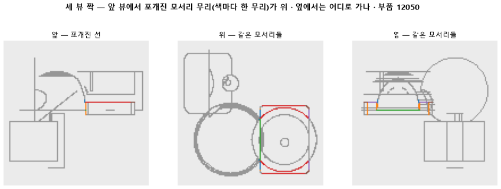

# 한 장에서 포개진 선을 나머지 두 장으로 가른다

## 분석
<!-- 사람 칸: 하네스 분석 단계 초안(claude -p) · 고치면 다시 만들어도 남는다 -->
### 한 줄로

**물음**: 한 장의 도면에서 서로 포개진 선을, 나머지 두 장으로 가를 수 있을까?

**답**: 넷에 셋은 가를 수 있다. 목표는 열에 아홉이었으니 판정은 실패다. 겹침을 전부 세 장 맞추기 단계에 맡길 수는 없다.

### 왜 이 판을 했나

부품 도면은 위 · 앞 · 옆 세 장이다. 한 장에서는 선 하나로 보여도, 실제로는 깊이가 다른 3D 모서리 여러 개가 겹쳐 있을 수 있다. 이런 겹침은 그 한 장만 봐서는 풀 수 없다.

그래서 이 일은 다음 단계에 넘기려 했다. 세 장의 선을 서로 짝지어 3D 모서리로 세우는 단계다. 이 계획은 다른 두 장이 겹침을 실제로 갈라 줄 때만 성립한다. 그 상한을 학습도 모델도 없이, CAD 정답 모서리만으로 먼저 쟀다.

### 바꾼 것 하나

포갠 선을 **한 장으로만 보던 것을 세 장으로 보게** 했다. 시험 부품 299개의 CAD 모서리를 세 장에 투영했다. 한 장에서 선 하나로 포개 보이는 모서리 묶음을 「무리」라 부른다. 무리 안의 짝마다 다른 두 장 중 한 곳에서라도 떨어지는지 봤다. 짝마다 갈리는 장이 달라도 된다. 모든 짝이 갈려야 그 무리를 갈린 것으로 셌다.

### 결과

| | 이 판 (세 장) | 대조 (한 장만) | 목표 | 넘었나 |
|---|---|---|---|---|
| 모든 짝이 갈린 무리의 몫 | 0.76 | 0.00 | 0.90 이상 | ✗ |
| 투영에 실패한 부품 | 0개 | — | 15개 이하 | ✓ |

대조는 바닥값이다. 한 장만 보면 정의상 아무것도 못 가른다. 그래서 0.76은 전부 다른 두 장이 보탠 몫이다. 투영 실패는 CAD 파일을 못 읽거나 못 그리는 경우다. 299개 중 5 % 정도까지는 빠져도 된다고 미리 정했다.

### 왜 이렇게 나왔나

**확인한 것**

- 겹침은 드물지 않다. 그려진 선의 38 %가 무리다.
- 무리 하나에는 모서리가 평균 4.12개 들어 있다. 그만큼 짝이 많아서 한 짝만 안 갈려도 무리가 실패로 셌다.

**짐작 (아직 확인 안 함)**

- 깊이만 다른 두 모서리라면 다른 장에서는 떨어져야 맞다. 그런데도 안 갈렸다면 깊이 차이가 128×128 도면에서 한두 화소 안이라 붙어 보였을 수 있다.
- 다른 장에서 점으로 줄어드는 모서리를 우리 셈이 「안 갈림」으로 쳤을 수도 있다. 셈 코드를 다시 봐야 한다.
- 모서리가 많은 무리일수록 실패가 몰릴 것으로 본다.

### 한계

- 시험 부품 299개로 한 번만 쟀다. 계산이라 같은 부품에서는 흔들림이 없겠지만, 다른 부품 묶음에서는 모른다.
- 몇 화소 떨어져야 갈렸다고 볼지는 이 글에 적지 않았다. 38 %가 선 개수 기준인지 길이 기준인지도 기록에 없다.
- 실패한 무리가 한 짝만 남은 것인지, 통째로 붙은 것인지는 나눠 세지 않았다. 그림으로 하나하나 보지도 않았다.

### 배운 것과 다음

다른 장은 겹침을 꽤 풀어 준다. 하지만 **세 장 맞추기에 통째로 맡기면 넷에 하나꼴로 풀리지 않는 무리가 남는다.**

1. 안 갈린 무리를 그림으로 모으고, 셈이 점이 된 모서리를 어떻게 다루는지 확인한다.
2. 짝 단위와 무리 크기별로 다시 세어 실패가 어디 몰리는지 본다.
3. 남은 몫을 한 장 안에서 풀지, 이 숫자를 보고 정한다.

명제: 시험 부품 299 개의 CAD 모서리를 위 · 앞 · 옆에 투영하면 그려진 2D 선의 일부는 깊이가 다른 3D 모서리 둘 이상이 포갠 것이고, 그런 포갠 선의 90 % 이상은 무리 안 모든 모서리 짝이 다른 두 뷰 가운데 하나에서 갈라진다. 그래서 겹침은 한 장에서 풀지 않고 세 뷰 짝 맞추기 단계로 넘겨도 된다. 투영에 실패한 부품은 15 개 이하

| 가지 | 종류 | 바탕 | 바꾼 손잡이 | 에폭 | git | 날짜 |
|---|---|---|---|---|---|---|
| A4 | 탐색 | 127 (하네스/conf/바탕.yaml) | 목표: CAD → 세뷰 | 10 | `f22034b` | 2026-10-24 11:57 |

## 1. 판정: **탐색 — 이김 판정 없음 · 기준 못 넘음**

| 지표 | 식 | 문턱 | 이 판 | 대조(한뷰만) | 통과 |
|---|---|---|---|---|---|
| 세뷰_가름 | >= | 0.9 | 0.759 | 0.000 | ✗ |
| 세뷰_실패 | <= | 15 | 0 | — | ✓ |

## 2. 숫자 — 이 판 대 대조

| 지표 | 이 판 | 대조 |
|---|---|---|
| 세뷰_부품 | 299 | — |
| 세뷰_실패 | 0 | — |
| 세뷰_겹침몫 | 0.384 | — |
| 세뷰_가름 | 0.759 | 0.000 |
| 세뷰_겹침당모서리 | 4.120 | — |

## 모델 구조
(이 판은 구조를 안 잼)

## 3. 학습 곡선

| 에폭 | 학습 loss | 시험 loss | 맞음(CAD 덩어리 수 · 선지도 선 종류) |
|---|---|---|---|

## 4. 점검

### 4.1 연기 판
첫 loss — → 배치 하나 40 걸음 — · VRAM — GB

### 4.2 층보기 (시험 64 · 4 층)
칸끼리 닮음 — (1 = 6 칸 같음) · 빈 조각 주의 몫 — (빈 조각 비율 0.54) · 주의 엔트로피 — · 출력 자리 퍼짐 — (정답 0.148)

### 4.3 탐침 — 합성 그림 (블록 4 · 128)
구조 6 종 — · 곡률 R² — · (블록 3: — · —)

### 4.4 특징 — 실제 도면 (조각 라벨 · 하네스/특징.py)
(이 판은 특징 점검을 안 함)

## 쇼츠
편 103_판142세뷰 · 대본검사 실패로 안 구움 · 업로드 대기

| 누구 | 말 |
|---|---|
| AI | 기계 부품을 위에서 본 도면이에요. |
| AI | 이 선 하나가 사실 모서리 여러 개예요. |
| AI | 높이만 다른 모서리들이 위에서 보면 딱 포개져요. |
| AI | 3D로 세우려면 이 선을 모서리마다 떼어 내야 해요. |
| AI | 이렇게 포개진 모서리 무리를 묶음이라 할게요. |
| AI | 묶음은 도면 곳곳에 있어요. |
| 나 | 위에서만 봐서 그렇지. 앞이랑 옆 도면 보면 다 갈리잖아. |
| AI | 앞에서 보니 초록 묶음은 쫙 갈라져요. |
| AI | 그런데 빨간 묶음은 앞에서도 옆에서도 붙어 있어요. |
| 나 | 세 장 다 봐도 안 떨어지는 게 있어? |
| 나 | 그럼 부품 전부, 위 앞 옆 세 장을 같이 놓고 확인해 봐. |
| AI | 묶음 안 모서리를 둘씩 짝 지었어요. |
| AI | 짝마다 앞이나 옆에서 떨어지는지 봤어요. |
| AI | 짝 하나라도 끝까지 붙어 있으면 그 묶음은 못 가른 거예요. |
| AI | 묶음 4개 중 3개꼴로 갈렸어요. 목표는 10개 중 9개였어요. |
| 나 | 세 장을 다 봐도 못 푸는 게 남는구나. |
| AI | 이번엔 실패예요. 남은 묶음은 끝까지 선 하나로 붙어 있어요. |

## 5. 해석
<!-- 사람 칸: 아래를 채운다 · 보고서를 다시 만들어도 남는다 -->
(비어 있음)

## 6. 다음 가지 (사람이 고름 · claudedocs/문제트리.md)
<!-- 사람 칸: 아래를 채운다 · 보고서를 다시 만들어도 남는다 -->
(비어 있음)

## 7. 재현
`python 하네스/하네스.py --config-name 판_142세뷰` · 설정 [설정.yaml](설정.yaml) · 판정 [판정.json](판정.json) · 산출 `G:/art2real/out/하네스/142세뷰/`

## 링크
- 쇼츠: 업로드 대기
- GitHub 이슈: https://github.com/sigongjoa/art2real/issues/14
