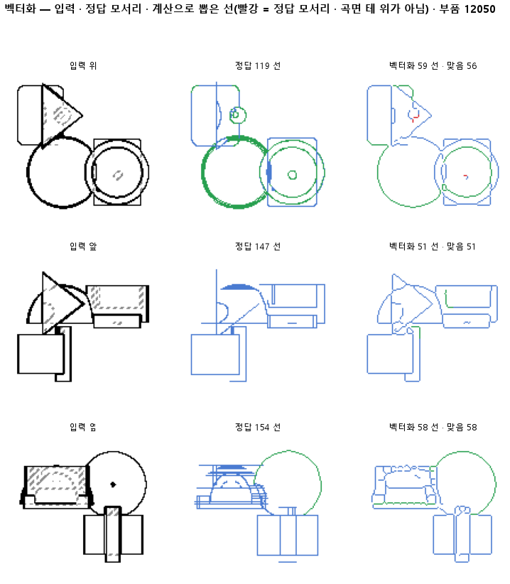

# 빗금으로 끊긴 숨은선 띠를 메워 한 선으로 뽑는다

## 분석
<!-- 사람 칸: 하네스 분석 단계 초안(claude -p) · 고치면 다시 만들어도 남는다 -->
### 한 줄로

**물음**: 점선으로 그린 숨은선이 굵은 띠로 칠해져 있을 때, 띠를 먼저 메워 한 줄로 만들면 숨은선이 덜 끊길까?

**답**: 덜 끊긴다. 숨은선 모서리가 엉뚱한 데서 끊기는 비율이 5.19 %에서 2.27 %로, 절반 아래가 됐다. 보이는 선과 전체 점수는 거의 그대로다. 기준 넷을 모두 넘어 판정은 통과다.

### 왜 이 판을 했나

선 목록은 두 지도에서 뽑는다. 하나는 판 137 모델이 화소마다 선 종류를 찍은 **칠한 지도**다. 다른 하나는 부품 모양에서 바로 그린 **정답 지도**다. 판 141에서 끊긴 토막을 잇는 단계를 넣었다. 그래도 정답 모서리 하나가 토막 없이 한 선으로 나오는 비율은 0.71에 머물렀다. 141에서 정한 목표는 0.80이다.

선을 뽑을 때는 먼저 칠한 띠를 1화소 두께로 깎아 **뼈대**를 만든다. 점선이 굵은 띠로 칠해지면 이 뼈대가 사다리처럼 갈라진다. 그러면 잇기 전에 이미 잘게 쪼개진다.

### 바꾼 것 하나

**숨은선 화소만 5×5 칸으로 메운 뒤** 뼈대를 만들었다. 보이는 선은 건드리지 않았다. 대조는 메우기만 끈 같은 계산이다. 이 판 안에서 함께 돌렸다. 그 숫자가 141 보고와 똑같이 나와서 표에는 141로 적었다. 시험 부품은 같은 299개다.

### 결과

| | 이 판 (143) | 대조 (141) | 목표 | 넘었나 |
|---|---|---|---|---|
| 숨은선 모서리가 갈림목 아닌 데서 끊김 | **2.27 %** | 5.19 % | 대조의 절반 아래 | ✓ |
| 보이는 선 중 찾은 비율 | 0.91 | 0.91 | 0.01 넘게 안 떨어짐 | ✓ |
| 보이는 선 종류를 맞게 가름 | 0.85 | 0.85 | 0.01 넘게 안 떨어짐 | ✓ |
| 정답 모서리와 맞음 (F1) | 0.91 | 0.91 | 안 떨어짐 | ✓ |
| 숨은선 중 찾은 비율 | 0.73 | 0.69 | — | |
| 한 선으로 뽑힌 모서리 | 0.75 | 0.71 | — | |
| 선 종류 전체 | 0.87 | 0.88 | — | |
| 그린 선 중 맞은 비율 | 0.99 | 1.00 | — | |

*갈림목은 선 셋 이상이 만나는 곳이다. 거기서 끊기는 건 정상이라 빼고 센다. F1은 찾은 비율과 맞은 비율을 함께 본 점수이고, 1이면 완벽하다.*

### 왜 이렇게 나왔나

**확인한 것**

- 나아진 건 숨은선 쪽이다. 숨은선을 찾은 비율이 0.69에서 0.73으로 올랐다. 보이는 선은 찾은 비율과 종류 모두 0.01 안쪽으로만 움직였다.
- 칠이 아니라 계산을 바꾼 효과다. 정답 지도를 넣어도 숨은선 끊김은 1.79 %이고, 한 선 비율은 0.77이다. 141에서 정답 지도로 낸 0.72보다 높다.
- 선 종류 전체가 0.88에서 0.87로 내려갔다. 보이는 선의 종류는 그대로이니, 떨어진 몫은 숨은선에서 나왔다.

**짐작 (아직 확인 안 함)**

- 그린 선 중 맞은 비율이 1.00에서 0.99로 내려갔다. 5×5로 메우다 옆 선과 붙어 헛선이 생겼을 것 같다.
- 굵어진 띠의 뼈대가 짧은 원호를 직선처럼 펴서 숨은선 종류가 틀렸을 수 있다.
- 한 선 비율이 0.75에 그친 건 갈림목에서 끊기는 몫 때문으로 본다. 이번 판은 그 몫을 건드리지 않았다.

### 한계

- 시험 부품 299개로 한 번만 돌렸다.
- 메움 크기는 5×5 하나만 써 봤다.
- 숨은선의 종류 정확도는 따로 재지 않았다. 종류가 숨은선에서 떨어졌다는 건 뺄셈으로만 안다.
- 정답 지도가 칠한 지도보다 나아야 하는데, 이번에도 F1이 둘 다 0.91이다. 세 판 연달아 이런데, 까닭을 아직 모른다.

### 배운 것과 다음

숨은선이 쪼개진 원인 하나는 점선 띠의 모양이었다. **잇기 전에 띠를 메우면 끊김이 절반 아래로 준다.** 대신 숨은선 종류와 맞은 비율을 조금 잃었다.

1. 종류가 바뀐 숨은선과 헛선을 그림으로 모아 원인을 확인한다.
2. 메움 크기를 3×3과 7×7로 바꿔, 끊김과 종류가 어떻게 맞바뀌는지 잰다.
3. 갈림목에서 끊기는 몫을 따로 세어, 한 선 비율이 목표 0.80에 왜 못 닿는지 본다.

명제: 141 과 같은 입력 · 잇기에서 숨은선 화소만 5×5 로 메우고 뼈대를 만들면, 숨은선 모서리가 갈림목 아닌 데서 끊기는 비율이 판 안 대조(메움 끔)의 절반 아래로 줄고, 보이는 선의 재현과 종류는 0.01 넘게 떨어지지 않으며 전체 F1 도 떨어지지 않는다

| 가지 | 종류 | 바탕 | 바꾼 손잡이 | 에폭 | git | 날짜 |
|---|---|---|---|---|---|---|
| A4 | 비교 | 127 (하네스/conf/바탕.yaml) | 벡터화.숨메움: None → True | 10 | `cb3f500` | 2026-10-24 13:08 |

## 1. 판정: **통과**

| 지표 | 식 | 문턱 | 이 판 | 대조(141이음) | 통과 |
|---|---|---|---|---|---|
| 벡_끊김_숨_비 | <= | 0.5 | 0.437 | — | ✓ |
| 벡_재현_보임_차 | >= | -0.01 | 0.001 | — | ✓ |
| 벡_종류_보임_차 | >= | -0.01 | -0.002 | — | ✓ |
| 벡_F1_차 | >= | 0.0 | 0.007 | — | ✓ |

## 2. 숫자 — 이 판 대 대조

| 지표 | 이 판 | 대조 |
|---|---|---|
| 벡_재현 | 0.844 | — |
| 벡_정밀 | 0.994 | — |
| 벡_F1 | 0.913 | 0.905 |
| 벡_종류 | 0.866 | 0.876 |
| 벡_조각 | 3.026 | — |
| 벡_한선 | 0.755 | 0.707 |
| 벡_끊김 | 0.015 | — |
| 벡_재현_보임 | 0.908 | — |
| 벡_종류_보임 | 0.847 | — |
| 벡_재현_숨 | 0.734 | — |
| 벡_끊김_숨 | 0.023 | — |
| 벡_재현_정답 | 0.840 | — |
| 벡_정밀_정답 | 0.997 | — |
| 벡_F1_정답 | 0.912 | — |
| 벡_종류_정답 | 0.852 | — |
| 벡_조각_정답 | 2.885 | — |
| 벡_한선_정답 | 0.770 | — |
| 벡_끊김_정답 | 0.012 | — |
| 벡_재현_보임_정답 | 0.904 | — |
| 벡_종류_보임_정답 | 0.840 | — |
| 벡_재현_숨_정답 | 0.733 | — |
| 벡_끊김_숨_정답 | 0.018 | — |
| 벡_재현_대조 | 0.828 | — |
| 벡_정밀_대조 | 0.999 | — |
| 벡_F1_대조 | 0.905 | — |
| 벡_종류_대조 | 0.876 | — |
| 벡_조각_대조 | 3.062 | — |
| 벡_한선_대조 | 0.707 | — |
| 벡_끊김_대조 | 0.023 | — |
| 벡_재현_보임_대조 | 0.907 | — |
| 벡_종류_보임_대조 | 0.849 | — |
| 벡_재현_숨_대조 | 0.695 | — |
| 벡_끊김_숨_대조 | 0.052 | — |
| 벡_재현_차 | 0.015 | — |
| 벡_정밀_차 | -0.004 | — |
| 벡_F1_차 | 0.007 | — |
| 벡_종류_차 | -0.010 | — |
| 벡_조각_차 | -0.036 | — |
| 벡_한선_차 | 0.047 | — |
| 벡_끊김_차 | -0.009 | — |
| 벡_재현_보임_차 | 0.001 | — |
| 벡_종류_보임_차 | -0.002 | — |
| 벡_재현_숨_차 | 0.039 | — |
| 벡_끊김_숨_차 | -0.029 | — |
| 벡_끊김_숨_비 | 0.437 | — |

## 모델 구조
(이 판은 구조를 안 잼)

## 3. 학습 곡선

| 에폭 | 학습 loss | 시험 loss | 맞음(CAD 덩어리 수 · 선지도 선 종류) |
|---|---|---|---|

## 4. 점검

### 4.1 연기 판
첫 loss — → 배치 하나 40 걸음 — · VRAM — GB

### 4.2 층보기 (시험 64 · 4 층)
칸끼리 닮음 — (1 = 6 칸 같음) · 빈 조각 주의 몫 — (빈 조각 비율 0.54) · 주의 엔트로피 — · 출력 자리 퍼짐 — (정답 0.148)

### 4.3 탐침 — 합성 그림 (블록 4 · 128)
구조 6 종 — · 곡률 R² — · (블록 3: — · —)

### 4.4 특징 — 실제 도면 (조각 라벨 · 하네스/특징.py)
(이 판은 특징 점검을 안 함)

## 쇼츠
편 104_판143숨메움 · 굽기 실패(코드 1): subprocess.CalledProcessError: Command '['G:/art2real/out/tts/chatterbox/Scripts/python.exe', 'G:\\art2real\\원화3d\\과정\\영상05\\tts\\굽기_chatterbox.py', 'G:/art2real/out/영상05/대화/104_판143숨메움/_cb일감.json']'  · 업로드 대기

| 누구 | 말 |
|---|---|
| AI | 오른쪽 점선 하나가 여러 토막으로 쪼개졌어요. |
| AI | 우리가 훈련시킨 모델은 이 도면 그림을 받아요. |
| AI | 모서리마다 선을 하나씩 다시 그려 내요. |
| AI | 점선은 가려진 모서리예요. 이것도 한 줄이어야 해요. |
| 나 | 토막 사이가 벌어져서 그래. 더 멀리까지 이어 붙이면 돼. |
| AI | 모델은 줄을 긋기 전에, 이 도면의 선 자리를 굵게 칠해요. |
| AI | 점선 자리는 빈틈 때문에 구멍이 숭숭 난 띠가 돼요. |
| AI | 그 띠 가운데로 줄을 그으면 구멍마다 두 갈래로 갈라져요. |
| 나 | 붙이기 전에 벌써 쪼개진 거네. |
| 나 | 실선은 그대로 두고, 점선 띠만 구멍을 칠해서 메워. |
| 나 | 그다음에 가운데 줄을 긋는 걸로 해 봐. |
| AI | 오른쪽 봐요. 점선이 한 줄로 이어졌어요. |
| AI | 점선 모서리 중 끊긴 몫이 5.19 %에서 2.27 %로 줄었어요. |
| AI | 실선은 멀쩡해요. 대신 메운 점선 몇 개는 모양을 잘못 읽었어요. |

## 5. 해석
<!-- 사람 칸: 아래를 채운다 · 보고서를 다시 만들어도 남는다 -->
(비어 있음)

## 6. 다음 가지 (사람이 고름 · claudedocs/문제트리.md)
<!-- 사람 칸: 아래를 채운다 · 보고서를 다시 만들어도 남는다 -->
(비어 있음)

## 7. 재현
`python 하네스/하네스.py --config-name 판_143숨메움` · 설정 [설정.yaml](설정.yaml) · 판정 [판정.json](판정.json) · 산출 `G:/art2real/out/하네스/143숨메움/`

## 링크
- 쇼츠: 업로드 대기
- GitHub 이슈: https://github.com/sigongjoa/art2real/issues/15
