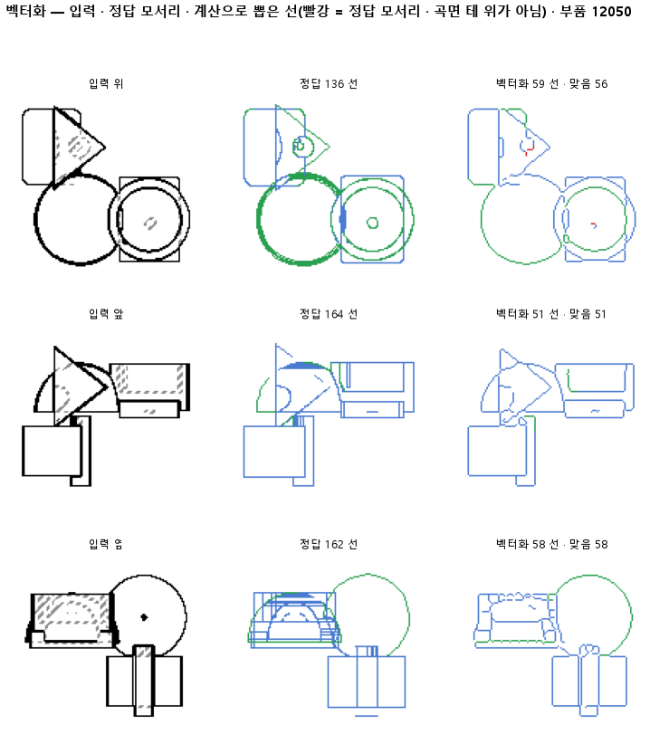

# 둥근 면의 윤곽선까지 정답에 넣고 다시 잰다

## 분석
<!-- 사람 칸: 하네스 분석 단계 초안(claude -p) · 고치면 다시 만들어도 남는다 -->
### 한 줄로

**물음**: 둥근 면의 윤곽선까지 정답에 넣고 다시 재면, 지금의 선 뽑기가 그 윤곽선을 찾고 종류까지 맞게 가를까?

**답**: 찾기는 한다. 윤곽선의 0.88을 찾았다. 하지만 찾은 윤곽선의 종류는 0.77만 맞아 목표 0.85에 못 미쳤다. 기준 넷 가운데 하나를 못 넘어 판정은 실패다.

### 왜 이 판을 했나

선 목록은 두 지도에서 뽑는다. **칠한 지도**는 판 137 모델이 화소마다 선 종류를 찍은 것이다. **정답 지도**는 부품 모양에서 바로 그린 것이다. 지금까지 정답 선은 CAD 모서리뿐이었다. 원통 옆면처럼 둥근 면이 앞쪽에서 뒤쪽으로 넘어가며 생기는 윤곽선은 정답에 없었다. 도면에는 이 선이 그려져 있다. 그래서 맞게 뽑은 윤곽선은 헛선으로 세거나 아예 세지 않았다. 143까지 세 판 연달아 정답 지도로 뽑아도 칠한 지도보다 나을 게 없었는데, 이 빈칸도 원인으로 의심했다.

### 바꾼 것 하나

**정답에 곡면 윤곽선을 더했다.** 입력과 선을 뽑는 계산은 143과 같다. 시험 부품 299개에서 윤곽선이 16,440개 나왔다.

### 결과

| | 이 판 (144) | 대조 (143) | 목표 | 넘었나 |
|---|---|---|---|---|
| 윤곽선 중 찾은 비율 | **0.88** | — | 0.80 | ✓ |
| 찾은 윤곽선의 종류가 맞음 | 0.77 | — | 0.85 | ✗ |
| 정답 선과 맞음 (F1) | 0.92 | 0.91 | 0.90 | ✓ |
| 정답 지도로 뽑았을 때 (F1) | 0.92 | 0.91 | 0.90 | ✓ |
| 정답 선 중 찾은 비율 | 0.85 | 0.84 | — | |
| 그린 선 중 맞은 비율 | 0.99 | 0.99 | — | |
| 선 종류 전체 | 0.85 | 0.87 | — | |
| 보이는 선의 종류 | 0.83 | 0.85 | — | |
| 한 선으로 뽑힌 모서리 | 0.76 | 0.75 | — | |

*143은 정답에 윤곽선이 없어서 윤곽선 칸을 잴 수 없다(—). 종류는 선이 직선인지 곡선인지 같은 모양 갈래이고, 보이는 선과 숨은선은 따로 센다. 「한 선으로」는 정답 모서리 하나가 토막 나지 않고 한 선으로 나온 비율이다. F1은 찾은 비율과 맞은 비율을 함께 본 점수로, 1이면 완벽하다.*

### 왜 이렇게 나왔나

**확인한 것**

- 종류가 틀리는 건 칠한 지도 탓이 아니다. 정답 지도로 뽑아도 윤곽선 종류는 0.73으로, 칠한 지도의 0.77보다 오히려 낮다. 문제는 뽑은 선에 종류를 붙이는 계산에 있다.
- 선 종류 전체가 0.87에서 0.85로 내려간 것은 새로 넣은 윤곽선 몫이다. 윤곽선 종류가 0.77이라 평균을 깎았다.
- 정답 선이 늘었는데도 찾은 비율은 0.84에서 0.85로 올랐다. 윤곽선 대부분이 이미 뽑히고 있었다는 뜻이다.

**짐작 (아직 확인 안 함)**

- 보이는 선의 종류가 0.85에서 0.83으로 내려간 것은 윤곽선이 보이는 선으로 세어지기 때문일 것 같다.
- 정답의 종류는 도면에 보이는 모양으로 정했다. 원통 옆면의 윤곽선은 곧게 보이고, 구의 윤곽선은 원으로 보인다. 계산이 이 둘을 곡면에서 나왔다는 이유로 한데 묶어 틀렸을 수 있다.
- 그린 선 중 맞은 비율이 0.99 그대로다. 전에 헛선으로 세던 윤곽선은 많지 않았던 것 같다.

### 한계

- 시험 부품 299개로, 한 번만 돌렸다.
- 정답 지도와 칠한 지도의 F1이 이번에도 둘 다 0.92다. 정답을 고쳐도 그대로라서, 네 판째 그 까닭을 모른다.
- 윤곽선 종류를 어떤 종류와 헷갈렸는지는 세지 않았다.

### 배운 것과 다음

선 뽑기는 둥근 면의 윤곽선을 이미 거의 찾고 있었다. **모자란 건 찾기가 아니라 종류를 붙이는 계산이다.** 정답 지도로 뽑아도 틀리니, 137 모델을 고쳐서 될 일이 아니다.

1. 종류가 틀린 윤곽선을 그림으로 모으고, 어떤 종류로 붙었는지 센다.
2. 윤곽선을 직선과 곡선으로 가르는 규칙이 맞는지 정답 지도에서 먼저 확인한다.
3. 정답 지도와 칠한 지도의 F1이 왜 같은지 부품별로 나눠 본다.

명제: 143 과 같은 입력 · 벡터화를, CAD 모서리에 곡면 테 윤곽선을 더한 정답으로 재면 윤곽선의 80 % 이상을 찾고 찾은 윤곽선의 종류(눈 기준)가 0.85 이상 맞으며, 전체 F1 은 0.90 을 지킨다. 같은 계산을 정답 선지도에 돌린 천장 F1 도 0.90 을 넘는다

| 가지 | 종류 | 바탕 | 바꾼 손잡이 | 에폭 | git | 날짜 |
|---|---|---|---|---|---|---|
| A4 | 탐색 | 127 (하네스/conf/바탕.yaml) | 벡터화.윤곽정답: None → True | 10 | `9baec8a` | 2026-10-24 13:55 |

## 1. 판정: **탐색 — 이김 판정 없음 · 기준 못 넘음**

| 지표 | 식 | 문턱 | 이 판 | 대조(143숨메움) | 통과 |
|---|---|---|---|---|---|
| 벡_재현_윤곽 | >= | 0.8 | 0.882 | — | ✓ |
| 벡_종류_윤곽 | >= | 0.85 | 0.765 | — | ✗ |
| 벡_F1 | >= | 0.9 | 0.917 | 0.913 | ✓ |
| 벡_F1_정답 | >= | 0.9 | 0.916 | — | ✓ |

## 2. 숫자 — 이 판 대 대조

| 지표 | 이 판 | 대조 |
|---|---|---|
| 벡_재현 | 0.850 | 0.844 |
| 벡_정밀 | 0.995 | — |
| 벡_F1 | 0.917 | 0.913 |
| 벡_종류 | 0.848 | 0.866 |
| 벡_조각 | 2.951 | — |
| 벡_한선 | 0.756 | — |
| 벡_끊김 | 0.013 | — |
| 벡_재현_보임 | 0.913 | — |
| 벡_종류_보임 | 0.828 | — |
| 벡_재현_숨 | 0.737 | — |
| 벡_끊김_숨 | 0.019 | — |
| 벡_재현_윤곽 | 0.882 | — |
| 벡_종류_윤곽 | 0.765 | — |
| 벡_윤곽수 | 16440 | — |
| 벡_재현_정답 | 0.847 | — |
| 벡_정밀_정답 | 0.997 | — |
| 벡_F1_정답 | 0.916 | — |
| 벡_종류_정답 | 0.830 | — |
| 벡_조각_정답 | 2.815 | — |
| 벡_한선_정답 | 0.769 | — |
| 벡_끊김_정답 | 0.011 | — |
| 벡_재현_보임_정답 | 0.909 | — |
| 벡_종류_보임_정답 | 0.816 | — |
| 벡_재현_숨_정답 | 0.736 | — |
| 벡_끊김_숨_정답 | 0.015 | — |
| 벡_재현_윤곽_정답 | 0.879 | — |
| 벡_종류_윤곽_정답 | 0.731 | — |
| 벡_윤곽수_정답 | 16440 | — |

## 모델 구조
(이 판은 구조를 안 잼)

## 3. 학습 곡선

| 에폭 | 학습 loss | 시험 loss | 맞음(CAD 덩어리 수 · 선지도 선 종류) |
|---|---|---|---|

## 4. 점검

### 4.1 연기 판
첫 loss — → 배치 하나 40 걸음 — · VRAM — GB

### 4.2 층보기 (시험 64 · 4 층)
칸끼리 닮음 — (1 = 6 칸 같음) · 빈 조각 주의 몫 — (빈 조각 비율 0.54) · 주의 엔트로피 — · 출력 자리 퍼짐 — (정답 0.148)

### 4.3 탐침 — 합성 그림 (블록 4 · 128)
구조 6 종 — · 곡률 R² — · (블록 3: — · —)

### 4.4 특징 — 실제 도면 (조각 라벨 · 하네스/특징.py)
(이 판은 특징 점검을 안 함)

## 쇼츠
편 105_판144윤곽정답 · 굽기 실패(코드 1): subprocess.CalledProcessError: Command '['G:/art2real/out/tts/chatterbox/Scripts/python.exe', 'G:\\art2real\\원화3d\\과정\\영상05\\tts\\굽기_chatterbox.py', 'G:/art2real/out/영상05/대화/105_판144윤곽정답/_cb일감.json']' · 업로드 대기

| 누구 | 말 |
|---|---|
| AI | 원통 옆 테두리 선, 오른쪽은 종류가 틀렸어요. |
| AI | 이 모델은 부품을 앞에서 본 도면을 받아요. |
| AI | 도면의 선을 하나씩 따서 CAD 설계도로 옮겨요. |
| AI | 여기 원통 옆 테두리는 모서리가 아니라 둥근 면 끝이에요. |
| 나 | 모델이 둥근 면 끝을 제대로 못 본 거네. |
| AI | 빨간 데 봐요. 테두리 선은 거의 다 찾았어요. |
| AI | 선을 찾은 뒤 종류는 모델이 아니라 계산이 붙여요. |
| 나 | 그럼 모델 말고, 부품 모양에서 바로 그린 선을 넣어 봐. |
| AI | 바로 그린 선을 넣어도 종류가 또 틀려요. |
| 나 | 모델이 아니라 종류 붙이는 계산 탓이었네. |
| AI | 테두리는 88 % 찾았어요. |
| AI | 찾은 것 중 종류는 77 %만 맞아요. 목표는 85 %예요. |
| AI | 목표에 못 미쳐서 이번엔 실패예요. |
| AI | 테두리 선까지 함께 세니 전체 종류 맞힘도 조금 내려갔어요. |

## 5. 해석
<!-- 사람 칸: 아래를 채운다 · 보고서를 다시 만들어도 남는다 -->
(비어 있음)

## 6. 다음 가지 (사람이 고름 · claudedocs/문제트리.md)
<!-- 사람 칸: 아래를 채운다 · 보고서를 다시 만들어도 남는다 -->
(비어 있음)

## 7. 재현
`python 하네스/하네스.py --config-name 판_144윤곽정답` · 설정 [설정.yaml](설정.yaml) · 판정 [판정.json](판정.json) · 산출 `G:/art2real/out/하네스/144윤곽정답/`

## 링크
- 쇼츠: 업로드 대기
- GitHub 이슈: https://github.com/sigongjoa/art2real/issues/16
