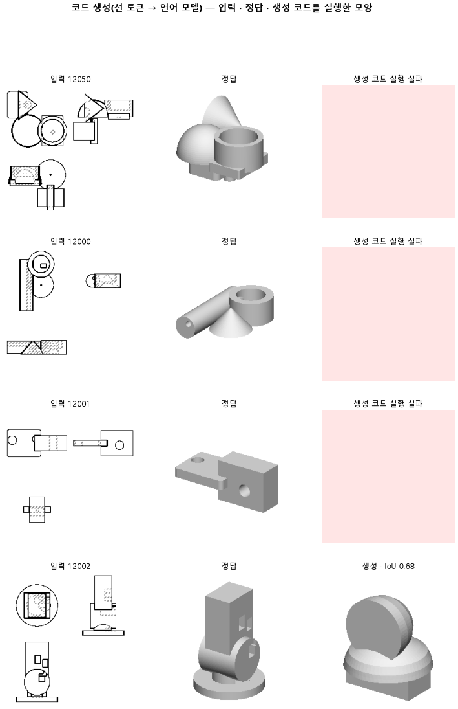
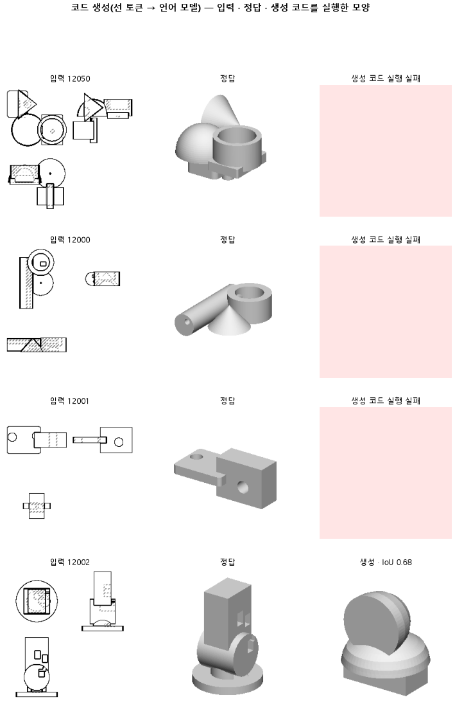

# 선 목록을 글로 주고 언어 모델이 CadQuery 코드를 쓰게 한다

## 분석
<!-- 사람 칸: 하네스 분석 단계 초안(claude -p) · 고치면 다시 만들어도 남는다 -->
### 한 줄로

**물음**: 도면에서 뽑은 선 목록을 글로 적어 언어 모델에게 주면, 실행되는 CAD 코드를 쓸 수 있을까?

**답**: 코드는 쓴다. 하지만 실행되는 코드가 절반이 안 된다(0.45). 그래서 모양 겹침의 중앙값이 0이다. 목표 둘 다 못 넘었고, 이 판은 실패다.

### 왜 이 판을 했나

우리 목표는 그림을 보고 CAD 코드를 뽑는 것이다. 지금 본 모델(127)은 코드를 쓰지 않는다. 부품을 작은 칸으로 이루어진 격자로 나누고, 칸마다 덩어리가 있는지 없는지를 채운다. 정말로 코드를 쓰게 하면 어떻게 되는지 이번에 처음 재 봤다.

### 바꾼 것 하나

할 일을 「칸 채우기」에서 **「코드 쓰기」**로 바꿨다. 먼저 부품마다 있는 도면 세 장(위 · 앞 · 옆, 128×128)에서 선을 뽑는다. 그다음 각 선이 어디 있고 무슨 종류인지를 글로 적는다. 모델에는 **그림은 넣지 않고 이 글만 준다.** 글을 받는 쪽은 코드를 쓰는 언어 모델(cadrille)이다. 이 모델이 CadQuery 코드를 쓴다. CadQuery는 파이썬으로 입체를 만드는 CAD 도구다. 학습은 모델 전체를 다시 가르치지 않고, 작은 덧댐(랭크 16)만 붙여서 했다. 3,000스텝을 돌렸고 학습률은 0.0001이다. 학습 부품은 12,000개, 시험 부품은 299개다.

### 결과

| | 이 판 (145) | 대조 (127) | 목표 | 넘었나 |
|---|---|---|---|---|
| 쓴 코드가 실행됨 | 0.45 | — | 0.90 이상 | ✗ |
| 실루엣 겹침 (중앙값) | 0.00 | 0.737 | 0.737 초과 | ✗ |
| 실루엣 겹침 (평균) | 0.24 | — | — | — |

*실루엣 겹침은 실행해서 나온 모양의 그림자가 정답 모양의 그림자와 얼마나 포개지는지 본 값이다. 1이면 똑같다. 127은 코드를 쓰지 않으므로 실행률이 없다.*

### 왜 이렇게 나왔나

**확인한 것**

- 학습은 제대로 됐다. 시험 손실이 250스텝에서 2.13, 끝에서 0.41로 내려갔다. 학습 손실 0.39와 거의 같으니, 학습 부품만 외운 것은 아니다.
- 1,500스텝부터는 거의 멈췄다. 남은 1,500스텝 동안 0.44에서 0.41로 0.03 내려갔을 뿐이다.
- 실행이 안 된 부품은 겹침을 0으로 셌다. 실행된 것이 절반이 안 되니 가운데 순서에 놓인 부품이 0이 된다. 실행된 것만 따로 보면 평균은 0.24 ÷ 0.45, 대략 0.53이다.

**짐작 (아직 확인 안 함)**

- 손실은 낮아도 코드 몇 글자만 틀리면 실행이 멈춘다. 글자를 맞히는 점수와 코드가 실행되는지는 따로 노는 것 같다.
- 실행이 실패한 이유는 문법 오류보다 CAD 연산 실패(면이 닫히지 않는 것 등)가 많을 것으로 본다.

### 한계

- 시험 부품 299개로 한 번만 돌렸다. 시드도 하나다.
- 127의 0.737을 같은 299개 부품에서 쟀는지가 기록에 없다. 부품 묶음이 다르면 두 판을 견준 것 자체가 흔들린다.
- 목표 0.90을 왜 그 값으로 정했는지는 기록에 없다. 열 개 중 아홉은 실행돼야 한다는 뜻인데, 이 판은 열 개 중 넷 반이다.
- 실행이 왜 실패했는지 종류별로 나눠 보지 않았다.

### 배운 것과 다음

언어 모델은 선 글을 보고 그럴듯한 코드를 쓴다. 하지만 **실행되지 않으면 모양이 0이 되니, 가장 먼저 막히는 곳은 실행률이다.** 손실이 내려가는 것만 보고 코드가 맞다고 판단할 수는 없다.

1. 실행이 안 된 코드를 모아 실패 종류(문법 · CAD 연산 · 시간 초과)를 센다.
2. 실행된 부품만 모아 겹침 중앙값을 다시 재고, 127을 같은 부품에서 다시 재서 견준다.
3. 도면 그림을 그대로 주는 판(146)과 실행률을 나란히 놓고 본다.

명제: 시험 부품 299 개에서 선 토큰을 글로 받은 cadrille 이 3000 스텝(학습 부품 한 바퀴쯤) LoRA 미세조정 뒤 쓴 CadQuery 코드는 90 % 이상 실행되고, 실행한 모양의 실루엣 IoU 중앙값이 판 127(덩어리 칸 디코더) 의 0.737 을 넘는다

| 가지 | 종류 | 바탕 | 바꾼 손잡이 | 에폭 | git | 날짜 |
|---|---|---|---|---|---|---|
| B1 | 탐색 | 127 (하네스/conf/바탕.yaml) | 학습.스텝: None → 3000, 코드.랭크: None → 16, 코드.입력: None → 선글, 학습.학습률: 0.0003 → 0.0001, 목표: CAD → 코드생성 | 10 | `cc898af` | 2026-10-24 22:06 |

## 1. 판정: **탐색 — 이김 판정 없음 · 기준 못 넘음**

| 지표 | 식 | 문턱 | 이 판 | 대조(127재현) | 통과 |
|---|---|---|---|---|---|
| 코드_실행률 | >= | 0.9 | 0.455 | — | ✗ |
| 코드_IoU | > | 0.737 | 0.000 | 0.737 | ✗ |

## 2. 숫자 — 이 판 대 대조

| 지표 | 이 판 | 대조 |
|---|---|---|
| 코드_실행률 | 0.455 | — |
| 코드_IoU | 0.000 | 0.737 |
| 코드_IoU평균 | 0.237 | — |
| 코드_학습loss | 0.395 | — |
| 코드_시험loss | 0.413 | — |
| 시험loss | 0.413 | — |
| 학습loss | 0.395 | — |

## 모델 구조
(이 판은 구조를 안 잼)

## 3. 학습 곡선

| 에폭 | 학습 loss | 시험 loss | 맞음(CAD 덩어리 수 · 선지도 선 종류) |
|---|---|---|---|
| 250 | 4.955 | 2.132 | 0.000 |
| 500 | 1.087 | 0.651 | 0.000 |
| 750 | 0.563 | 0.512 | 0.000 |
| 1000 | 0.489 | 0.491 | 0.000 |
| 1250 | 0.453 | 0.455 | 0.000 |
| 1500 | 0.446 | 0.443 | 0.000 |
| 1750 | 0.424 | 0.433 | 0.000 |
| 2000 | 0.416 | 0.429 | 0.000 |
| 2250 | 0.420 | 0.426 | 0.000 |
| 2500 | 0.409 | 0.416 | 0.000 |
| 2750 | 0.400 | 0.413 | 0.000 |
| 3000 | 0.395 | 0.413 | 0.000 |

## 4. 점검

### 4.1 연기 판
첫 loss — → 배치 하나 40 걸음 — · VRAM — GB

### 4.2 층보기 (시험 64 · 4 층)
칸끼리 닮음 — (1 = 6 칸 같음) · 빈 조각 주의 몫 — (빈 조각 비율 0.54) · 주의 엔트로피 — · 출력 자리 퍼짐 — (정답 0.148)

### 4.3 탐침 — 합성 그림 (블록 4 · 128)
구조 6 종 — · 곡률 R² — · (블록 3: — · —)

### 4.4 특징 — 실제 도면 (조각 라벨 · 하네스/특징.py)
(이 판은 특징 점검을 안 함)

## 쇼츠
편 107_판145선글코드 · 47.0 초 · 13 줄 · 서재용 업로드 대기

[쇼츠 영상](쇼츠.mp4)

| 누구 | 말 |
|---|---|
| AI | 이 도면대로 만들라고 했는데, 모양이 텅 비어 나왔어요. |
| AI | 모델은 도면을 보고 코드를 쓰도록 가르친 프로그램이에요. |
| AI | 그 코드를 실행하면 3D 부품이 만들어져요. |
| AI | 그림은 안 보여 주고, 선 위치만 글로 적어 줬어요. |
| 나 | 그림을 못 보니까 엉터리 코드를 쓴 거겠지. |
| AI | 부품마다 정답 코드가 있는데, 써 낸 코드가 그거랑 거의 같아요. |
| AI | 처음 보는 부품 도면에서도요. |
| 나 | 코드가 거의 같은데 모양이 비었다고? |
| 나 | 그럼 써 낸 코드를 하나씩 실행해 봐. |
| AI | 실행해 보니 중간에 멈추는 코드가 더 많아요. |
| AI | 멈춘 코드는 아무것도 못 만들어서 텅 빈 거예요. |
| 나 | 글자가 맞는 거랑 실행되는 건 다른 거였네. |
| AI | 100개 중 45개만 실행돼요. 이번엔 실패예요. |

## 5. 해석
<!-- 사람 칸: 아래를 채운다 · 보고서를 다시 만들어도 남는다 -->
(비어 있음)

## 6. 다음 가지 (사람이 고름 · claudedocs/문제트리.md)
<!-- 사람 칸: 아래를 채운다 · 보고서를 다시 만들어도 남는다 -->
(비어 있음)

## 7. 재현
`python 하네스/하네스.py --config-name 판_145선글코드` · 설정 [설정.yaml](설정.yaml) · 판정 [판정.json](판정.json) · 산출 `G:/art2real/out/하네스/145선글코드/`

## 링크
- 쇼츠: 서재용 업로드 대기
- GitHub 이슈: https://github.com/sigongjoa/art2real/issues/18
