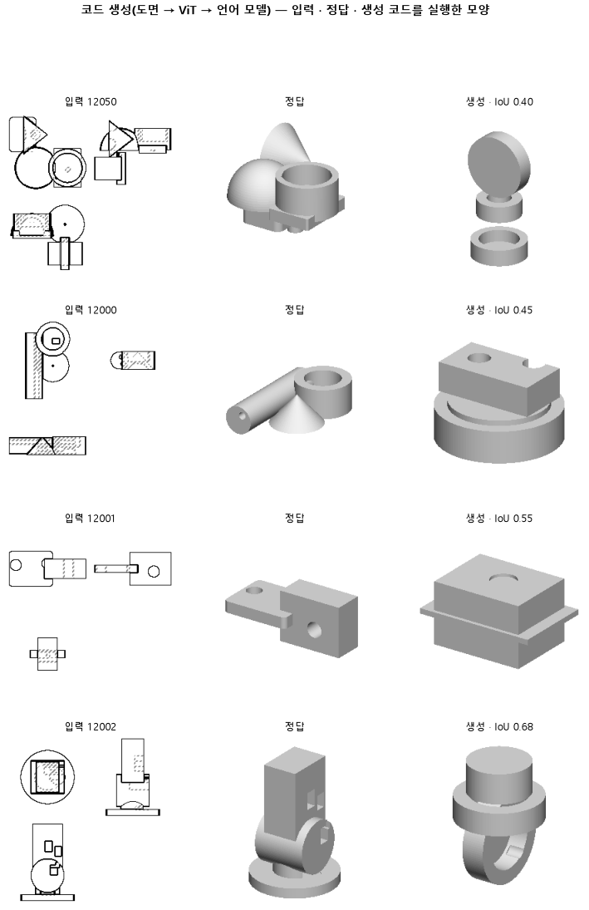

# 도면 그림을 그대로 주고 언어 모델이 CadQuery 코드를 쓰게 한다

## 분석
<!-- 사람 칸: 하네스 분석 단계 초안(claude -p) · 고치면 다시 만들어도 남는다 -->
### 한 줄로

**물음**: 3면도를 그대로 언어 모델에 보여 주면, 실행되는 CAD 코드를 써서 판 127보다 모양을 잘 맞출까?

**답**: 아니다. 코드는 열에 아홉 가까이 실행되지만(0.87) 목표 0.90에 못 미친다. 모양 겹침은 0.50으로 127의 0.74보다 한참 낮다. 기준 둘 다 못 넘어 실패다.

### 왜 이 판을 했나

우리 목표는 아무 그림이나 받아 CAD 코드로 바꾸는 것이다. 본 모델 127은 코드를 쓰지 않는다. 정해진 수의 칸마다 상자나 원통 같은 덩어리 하나와 그 치수, 자리를 내놓고, 이것을 조립해 모양을 만든다. 이번에는 CAD 코드를 쓸 줄 아는 언어 모델 cadrille에게 도면을 보여 주고 CadQuery 코드를 직접 쓰게 했다. 코드는 실행해서 검사할 수 있고, 덩어리 수에 제한도 없다.

### 바꾼 것 하나

과제를 「덩어리 칸 채우기」에서 「코드 쓰기」로 바꿨다. 입력은 부품마다 위·앞·옆 도면 세 장(128×128)이다. cadrille은 얼려 두고, 작은 덧붙임 행렬(LoRA)만 3,000스텝 학습했다. 학습 부품 12,000개를 한 바퀴쯤 도는 양이다. 시험 부품은 299개다.

### 결과

| | 이 판 (146) | 대조 (127) | 목표 | 넘었나 |
|---|---|---|---|---|
| 코드가 실행됨 | 0.87 | — | 0.90 이상 | ✗ |
| 실루엣 겹침 (중앙값) | 0.50 | 0.74 | 0.74 넘게 | ✗ |
| 실루엣 겹침 (평균) | 0.47 | — | — | — |

*겹침: 두 모양의 크기를 맞춘 뒤, 입력 세 장과 다른 비스듬한 방향 한 곳에서 본 실루엣이 겹친 넓이 ÷ 합친 넓이다. 실행에 실패한 부품은 0으로 쳐서 299개 전체에서 구했다.*

### 왜 이렇게 나왔나

**확인한 것**

- 손실(정답 코드와 얼마나 다르게 썼는지)은 2,000스텝 뒤로 거의 내려가지 않았다. 2,000스텝에서 0.40이었고, 3,000스텝에서도 0.40이었다.
- 외워서 생긴 문제는 아니다. 학습 손실 0.37과 시험 손실 0.40의 차이가 0.03이다.
- 평균(0.47)이 중앙값(0.50)보다 낮은 것은 실행 실패 13 %가 0점으로 들어가서다.
- 그림의 네 부품에서 틀린 것은 치수보다 구조다. 덩어리의 종류와 개수부터 다르다.

**짐작 (아직 확인 안 함)**

- 손실은 글자를 하나씩 맞히는 점수라서, 모양이 맞는지는 잘 보여 주지 않는 것 같다.
- cadrille은 음영을 넣어 렌더한 그림으로 배웠다. 선만 있는 작은 도면은 낯선 입력이라 원뿔이나 반구를 못 알아보는 것일 수 있다.

### 한계

- 시험 부품 299개로 한 번만 돌렸다.
- 0.74는 명제를 쓸 때 판 127에서 옮겨 온 값이다. 127 재현 기록에는 이 숫자가 없다. 같은 부품, 같은 채점으로 다시 잰 비교가 아니다.
- 0.90이라는 실행률 목표는 미리 정한 선일 뿐, 근거를 따로 재지는 않았다.
- 겹침은 학습이 끝난 뒤 한 번만 쟀다. 그래서 손실이 평평해진 뒤에도 모양이 나아졌는지는 모른다.

### 배운 것과 다음

언어 모델이 도면을 보고 실행되는 코드를 쓰는 것 자체는 된다. 하지만 정답과 다른 부품을 짓는다.

1. 중간 스텝마다 겹침을 재서, 더 학습하면 모양이 나아지는지 본다.
2. 실행에 실패한 코드를 오류 종류별로 나눈다.
3. 같은 과제를 선 글로 입력한 판 145와 견준다.

명제: 시험 부품 299 개에서 3면도 그림을 ViT 로 받은 cadrille 이 3000 스텝(학습 부품 한 바퀴쯤) LoRA 미세조정 뒤 쓴 CadQuery 코드는 90 % 이상 실행되고, 실행한 모양의 실루엣 IoU 중앙값이 판 127(덩어리 칸 디코더) 의 0.737 을 넘는다

| 가지 | 종류 | 바탕 | 바꾼 손잡이 | 에폭 | git | 날짜 |
|---|---|---|---|---|---|---|
| B1 | 탐색 | 127 (하네스/conf/바탕.yaml) | 학습.스텝: None → 3000, 목표: CAD → 코드생성, 학습.학습률: 0.0003 → 0.0001, 코드.랭크: None → 16, 코드.입력: None → 도면 | 10 | `4e772f9` | 2026-10-25 16:55 |

## 1. 판정: **탐색 — 이김 판정 없음 · 기준 못 넘음**

| 지표 | 식 | 문턱 | 이 판 | 대조(127재현) | 통과 |
|---|---|---|---|---|---|
| 코드_실행률 | >= | 0.9 | 0.890 | — | ✗ |
| 코드_IoU | > | 0.737 | 0.500 | 0.737 | ✗ |

## 2. 숫자 — 이 판 대 대조

| 지표 | 이 판 | 대조 |
|---|---|---|
| 코드_실행률 | 0.890 | — |
| 코드_IoU | 0.500 | 0.737 |
| 코드_IoU평균 | 0.468 | — |
| 코드_학습loss | 0.368 | — |
| 코드_시험loss | 0.397 | — |
| 시험loss | 0.397 | — |
| 학습loss | 0.368 | — |

## 모델 구조
(이 판은 구조를 안 잼)

## 3. 학습 곡선

| 에폭 | 학습 loss | 시험 loss | 맞음(CAD 덩어리 수 · 선지도 선 종류) |
|---|---|---|---|
| 250 | 5.095 | 2.324 | 0.000 |
| 500 | 1.183 | 0.651 | 0.000 |
| 750 | 0.558 | 0.509 | 0.000 |
| 1000 | 0.477 | 0.476 | 0.000 |
| 1250 | 0.442 | 0.449 | 0.000 |
| 1500 | 0.431 | 0.432 | 0.000 |
| 1750 | 0.410 | 0.422 | 0.000 |
| 2000 | 0.385 | 0.405 | 0.000 |
| 2250 | 0.379 | 0.402 | 0.000 |
| 2500 | 0.378 | 0.400 | 0.000 |
| 2750 | 0.373 | 0.397 | 0.000 |
| 3000 | 0.368 | 0.397 | 0.000 |

## 4. 점검

### 4.1 연기 판
첫 loss — → 배치 하나 40 걸음 — · VRAM — GB

### 4.2 층보기 (시험 64 · 4 층)
칸끼리 닮음 — (1 = 6 칸 같음) · 빈 조각 주의 몫 — (빈 조각 비율 0.54) · 주의 엔트로피 — · 출력 자리 퍼짐 — (정답 0.148)

### 4.3 탐침 — 합성 그림 (블록 4 · 128)
구조 6 종 — · 곡률 R² — · (블록 3: — · —)

### 4.4 특징 — 실제 도면 (조각 라벨 · 하네스/특징.py)
(이 판은 특징 점검을 안 함)

## 쇼츠
편 106_판146도면코드 · 63.4 초 · 14 줄 · 서재용 업로드 대기

[쇼츠 영상](쇼츠.mp4)

| 누구 | 말 |
|---|---|
| AI | 모델한테 부품을 만들게 했더니 정답이랑 다른 모양이 나왔어요. |
| AI | 왼쪽이 정답, 오른쪽이 모델이 만든 거예요. |
| AI | 정답을 앞에서 본 도면이에요. 위, 옆도 넣어요. |
| AI | 모델은 도면 보고 코드를 써요. 돌리면 입체가 나와요. |
| AI | 예전 모델은 코드 없이 정해진 조각만 골라 붙였어요. |
| 나 | 코드가 꼬여서 모양이 깨졌나 보네. |
| AI | 오른쪽은 오류 없이 돈 코드예요. 깨진 게 아니에요. |
| 나 | 정답이랑 오른쪽, 무슨 조각으로 됐는지 비교해 봐. |
| AI | 정답엔 원뿔, 반구, 옆으로 누운 원통이 있어요. |
| AI | 오른쪽엔 그런 조각이 없어요. 세운 원통이랑 상자만 쌓았어요. |
| 나 | 치수가 아니라 조각부터 틀렸네. |
| AI | 덩치는 비슷해서 정답과 반쯤은 겹쳐요. |
| AI | 다 겹치면 1인데, 이번엔 0.50, 예전 모델은 0.74예요. |
| AI | 코드로 짓게 한 건 실패예요. |

## 5. 해석
<!-- 사람 칸: 아래를 채운다 · 보고서를 다시 만들어도 남는다 -->
(비어 있음)

## 6. 다음 가지 (사람이 고름 · claudedocs/문제트리.md)
<!-- 사람 칸: 아래를 채운다 · 보고서를 다시 만들어도 남는다 -->
(비어 있음)

## 7. 재현
`python 하네스/하네스.py --config-name 판_146도면코드` · 설정 [설정.yaml](설정.yaml) · 판정 [판정.json](판정.json) · 산출 `G:/art2real/out/하네스/146도면코드/`

## 링크
- 쇼츠: 서재용 업로드 대기
- GitHub 이슈: https://github.com/sigongjoa/art2real/issues/17
