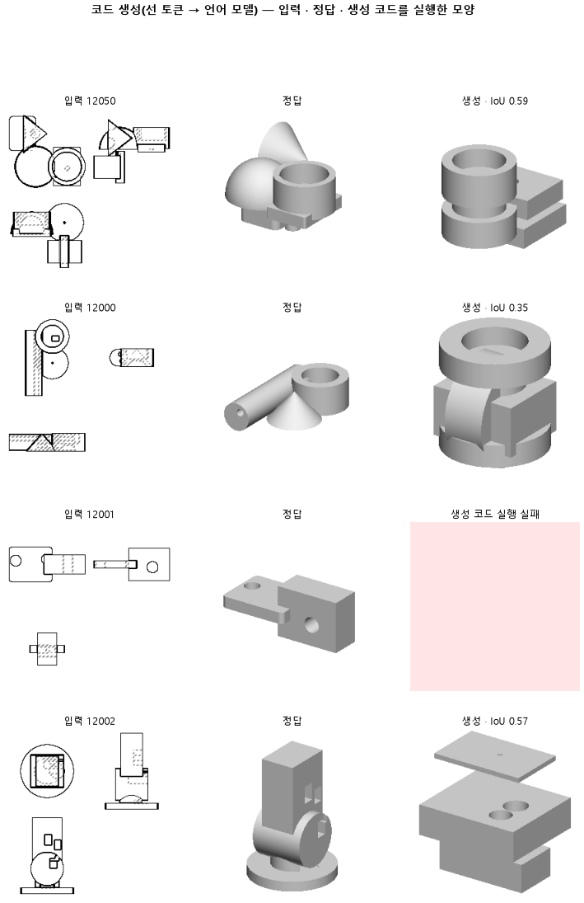

# 선 글의 좌표를 숫자 조각이 아니라 좌표 토큰 하나로 읽게 한다

## 분석
<!-- 사람 칸: 하네스 분석 단계 초안(claude -p) · 고치면 다시 만들어도 남는다 -->
### 한 줄로

**물음**: 도면에서 뽑은 선 목록을 글로 적어 언어 모델에 줄 때, 글 속 좌표를 숫자 조각 여러 개가 아니라 토큰 하나로 읽게 하면 실행되는 CAD 코드가 늘까?

**답**: 늘었다. 실행되는 코드는 절반이 안 되다가(0.48) 열에 여덟 반(0.85)이 됐다. 모양 겹침의 중앙값은 0에서 0.48로 올랐다. 목표 둘 다 넘어 판정은 통과다.

### 왜 이 판을 했나

앞 판(145)에서 언어 모델은 선 글을 보고 CadQuery 코드를 썼다. 하지만 코드의 절반 넘게가 실행되지 않았다. 실행이 안 된 부품은 겹침을 0으로 세므로, 중앙값이 0이었다.

글 속 좌표는 두세 자리 숫자다. 언어 모델은 이런 숫자를 몇 조각으로 쪼개 읽는다. 좌표 하나를 맞히려면 조각을 다 맞혀야 한다. 우리는 실행이 여기서 깨진다고 보았다.

### 바꾼 것 하나

입력 글에서 **좌표만** 바꿨다. 좌표 하나가 토큰 하나가 된다. 토큰은 언어 모델이 글을 읽는 낱말 단위다. 새 토큰을 어떻게 만들었는지는 판 기록에 없다. 좌표를 몇 칸으로 나눴는지, 범위가 어디까지인지, 새 토큰을 어떻게 배웠는지가 빠져 있다.

나머지는 145와 같다. 덧댐 학습을 같은 시드로 3,000스텝 했다. 덧댐 학습은 모델 본체를 얼려 두고 작은 무게 묶음(크기 16)만 새로 배우는 방식이다. 학습 부품은 12,000개, 시험 부품은 299개다.

### 결과

| | 이 판 (147) | 대조 (145) | 목표 | 넘었나 |
|---|---|---|---|---|
| 쓴 코드가 실행됨 | **0.85** | 0.48 | 0.70 이상 | ✓ |
| 실루엣 겹침 (중앙값) | **0.48** | 0.00 | 0.45 이상 | ✓ |
| 실루엣 겹침 (평균) | 0.44 | 0.25 | — | — |

*겹침은 실행해서 나온 모양의 그림자가 정답 모양의 그림자와 얼마나 포개지는지 본 값이다. 실행이 안 된 부품은 0으로 센다.*

### 왜 이렇게 나왔나

**확인한 것**

- 오른 몫은 실행률에서 왔다. 실행률이 0.48에서 0.85로 올라 실행된 부품이 절반을 넘었다. 그래서 가운데 순서의 부품이 더는 0이 아니다.
- 시험 손실은 1,500스텝 뒤로 평평해졌다. 거기서 끝까지 0.44에서 0.41로 내려갔을 뿐이다.

**짐작 (아직 확인 안 함)**

- 실행된 부품만 평균하면 이 판은 대략 0.52(0.44 ÷ 0.85), 145는 대략 0.53(0.25 ÷ 0.48)이다. 하지만 이 판은 85 %, 145는 48 %의 부품으로 낸 평균이라 서로 다른 묶음이다. 이 판에서 새로 실행된 부품이 더 어려운 것들이면 모양도 나아졌을 수 있다. 두 판 모두 실행된 부품끼리는 아직 견주지 않았다.
- 조각 하나만 어긋나도 좌표가 엉뚱해지고, 그러면 면이 안 닫혀 CAD 연산이 실패했을 것으로 본다. 실패 종류는 세지 않았다.

### 한계

- 시험 부품 299개로 한 번만 돌렸다. 시드도 하나다.
- 시험 손실 0.41 대 0.41은 견줄 수 없다. 좌표를 쪼개는 방식이 다르니 토큰 열 자체가 다르다.
- 좌표를 칸으로 나눴다면 145와 정밀도가 다르다. 그러면 두 판이 같은 정보를 받았다고 말할 수 없다.
- 145의 실행률이 명제에는 0.455, 대조 기록에는 0.48로 적혀 있다. 왜 다른지 모른다. 다만 0.02 차이라서, 0.37 벌어진 이번 판정은 바뀌지 않는다.
- 도면 그림을 그대로 준 146(실행 0.87 · 중앙값 0.50)보다 낮다. 두 판이 같은 조건이었는지는 기록에 없다.

### 배운 것과 다음

코드가 막히던 첫 자리는 실행률이었다. **좌표를 읽는 단위를 바꾸자 실행되는 코드가 크게 늘었다.** 모양까지 나아졌는지는 아직 모른다.

1. 두 판에서 모두 실행된 부품끼리 겹침을 다시 견준다.
2. 아직 실행이 안 되는 15 %를 모아 실패 종류(문법 · CAD 연산 · 시간 초과)를 센다.
3. 좌표 토큰을 만든 방법을 기록에 적고, 146과 같은 조건에서 나란히 놓고 본다.

명제: 145 와 같은 학습(3000 스텝 · LoRA r16 · 같은 시드)에서 입력 좌표만 토큰 하나씩으로 바꾸면, 시험 299 개에서 생성 코드 실행률이 0.70 이상이고 실행 실패를 0 으로 친 실루엣 IoU 중앙값이 0.45 이상이다(145 는 0.455 · 0.000 · 146 은 0.87 · 0.499)

| 가지 | 종류 | 바탕 | 바꾼 손잡이 | 에폭 | git | 날짜 |
|---|---|---|---|---|---|---|
| B1 | 비교 | 127 (하네스/conf/바탕.yaml) | 코드.토큰: None → 좌표 | 10 | `c87055c` | 2026-10-25 19:55 |

## 1. 판정: **통과**

| 지표 | 식 | 문턱 | 이 판 | 대조(145선글코드) | 통과 |
|---|---|---|---|---|---|
| 코드_실행률 | >= | 0.7 | 0.846 | 0.455 | ✓ |
| 코드_IoU | >= | 0.45 | 0.481 | 0.000 | ✓ |

## 2. 숫자 — 이 판 대 대조

| 지표 | 이 판 | 대조 |
|---|---|---|
| 코드_실행률 | 0.846 | 0.455 |
| 코드_IoU | 0.481 | 0.000 |
| 코드_IoU평균 | 0.438 | — |
| 코드_학습loss | 0.384 | — |
| 코드_시험loss | 0.409 | — |
| 시험loss | 0.409 | — |
| 학습loss | 0.384 | — |

## 모델 구조
(이 판은 구조를 안 잼)

## 3. 학습 곡선

| 에폭 | 학습 loss | 시험 loss | 맞음(CAD 덩어리 수 · 선지도 선 종류) |
|---|---|---|---|
| 250 | 5.190 | 2.208 | 0.000 |
| 500 | 1.125 | 0.648 | 0.000 |
| 750 | 0.557 | 0.511 | 0.000 |
| 1000 | 0.479 | 0.480 | 0.000 |
| 1250 | 0.442 | 0.457 | 0.000 |
| 1500 | 0.434 | 0.440 | 0.000 |
| 1750 | 0.412 | 0.428 | 0.000 |
| 2000 | 0.404 | 0.422 | 0.000 |
| 2250 | 0.405 | 0.420 | 0.000 |
| 2500 | 0.396 | 0.412 | 0.000 |
| 2750 | 0.389 | 0.410 | 0.000 |
| 3000 | 0.384 | 0.409 | 0.000 |

## 4. 점검

### 4.1 연기 판
첫 loss — → 배치 하나 40 걸음 — · VRAM — GB

### 4.2 층보기 (시험 64 · 4 층)
칸끼리 닮음 — (1 = 6 칸 같음) · 빈 조각 주의 몫 — (빈 조각 비율 0.54) · 주의 엔트로피 — · 출력 자리 퍼짐 — (정답 0.148)

### 4.3 탐침 — 합성 그림 (블록 4 · 128)
구조 6 종 — · 곡률 R² — · (블록 3: — · —)

### 4.4 특징 — 실제 도면 (조각 라벨 · 하네스/특징.py)
(이 판은 특징 점검을 안 함)

## 쇼츠
편 108_판147좌표토큰 · 58.7 초 · 14 줄 · 서재용 업로드 대기

[쇼츠 영상](쇼츠.mp4)

| 누구 | 말 |
|---|---|
| AI | 오른쪽이 모델이 만든 건데, 거의 다 비었어요. |
| AI | 왼쪽은 정답이에요. 모델이 이 모양을 만들어야 해요. |
| AI | 모델한테 이 도면 선들의 좌표를 숫자로 적어 줬어요. |
| AI | 모델은 그걸 읽고 모양을 만드는 CAD 코드를 써요. |
| 나 | 이런 도면을 잔뜩 보여 주면서 가르쳤잖아. |
| 나 | 아직 도면을 못 알아보네. 학습이 모자란 거야. |
| AI | 코드는 써 냈어요. 그런데 돌리면 멈춰서 비어요. |
| AI | 모델은 원래 숫자 하나를 몇 조각으로 쪼개 읽어요. |
| AI | 한 조각만 틀려도 선이 어긋나, 면이 안 닫혀 멈출 수 있어요. |
| 나 | 좌표 하나를 한 덩어리로 읽게, 읽는 법만 바꿔 봐. |
| AI | 비어 있던 오른쪽에 모양이 생겼어요. |
| AI | 끝까지 돌아가는 코드가 48%에서 85%로 늘었어요. |
| 나 | 도면이 아니라 숫자 읽기에서 막혔던 거네. |
| AI | 늘어난 건 모양이 나온 수예요. 더 닮았는지는 아직 안 쟀어요. |

## 5. 해석
<!-- 사람 칸: 아래를 채운다 · 보고서를 다시 만들어도 남는다 -->
(비어 있음)

## 6. 다음 가지 (사람이 고름 · claudedocs/문제트리.md)
<!-- 사람 칸: 아래를 채운다 · 보고서를 다시 만들어도 남는다 -->
(비어 있음)

## 7. 재현
`python 하네스/하네스.py --config-name 판_147좌표토큰` · 설정 [설정.yaml](설정.yaml) · 판정 [판정.json](판정.json) · 산출 `G:/art2real/out/하네스/147좌표토큰/`

## 링크
- 쇼츠: 서재용 업로드 대기
- GitHub 이슈: https://github.com/sigongjoa/art2real/issues/19
