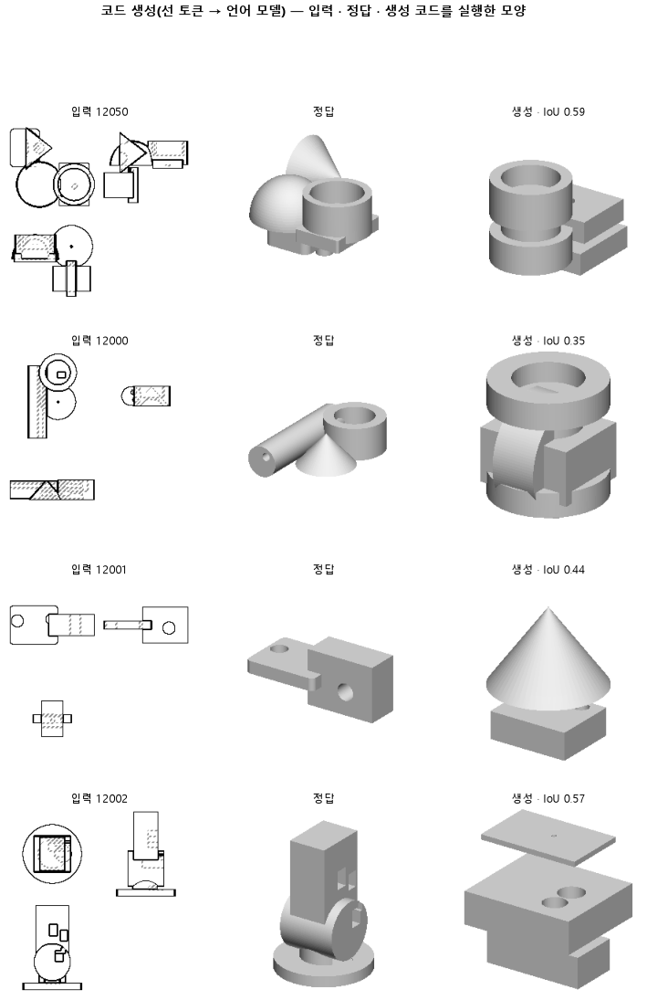

# 코드를 쓰는 중에 문법상 안 되는 다음 토큰을 막아 실행되는 코드만 나오게 한다

## 분석
<!-- 사람 칸: 하네스 분석 단계 초안(claude -p) · 고치면 다시 만들어도 남는다 -->
### 한 줄로

**물음**: 이미 학습한 모델은 그대로 두고, 코드를 쓰는 도중에 문법에 어긋나는 다음 낱말만 막으면, 쓴 코드가 거의 다 실행될까?

**답**: 실행되는 코드는 늘었다(0.85 → 0.91). 하지만 목표 0.95에는 못 미쳤다. 이 판에서 실제로 시험한 목표는 실행률 하나였고, 그것을 넘지 못해 판정은 실패다.

### 왜 이 판을 했나

147 판에서는 좌표를 읽는 단위를 바꿨다. 숫자 하나가 토큰 여러 개로 쪼개지던 것을 토큰 하나로 묶었다. 토큰은 언어 모델이 글을 읽고 쓰는 낱말 단위다. 그러자 실행되는 코드가 0.48에서 0.85로 늘었다. 그래도 일곱에 하나꼴로 코드가 실행되지 않았다. 실행이 안 된 부품은 겹침을 0으로 세므로 점수가 깎인다.

괄호 짝이 틀리거나 만들지 않은 입체를 부르는 실수는 학습 없이도 막을 수 있다. 맞는 꼴을 문법이 이미 알기 때문이다. 그래서 이런 실수를 코드를 만드는 단계에서 막아 보기로 했다.

### 바꾼 것 하나

**코드를 만드는 방식만** 바꿨다. 모델이 다음 토큰을 고를 때 CadQuery 문법상 올 수 없는 토큰은 고르지 못하게 했다. 코드 속 입체 덩어리는 b1, b2처럼 이름 붙은 변수다. 규칙은 학습 정답 코드에 나온 꼴만 허용하도록 정했다.

- 괄호 짝을 맞춘다.
- 앞에서 만든 입체 변수만 부를 수 있다.
- `cq.`로 시작하는 이름은 정답에 나온 2개만, 메서드는 16개만 쓴다.
- `.add(` 뒤에는 원뿔 만들기만 올 수 있다.
- 괄호가 열린 채 줄이 끝나려 하면 괄호를 닫고 줄을 바꾼다.

덧댐 학습(LoRA)은 147이 배운 것을 그대로 썼다. 덧댐 학습은 모델 본체를 얼려 두고 작은 무게 묶음만 새로 배우는 방식이다. 그래서 손실도 147과 같다(0.38 · 0.41). 시험 부품도 같은 299개다.

### 결과

| | 이 판 (149) | 대조 (147) | 목표 | 넘었나 |
|---|---|---|---|---|
| 쓴 코드가 실행됨 | **0.91** | 0.85 | 0.95 이상 | ✗ |
| 실행된 것만의 겹침 (중앙값) | 0.51 | 0.51 | 0.49 이상 | ✓ |
| 겹침 중앙값 (실행 안 됨 = 0) | 0.50 | 0.48 | — | — |
| 겹침 평균 | 0.48 | 0.44 | — | — |

*겹침은 실행해서 나온 모양이 정답 모양과 얼마나 포개지는지 본 값이다. 1이면 완벽하다. 두 번째 목표는 모양이 무너지지 않는지만 본 것이다. 147이 이미 0.51이라 처음부터 넘기 쉬웠다.*

### 왜 이렇게 나왔나

**확인한 것**

- 오른 몫은 실행률에서 왔다. 299개 중 약 20개가 새로 실행됐다(0.85 → 0.91). 실행된 것만의 겹침은 0.51 그대로라서, 전체 중앙값과 평균이 조금씩 올랐다.

**짐작 (아직 확인 안 함)**

- 남은 약 9 %(26개쯤)는 문법은 맞는데 CAD 연산에서 실패했을 것으로 본다. 크기가 0인 원뿔이나, 서로 닿지 않는 입체끼리 합치는 경우가 그렇다. 이번 제약은 숫자 값을 보지 않는다. 실패 종류는 세지 않았다.
- 괄호를 억지로 닫은 줄은 실행은 되지만, 원래 쓰려던 것보다 짧은 모양이 됐을 수 있다.

### 한계

- 시험 부품 299개로, 시드 하나로 한 번만 돌렸다.
- 147의 실행된 것만의 겹침(0.51)은 미리 적어 둔 예측 문장에만 있고, 대조 기록에는 없다.
- 판 기록에는 에폭 10이라 적혀 있는데, 학습 곡선은 3,000스텝까지 있다. 왜 다른지는 아직 모른다.
- 문법을 일부만 막았으니 실행률 1.0은 처음부터 보장되지 않았다. 0.95를 무엇에 근거해 정했는지도 기록에 없다.

### 배운 것과 다음

문법으로 막을 수 있는 실패는 막혔다. **남은 실패는 문법 밖에 있다.** 모양 점수는 제자리라서, 실행률만 올려서는 겹침이 크게 오르지 않는다.

1. 아직 실행이 안 되는 약 26개를 모아 실패 종류(CAD 연산 · 억지로 닫은 괄호)를 센다.
2. 숫자가 들어가는 칸에 범위 제약을 줄지는 1번 결과를 보고 정한다.

명제: 147 이 학습한 LoRA 를 그대로 두고 생성만 CadQuery 부분 문법 제약(괄호 짝 · 정의된 bN 만 · 학습 정답에 나온 cq 경로 2 개 · 메서드 16 개 · .add( 뒤는 cq.Solid.makeCone( 만 · 괄호가 열린 채 줄을 끝내려 하면 닫고 줄 바꿈)으로 바꾸면, 시험 299 개 실행률이 0.95 이상이 되고 실행된 것만의 IoU 중앙값은 0.49 이상으로 유지된다(147 은 0.846 · 0.510)

| 가지 | 종류 | 바탕 | 바꾼 손잡이 | 에폭 | git | 날짜 |
|---|---|---|---|---|---|---|
| B1 | 비교 | 127 (하네스/conf/바탕.yaml) | 코드.디코딩: None → 제약 | 10 | `08c5b7f` | 2026-10-25 22:03 |

## 1. 판정: **실패**

| 지표 | 식 | 문턱 | 이 판 | 대조(147좌표토큰) | 통과 |
|---|---|---|---|---|---|
| 코드_실행률 | >= | 0.95 | 0.913 | 0.846 | ✗ |
| 코드_IoU실행 | >= | 0.49 | 0.512 | 0.510 | ✓ |

## 2. 숫자 — 이 판 대 대조

| 지표 | 이 판 | 대조 |
|---|---|---|
| 코드_실행률 | 0.913 | 0.846 |
| 코드_IoU | 0.496 | 0.481 |
| 코드_IoU평균 | 0.476 | — |
| 코드_IoU실행 | 0.512 | 0.510 |
| 코드_OOM | 0.000 | — |
| 코드_정답실패 | 0.000 | — |
| 코드_학습loss | 0.384 | — |
| 코드_시험loss | 0.409 | — |
| 시험loss | 0.409 | — |
| 학습loss | 0.384 | — |

## 모델 구조
(이 판은 구조를 안 잼)

## 3. 학습 곡선

| 에폭 | 학습 loss | 시험 loss | 맞음(CAD 덩어리 수 · 선지도 선 종류) |
|---|---|---|---|
| 250 | 5.190 | 2.208 | 0.000 |
| 500 | 1.125 | 0.648 | 0.000 |
| 750 | 0.557 | 0.511 | 0.000 |
| 1000 | 0.479 | 0.480 | 0.000 |
| 1250 | 0.442 | 0.457 | 0.000 |
| 1500 | 0.434 | 0.440 | 0.000 |
| 1750 | 0.412 | 0.428 | 0.000 |
| 2000 | 0.404 | 0.422 | 0.000 |
| 2250 | 0.405 | 0.420 | 0.000 |
| 2500 | 0.396 | 0.412 | 0.000 |
| 2750 | 0.389 | 0.410 | 0.000 |
| 3000 | 0.384 | 0.409 | 0.000 |

## 4. 점검

### 4.1 연기 판
첫 loss — → 배치 하나 40 걸음 — · VRAM — GB

### 4.2 층보기 (시험 64 · 4 층)
칸끼리 닮음 — (1 = 6 칸 같음) · 빈 조각 주의 몫 — (빈 조각 비율 0.54) · 주의 엔트로피 — · 출력 자리 퍼짐 — (정답 0.148)

### 4.3 탐침 — 합성 그림 (블록 4 · 128)
구조 6 종 — · 곡률 R² — · (블록 3: — · —)

### 4.4 특징 — 실제 도면 (조각 라벨 · 하네스/특징.py)
(이 판은 특징 점검을 안 함)

## 쇼츠
편 110_판149문법제약 · 47.4 초 · 13 줄 · 서재용 업로드 대기

[쇼츠 영상](쇼츠.mp4)

| 누구 | 말 |
|---|---|
| AI | 왼쪽이 정답인데, 오른쪽은 코드가 멈춰서 텅 비었어요. |
| AI | 이 도면을 주면 모양을 만드는 코드를 짜는 모델이에요. |
| AI | 그 코드를 돌려서 나온 모양이 오른쪽이에요. |
| 나 | 코드를 덜 배운 거네. 더 가르쳐야겠다. |
| AI | 멈춘 코드들을 보니 괄호 짝이 안 맞았어요. |
| AI | 만들지도 않은 부품 이름을 쓴 것도 있어요. |
| AI | 이런 실수는 배울 일이 아니에요. 규칙만 지키면 막혀요. |
| 나 | 배울 게 아니라 규칙 실수였네. |
| AI | 모델은 코드를 앞에서부터 한 조각씩 이어 써요. |
| 나 | 쓰는 중에 규칙에 어긋나는 조각은 못 쓰게 해 봐. |
| AI | 돌아간 코드가 85 %에서 91 %로 늘었어요. |
| AI | 그런데 오른쪽 모양이 왼쪽 정답과 닮은 정도는 그대로예요. |
| 나 | 돌아가도 모양이 틀린 건 규칙 탓이 아니었네. |

## 5. 해석
<!-- 사람 칸: 아래를 채운다 · 보고서를 다시 만들어도 남는다 -->
(비어 있음)

## 6. 다음 가지 (사람이 고름 · claudedocs/문제트리.md)
<!-- 사람 칸: 아래를 채운다 · 보고서를 다시 만들어도 남는다 -->
(비어 있음)

## 7. 재현
`python 하네스/하네스.py --config-name 판_149문법제약` · 설정 [설정.yaml](설정.yaml) · 판정 [판정.json](판정.json) · 산출 `G:/art2real/out/하네스/149문법제약/`

## 링크
- 쇼츠: 서재용 업로드 대기
- GitHub 이슈: https://github.com/sigongjoa/art2real/issues/21
