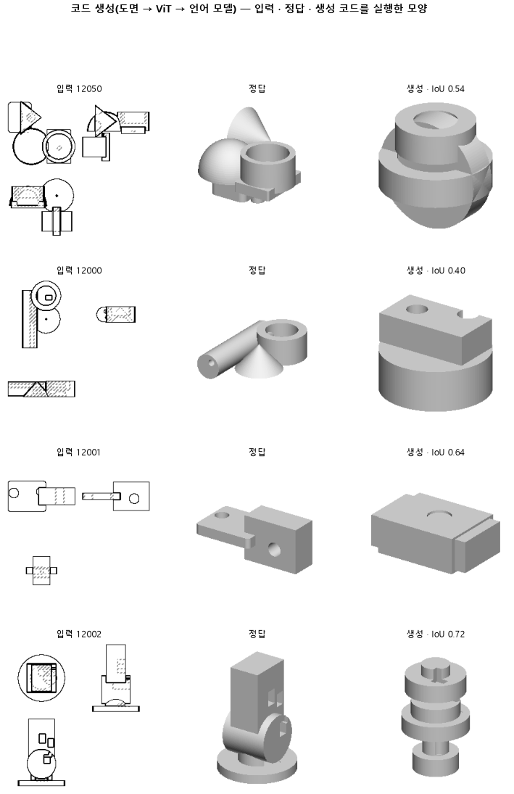

# 코드를 쓰는 중에 문법상 안 되는 다음 토큰을 막아 실행되는 코드만 나오게 한다

## 분석
<!-- 사람 칸: 하네스 분석 단계 초안(claude -p) · 고치면 다시 만들어도 남는다 -->
### 한 줄로

**물음**: 학습은 그대로 두고, 코드를 쓰는 순간에 문법을 깨는 다음 조각만 막으면 코드가 95 % 넘게 실행될까?

**답**: 실행률은 0.89에서 0.94로 올랐지만 0.95에는 못 미쳤다. 실행된 코드의 모양 점수는 0.52로 지켰다. 기준 둘 중 하나를 못 넘어 실패다.

### 왜 이 판을 했나

판 146에서는 언어 모델이 도면 세 장을 보고 CadQuery 코드를 썼다. 그런데 열에 하나꼴로 코드가 실행되지 않았고, 실행 안 된 부품은 0점이 됐다. 괄호를 안 닫았거나 없는 이름을 불러서 생긴 실수라면 다시 학습할 필요가 없다. 코드를 쓰는 단계에서 막으면 된다고 봤다.

### 바꾼 것 하나

146이 학습한 작은 덧붙임 행렬(LoRA)은 그대로 쓰고, 코드를 내놓는 방식만 바꿨다. 모델은 코드를 조각(토큰) 하나씩 쓴다. 이번에는 조각을 하나 쓸 때마다 문법 검사를 걸었다.

막는 규칙은 이렇다. 괄호 짝을 깨는 조각은 막는다. 코드에서 덩어리 하나는 b1, b2… 같은 이름에 담기는데, 앞에서 만든 이름만 부를 수 있다. CadQuery에서 꺼내 쓰는 이름은 학습 정답에 나온 것만 허용한다. 코드 첫머리에 오는 이름 2개와 메서드 16개다. 규칙 하나는 막는 대신 끼워 넣는다. 괄호가 열린 채 줄을 끝내려 하면 닫는 괄호를 넣고 줄을 바꾼다. 시험 부품 299개는 146과 같다.

### 결과

| | 이 판 (150) | 대조 (146) | 목표 | 넘었나 |
|---|---|---|---|---|
| 코드가 실행됨 | **0.94** | 0.89 | 0.95 이상 | ✗ |
| 실행된 것만 모양 점수 (중앙값) | 0.52 | 0.52 | 0.50 이상 | ✓ |
| 전체 모양 점수 (중앙값, 실패는 0점) | 0.51 | 0.50 | — | — |
| 전체 모양 점수 (평균) | 0.49 | 0.47 | — | — |

*모양 점수: 두 모양의 크기를 맞춘 뒤, 입력 세 방향과 비스듬한 한 방향에서 본 실루엣이 겹친 넓이 ÷ 합친 넓이다. 1이면 똑같다. 목표 0.50은 146의 0.52를 크게 잃지 않는 선으로 잡았다.*

### 왜 이렇게 나왔나

**확인한 것**

- 모델은 146과 같다. 학습 손실 0.37, 시험 손실 0.40이 두 판에서 똑같다.
- 실행에 실패한 비율이 0.11에서 0.06으로 줄었다. 0점이 빠진 만큼 전체 평균이 0.47에서 0.49로 올랐다.
- 실행된 코드만 본 모양 점수는 0.52로 146과 같다. 실행되느냐만 바뀌었고 모양은 그대로다.

**짐작 (아직 확인 안 함)**

- 남은 실패는 문법으로는 못 잡는 오류일 것 같다. 문법이 맞아도 치수가 0이면 실행되지 않는다. 덩어리를 합치다 CAD 엔진이 멈추는 경우도 이 검사로는 못 막는다.
- 새로 살아난 코드도 평균 정도의 모양을 지어서 점수가 그대로인 것으로 본다.
- 146 그림에서는 덩어리의 종류와 개수부터 틀렸다. 이번에도 그게 원인일 것 같지만, 이 판에서는 세어 보지 않았다.

### 한계

- 시험 부품 299개로 한 번만 돌렸다.
- 0.94와 0.95의 차이는 부품 네 개쯤이다. 아깝게 졌지만 실패는 실패다.
- 146 분석 글에는 실행률이 0.87로 적혀 있지만, 146 기록 값은 0.89다. 이 글은 같은 시험 부품에서 잰 기록 값으로 견줬다. 분석 글이 왜 다른 값을 적었는지는 확인하지 않았다. 0.87이 맞다면 오른 폭은 더 크다.

### 배운 것과 다음

문법 제약을 걸면 다시 학습하지 않아도 실행률이 오르고, 모양 점수도 잃지 않는다. 하지만 모양은 고치지 못한다. 점수가 낮은 주된 이유는 실행 실패가 아니었다. **실행된 코드부터 정답과 다른 모양을 짓는다.**

1. 남은 실패 코드를 오류 종류별로 나눠, 문법 밖 오류인지 확인한다.
2. 실행된 코드의 덩어리 개수를 정답과 견줘 센다.
3. 문법 제약은 켜 둔 채, 덩어리 개수와 배치를 먼저 쓰게 하는 판 151로 넘어간다.

명제: 146(도면 → ViT)이 학습한 LoRA 를 그대로 두고 생성만 CadQuery 부분 문법 제약(괄호 짝 · 정의된 bN 만 · 학습 정답에 나온 cq 경로 2 개 · 메서드 16 개 · .add( 뒤는 cq.Solid.makeCone( 만 · 괄호가 열린 채 줄을 끝내려 하면 닫고 줄 바꿈)으로 바꾸면, 시험 299 개 실행률이 0.95 이상이 되고 실행된 것만의 IoU 중앙값은 0.50 이상으로 유지된다(146 은 0.890 · 0.518)

| 가지 | 종류 | 바탕 | 바꾼 손잡이 | 에폭 | git | 날짜 |
|---|---|---|---|---|---|---|
| B1 | 비교 | 127 (하네스/conf/바탕.yaml) | 코드.디코딩: None → 제약 | 10 | `08c5b7f` | 2026-10-25 21:45 |

## 1. 판정: **실패**

| 지표 | 식 | 문턱 | 이 판 | 대조(146도면코드) | 통과 |
|---|---|---|---|---|---|
| 코드_실행률 | >= | 0.95 | 0.940 | 0.890 | ✗ |
| 코드_IoU실행 | >= | 0.5 | 0.517 | 0.518 | ✓ |

## 2. 숫자 — 이 판 대 대조

| 지표 | 이 판 | 대조 |
|---|---|---|
| 코드_실행률 | 0.940 | 0.890 |
| 코드_IoU | 0.509 | 0.500 |
| 코드_IoU평균 | 0.492 | — |
| 코드_IoU실행 | 0.517 | 0.518 |
| 코드_OOM | 0.000 | — |
| 코드_정답실패 | 0.000 | — |
| 코드_학습loss | 0.368 | — |
| 코드_시험loss | 0.397 | — |
| 시험loss | 0.397 | — |
| 학습loss | 0.368 | — |

## 모델 구조
(이 판은 구조를 안 잼)

## 3. 학습 곡선

| 에폭 | 학습 loss | 시험 loss | 맞음(CAD 덩어리 수 · 선지도 선 종류) |
|---|---|---|---|
| 250 | 5.095 | 2.324 | 0.000 |
| 500 | 1.183 | 0.651 | 0.000 |
| 750 | 0.558 | 0.509 | 0.000 |
| 1000 | 0.477 | 0.476 | 0.000 |
| 1250 | 0.442 | 0.449 | 0.000 |
| 1500 | 0.431 | 0.432 | 0.000 |
| 1750 | 0.410 | 0.422 | 0.000 |
| 2000 | 0.385 | 0.405 | 0.000 |
| 2250 | 0.379 | 0.402 | 0.000 |
| 2500 | 0.378 | 0.400 | 0.000 |
| 2750 | 0.373 | 0.397 | 0.000 |
| 3000 | 0.368 | 0.397 | 0.000 |

## 4. 점검

### 4.1 연기 판
첫 loss — → 배치 하나 40 걸음 — · VRAM — GB

### 4.2 층보기 (시험 64 · 4 층)
칸끼리 닮음 — (1 = 6 칸 같음) · 빈 조각 주의 몫 — (빈 조각 비율 0.54) · 주의 엔트로피 — · 출력 자리 퍼짐 — (정답 0.148)

### 4.3 탐침 — 합성 그림 (블록 4 · 128)
구조 6 종 — · 곡률 R² — · (블록 3: — · —)

### 4.4 특징 — 실제 도면 (조각 라벨 · 하네스/특징.py)
(이 판은 특징 점검을 안 함)

## 쇼츠
편 109_판150문법제약도면 · 67.2 초 · 16 줄 · 서재용 업로드 대기

[쇼츠 영상](쇼츠.mp4)

| 누구 | 말 |
|---|---|
| AI | 오른쪽이 텅 비었어요. 모델이 지었어야 할 자리예요. |
| AI | 모델은 이 도면을 보고 CAD 코드를 써요. |
| AI | 그 코드를 돌리면 3D 모양이 나와요. |
| AI | 왼쪽이 정답 모양, 오른쪽이 코드로 지은 모양이에요. |
| AI | 대부분은 잘 도는데, 가끔 코드가 안 돌아서 이렇게 비어요. |
| 나 | 쓰다가 괄호를 안 닫았거나 오타가 났겠지. |
| 나 | 그것만 막으면 오른쪽도 정답처럼 나오겠네. |
| 나 | 코드를 쓰는 동안 괄호 짝이 깨지면 막고 다시 돌려. |
| AI | 한 글자씩 쓸 때마다 괄호 짝과 이름을 검사했어요. |
| AI | 비어 있던 오른쪽에 이제 모양이 나와요. |
| AI | 그런데 왼쪽 정답이랑 나란히 보세요. |
| AI | 여기 덩어리가 붙는 자리가 정답이랑 달라요. |
| AI | 원래부터 잘 돌던 코드도 정답과 다른 모양이었어요. |
| AI | 도는 비율 0.89→0.94, 모양 점수는 0.52 그대로예요. |
| 나 | 모양이 틀린 건 괄호 탓이 아니었네. |
| AI | 이번엔 실패예요. 돌게는 했는데 모양은 못 고쳤어요. |

## 5. 해석
<!-- 사람 칸: 아래를 채운다 · 보고서를 다시 만들어도 남는다 -->
(비어 있음)

## 6. 다음 가지 (사람이 고름 · claudedocs/문제트리.md)
<!-- 사람 칸: 아래를 채운다 · 보고서를 다시 만들어도 남는다 -->
(비어 있음)

## 7. 재현
`python 하네스/하네스.py --config-name 판_150문법제약도면` · 설정 [설정.yaml](설정.yaml) · 판정 [판정.json](판정.json) · 산출 `G:/art2real/out/하네스/150문법제약도면/`

## 링크
- 쇼츠: 서재용 업로드 대기
- GitHub 이슈: https://github.com/sigongjoa/art2real/issues/20
