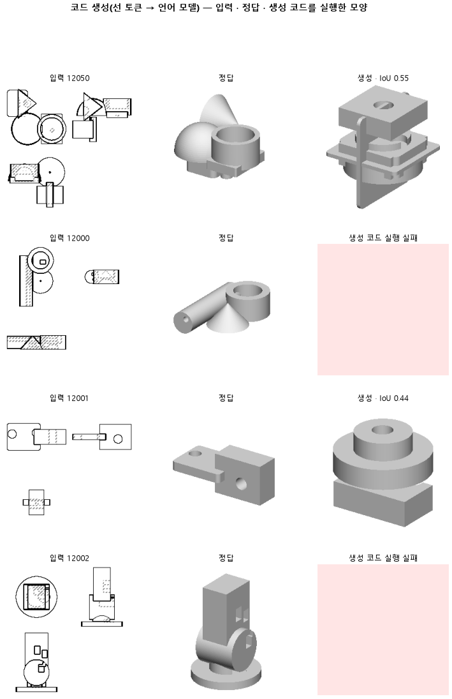

# 코드의 첫 줄에 몸 개수와 배치를 먼저 쓰게 해서 몸을 쌓기만 하는 버릇을 고친다

## 분석
<!-- 사람 칸: 하네스 분석 단계 초안(claude -p) · 고치면 다시 만들어도 남는다 -->
### 한 줄로

**물음**: 코드 첫 줄에 몸이 몇 개이고 어디에 놓이는지를 먼저 쓰게 하면, 몸을 하나씩 덧붙이기만 하던 버릇이 고쳐질까?

**답**: 몸 개수를 맞힌 비율은 0.36이다. 147의 0.39와 비슷하다. 실행되는 코드는 0.85에서 0.37로 줄었다. 기준 셋 가운데 하나도 넘지 못했고, 최종 목표선에도 못 미쳤다. 판정은 실패다.

### 왜 이 판을 했나

147에서는 도면의 선 목록을 글로 주었다. 그 글에서 좌표 하나는 토큰 하나다. 이렇게 바꾸자 실행되는 코드가 크게 늘었다. 그런데 몸 개수가 정답과 같은 부품은 0.39뿐이었다. 몸은 상자나 원기둥처럼 코드에서 따로 지은 덩어리 하나를 말한다. 모델은 전체를 정하지 않은 채 몸을 하나 짓고, 또 하나 붙이는 식으로 코드를 이어 썼다.

우리는 계획이 없는 것이 원인이라고 보았다. 계획을 맨 앞에 쓰게 하면 아래 코드가 그 계획을 따를 것이라고 기대했다.

### 바꾼 것 하나

정답 코드의 **서식만** 바꿨다. 첫 줄에 몸 개수와 배치를 적고, 그 아래에서 몸을 짓는다. 나머지는 147과 같다. 입력 글, 3,000스텝 학습, 학습 부품 12,000개, 시험 부품 299개다.

### 결과

| | 이 판 (151) | 대조 (147) | 목표 | 넘었나 |
|---|---|---|---|---|
| 몸 개수가 정답과 같음 | 0.36 | 0.39 | 0.55 이상 | ✗ |
| 쓴 코드가 실행됨 | 0.37 | **0.85** | — | — |
| 실루엣 겹침 중앙값 (이 판 기준) | 0.00 | **0.48** | 0.58 이상 | ✗ |
| 실루엣 겹침 중앙값 (최종 목표선) | 0.00 | 0.48 | 0.74 이상 | ✗ |
| 실루엣 겹침 평균 | 0.21 | 0.44 | — | — |
| 실행된 부품만의 겹침 | 0.58 | — | — | — |

*0.58은 이 판을 돌리기 전에 정한 기준이다. 0.74는 이 연구 줄기가 끝내 넘어야 할 목표선이다. 실행이 안 된 부품은 겹침을 0으로 센다.*

### 왜 이렇게 나왔나

**확인한 것** (생성 코드 299 개를 줄마다 파싱 · 정답을 넣어 준 채 다음 토큰 맞힘을 잼 — 아래 「배웠나」 표)

- 실행 실패 188 개 = 문법 오류 132 · 시간 넘음 36 · 이름 · 번호 오류 20. 문법 오류 120 개는 몸 줄에서, 15 개만 첫 줄(layout)에서 났다.
- 깨진 몸 줄 120 개 중 105 개에 `.add(cq.Workplane(` 가 있다. 원뿔 틀(`.add(cq.Solid.makeCone(…))`)로 시작해 놓고 상자 · 원기둥 틀로 갈아탄 것이다. 정답에는 0 번, 147 생성에는 26 번, 이 판에는 248 번 나온다. 이 판은 원뿔을 한 번도 제대로 못 썼다.
- 모델은 **원뿔을 아예 배우지 못했다.** 정답을 넣어 줘도 `cq.` 다음 `.Solid` 를 학습 부품에서조차 0/42 맞혔다(147 도 0/42). 그 자리 logit 은 8, `.Work`(Workplane) 는 18 이다. `.Solid` 만 넘으면 뒤의 `.make` · `C` · `one` 은 다 맞힌다. 바탕 모델(cadrille)이 `cq.Workplane` 으로 굳어 있고, 어텐션에만 붙인 LoRA r16 으로 3,000 스텝(배치 1 · 학습 부품 약 한 바퀴)은 그 습관을 못 뒤집었다.
- 일반 토큰 맞힘은 학습 부품 0.85 · 시험 부품 0.85 로 같다. 외우지도 못한 것이다. 손실이 147 과 같다는 것은 「충분히 배웠다」는 뜻이 아니었다(초안의 「덜 배워서 생긴 실패가 아니다」는 틀렸다).
- 이 판만의 몫: 몸 줄 끝 괄호. 147 은 몸 줄이 늘 `, "z", (x, y, z))` 로 끝나 끝 괄호를 1.00 맞혔다. 이 판은 위치가 첫 줄로 가서 끝이 모양식에 따라 `))` · `)))` 로 달라지고, 0.70 만 맞혔다. 깨진 줄의 96 개가 정확히 `)` 하나 모자랐다.
- 첫 줄 계획과 몸 줄이 따로 논다. 계획의 몸 수와 실제 몸 줄 수가 같은 것은 110/299. 섞인 줄에서 계획에 적힌 종류는 revolve 106 · box 15 · cone 7 이었다.

**짐작 (아직 확인 안 함)**

- 실행된 부품만의 겹침 0.58(147 0.51)은 배치 먼저의 효과일 수도, 쉬운 부품만 살아남은 탓일 수도 있다. 두 판에서 모두 실행된 부품끼리 견주지 않았다.

### 한계

- 시험 부품 299개로, 시드 하나로 한 번만 돌렸다.
- 147의 몸 개수 0.39는 판 전에 적어 둔 예상 문장에만 있다. 대조 기록에는 없다. 같은 방법으로 쟀는지 모른다.
- 기록에는 「에폭 10」으로 적혀 있다. 그런데 학습 곡선의 칸은 스텝 수(3,000)다. 왜 다른지 모른다.

### 배운 것과 다음

첫 줄에 계획을 적게 하자 실행된 코드의 모양은 나아졌지만(0.51 → 0.58), **끝 괄호 세기가 새로 생겨 실행이 절반 아래로 무너졌다.** 그보다 먼저, 145 · 147 · 151 모두 원뿔을 배우지 못한 상태였다 — 학습량부터 확인한다.

1. 판 152: 147 그대로 학습 스텝만 3 배(9,000). 원뿔 갈래 맞힘(코드_원뿔배움)이 학습 부품에서 0.5 를 넘는지 본다.
2. 3 배로도 0 이면 학습량이 아니라 LoRA 칸이 모자란 것 — MLP 에도 LoRA 를 붙인다.
3. 배치 먼저 서식은 원뿔을 배운 뒤에 다시 본다.

명제: 147 과 같은 학습(선 토큰 · 3000 스텝 · LoRA r16)에서 정답 코드 서식만 「배치 먼저」로 바꾸면, 시험 299 개에서 몸 개수가 정답과 같은 비율이 0.55 이상이고 실행 실패를 0 으로 친 IoU 중앙값이 0.58 이상이다(147 은 0.385 · 0.481)

| 가지 | 종류 | 바탕 | 바꾼 손잡이 | 에폭 | git | 날짜 |
|---|---|---|---|---|---|---|
| B1 | 비교 | 127 (하네스/conf/바탕.yaml) | 코드.서식: None → 배치먼저 | 10 | `1da7286` | 2026-10-26 01:43 |

## 1. 판정: **실패 · 목표선 0/1**

| 지표 | 식 | 문턱 | 이 판 | 대조(147좌표토큰) | 통과 |
|---|---|---|---|---|---|
| 코드_몸개수맞음 | >= | 0.55 | 0.364 | 0.385 | ✗ |
| 코드_IoU | >= | 0.58 | 0.000 | 0.481 | ✗ |
| 코드_IoU | >= | 0.737 | 0.000 | 0.481 | ✗ |

## 2. 숫자 — 이 판 대 대조

| 지표 | 이 판 | 대조 |
|---|---|---|
| 코드_실행률 | 0.371 | 0.846 |
| 코드_IoU | 0.000 | 0.481 |
| 코드_IoU평균 | 0.212 | — |
| 코드_IoU실행 | 0.583 | 0.510 |
| 코드_OOM | 0.000 | — |
| 코드_정답실패 | 0.000 | — |
| 코드_몸개수맞음 | 0.364 | 0.385 |
| 코드_학습loss | 0.401 | — |
| 코드_시험loss | 0.416 | — |
| 시험loss | 0.416 | — |
| 학습loss | 0.401 | — |

## 모델 구조
(이 판은 구조를 안 잼)

## 3. 학습 곡선

| 에폭 | 학습 loss | 시험 loss | 맞음(CAD 덩어리 수 · 선지도 선 종류) |
|---|---|---|---|
| 250 | 5.305 | 2.286 | 0.000 |
| 500 | 1.174 | 0.676 | 0.000 |
| 750 | 0.563 | 0.510 | 0.000 |
| 1000 | 0.478 | 0.487 | 0.000 |
| 1250 | 0.445 | 0.452 | 0.000 |
| 1500 | 0.439 | 0.440 | 0.000 |
| 1750 | 0.417 | 0.431 | 0.000 |
| 2000 | 0.412 | 0.425 | 0.000 |
| 2250 | 0.423 | 0.427 | 0.000 |
| 2500 | 0.413 | 0.419 | 0.000 |
| 2750 | 0.404 | 0.417 | 0.000 |
| 3000 | 0.401 | 0.416 | 0.000 |

## 4. 점검

### 4.1 연기 판
첫 loss — → 배치 하나 40 걸음 — · VRAM — GB

### 4.2 층보기 (시험 64 · 4 층)
칸끼리 닮음 — (1 = 6 칸 같음) · 빈 조각 주의 몫 — (빈 조각 비율 0.54) · 주의 엔트로피 — · 출력 자리 퍼짐 — (정답 0.148)

### 4.3 탐침 — 합성 그림 (블록 4 · 128)
구조 6 종 — · 곡률 R² — · (블록 3: — · —)

### 4.4 특징 — 실제 도면 (조각 라벨 · 하네스/특징.py)
(이 판은 특징 점검을 안 함)

## 쇼츠
편 111_판151배치먼저 · 58.3 초 · 14 줄 · 서재용 업로드 대기

[쇼츠 영상](쇼츠.mp4)

| 누구 | 말 |
|---|---|
| AI | 왼쪽은 정답, 오른쪽은 모델이 만든 부품인데 빈 칸투성이예요. |
| AI | 이 모델은 정면에서 본 도면을 보고 CAD 코드를 써요. |
| AI | 부품은 상자나 원기둥 같은 덩어리를 여러 개 붙인 거예요. |
| AI | 지난번엔 덩어리를 하나씩 덧붙이다 개수를 자주 틀렸어요. |
| AI | 그래서 첫 줄에 몇 개를 어디 둘지, 계획부터 쓰게 가르쳤어요. |
| 나 | 외울 게 한 줄 늘어서 덜 배운 거네. |
| AI | 아니요, 지난번 모델만큼 잘 배웠어요. |
| 나 | 그럼 빈 칸만 모아서 왜 비었는지 조사해 봐. |
| AI | 빈 칸은 모델이 쓴 코드가 아예 안 돌아간 자리예요. |
| AI | 컴퓨터 탓도 아니고, 전부 모델이 쓴 코드에서 깨졌어요. |
| AI | 돌아가는 코드가 85 %에서 37 %로 줄었어요. |
| 나 | 계획 한 줄 넣었다가 코드가 망가졌네. |
| AI | 이번 시도는 실패예요. |
| AI | 덩어리 개수를 맞히는 것도 지난번보다 나아지지 않았어요. |

## 5. 해석
<!-- 사람 칸: 아래를 채운다 · 보고서를 다시 만들어도 남는다 -->
(비어 있음)

## 6. 다음 가지 (사람이 고름 · claudedocs/문제트리.md)
<!-- 사람 칸: 아래를 채운다 · 보고서를 다시 만들어도 남는다 -->
(비어 있음)

## 7. 재현
`python 하네스/하네스.py --config-name 판_151배치먼저` · 설정 [설정.yaml](설정.yaml) · 판정 [판정.json](판정.json) · 산출 `G:/art2real/out/하네스/151배치먼저/`

## 링크
- 쇼츠: 서재용 업로드 대기
- GitHub 이슈: https://github.com/sigongjoa/art2real/issues/22
