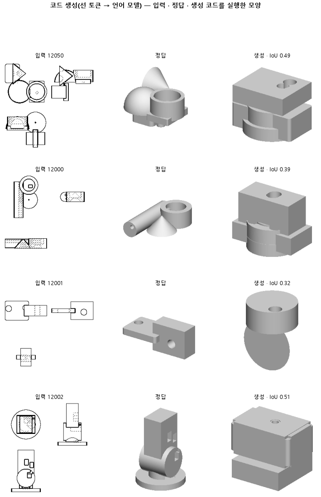

# 같은 모델을 세 배 오래 학습시켜, 덜 배워서 원뿔을 못 쓰던 것인지 본다

## 분석
<!-- 사람 칸: 하네스 분석 단계 초안(claude -p) · 고치면 다시 만들어도 남는다 -->
### 한 줄로

**물음**: 147 모델을 세 배 오래 학습시키면 원뿔을 만드는 코드를 고르게 될까? 모양도 정답에 더 가까워질까?

**답**: 정답 코드를 바로 앞까지 넣어 주면 원뿔 코드를 고르게 됐다. 하지만 모양 겹침의 중앙값은 0.48에서 0.51로 조금 오르는 데 그쳐 기준 0.55에 못 미쳤다. 판정은 실패다.

### 왜 이 판을 했나

우리 모델은 부품 도면 세 장(위·앞·옆)을 보고 CadQuery 코드를 쓴다. CadQuery는 파이썬으로 CAD 모양을 짓는 도구다. 모양을 짓는 줄은 「cq.」로 시작한다. 원뿔을 만들려면 그다음 낱말로 「.Solid」를 골라야 한다.

147은 이 자리에서 「.Solid」를 한 번도 고르지 못했다. 학습 부품에서도 0이었다. 그런데 손실은 3,000스텝이 끝날 때까지 조금씩 내려가고 있었다. 그래서 덜 배운 탓인지, 이 방식으로는 아예 못 배우는지 가려 보고 싶었다.

### 바꾼 것 하나

**학습 스텝만** 3,000에서 9,000으로 늘렸다. 스텝은 무게를 한 번 고치는 단위다. 학습 부품 12,000개와 시험 부품 299개는 147과 같다.

### 결과

| | 이 판 (152) | 대조 (147) | 목표 | 넘었나 |
|---|---|---|---|---|
| 원뿔 낱말을 고름 (학습 부품) | **1.00** | 0 | 0.5 이상 | ✓ |
| 모양 겹침 (중앙값) | 0.51 | 0.48 | 0.55 이상 | ✗ |
| 모양 겹침 (중앙값 · 최종 목표) | 0.51 | 0.48 | 0.74 이상 | ✗ |
| 쓴 코드가 실행됨 | 0.98 | 0.85 | — | — |
| 모양 겹침 (평균) | 0.51 | 0.44 | — | — |

*겹침은 코드를 실행해서 나온 모양의 그림자가 정답 모양의 그림자와 얼마나 포개지는지를 본 값이다. 실행이 안 된 부품은 0으로 센다. 0.55는 이 판이 미리 걸어 둔 기준이고, 0.74는 이 연구 방향이 끝내 넘어야 할 선이다.*

### 왜 이렇게 나왔나

**확인한 것**

- 147이 원뿔 낱말을 못 고른 것은 덜 배운 탓이었다. 3,000스텝에서 0이던 값이 9,000스텝에서는 1.00이 됐다. 기록된 값 셋이 모두 1.00이다.
- 이번에도 오른 몫은 실행률에서 왔다. 실행된 부품만 평균하면 이 판은 0.51이다. 147은 실행이 안 된 부품을 0으로 넣은 평균(0.44)을 실행률(0.85)로 나누면 0.52가 나온다. 실행된 모양끼리 보면 거의 같다.
- 시험 손실은 3,000스텝에서 0.39, 9,000스텝에서 0.36이다. 늘린 6,000스텝 동안 0.03밖에 내려가지 않았다.

**짐작 (아직 확인 안 함)**

- 모양이 오르지 않는 것은 치수나 덩어리 짜임이 틀려서라고 본다. 따로 떨어진 덩어리의 개수를 맞힌 부품은 0.45다. 다만 147에서는 이 값을 재지 않아서, 원래부터 그랬는지는 모른다.
- 원뿔은 정답을 넣어 준 학습 부품에서만 쟀다. 모델이 혼자 시험 부품의 코드를 쓸 때 원뿔이 필요한 자리에서 실제로 원뿔을 쓰는지는 세지 않았다.

### 한계

- 시험 부품은 299개다. 실행된 부품끼리 견줄 때는 두 판의 묶음 크기도 다르다(98 % 대 85 %).
- 기록에는 시드 하나로 한 번 돌렸다고 적혀 있다. 그런데 기준 칸에는 값이 셋(0.53 · 0.51 · 0.49) 있다. 위에서 「셋 모두 1.00」이라고 쓴 것도 이 셋이다. 이 셋이 서로 다른 시드라면, 그 사이 폭(0.03)이 147과의 차이(0.03)와 같다. 그러면 오른 몫이 흔들림 안쪽일 수 있다.
- 같은 설정이라면 이 판의 3,000스텝 손실이 147의 끝 값과 같아야 한다. 그런데 0.39 대 0.41로 다르고, 원인은 모른다.

### 배운 것과 다음

정답을 앞까지 보여 주면, 오래 배운 모델은 원뿔 낱말을 고른다. 그래도 **모양 겹침은 거의 그대로다.** 세 배로 늘린 학습이 준 것은 실행률이었다. 실행된 모양의 질은 147과 비슷하다. 손실도 거의 평평하니, 학습을 더 늘리는 것은 다음 수가 아니다.

1. 두 판에서 모두 실행된 부품끼리 겹침을 다시 견준다.
2. 147에서도 덩어리 개수를 잰다. 틀린 부품은 덩어리가 빠졌는지 더 붙었는지 센다.
3. 정답을 넣어 주지 않았을 때 시험 부품에서 원뿔을 쓰는지 센다.

명제: 147 과 같은 설정에서 학습 스텝만 3000 → 9000 으로 늘리면, 정답을 넣어 줄 때 학습 부품의 원뿔 갈래(「cq.」 다음 「.Solid」) 맞힘이 0.5 이상이고 실행 실패를 0 으로 친 실루엣 IoU 중앙값이 0.55 이상이다(147 은 0 · 0.481)

| 가지 | 종류 | 바탕 | 바꾼 손잡이 | 에폭 | git | 날짜 |
|---|---|---|---|---|---|---|
| B1 | 비교 | 127 (하네스/conf/바탕.yaml) | 학습.스텝: 3000 → 9000 | 10 | `7cdfd8c` | 2026-10-27 14:54 |

## 1. 판정: **실패 · 목표선 0/1**

| 지표 | 식 | 문턱 | 이 판 | 대조(147좌표토큰) | 통과 |
|---|---|---|---|---|---|
| 코드_원뿔배움 | >= | 0.5 | 1.000 | 0.000 | ✓ |
| 코드_IoU | >= | 0.55 | 0.509 | 0.481 | ✗ |
| 코드_IoU | >= | 0.737 | 0.509 | 0.481 | ✗ |

## 2. 숫자 — 이 판 대 대조

| 지표 | 이 판 | 대조 |
|---|---|---|
| 코드_실행률 | 0.982 | 0.846 |
| 코드_IoU | 0.509 | 0.481 |
| 코드_IoU평균 | 0.508 | — |
| 코드_IoU실행 | 0.511 | — |
| 코드_OOM | 0.000 | — |
| 코드_원뿔배움 | 1.000 | 0.000 |
| 코드_몸개수맞음 | 0.453 | — |
| 코드_학습loss | 0.321 | — |
| 코드_시험loss | 0.362 | — |
| 시험loss | 0.362 | — |
| 학습loss | 0.321 | — |

## 모델 구조
(이 판은 구조를 안 잼)

## 3. 학습 곡선

| 에폭 | 학습 loss | 시험 loss | 맞음(CAD 덩어리 수 · 선지도 선 종류) |
|---|---|---|---|
| 250 | 5.188 | 2.204 | 0.000 |
| 500 | 1.114 | 0.642 | 0.000 |
| 750 | 0.552 | 0.506 | 0.000 |
| 1000 | 0.474 | 0.477 | 0.000 |
| 1250 | 0.435 | 0.459 | 0.000 |
| 1500 | 0.427 | 0.437 | 0.000 |
| 1750 | 0.401 | 0.414 | 0.000 |
| 2000 | 0.384 | 0.412 | 0.000 |
| 2250 | 0.378 | 0.408 | 0.000 |
| 2500 | 0.375 | 0.392 | 0.000 |
| 2750 | 0.367 | 0.394 | 0.000 |
| 3000 | 0.360 | 0.393 | 0.000 |
| 3250 | 0.351 | 0.390 | 0.000 |
| 3500 | 0.357 | 0.384 | 0.000 |
| 3750 | 0.353 | 0.385 | 0.000 |
| 4000 | 0.351 | 0.386 | 0.000 |
| 4250 | 0.346 | 0.378 | 0.000 |
| 4500 | 0.342 | 0.374 | 0.000 |
| 4750 | 0.343 | 0.383 | 0.000 |
| 5000 | 0.339 | 0.373 | 0.000 |
| 5250 | 0.343 | 0.371 | 0.000 |
| 5500 | 0.333 | 0.369 | 0.000 |
| 5750 | 0.337 | 0.370 | 0.000 |
| 6000 | 0.326 | 0.366 | 0.000 |
| 6250 | 0.333 | 0.366 | 0.000 |
| 6500 | 0.329 | 0.365 | 0.000 |
| 6750 | 0.330 | 0.364 | 0.000 |
| 7000 | 0.329 | 0.364 | 0.000 |
| 7250 | 0.324 | 0.363 | 0.000 |
| 7500 | 0.324 | 0.363 | 0.000 |
| 7750 | 0.325 | 0.361 | 0.000 |
| 8000 | 0.324 | 0.362 | 0.000 |
| 8250 | 0.331 | 0.361 | 0.000 |
| 8500 | 0.321 | 0.361 | 0.000 |
| 8750 | 0.322 | 0.361 | 0.000 |
| 9000 | 0.316 | 0.361 | 0.000 |

## 4. 점검

### 4.1 연기 판
첫 loss — → 배치 하나 40 걸음 — · VRAM — GB

### 4.2 층보기 (시험 64 · 4 층)
칸끼리 닮음 — (1 = 6 칸 같음) · 빈 조각 주의 몫 — (빈 조각 비율 0.54) · 주의 엔트로피 — · 출력 자리 퍼짐 — (정답 0.148)

### 4.3 탐침 — 합성 그림 (블록 4 · 128)
구조 6 종 — · 곡률 R² — · (블록 3: — · —)

### 4.4 특징 — 실제 도면 (조각 라벨 · 하네스/특징.py)
(이 판은 특징 점검을 안 함)

## 쇼츠
편 112_판152오래학습 · 57.5 초 · 14 줄 · 서재용 업로드 대기

[쇼츠 영상](쇼츠.mp4)

| 누구 | 말 |
|---|---|
| AI | 왼쪽이 정답, 오른쪽이 모델이 지은 부품이에요. |
| AI | 덩어리가 붙은 자리가 서로 달라요. |
| AI | 이 모델은 부품을 위·앞·옆에서 그린 도면 세 장을 봐요. |
| AI | 그걸 보고 모양을 짓는 코드를 써요. 돌리면 입체 부품이 나와요. |
| AI | 이번엔 전보다 훨씬 오래 가르쳤어요. |
| 나 | 오래 배웠으니 전보다 정답에 가까워졌겠지. |
| AI | 달라진 건 있어요. 코드가 중간에 멈추는 일이 거의 없어졌어요. |
| AI | 전엔 코드가 멈추면 모양이 아예 안 나왔거든요. |
| AI | 근데 나온 모양을 봐요. 덩어리 붙는 자리가 여전히 틀려요. |
| 나 | 위·앞·옆 그림자를 정답이랑 겹쳐서 비교해 봐. |
| AI | 그림자가 정답이랑 완전히 포개지면 만점이에요. |
| AI | 전엔 0.48, 지금 0.51. 목표 0.55에 못 미쳐요. |
| 나 | 오래 가르쳐도 모양은 거의 그대로네. |
| AI | 이번 학습은 실패예요. 늘어난 건 모양이 나오는 횟수뿐이에요. |

## 5. 해석
<!-- 사람 칸: 아래를 채운다 · 보고서를 다시 만들어도 남는다 -->
(비어 있음)

## 6. 다음 가지 (사람이 고름 · claudedocs/문제트리.md)
<!-- 사람 칸: 아래를 채운다 · 보고서를 다시 만들어도 남는다 -->
(비어 있음)

## 7. 재현
`python 하네스/하네스.py --config-name 판_152오래학습` · 설정 [설정.yaml](설정.yaml) · 판정 [판정.json](판정.json) · 산출 `G:/art2real/out/하네스/152오래학습/`

## 링크
- 쇼츠: 서재용 업로드 대기
- GitHub 이슈: https://github.com/sigongjoa/art2real/issues/23
