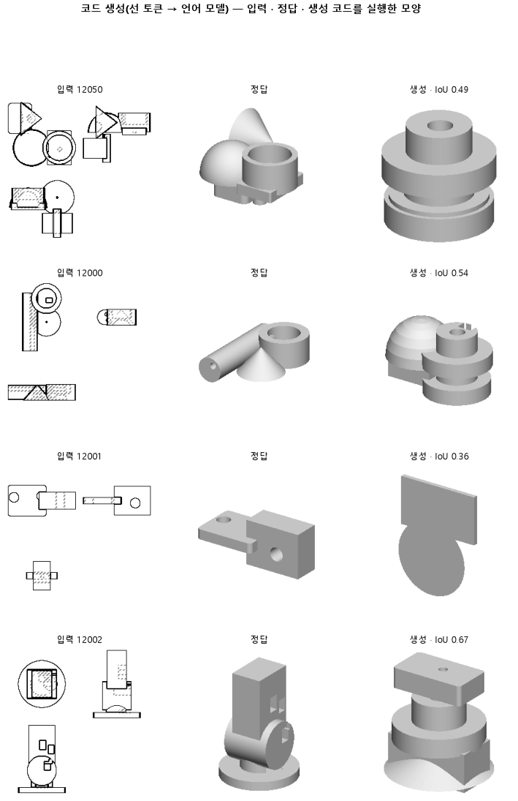

# 입력 선만 정답으로 바꿔, 152 가 위치를 틀린 게 CNN 이 뽑은 선 탓인지 본다

## 분석
<!-- 사람 칸: 하네스 분석 단계 초안(claude -p) · 고치면 다시 만들어도 남는다 -->
### 한 줄로

**물음**: 152가 만든 모양이 정답과 어긋난 것은 CNN(도면에서 선을 뽑는 앞단)이 선을 잘못 뽑았기 때문일까?

**답**: 선 탓은 작아 보인다. 정답 선을 넣어도 모양 겹침은 0.51에서 0.54로 조금만 올랐고, 덩어리 개수를 맞힌 비율은 오히려 내려갔다. 표의 마지막 줄인 목표선 0.74를 넘지 못해 판정은 실패다. 다만 앞단 탓을 완전히 지우지는 못했다.

### 왜 이 판을 했나

우리 모델은 부품 도면 세 장(위·앞·옆)을 보고 CAD 코드를 쓴다. 이때 CNN이 뽑은 선을 좌표 글로 바꿔 함께 넣는다. 152는 쓴 코드가 거의 다 실행됐는데도 모양 겹침이 0.51에 머물렀다. 모양 겹침은 코드를 실행해 나온 모양의 그림자가 정답 그림자와 얼마나 포개지는지를 본 값이다. 실행이 안 된 부품은 0으로 센다.

원인은 둘 중 하나로 봤다. 앞단이 선을 잘못 뽑았거나, 선을 제대로 받아도 코드를 쓰는 쪽이 못 쓰거나. 그래서 앞단이 완벽하다고 치고 돌려 보기로 했다.

### 바꾼 것 하나

**입력 선만** 바꿨다. CNN이 뽑은 선 대신 정답 선지도를 같은 방식으로 좌표 글로 바꿔 넣었다. 152가 학습한 LoRA(큰 모델에 덧붙여 학습한 작은 무게)는 그대로 쓰고, 새로 학습하지 않았다. 시험 부품 299개도 같다.

### 결과

| | 이 판 (153) | 대조 (152) | 목표 | 넘었나 |
|---|---|---|---|---|
| 모양 겹침 (중앙값) | 0.54 | 0.51 | 0.60 이상 | ✗ |
| 덩어리 개수 맞음 | 0.38 | 0.45 | 0.55 이상 | ✗ |
| 모양 겹침 (중앙값 · 목표선) | 0.54 | 0.51 | 0.74 이상 | ✗ |
| 쓴 코드가 실행됨 | 0.98 | 0.98 | — | — |
| 모양 겹침 (실행된 것만) | 0.54 | 0.51 | — | — |

*덩어리는 부품을 이루는 따로 떨어진 고체 하나다. 덩어리 개수 맞음은 그 개수가 정답과 같은 부품의 비율이다.*

### 왜 이렇게 나왔나

**확인한 것**

- 오른 몫은 작다. 실행률은 두 판 모두 0.98이라, 오른 몫은 실행된 모양에서 나왔다. 대조 기록(0.51)보다는 0.03, 판 전에 미리 적어 둔 152 값(0.53)보다는 0.01 높다.
- 덩어리 개수 맞음은 0.45에서 0.38로 내려갔다. 선은 정확해졌는데 덩어리 짜임은 더 틀렸다.

**짐작 (아직 확인 안 함)**

- LoRA는 CNN이 뽑은 선만 보고 배웠다. 정답 선은 처음 보는 꼴이라 오히려 헷갈렸을 수 있다. 그렇다면 이 판은 정답 선의 효과를 낮게 잰 것이다.
- 코드를 쓰는 쪽이 선을 거의 안 쓰고 그림만 보고 짐작하고 있을 수도 있다.

### 한계

- 시험 부품 299개로 한 번만 돌렸다. 152 기록에는 같은 지표 값이 셋(0.53 · 0.51 · 0.49) 있었다. 이번에 오른 몫은 그 폭 안쪽이다. 덩어리 개수의 흔들림은 재지 않아서, 0.07 내려간 것이 실제로 나빠진 것인지 모른다.
- 아래 학습 곡선은 152의 것이다. 이 판은 학습하지 않았다(로그 「152오래학습 LoRA 읽음 · 학습 없음」 · 학습.json 이 152 와 바이트까지 같음). 「학습 부품 12,000개」는 분석 초안에 넘긴 사실 칸의 버그였고, 실제 학습 부품은 3,000개다(고침).

### 배운 것과 다음

선을 정답으로 줘도 모양은 거의 그대로였다. **지금은 코드를 쓰는 쪽이 더 의심스럽다.** 다만 처음 보는 꼴 탓일 가능성이 남아 있어서 앞단을 아직 놓을 수는 없다.

1. 정답 선으로 LoRA를 새로 학습시켜, 처음 보는 꼴 탓인지 가린다.
2. 입력에서 선을 아예 빼고 돌려, 모델이 선을 쓰기는 하는지 본다.

명제: 152 가 학습한 LoRA 를 그대로 두고 입력 선 글만 CNN 예측에서 정답 선지도 벡터화로 바꾸면, 시험 299 개의 실행 실패를 0 으로 친 실루엣 IoU 중앙값이 0.60 이상이고 몸 개수가 정답과 같은 비율이 0.55 이상이다(152 시드 0 은 0.525 · 0.445)

| 가지 | 종류 | 바탕 | 바꾼 손잡이 | 에폭 | git | 날짜 |
|---|---|---|---|---|---|---|
| B1 | 비교 | 127 (하네스/conf/바탕.yaml) | 코드.선입력: None → 정답 | 10 | `0251d63` | 2026-10-27 17:04 |

## 1. 판정: **실패 · 목표선 0/1**

| 지표 | 식 | 문턱 | 이 판 | 대조(152오래학습) | 통과 |
|---|---|---|---|---|---|
| 코드_IoU | >= | 0.6 | 0.537 | 0.525 | ✗ |
| 코드_몸개수맞음 | >= | 0.55 | 0.381 | 0.445 | ✗ |
| 코드_IoU | >= | 0.737 | 0.537 | 0.525 | ✗ |

## 2. 숫자 — 이 판 대 대조

| 지표 | 이 판 | 대조 |
|---|---|---|
| 코드_실행률 | 0.980 | 0.983 |
| 코드_IoU | 0.537 | 0.525 |
| 코드_IoU평균 | 0.520 | — |
| 코드_IoU실행 | 0.540 | 0.527 |
| 코드_OOM | 0.000 | — |
| 코드_정답실패 | 0.000 | — |
| 코드_원뿔배움 | 1.000 | — |
| 코드_몸개수맞음 | 0.381 | 0.445 |
| 코드_학습loss | 0.316 | — |
| 코드_시험loss | 0.361 | — |
| 시험loss | 0.361 | — |
| 학습loss | 0.316 | — |

## 모델 구조
(이 판은 구조를 안 잼)

## 3. 학습 곡선

*이 판은 학습 없음 — 152오래학습 의 LoRA 를 그대로 읽어 그 판의 곡선을 옮겨 붙였다.*

| 에폭 | 학습 loss | 시험 loss | 맞음(CAD 덩어리 수 · 선지도 선 종류) |
|---|---|---|---|
| 250 | 5.188 | 2.204 | 0.000 |
| 500 | 1.114 | 0.642 | 0.000 |
| 750 | 0.552 | 0.506 | 0.000 |
| 1000 | 0.474 | 0.477 | 0.000 |
| 1250 | 0.435 | 0.459 | 0.000 |
| 1500 | 0.427 | 0.437 | 0.000 |
| 1750 | 0.401 | 0.414 | 0.000 |
| 2000 | 0.384 | 0.412 | 0.000 |
| 2250 | 0.378 | 0.408 | 0.000 |
| 2500 | 0.375 | 0.392 | 0.000 |
| 2750 | 0.367 | 0.394 | 0.000 |
| 3000 | 0.360 | 0.393 | 0.000 |
| 3250 | 0.351 | 0.390 | 0.000 |
| 3500 | 0.357 | 0.384 | 0.000 |
| 3750 | 0.353 | 0.385 | 0.000 |
| 4000 | 0.351 | 0.386 | 0.000 |
| 4250 | 0.346 | 0.378 | 0.000 |
| 4500 | 0.342 | 0.374 | 0.000 |
| 4750 | 0.343 | 0.383 | 0.000 |
| 5000 | 0.339 | 0.373 | 0.000 |
| 5250 | 0.343 | 0.371 | 0.000 |
| 5500 | 0.333 | 0.369 | 0.000 |
| 5750 | 0.337 | 0.370 | 0.000 |
| 6000 | 0.326 | 0.366 | 0.000 |
| 6250 | 0.333 | 0.366 | 0.000 |
| 6500 | 0.329 | 0.365 | 0.000 |
| 6750 | 0.330 | 0.364 | 0.000 |
| 7000 | 0.329 | 0.364 | 0.000 |
| 7250 | 0.324 | 0.363 | 0.000 |
| 7500 | 0.324 | 0.363 | 0.000 |
| 7750 | 0.325 | 0.361 | 0.000 |
| 8000 | 0.324 | 0.362 | 0.000 |
| 8250 | 0.331 | 0.361 | 0.000 |
| 8500 | 0.321 | 0.361 | 0.000 |
| 8750 | 0.322 | 0.361 | 0.000 |
| 9000 | 0.316 | 0.361 | 0.000 |

## 4. 점검

### 4.1 연기 판
첫 loss — → 배치 하나 40 걸음 — · VRAM — GB

### 4.2 층보기 (시험 64 · 4 층)
칸끼리 닮음 — (1 = 6 칸 같음) · 빈 조각 주의 몫 — (빈 조각 비율 0.54) · 주의 엔트로피 — · 출력 자리 퍼짐 — (정답 0.148)

### 4.3 탐침 — 합성 그림 (블록 4 · 128)
구조 6 종 — · 곡률 R² — · (블록 3: — · —)

### 4.4 특징 — 실제 도면 (조각 라벨 · 하네스/특징.py)
(이 판은 특징 점검을 안 함)

## 쇼츠
편 113_판153정답선입력 · 56.9 초 · 13 줄 · 서재용 업로드 대기

[쇼츠 영상](쇼츠.mp4)

| 누구 | 말 |
|---|---|
| AI | 모델이 만든 오른쪽 부품이 왼쪽 정답과 모양이 달라요. |
| AI | 이 모델은 부품을 앞 · 위 · 옆에서 본 도면 세 장을 봐요. |
| AI | 그걸 보고 부품을 만드는 CAD 코드를 써요. |
| AI | 도면의 테두리 선은 작은 프로그램이 따로 따서 같이 줘요. |
| 나 | 그 프로그램이 선을 삐뚤게 땄겠지. 그래서 모양이 틀린 거야. |
| AI | 정답 부품이 있으니 완벽한 선은 거기서 바로 뽑을 수 있어요. |
| 나 | 그럼 프로그램 선은 빼고 정답 선을 넣어 봐. |
| AI | 모델은 그대로 두고 시험 부품 전부에 선만 바꿔 넣었어요. |
| AI | 오른쪽 봐요. 선이 완벽한데도 여전히 정답과 달라요. |
| AI | 정답과 다 겹치면 1인데, 0.51에서 0.54로 조금 올랐어요. |
| 나 | 선 탓은 작았네. |
| AI | 이번엔 실패예요. 선을 고쳐 줘도 모양은 못 맞혀요. |
| AI | 따로 떨어진 조각 수를 맞힌 부품은 오히려 줄었어요. |

## 5. 해석
<!-- 사람 칸: 아래를 채운다 · 보고서를 다시 만들어도 남는다 -->
(비어 있음)

## 6. 다음 가지 (사람이 고름 · claudedocs/문제트리.md)
<!-- 사람 칸: 아래를 채운다 · 보고서를 다시 만들어도 남는다 -->
(비어 있음)

## 7. 재현
`python 하네스/하네스.py --config-name 판_153정답선입력` · 설정 [설정.yaml](설정.yaml) · 판정 [판정.json](판정.json) · 산출 `G:/art2real/out/하네스/153정답선입력/`

## 링크
- 쇼츠: 서재용 업로드 대기
- GitHub 이슈: https://github.com/sigongjoa/art2real/issues/24
