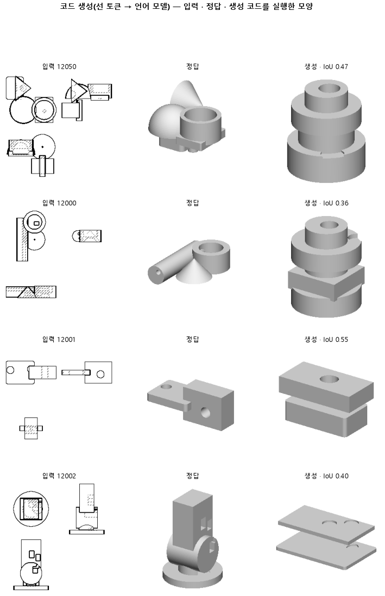

# LoRA 를 MLP 까지 넓혀, 몸 개수와 위치를 더 잘 쓰는지 본다

## 분석
<!-- 사람 칸: 하네스 분석 단계 초안(claude -p) · 고치면 다시 만들어도 남는다 -->
### 한 줄로

**물음**: 모델에서 고쳐 배우는 자리를 어텐션에서 MLP까지 넓히면, 덩어리 개수와 모양을 더 잘 맞힐까?

**답**: 거의 그대로였다. 모양 겹침은 0.51에서 0.53으로 올라 기준 0.55에 못 미쳤다. 덩어리 개수를 맞힌 비율은 0.45에서 0.44로 조금 내려갔다. 판정은 실패다.

### 왜 이 판을 했나

우리 모델은 부품 도면 세 장(위·앞·옆)을 보고 CAD 코드를 쓴다. 큰 언어 모델의 원래 무게는 얼려 둔다. 옆에 작은 판을 붙이고 그 판만 배우게 한다. 이 방법을 LoRA라고 한다.

152는 이 판을 어텐션에만 붙였다. 어텐션은 낱말끼리 서로 참고하는 부분이다. 152는 거의 모든 부품에서 실행되는 코드를 썼다. 그래도 모양 겹침은 0.51에 머물렀다. 따로 떨어진 덩어리의 개수를 맞힌 부품도 0.45뿐이었다. 그래서 낱말 하나하나를 계산하는 부분(MLP)까지 배우게 하면 치수와 덩어리 짜임을 더 잘 담는지 보고 싶었다.

### 바꾼 것 하나

LoRA를 붙이는 자리를 **어텐션 넷에서 MLP 셋(gate · up · down)까지** 넓혔다. 학습 9,000스텝, 학습 부품 3,000개, 시험 부품 299개는 152와 같다.

기준 칸에는 같은 설정으로 세 번 돌린 값이 있다. 판정에도 「시드 3번」이라고 적혀 있다. 그런데 기록의 다른 칸에는 「시드 하나로 한 번 돌림」이라고 되어 있다. 이 글은 세 번 돌렸다고 보고 썼다. 이 전제가 틀리면 아래에서 말하는 「흔들림」도 근거를 잃는다.

### 결과

| | 이 판 (154) | 대조 (152) | 목표 | 넘었나 |
|---|---|---|---|---|
| 모양 겹침 (중앙값) | 0.53 | 0.51 | 0.55 이상 | ✗ |
| 덩어리 개수를 맞힘 | 0.44 | 0.45 | 0.50 이상 | ✗ (세 번 중 한 번만 넘음) |
| 모양 겹침 (최종 목표) | 0.53 | 0.51 | 0.74 이상 | ✗ |
| 쓴 코드가 실행됨 | 0.99 | 0.98 | — | — |
| 시험 손실 | 0.34 | 0.36 | — | — |

*모양 겹침은 코드를 실행해 나온 모양의 그림자가 정답 모양의 그림자와 얼마나 포개지는지를 본 값이다. 1이면 똑같고, 실행이 안 된 부품은 0으로 센다. 0.55는 이 판에 미리 걸어 둔 기준이다. 0.74는 이 연구 방향이 끝내 넘어야 할 선이다. 판정에는 둘 다 썼다.*

### 왜 이렇게 나왔나

**확인한 것**

- 실행이 안 된 부품을 빼고 봐도 0.51에서 0.53으로 오른다. 152가 147보다 나아진 것은 거의 다 실행률 덕이었다. 이번에는 실행된 모양 자체도 조금 올랐다.
- 그래도 이 오름은 흔들림 안쪽이다. 152를 세 번 돌린 겹침은 0.49~0.53이었고, 이 판은 0.52~0.53이다. 이 판에서 가장 좋은 값이 152에서 가장 좋은 값과 같다.
- 덩어리 개수는 세 번 돌린 값이 0.39~0.50으로 벌어졌다. 이 폭(0.11)이 152와의 차이보다 훨씬 크다.

**짐작 (아직 확인 안 함)**

- 손실은 학습 0.32 → 0.29, 시험 0.36 → 0.34로 내려갔다. 다만 손실은 돌릴 때마다 얼마나 흔들리는지 적지 않았다. 그래서 이 차이가 진짜인지 모른다. 진짜라면 코드의 겉 서식을 더 잘 맞힌 몫일 것 같다.
- 덩어리 개수가 크게 흔들리는 것은 도면에서 개수가 잘 안 읽혀서, 시작값에 따라 판단이 갈리기 때문일 수 있다.

### 한계

- 시험 부품 299개다. 설정마다 세 번씩 두 설정만 견줬다.
- 몇 번 돌렸는지에 대해 기록끼리 서로 다르게 적혀 있다.
- 덩어리 개수가 왜 이렇게 흔들리는지는 설명하지 못했다.

### 배운 것과 다음

**이번에 넓힌 정도로는 모양도 덩어리 개수도 흔들림을 넘어 움직이지 않았다.** 배우는 자리를 넓히는 것이 다음 수라고 볼 근거는 아직 없다.

1. 시드 기록부터 바로잡는다.
2. 덩어리 개수가 틀린 부품에서 덩어리가 빠졌는지 더 붙었는지 센다.
3. 세 번 돌린 값이 크게 갈린 부품을 그림으로 모아, 도면에서 개수가 읽히는 부품인지 본다.

명제: 152 와 같은 설정에서 LoRA 대상만 어텐션 넷에서 MLP 셋(gate · up · down)까지 넓히면, 시험 299 개의 실행 실패를 0 으로 친 실루엣 IoU 중앙값이 0.55 이상이고 몸 개수가 정답과 같은 비율이 0.50 이상이다(152 는 시드 평균 0.509 · 0.453)

| 가지 | 종류 | 바탕 | 바꾼 손잡이 | 에폭 | git | 날짜 |
|---|---|---|---|---|---|---|
| B1 | 비교 | 127 (하네스/conf/바탕.yaml) | 코드.LoRA대상: None → 전부 | 10 | `081552f` | 2026-10-28 20:06 |

## 1. 판정: **흔들림 — 시드 3 번이 기준 양쪽 · 목표선 0/1**

| 지표 | 식 | 문턱 | 이 판 | 대조(152오래학습) | 통과 |
|---|---|---|---|---|---|
| 코드_IoU | >= | 0.55 | 0.528 | 0.509 | ✗ |
| 코드_몸개수맞음 | >= | 0.5 | 0.445 | 0.453 | ✗ |
| 코드_IoU | >= | 0.737 | 0.528 | 0.509 | ✗ |

## 2. 숫자 — 이 판 대 대조

| 지표 | 이 판 | 대조 |
|---|---|---|
| 코드_실행률 | 0.991 | 0.982 |
| 코드_IoU | 0.528 | 0.509 |
| 코드_IoU평균 | 0.525 | — |
| 코드_IoU실행 | 0.530 | 0.511 |
| 코드_OOM | 0.000 | — |
| 코드_정답실패 | 0.000 | — |
| 코드_원뿔배움 | 1.000 | — |
| 코드_몸개수맞음 | 0.445 | 0.453 |
| 코드_학습loss | 0.289 | — |
| 코드_시험loss | 0.344 | — |
| 시험loss | 0.344 | — |
| 학습loss | 0.289 | — |

## 모델 구조
(이 판은 구조를 안 잼)

## 3. 학습 곡선

| 에폭 | 학습 loss | 시험 loss | 맞음(CAD 덩어리 수 · 선지도 선 종류) |
|---|---|---|---|
| 250 | 3.851 | 0.679 | 0.000 |
| 500 | 0.502 | 0.444 | 0.000 |
| 750 | 0.398 | 0.410 | 0.000 |
| 1000 | 0.376 | 0.398 | 0.000 |
| 1250 | 0.359 | 0.382 | 0.000 |
| 1500 | 0.358 | 0.377 | 0.000 |
| 1750 | 0.349 | 0.371 | 0.000 |
| 2000 | 0.339 | 0.372 | 0.000 |
| 2250 | 0.340 | 0.372 | 0.000 |
| 2500 | 0.339 | 0.364 | 0.000 |
| 2750 | 0.331 | 0.367 | 0.000 |
| 3000 | 0.327 | 0.361 | 0.000 |
| 3250 | 0.318 | 0.362 | 0.000 |
| 3500 | 0.324 | 0.357 | 0.000 |
| 3750 | 0.318 | 0.359 | 0.000 |
| 4000 | 0.319 | 0.356 | 0.000 |
| 4250 | 0.314 | 0.357 | 0.000 |
| 4500 | 0.312 | 0.353 | 0.000 |
| 4750 | 0.310 | 0.355 | 0.000 |
| 5000 | 0.307 | 0.353 | 0.000 |
| 5250 | 0.312 | 0.351 | 0.000 |
| 5500 | 0.301 | 0.350 | 0.000 |
| 5750 | 0.309 | 0.349 | 0.000 |
| 6000 | 0.296 | 0.349 | 0.000 |
| 6250 | 0.302 | 0.349 | 0.000 |
| 6500 | 0.298 | 0.348 | 0.000 |
| 6750 | 0.301 | 0.346 | 0.000 |
| 7000 | 0.299 | 0.347 | 0.000 |
| 7250 | 0.294 | 0.347 | 0.000 |
| 7500 | 0.295 | 0.347 | 0.000 |
| 7750 | 0.292 | 0.345 | 0.000 |
| 8000 | 0.295 | 0.345 | 0.000 |
| 8250 | 0.300 | 0.344 | 0.000 |
| 8500 | 0.290 | 0.344 | 0.000 |
| 8750 | 0.290 | 0.344 | 0.000 |
| 9000 | 0.284 | 0.344 | 0.000 |

## 4. 점검

### 4.1 연기 판
첫 loss — → 배치 하나 40 걸음 — · VRAM — GB

### 4.2 층보기 (시험 64 · 4 층)
칸끼리 닮음 — (1 = 6 칸 같음) · 빈 조각 주의 몫 — (빈 조각 비율 0.54) · 주의 엔트로피 — · 출력 자리 퍼짐 — (정답 0.148)

### 4.3 탐침 — 합성 그림 (블록 4 · 128)
구조 6 종 — · 곡률 R² — · (블록 3: — · —)

### 4.4 특징 — 실제 도면 (조각 라벨 · 하네스/특징.py)
(이 판은 특징 점검을 안 함)

## 쇼츠
편 114_판154MLP포함 · 57.1 초 · 14 줄 · 서재용 업로드 대기

[쇼츠 영상](쇼츠.mp4)

| 누구 | 말 |
|---|---|
| AI | 오른쪽이 모델이 만든 건데, 덩어리 수가 왼쪽 정답과 달라요. |
| AI | 떨어진 덩어리가 빠지거나, 없던 게 더 붙었어요. |
| AI | 모델은 이 도면을 보고 부품을 만드는 코드를 짜요. |
| 나 | 덩어리 수는 도면에 다 보이잖아. |
| 나 | 모델에서 학습하는 부분이 작아서 못 세는 거야. |
| AI | 맞아요. 모델 대부분은 얼려 두고, 작은 부분만 학습해요. |
| AI | 지금은 코드 낱말끼리 서로 살피는 부분만 학습해요. |
| 나 | 학습하는 부분을 모델 곳곳으로 넓게 바꿔. |
| AI | 낱말 하나하나를 계산하는 부분까지 학습하게 바꿨어요. |
| AI | 오른쪽이 다시 학습한 모델이 만든 거예요. |
| AI | 그래도 덩어리가 빠지거나 더 붙은 부품이 절반 넘어요. |
| AI | 덩어리 수 맞힌 비율 0.45→0.44, 거의 그대로예요. |
| 나 | 넓혀도 세는 건 그대로네. |
| AI | 덩어리 수를 못 맞히니, 이번 학습은 실패예요. |

## 5. 해석
<!-- 사람 칸: 아래를 채운다 · 보고서를 다시 만들어도 남는다 -->
(비어 있음)

## 6. 다음 가지 (사람이 고름 · claudedocs/문제트리.md)
<!-- 사람 칸: 아래를 채운다 · 보고서를 다시 만들어도 남는다 -->
(비어 있음)

## 7. 재현
`python 하네스/하네스.py --config-name 판_154MLP포함` · 설정 [설정.yaml](설정.yaml) · 판정 [판정.json](판정.json) · 산출 `G:/art2real/out/하네스/154MLP포함/`

## 링크
- 쇼츠: 서재용 업로드 대기
- GitHub 이슈: https://github.com/sigongjoa/art2real/issues/25
