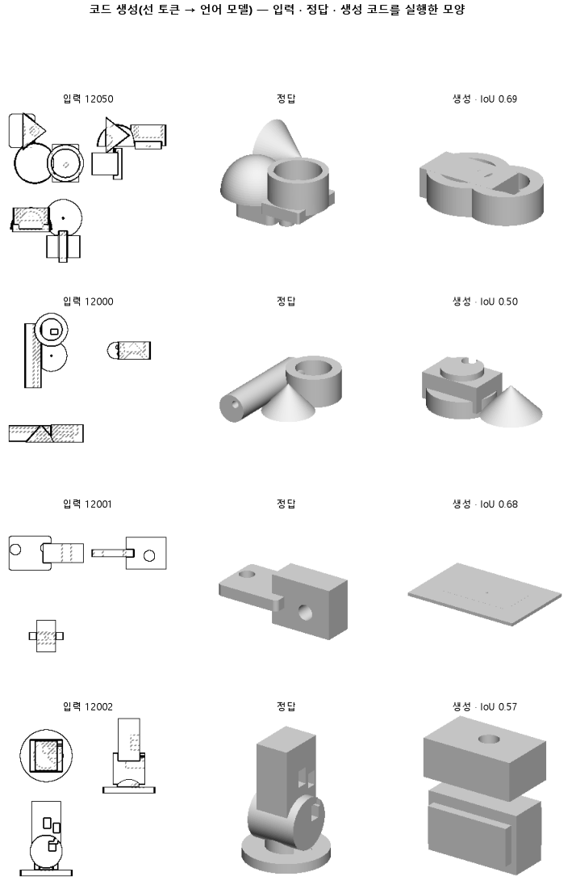

# 정답 코드의 숫자를 도면과 같은 기준으로 적어, 몸을 옆으로도 놓는지 본다

## 분석
<!-- 사람 칸: 하네스 분석 단계 초안(claude -p) · 고치면 다시 만들어도 남는다 -->
### 한 줄로

**물음**: 정답 코드의 숫자를 도면과 같은 기준으로 적으면, 모델이 몸을 옆으로도 놓고 모양도 정답에 더 가까워질까?

**답**: 옆으로 놓는 비율은 0.01에서 0.39로 올랐다. 그러나 세 번 중 한 번만 목표 0.50을 넘었고, 모양 겹침은 0.51에서 0.52로 거의 그대로다. 판정은 「흔들림」이고, 최종 목표에는 못 미쳤다.

### 왜 이 판을 했나

우리 모델은 부품 도면 세 장(위·앞·옆)을 보고 CAD 코드를 쓴다. 코드는 덩어리(몸)를 하나씩 짓고 합친다.

152는 몸을 거의 한 기둥으로만 쌓았다. 첫 몸에서 옆(x나 y)으로 옮긴 몸의 비율이 0.01이었고, 정답 코드는 0.77이다. 정답 코드의 숫자는 mm 단위에 첫 몸이 원점인데, 도면은 전체 모양이 가운데에 놓여 있다. 그림에서 본 자리와 코드에 쓸 숫자의 기준이 달랐던 셈이다. 기준을 맞추면 모델이 자리를 읽어 쓸 수 있을지 보고 싶었다.

### 바꾼 것 하나

**정답 코드의 좌표 기준만** 바꿨다. 전체 모양의 가운데를 원점으로 삼고, 가장 긴 변을 100으로 맞췄다. 도면과 같은 기준이다. 학습 부품 3,000개, 시험 부품 299개, 9,000스텝 학습은 152와 같다.

### 결과

| | 이 판 (155) | 대조 (152) | 목표 | 넘었나 |
|---|---|---|---|---|
| 몸을 옆으로 옮겨 놓음 | **0.39** | 0.01 | 0.50 이상 | ✗ |
| 모양 겹침 (중앙값) | 0.52 | 0.51 | 0.55 이상 | ✗ |
| 모양 겹침 (중앙값 · 최종 목표) | 0.52 | 0.51 | 0.74 이상 | ✗ |
| 쓴 코드가 실행됨 | 0.94 | 0.98 | — | — |
| 몸 개수를 맞힘 | 0.37 | 0.45 | — | — |

*겹침은 실행 안 된 부품을 0으로 센 값이다. 이 판 값은 세 번 돌린 결과의 평균으로, 반올림 전 값으로 냈다. 0.55는 이 판의 목표이고, 0.74는 이 연구 방향이 끝내 넘어야 할 선이다.*

### 왜 이렇게 나왔나

**확인한 것**

- 0.01과 0.39는 같은 자로 잰 값이다. 이 비율은 첫 몸 자리와의 차이만 보므로, 원점이 옮겨졌다고 저절로 오르지 않는다. 정답 코드를 두 기준으로 재 봐도 둘 다 0.77이다. 오른 몫은 모델이 놓는 방식이 바뀐 것이다.
- 다만 세 번의 값이 0.53, 0.33, 0.31로 갈린다. 평균으로는 정답의 절반쯤이다.
- 옆으로 놓는 것과 겹침은 같이 움직이지 않았다. 가장 많이 놓은 첫 번째의 겹침은 0.53이고, 가장 적게 놓은 세 번째가 0.54다. 세 번 모두 0.55에 못 미쳤다.
- 실행된 부품만 보면 겹침은 0.51에서 0.54로 조금 올랐다. 그런데 실행률이 0.98에서 0.94로 내려가 그 몫을 깎았다.
- 몸 개수를 맞힌 비율은 세 번 모두(0.39, 0.37, 0.36) 152의 0.45보다 낮았다.

**짐작 (아직 확인 안 함)**

- 옆으로 놓아도 겹침이 안 오르는 것은 놓은 자리가 틀려서일 수 있다. 자리 오차는 재지 않았다.
- 시험 손실은 152의 0.36보다 높은 0.39다. 코드 숫자 표기가 달라진 탓이라면 두 손실은 같은 잣대가 아니다.
- 몸 개수와 실행률이 내린 까닭은 아직 모른다. 숫자를 고르기가 어려워졌을 수 있다.

### 한계

- 시험 부품은 299개이고, 같은 설정을 시드(처음 무작위 값)만 바꿔 세 번 돌렸다.
- 옆으로 놓는 비율은 세 번 사이 폭이 0.22나 된다. 평균 0.39 하나로 효과 크기를 말하기는 어렵다. 왜 첫 번째만 높은지도 모른다.
- 겹침 차이 0.01은 세 번 사이 폭(0.03)보다 작다. 올랐다고 말할 수 없다.
- 설정은 하나지만 원점과 크기가 함께 바뀌었다. 어느 쪽이 옆으로 놓게 했는지는 가릴 수 없다.

### 배운 것과 다음

**기준을 맞추니 모델이 몸을 옆으로 놓기 시작했다. 그러나 그것만으로는 모양이 정답에 가까워지지 않았다.** 겹침은 그대로이고 실행률과 몸 개수는 내렸으니, 이 좌표 기준을 기본값으로 삼을 근거는 아직 없다.

1. 옆으로 놓은 몸의 자리가 정답과 얼마나 어긋나는지 잰다.
2. 실행이 깨진 코드와 몸 개수를 틀린 부품을 세어, 무엇이 늘었는지 본다.
3. 시드마다 옆으로 놓는 비율이 왜 갈리는지 확인한다.

명제: 152 와 같은 설정에서 정답 코드의 좌표만 mm · 첫 몸 원점에서 도면 기준(전체 가운데 원점 · 가장 긴 변 100)으로 바꾸면, 시험 299 개에서 첫 몸 대비 x 나 y 로 옮긴 몸의 비율이 0.5 이상이고 실행 실패를 0 으로 친 실루엣 IoU 중앙값이 0.55 이상이다(152 는 시드 평균 0.006 · 0.509)

| 가지 | 종류 | 바탕 | 바꾼 손잡이 | 에폭 | git | 날짜 |
|---|---|---|---|---|---|---|
| B1 | 비교 | 127 (하네스/conf/바탕.yaml) | 코드.좌표계: None → 도면 | 10 | `d5cf647` | 2026-10-30 17:13 |

## 1. 판정: **흔들림 — 시드 3 번이 기준 양쪽 · 목표선 0/1**

| 지표 | 식 | 문턱 | 이 판 | 대조(152오래학습) | 통과 |
|---|---|---|---|---|---|
| 코드_옆옮김 | >= | 0.5 | 0.390 | 0.006 | ✗ |
| 코드_IoU | >= | 0.55 | 0.524 | 0.509 | ✗ |
| 코드_IoU | >= | 0.737 | 0.524 | 0.509 | ✗ |

## 2. 숫자 — 이 판 대 대조

| 지표 | 이 판 | 대조 |
|---|---|---|
| 코드_실행률 | 0.939 | 0.982 |
| 코드_IoU | 0.524 | 0.509 |
| 코드_IoU평균 | 0.508 | — |
| 코드_IoU실행 | 0.536 | 0.511 |
| 코드_OOM | 0.000 | — |
| 코드_정답실패 | 0.000 | — |
| 코드_원뿔배움 | 1.000 | — |
| 코드_옆옮김 | 0.390 | 0.006 |
| 코드_옆옮김정답 | 0.766 | — |
| 코드_몸개수맞음 | 0.375 | 0.453 |
| 코드_학습loss | 0.361 | — |
| 코드_시험loss | 0.394 | — |
| 시험loss | 0.394 | — |
| 학습loss | 0.361 | — |

## 모델 구조
(이 판은 구조를 안 잼)

## 3. 학습 곡선

| 에폭 | 학습 loss | 시험 loss | 맞음(CAD 덩어리 수 · 선지도 선 종류) |
|---|---|---|---|
| 250 | 5.215 | 2.255 | 0.000 |
| 500 | 1.178 | 0.733 | 0.000 |
| 750 | 0.605 | 0.583 | 0.000 |
| 1000 | 0.517 | 0.515 | 0.000 |
| 1250 | 0.496 | 0.492 | 0.000 |
| 1500 | 0.465 | 0.474 | 0.000 |
| 1750 | 0.437 | 0.446 | 0.000 |
| 2000 | 0.418 | 0.443 | 0.000 |
| 2250 | 0.423 | 0.436 | 0.000 |
| 2500 | 0.410 | 0.426 | 0.000 |
| 2750 | 0.412 | 0.424 | 0.000 |
| 3000 | 0.402 | 0.419 | 0.000 |
| 3250 | 0.397 | 0.421 | 0.000 |
| 3500 | 0.391 | 0.418 | 0.000 |
| 3750 | 0.389 | 0.414 | 0.000 |
| 4000 | 0.389 | 0.411 | 0.000 |
| 4250 | 0.384 | 0.414 | 0.000 |
| 4500 | 0.385 | 0.407 | 0.000 |
| 4750 | 0.385 | 0.406 | 0.000 |
| 5000 | 0.378 | 0.407 | 0.000 |
| 5250 | 0.380 | 0.403 | 0.000 |
| 5500 | 0.379 | 0.403 | 0.000 |
| 5750 | 0.375 | 0.401 | 0.000 |
| 6000 | 0.359 | 0.400 | 0.000 |
| 6250 | 0.370 | 0.399 | 0.000 |
| 6500 | 0.372 | 0.397 | 0.000 |
| 6750 | 0.370 | 0.396 | 0.000 |
| 7000 | 0.370 | 0.395 | 0.000 |
| 7250 | 0.366 | 0.394 | 0.000 |
| 7500 | 0.376 | 0.393 | 0.000 |
| 7750 | 0.357 | 0.394 | 0.000 |
| 8000 | 0.367 | 0.393 | 0.000 |
| 8250 | 0.371 | 0.393 | 0.000 |
| 8500 | 0.362 | 0.393 | 0.000 |
| 8750 | 0.357 | 0.393 | 0.000 |
| 9000 | 0.356 | 0.393 | 0.000 |

## 4. 점검

### 4.1 연기 판
첫 loss — → 배치 하나 40 걸음 — · VRAM — GB

### 4.2 층보기 (시험 64 · 4 층)
칸끼리 닮음 — (1 = 6 칸 같음) · 빈 조각 주의 몫 — (빈 조각 비율 0.54) · 주의 엔트로피 — · 출력 자리 퍼짐 — (정답 0.148)

### 4.3 탐침 — 합성 그림 (블록 4 · 128)
구조 6 종 — · 곡률 R² — · (블록 3: — · —)

### 4.4 특징 — 실제 도면 (조각 라벨 · 하네스/특징.py)
(이 판은 특징 점검을 안 함)

## 쇼츠
편 115_판155도면좌표 · 55.7 초 · 14 줄 · 서재용 업로드 대기

[쇼츠 영상](쇼츠.mp4)

| 누구 | 말 |
|---|---|
| AI | 학습시킨 모델이 도면을 보고 덩어리를 위로만 쌓아요. |
| AI | 덩어리를 붙여 부품을 짓는 코드를 쓰는 프로그램이에요. |
| AI | 도면엔 분명 덩어리가 옆에 붙어 있어요. |
| 나 | 옆에 있는 걸 못 알아보는 거네. |
| AI | 학습 때 보는 정답 코드는 맨 처음 덩어리에서 자리를 재요. |
| AI | 그런데 도면은 부품 전체의 한가운데가 기준이에요. |
| 나 | 본 자리를 코드로 못 옮겨서 위로만 쌓았던 거네. |
| 나 | 정답 코드의 기준도 도면처럼 부품 한가운데로 바꿔. |
| AI | 왼쪽이 정답 부품, 오른쪽이 모델이 새로 만든 거예요. |
| AI | 이 뾰족한 원뿔 덩어리를 봐요. 옆에 놓았어요. |
| AI | 다른 건 아직 위로 쌓거나, 넓은 판 하나로 합쳐 버려요. |
| AI | 1점 만점에 정답과 겹침은 0.51에서 0.52로 그쳤어요. |
| 나 | 옆에 놓기만 했지, 정답엔 안 가까워졌네. |
| AI | 실패예요. 돌아가지 않는 코드도 조금 늘었어요. |

## 5. 해석
<!-- 사람 칸: 아래를 채운다 · 보고서를 다시 만들어도 남는다 -->
(비어 있음)

## 6. 다음 가지 (사람이 고름 · claudedocs/문제트리.md)
<!-- 사람 칸: 아래를 채운다 · 보고서를 다시 만들어도 남는다 -->
(비어 있음)

## 7. 재현
`python 하네스/하네스.py --config-name 판_155도면좌표` · 설정 [설정.yaml](설정.yaml) · 판정 [판정.json](판정.json) · 산출 `G:/art2real/out/하네스/155도면좌표/`

## 링크
- 쇼츠: 서재용 업로드 대기
- GitHub 이슈: https://github.com/sigongjoa/art2real/issues/26
