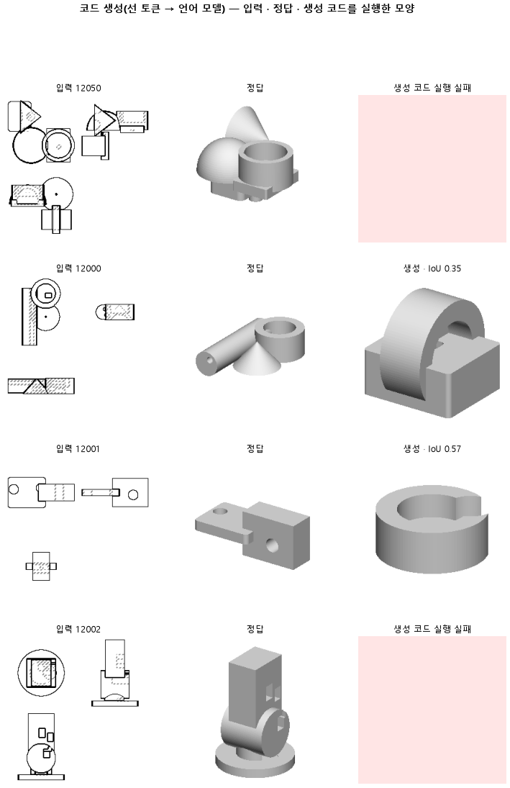

# 읽기 없이 코드만 240 부품으로 오래 배워, 증류 판의 대조값을 잰다

## 분석
<!-- 사람 칸: 하네스 분석 단계 초안(claude -p) · 고치면 다시 만들어도 남는다 -->
### 한 줄로

**물음**: 학습 부품을 240개로 줄이고 짧게 배우면, 증류 판과 비교할 기준값이 나올까?

**답**: 코드 실행률이 0.48로 절반 아래였고, 모양 겹침 중앙값은 0.00이었다. 목표선 1개 중 0개를 넘겨 판정은 실패다.

### 왜 이 판을 했나

우리 모델은 부품 도면 세 장을 보고 CAD 코드를 쓴다. 지금은 큰 모델에서 작은 모델로 지식을 옮기는 증류를 시험하려 한다. 증류 판의 결과를 판단하려면 증류 없이 같은 조건으로 배웠을 때 어느 수준이 나오는지 먼저 알아야 한다.

앞 판(155)은 부품 3,000개를 9,000스텝 배웠다. 증류 판은 배울 부품이 240개뿐이라, 스텝도 2,400으로 줄여 비교 기준을 만들었다.

### 바꾼 것 하나

학습 부품을 3,000개에서 **240개**로, 스텝을 9,000에서 **2,400**으로 줄였다. 시험 부품도 299개에서 100개로 줄였다. 나머지는 155와 같다. 부품은 12분의 1이 됐고 스텝은 약 4분의 1이 됐으므로, 부품 하나당 학습 횟수는 155의 3스텝에서 이 판의 10스텝으로 오히려 늘었다.

### 결과

| | 이 판 (156a) | 대조 (155) | 목표 | 넘었나 |
|---|---|---|---|---|
| 모양 겹침 (중앙값) | 0.00 | 0.52 | 0.30 이상 | ✗ |
| 쓴 코드가 실행됨 | 0.48 | 0.94 | — | — |
| 실행된 것만 겹침 | 0.54 | 0.54 | — | — |
| 원뿔을 코드에 씀 | 0.00 | 1.00 | — | — |
| 몸 개수를 맞힘 | 0.31 | 0.37 | — | — |

*겹침은 실행 안 된 부품을 0으로 센 값이다. 원뿔은 모델이 원뿔 도형을 코드에 쓸 줄 아는지를 보는 지표로, 학습이 어느 정도 됐는지를 나타낸다. 155에서는 시험 부품 전체가 원뿔을 썼고, 이 판에서는 하나도 없었다.*

### 왜 이렇게 나왔나

**확인한 것**

- 실행된 코드만 보면 겹침은 0.54로 155와 같다. 실행률이 0.94에서 0.48로 내려가면서 시험 100개 중 절반 이상이 코드 오류로 실패했고, 그 결과 중앙값이 0.00이 됐다.
- 원뿔을 코드에 쓴 비율이 155의 1.00에서 0.00으로 떨어졌다. 같은 종류의 부품을 다루는데도, 이 판에서는 원뿔 도형을 한 번도 쓰지 않았다.
- 학습 손실은 0.42, 시험 손실은 0.49다.

**짐작 (아직 확인 안 함)**

- 실행이 깨지고 원뿔을 못 쓰는 것은 학습에 쓰인 부품의 종류가 줄어서일 가능성이 크다. 부품당 학습 횟수는 늘었지만, 240개 안에 원뿔 부품이 충분하지 않았을 수 있다.
- 부품 수와 스텝을 동시에 바꿨기 때문에 어느 쪽이 실행률에 더 영향을 줬는지는 이 판만으로는 가를 수 없다.

### 한계

- 시험 부품 100개, 시드 하나만 돌렸다.
- 겹침 중앙값 0.00은 기준으로 구별력이 낮다. 증류 판이 이 값보다 높다고 해도 그게 얼마나 의미 있는 차이인지 말하기 어렵다. 실행률 0.48이 더 실질적인 비교 기준이 될 것이다.
- 부품 수와 스텝을 같이 바꿨고 부품당 학습 횟수가 달라졌기 때문에, 두 판을 "데이터만 적은 조건"으로 단순 비교하기 어렵다.

### 배운 것과 다음

이 조건(240개·2,400스텝)으로는 실행률이 너무 낮아 모양 겹침 중앙값이 제대로 잡히지 않는다. **증류 없이 이 정도 학습 데이터면 코드 절반이 실행조차 안 된다는 것을 확인했다.** 겹침 중앙값보다는 실행률 0.48을 증류 판의 비교 기준으로 쓰는 것이 낫다.

1. 증류 판에서 실행률이 0.48보다 높게 나오는지 본다.
2. 실행이 깨진 코드의 오류 종류를 세어 무엇부터 막히는지 확인한다.
3. 원뿔을 배우려면 최소 몇 부품이 필요한지 학습 곡선으로 따로 확인한다.

명제: 155 설정에서 학습 부품을 읽기가 있는 240 개로 줄이고 2400 스텝 배우면, 시험 100 개의 부피 IoU 중앙값이 0.30 이상이다(155 는 0.17 · 바닥 원기둥 0.15)

| 가지 | 종류 | 바탕 | 바꾼 손잡이 | 에폭 | git | 날짜 |
|---|---|---|---|---|---|---|
| B1 | 탐색 | 127 (하네스/conf/바탕.yaml) | 코드.시험수: None → 100, 코드.학습부품: None → 증류, 학습.스텝: 9000 → 2400 | 10 | `f5e5236` | 2026-10-31 11:11 |

## 1. 판정: **탐색 — 이김 판정 없음 · 기준 못 넘음 · 목표선 0/1**

| 지표 | 식 | 문턱 | 이 판 | 대조(155도면좌표) | 통과 |
|---|---|---|---|---|---|
| 코드_부피IoU | >= | 0.3 | 0.000 | 0.173 | ✗ |
| 코드_부피IoU | >= | 0.8 | 0.000 | 0.173 | ✗ |

## 2. 숫자 — 이 판 대 대조

| 지표 | 이 판 | 대조 |
|---|---|---|
| 코드_실행률 | 0.480 | — |
| 코드_IoU | 0.000 | — |
| 코드_IoU평균 | 0.253 | — |
| 코드_부피IoU | 0.000 | 0.173 |
| 코드_부피바닥 | 0.149 | — |
| 코드_IoU실행 | 0.539 | — |
| 코드_OOM | 0.000 | — |
| 코드_정답실패 | 0.000 | — |
| 코드_원뿔배움 | 0.000 | — |
| 코드_옆옮김 | 0.331 | — |
| 코드_옆옮김정답 | 0.787 | — |
| 코드_몸개수맞음 | 0.310 | — |
| 코드_학습loss | 0.422 | — |
| 코드_시험loss | 0.486 | — |
| 시험loss | 0.486 | — |
| 학습loss | 0.422 | — |

## 모델 구조
(이 판은 구조를 안 잼)

## 3. 학습 곡선

| 에폭 | 학습 loss | 시험 loss | 맞음(CAD 덩어리 수 · 선지도 선 종류) |
|---|---|---|---|
| 250 | 5.220 | 2.194 | 0.000 |
| 500 | 1.164 | 0.720 | 0.000 |
| 750 | 0.606 | 0.582 | 0.000 |
| 1000 | 0.536 | 0.534 | 0.000 |
| 1250 | 0.496 | 0.513 | 0.000 |
| 1500 | 0.458 | 0.506 | 0.000 |
| 1750 | 0.449 | 0.491 | 0.000 |
| 2000 | 0.436 | 0.487 | 0.000 |
| 2250 | 0.418 | 0.487 | 0.000 |
| 2400 | 0.422 | 0.486 | 0.000 |

## 4. 점검

### 4.1 연기 판
첫 loss — → 배치 하나 40 걸음 — · VRAM — GB

### 4.2 층보기 (시험 64 · 4 층)
칸끼리 닮음 — (1 = 6 칸 같음) · 빈 조각 주의 몫 — (빈 조각 비율 0.54) · 주의 엔트로피 — · 출력 자리 퍼짐 — (정답 0.148)

### 4.3 탐침 — 합성 그림 (블록 4 · 128)
구조 6 종 — · 곡률 R² — · (블록 3: — · —)

### 4.4 특징 — 실제 도면 (조각 라벨 · 하네스/특징.py)
(이 판은 특징 점검을 안 함)

## 쇼츠
편 116_판156a증류대조 · 대본검사 실패로 안 구움 · 업로드 대기

| 누구 | 말 |
|---|---|
| 누구 | 말 |
| AI | 도면을 넣었는데 덩어리가 하나도 안 잡혀요. |
| AI | 도면을 보고 CAD 코드를 써요. 왼쪽이 정답이에요. |
| AI | 이번엔 배울 도면을 이전보다 열두 배 줄였어요. |
| 나 | 조금밖에 못 배웠으니까 모양을 못 잡는 거잖아. |
| AI | 실행된 것만 골라봤어요. |
| AI | 돌아간 건 이전 판이랑 겹침이 같아요. |
| 나 | 학습 문제가 아니었네. |
| 나 | 안 돌아간 코드부터 확인해 봐. |
| AI | 실행률이 0.48이에요. 절반이 막혔어요. |
| 나 | 모양 전에 실행이 막혔어. |

## 5. 해석
<!-- 사람 칸: 아래를 채운다 · 보고서를 다시 만들어도 남는다 -->
(비어 있음)

## 6. 다음 가지 (사람이 고름 · claudedocs/문제트리.md)
<!-- 사람 칸: 아래를 채운다 · 보고서를 다시 만들어도 남는다 -->
(비어 있음)

## 7. 재현
`python 하네스/하네스.py --config-name 판_156a증류대조` · 설정 [설정.yaml](설정.yaml) · 판정 [판정.json](판정.json) · 산출 `G:/art2real/out/하네스/156a증류대조/`

## 링크
- 쇼츠: 업로드 대기
- GitHub 이슈: https://github.com/sigongjoa/art2real/issues/27
