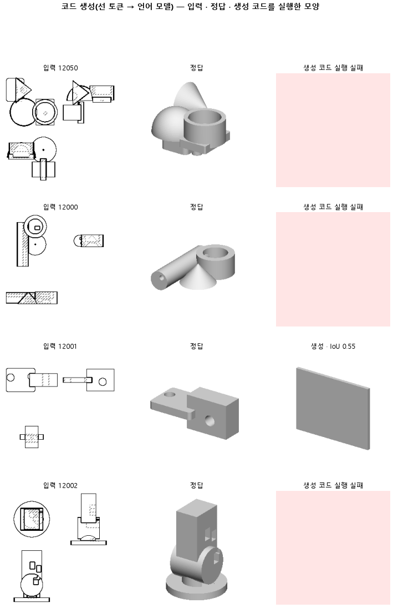

# 큰 모델이 도면을 읽는 과정을 함께 배워, 작은 모델이 도면을 몸 단위로 읽게 되는지 본다

## 분석
<!-- 사람 칸: 하네스 분석 단계 초안(claude -p) · 고치면 다시 만들어도 남는다 -->
---

### 한 줄로

**물음**: 정답 코드 앞에 도면 읽기 주석을 붙여 배우면, 모델이 부품 도면에서 몸을 더 잘 짜낼까?

**답**: 코드 실행률이 0.24로 대조(0.48)의 절반이 됐다. 모양 겹침 중앙값은 두 판 모두 0.00이고, 목표(0.30)에 미치지 못했다. 판정은 실패다.

---

### 왜 이 판을 했나

우리 모델은 부품 도면 세 장을 보고 CAD 코드를 쓴다. 대조 판(156a)에서는 코드 절반이 실행되지 않았다. 모델이 도면을 이해하지 않고 코드를 바로 쓰려 한다는 가설 아래, 별도의 큰 언어 모델이 도면을 보고 남긴 분석 주석을 정답 코드 앞에 붙여 학습 데이터를 만들었다. 주석을 먼저 쓰며 구조를 파악하면 코드도 더 잘 맞출 것이라 기대했다.

---

### 바꾼 것 하나

출력 서식을 **「코드만」에서 「도면 읽기 주석 먼저, 코드 나중」으로** 바꿨다. 학습 부품 240개, 2,400스텝, 시험 부품 100개, 위·앞·옆 세 장 128×128 도면은 대조와 같다.

---

### 결과

| | 이 판 (156b) | 대조 (156a) | 목표 | 넘었나 |
|---|---|---|---|---|
| 모양 겹침 (중앙값) | 0.00 | 0.00 | 0.30 이상 | ✗ |
| 쓴 코드가 실행됨 | 0.24 | 0.48 | — | — |
| 실행된 것만 겹침 | 0.55 | 0.54 | — | — |
| 원뿔 도형을 코드에 씀† | 0.00 | 0.00 | — | — |
| 몸 개수를 맞힘 | 0.30 | 0.31 | — | — |
| 학습 손실 | 1.27 | 0.42 | — | — |

†원뿔 항목은 모델이 원뿔 도형 명령어를 코드에 쓸 줄 아는지 보는 지표다. 1.00이면 시험 부품 전체에서 원뿔 코드가 나왔다는 뜻으로, 학습이 어느 정도 됐는지를 나타낸다.

---

### 왜 이렇게 나왔나

**확인한 것**

- 실행된 코드만 보면 겹침은 0.55로 대조(0.54)와 거의 같다. 실행률이 0.48에서 0.24로 줄면서 시험 100개 중 76개가 코드 오류로 실패했고, 전체 중앙값이 0.00이 됐다.
- 생성 글 길이 중앙값이 대조 664바이트에서 1,731바이트로 늘었고, 괄호가 안 닫힌 실패가 17개에서 31개로 늘었다. 읽기 주석은 같은 구절을 되풀이하고 좌표도 `z≈-10` 같은 값만 반복한다.
- 학습 손실이 대조 0.42에서 이 판 1.27로 세 배 가까이 높다. 학습 곡선에서 1,750번째 반복 이후 시험 손실이 0.76에서 0.75로 거의 내려가지 않았고, 2,400번까지 전부 써도 수렴하지 않았다.

**짐작 (아직 확인 안 함)**

- 실행률이 낮은 것은 출력이 길어진 탓일 가능성이 크다. 주석을 먼저 써야 하므로 코드에 도달하기 전에 문법이 깨지는 자리가 늘어난다.
- 손실이 높은 것은 주석 쓰기와 코드 쓰기를 동시에 배워야 해서 2,400 반복으로는 부족했을 수 있다.

---

### 한계

- 시험 부품 100개, 시드 하나만 돌렸다.
- 주석을 만든 큰 모델의 품질을 확인하지 않았다. 주석이 잘못됐다면 오히려 학습을 방해할 수 있다.

---

### 배운 것과 다음

도면 읽기 주석 서식은 코드 실행률을 절반으로 떨어뜨렸다. **출력이 길어지면 코드가 깨지는 자리가 늘어난다는 것을 확인했다.** 두 판 모두 겹침 중앙값이 0.00이어서 서식 변화의 효과는 실행률 차이(0.48 대 0.24)로 읽는 것이 낫다.

1. 실행이 깨진 코드를 세어 주석 부분에서 깨지는지, 코드 부분에서 깨지는지 확인한다.
2. 학습 부품 수를 같게 하고 서식만 바꾼 판으로 효과를 따로 잰다.
3. 스텝을 늘려 손실이 더 내려가는지 본다.

명제: 156a 와 같은 설정에서 정답 앞에 도면 읽기 주석을 붙여 배우면, 시험 100 개의 부피 IoU 중앙값이 0.30 이상이다(155 는 0.17 · 바닥 원기둥 0.15)

| 가지 | 종류 | 바탕 | 바꾼 손잡이 | 에폭 | git | 날짜 |
|---|---|---|---|---|---|---|
| B1 | 탐색 | 127 (하네스/conf/바탕.yaml) | 코드.서식: None → 읽기먼저 | 10 | `80ec56e` | 2026-10-31 20:35 |

## 1. 판정: **탐색 — 이김 판정 없음 · 기준 못 넘음 · 목표선 0/1**

| 지표 | 식 | 문턱 | 이 판 | 대조(156a증류대조) | 통과 |
|---|---|---|---|---|---|
| 코드_부피IoU | >= | 0.3 | 0.000 | — | ✗ |
| 코드_부피IoU | >= | 0.8 | 0.000 | — | ✗ |

## 2. 숫자 — 이 판 대 대조

| 지표 | 이 판 | 대조 |
|---|---|---|
| 코드_실행률 | 0.240 | — |
| 코드_IoU | 0.000 | — |
| 코드_IoU평균 | 0.123 | — |
| 코드_부피IoU | 0.000 | — |
| 코드_부피바닥 | 0.149 | — |
| 코드_IoU실행 | 0.550 | — |
| 코드_OOM | 0.000 | — |
| 코드_정답실패 | 0.000 | — |
| 코드_원뿔배움 | 0.000 | — |
| 코드_옆옮김 | 0.452 | — |
| 코드_옆옮김정답 | 0.787 | — |
| 코드_몸개수맞음 | 0.300 | — |
| 코드_학습loss | 1.269 | — |
| 코드_시험loss | 0.751 | — |
| 시험loss | 0.751 | — |
| 학습loss | 1.269 | — |

## 모델 구조
(이 판은 구조를 안 잼)

## 3. 학습 곡선

| 에폭 | 학습 loss | 시험 loss | 맞음(CAD 덩어리 수 · 선지도 선 종류) |
|---|---|---|---|
| 250 | 6.458 | 2.701 | 0.000 |
| 500 | 2.787 | 1.310 | 0.000 |
| 750 | 1.892 | 0.937 | 0.000 |
| 1000 | 1.621 | 0.854 | 0.000 |
| 1250 | 1.487 | 0.788 | 0.000 |
| 1500 | 1.375 | 0.792 | 0.000 |
| 1750 | 1.329 | 0.760 | 0.000 |
| 2000 | 1.280 | 0.753 | 0.000 |
| 2250 | 1.295 | 0.752 | 0.000 |
| 2400 | 1.269 | 0.751 | 0.000 |

## 4. 점검

### 4.1 연기 판
첫 loss — → 배치 하나 40 걸음 — · VRAM — GB

### 4.2 층보기 (시험 64 · 4 층)
칸끼리 닮음 — (1 = 6 칸 같음) · 빈 조각 주의 몫 — (빈 조각 비율 0.54) · 주의 엔트로피 — · 출력 자리 퍼짐 — (정답 0.148)

### 4.3 탐침 — 합성 그림 (블록 4 · 128)
구조 6 종 — · 곡률 R² — · (블록 3: — · —)

### 4.4 특징 — 실제 도면 (조각 라벨 · 하네스/특징.py)
(이 판은 특징 점검을 안 함)

## 쇼츠
편 117_판156b읽기먼저 · 40.0 초 · 12 줄 · 서재용 업로드 대기

[쇼츠 영상](쇼츠.mp4)

| 누구 | 말 |
|---|---|
| #누구 | 말 |
| AI | 도면을 보고 짠 코드가 대부분 실행이 안 돼요. |
| 나 | 이 모델이 도면 보고 CAD 코드를 짜 주는 거잖아. |
| AI | 코드가 실행돼야 부품이 나와요. 대부분이 실패예요. |
| 나 | 설명을 먼저 쓰면 코드를 더 잘 짜겠지. |
| AI | 해 봤어요. 설명 먼저 쓰고 코드를 뒤에 붙였어요. |
| 나 | 그러면 더 잘 됐겠지. |
| AI | 실행되는 코드가 오히려 절반으로 줄었어요. |
| 나 | 설명이 길수록 코드가 뒤로 밀려서 깨지는 거네. |
| AI | 실행된 건 정답과 얼마나 겹치는지, 전이랑 같아요. |
| 나 | 설명을 빼고 돌려. |
| AI | 실행률 0.24 |
| 나 | 설명이 코드를 깨뜨린 거였네. |

## 5. 해석
<!-- 사람 칸: 아래를 채운다 · 보고서를 다시 만들어도 남는다 -->
(비어 있음)

## 6. 다음 가지 (사람이 고름 · claudedocs/문제트리.md)
<!-- 사람 칸: 아래를 채운다 · 보고서를 다시 만들어도 남는다 -->
(비어 있음)

## 7. 재현
`python 하네스/하네스.py --config-name 판_156b읽기먼저` · 설정 [설정.yaml](설정.yaml) · 판정 [판정.json](판정.json) · 산출 `G:/art2real/out/하네스/156b읽기먼저/`

## 링크
- 쇼츠: 서재용 업로드 대기
- GitHub 이슈: https://github.com/sigongjoa/art2real/issues/28
