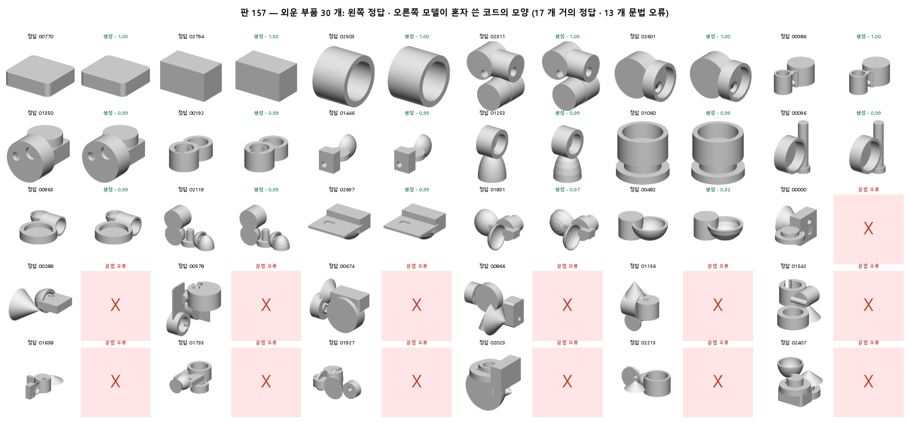
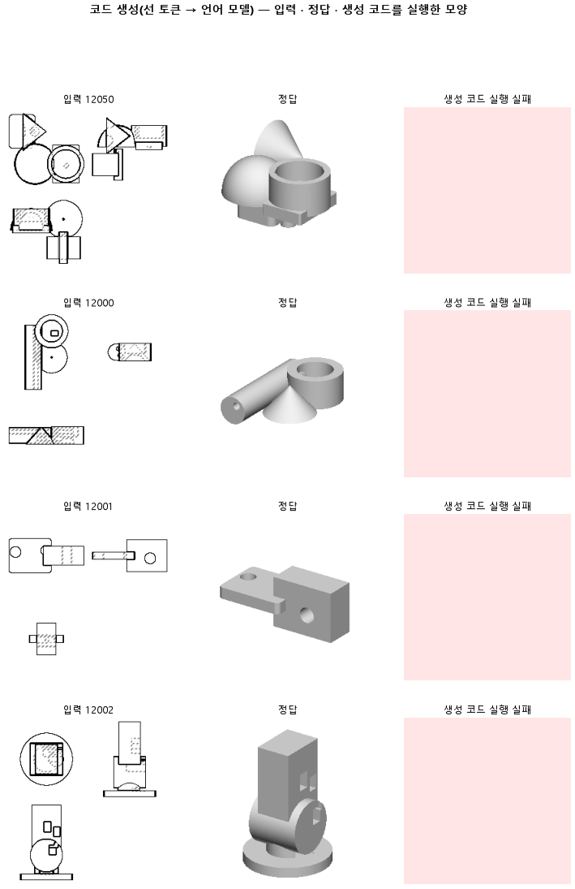

# 부품 30 개만 80 바퀴 배워, 모델이 본 부품을 외울 수 있는지 잰다

## 분석
<!-- 사람 칸: 하네스 분석 단계 초안(claude -p) · 고치면 다시 만들어도 남는다 -->
### 한 줄로

**물음**: 부품 30개만 되풀이해 배우면, 모델이 그 30개를 외울 수 있을까?

**답**: 외울 수 있다. 배운 30개의 모양 겹침 중앙값은 0.976으로, 미리 정한 0.80을 넘었다. 30개 중 17개는 0.92 이상으로 거의 똑같고, 13개는 문법이 깨져 실행되지 않았다. 표의 판정 실패(목표선 1개 중 0개)는 처음 보는 시험 부품 100개의 점수다.

### 왜 이 판을 했나

우리 모델은 부품 도면 세 장을 보고 CAD 코드를 쓴다. 대조 판(156a)은 배운 부품에서도 모양 겹침 중앙값이 0.00이었다. 겹침은 코드로 만든 모양과 정답 모양이 얼마나 겹치는지를 뜻하고, 1이면 똑같다.

본 부품도 못 쓰면 다른 설정을 돌려 봐야 소용없다. 그래서 먼저 정해 뒀다. 30개의 겹침 중앙값이 0.80을 못 넘으면 학습량이 아니라 구조나 코드 표현 문제로 본다.

### 바꾼 것 하나

학습 부품을 240개에서 **30개**로 줄였다. 2,400스텝과 시험 부품 100개는 156a와 같다. 그래서 부품 하나를 보는 횟수가 10번에서 80번으로 늘었다.

### 결과

| | 이 판 (157) | 대조 (156a) | 목표 | 넘었나 |
|---|---|---|---|---|
| 모양 겹침 (배운 부품) | **0.976** (30개) | 0.00 (50개) | 0.80 이상 | ✓ |
| 쓴 코드가 실행됨 (배운 부품) | 0.57 | 0.46 | — | — |
| 덩어리 개수를 맞힘 (배운 부품) | 0.73 | 0.32 | — | — |
| 모양 겹침 (시험 100개) | 0.00 | 0.00 | — | — |
| 쓴 코드가 실행됨 (시험) | 0.01 | 0.48 | — | — |
| 실행된 것만 겹침 | 0.55 | 0.54 | — | — |
| 원뿔을 코드에 씀 | 0.00 | 0.00 | — | — |
| 덩어리 개수를 맞힘 (시험) | 0.29 | 0.31 | — | — |
| 시험 손실 | 1.41 | 0.49 | — | — |
| 학습 손실 (배운 부품) | 0.04 | 0.42 | — | — |

*목표 0.80은 외운 30개의 기준이다. 하네스 판정은 시험 100개로 나와서, 30개는 `학습부품확인.py`로 따로 쟀다. 실행되지 않은 코드는 겹침 0으로 센다. 배운 부품의 대조 값은 156a의 학습 부품 50개다. 손실은 코드가 정답과 다른 정도로, 낮을수록 좋다. 덩어리는 코드가 만드는 몸체 하나를 뜻한다.*

### 왜 이렇게 나왔나

**확인한 것**

- 혼자 쓴 코드도 외웠다. 배운 30개 중 실행된 17개는 겹침이 전부 0.92 이상이다. 결과는 둘로 갈린다. 실행되면 거의 정답이고, 안 되면 0이다.
- 실행 안 된 13개는 모두 문법 오류다. 괄호 짝과 닫히지 않은 문자열이 많다. 코드 길이 중앙값은 실패 995자, 성공 654자로 긴 코드가 더 깨지지만, 구간은 겹친다.
- 코드 따라 쓰기는 늘었다. 학습 손실은 5.12에서 0.04로 내려갔고, 156a의 0.42보다 훨씬 낮다.
- 처음 보는 부품은 나빠졌다. 시험 손실은 750스텝의 0.72가 가장 낮았고, 그 뒤 1.41까지 올랐다. 실행률도 0.48에서 0.01로 떨어졌다.
- **깨진 것은 원뿔 부품이다.** 배운 30개 중 정답에 원뿔이 든 부품이 12개인데, 12개 모두 실행되지 않았다. 원뿔 없는 18개는 17개가 실행됐다. 생성 코드에는 원뿔 명령(`makeCone`)이 한 번도 나오지 않았다. 원뿔 자리에서 글이 뒤섞여 문법이 깨진다.
- 그래서 시험 부품에서도 원뿔 표시가 0.00이다. 앞 판(155)은 1.00이었다.

**짐작 (아직 확인 안 함)**

- 도면 읽는 법이 아니라 코드 30개의 글자를 외웠을 수 있다. 그렇다면 처음 보는 도면에서 코드가 무너지는 것도 설명된다.
- 학습 손실이 0.04인데 배운 부품의 43%가 깨진 것은, 토큰 하나의 작은 실수가 코드 전체를 망치기 때문일 수 있다.
- 원뿔 명령은 `cq.Solid.makeCone(r, 0, h)` 한 줄로 짧다. 그런데도 못 쓰는 까닭은 아직 모른다. `Solid` 처럼 다른 부품에 드문 낱말이 끼어 있어서일 수 있다.

### 한계

- 하네스 판정은 시험 부품 기준이라 표의 판정 문구와 이 글의 답이 다르다. 물음의 답은 배운 30개 값이다.
- 30개는 시드 하나로 쟀다. 다시 돌린 흔들림은 재지 않았다.
- 30개는 학습 부품 240개에서 골랐고, 진단용이다. 본 학습 데이터는 바꾸지 않았다.
- 이 판의 실행된 것만 겹침 0.55는 부품 1개의 값이라 156a의 0.54와 비교할 수 없다.
- 156a의 실행된 것만 겹침은 배운 부품이 0.23, 시험 부품이 0.54다. 배운 부품이 더 낮은 까닭은 설명하지 못했다.

### 배운 것과 다음

**모델 구조와 코드 표현은 도면에서 정확한 코드까지 가는 길을 담을 수 있다. 막힌 곳은 처음 보는 도면에 일반화하는 단계다.** 미리 적은 기준대로면 구조 · 표현 문제 가설은 이 판에서 지지되지 않는다. 다만 30개를 외운다고 3,000개를 일반화할 수 있다는 뜻은 아니다. 156a 학습 부품이 0.00이었던 것은 240개를 10바퀴 돈 학습량 탓일 수 있다.

1. 학습 부품 수를 30에서 늘려 가며, 외우기가 어디서 무너지는지 잰다.
2. 원뿔 부품에서 생성 글이 어느 토큰부터 정답과 갈라지는지 본다.
3. 외우기 판은 배운 부품으로 채점하도록 판정을 고친다.

명제: 156a 설정에서 학습 부품을 30 개로 줄이면 그 30 개의 부피 IoU 중앙값이 0.80 이상이다(156a 학습 부품 0.00 · 실행된 것만 0.23) — 못 넘으면 학습량이 아니라 구조 · 표현 문제

| 가지 | 종류 | 바탕 | 바꾼 손잡이 | 에폭 | git | 날짜 |
|---|---|---|---|---|---|---|
| B1 | 탐색 | 127 (하네스/conf/바탕.yaml) | 코드.학습부품: 증류 → 외우기 | 10 | `2bde3c3` | 2026-11-02 12:39 |

## 1. 판정: **탐색 — 이김 판정 없음 · 기준 못 넘음 · 목표선 0/1**

| 지표 | 식 | 문턱 | 이 판 | 대조(156a증류대조) | 통과 |
|---|---|---|---|---|---|
| 코드_부피IoU | >= | 0.3 | 0.000 | 0.000 | ✗ |
| 코드_부피IoU | >= | 0.8 | 0.000 | 0.000 | ✗ |

## 2. 숫자 — 이 판 대 대조

| 지표 | 이 판 | 대조 |
|---|---|---|
| 코드_실행률 | 0.010 | — |
| 코드_IoU | 0.000 | — |
| 코드_IoU평균 | 0.005 | — |
| 코드_부피IoU | 0.000 | 0.000 |
| 코드_부피바닥 | 0.149 | — |
| 코드_IoU실행 | 0.550 | — |
| 코드_OOM | 0.000 | — |
| 코드_정답실패 | 0.000 | — |
| 코드_원뿔배움 | 0.000 | — |
| 코드_옆옮김 | 1.000 | — |
| 코드_옆옮김정답 | 0.787 | — |
| 코드_몸개수맞음 | 0.290 | — |
| 코드_학습loss | 0.036 | — |
| 코드_시험loss | 1.414 | — |
| 시험loss | 1.414 | — |
| 학습loss | 0.036 | — |

## 모델 구조
(이 판은 구조를 안 잼)

## 3. 학습 곡선

| 에폭 | 학습 loss | 시험 loss | 맞음(CAD 덩어리 수 · 선지도 선 종류) |
|---|---|---|---|
| 250 | 5.120 | 2.199 | 0.000 |
| 500 | 1.045 | 0.742 | 0.000 |
| 750 | 0.471 | 0.720 | 0.000 |
| 1000 | 0.288 | 0.839 | 0.000 |
| 1250 | 0.176 | 1.062 | 0.000 |
| 1500 | 0.091 | 1.218 | 0.000 |
| 1750 | 0.063 | 1.346 | 0.000 |
| 2000 | 0.046 | 1.403 | 0.000 |
| 2250 | 0.031 | 1.414 | 0.000 |
| 2400 | 0.036 | 1.414 | 0.000 |

## 4. 점검

### 4.1 연기 판
첫 loss — → 배치 하나 40 걸음 — · VRAM — GB

### 4.2 층보기 (시험 64 · 4 층)
칸끼리 닮음 — (1 = 6 칸 같음) · 빈 조각 주의 몫 — (빈 조각 비율 0.54) · 주의 엔트로피 — · 출력 자리 퍼짐 — (정답 0.148)

### 4.3 탐침 — 합성 그림 (블록 4 · 128)
구조 6 종 — · 곡률 R² — · (블록 3: — · —)

### 4.4 특징 — 실제 도면 (조각 라벨 · 하네스/특징.py)
(이 판은 특징 점검을 안 함)

## 쇼츠
편 118_판157외우기 · 56.5 초 · 14 줄 · 서재용 업로드 대기

[쇼츠 영상](쇼츠.mp4)

| 누구 | 말 |
|---|---|
| AI | 모델에 이 도면을 넣었더니, 모델이 쓴 코드가 안 돌아요. |
| AI | 이 모델은 도면을 보고, 모양을 만드는 프로그램 코드를 써요. |
| AI | 외우게 하려고, 몇 장 안 되는 도면만 몇 번이고 보여 줬어요. |
| 나 | 본 걸 또 보여 줬는데도 못 외웠네. |
| 나 | 모델이 작아서 외울 자리가 없는 거야. |
| AI | 그런데 다른 도면은 정답과 거의 똑같은 코드가 나와요. |
| AI | 안 도는 건 이 도면처럼 뾰족한 원뿔이 든 부품이에요. |
| AI | 모델이 쓴 코드엔 원뿔을 만드는 줄이 한 번도 없어요. |
| AI | 도면 속 원뿔 자리에 오면 코드가 뒤엉켜 안 돌아요. |
| 나 | 다른 건 외웠으니까, 작아서가 아니었네. |
| 나 | 원뿔 든 부품만 따로 모아서 확인해 봐. |
| AI | 원뿔 없는 부품은 거의 다 돌아요. |
| AI | 원뿔 든 12개는 다 안 돌아요. |
| AI | 원뿔 든 부품은 끝내 하나도 못 외웠어요. |

## 5. 해석
<!-- 사람 칸: 아래를 채운다 · 보고서를 다시 만들어도 남는다 -->
(비어 있음)

## 6. 다음 가지 (사람이 고름 · claudedocs/문제트리.md)
<!-- 사람 칸: 아래를 채운다 · 보고서를 다시 만들어도 남는다 -->
(비어 있음)

## 7. 재현
`python 하네스/하네스.py --config-name 판_157외우기` · 설정 [설정.yaml](설정.yaml) · 판정 [판정.json](판정.json) · 산출 `G:/art2real/out/하네스/157외우기/`

## 링크
- 쇼츠: 서재용 업로드 대기
- GitHub 이슈: https://github.com/sigongjoa/art2real/issues/29
