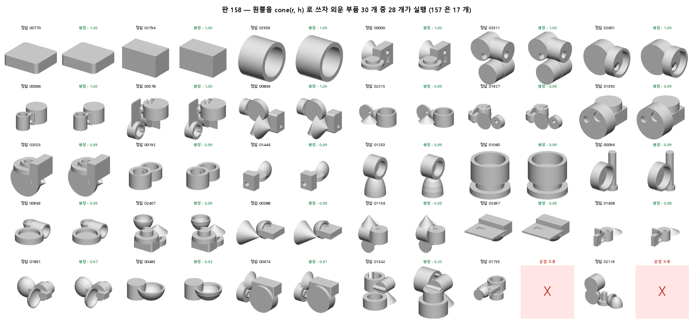
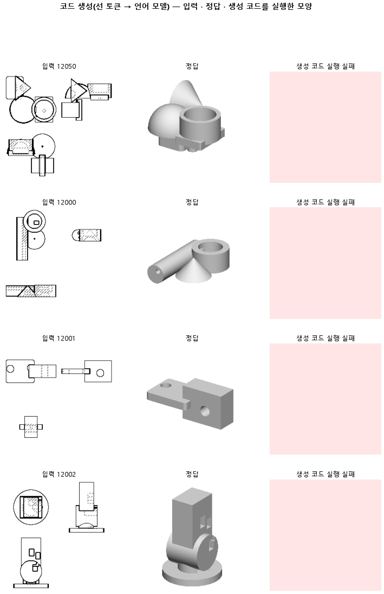

# 원뿔을 정답 코드에서 한 이름으로 써, 못 배우던 원뿔 토큰을 배우는지 본다

## 분석
<!-- 사람 칸: 하네스 분석 단계 초안(claude -p) · 고치면 다시 만들어도 남는다 -->
### 한 줄로

**물음**: 원뿔을 정답 코드에서 `cone(r, h)` 한 이름으로 쓰면, 157에서 못 배우던 원뿔 첫 칸을 배울까?

**답**: 배운 부품에서는 원뿔 첫 칸을 다 맞혔다. 미리 정한 판정 기준을 넘었으니 판정은 통과다. 하지만 최종 목표인 처음 보는 부품의 모양 겹침은 여전히 0.00이라, 이 목표는 넘지 못했다.

### 왜 이 판을 했나

우리 모델은 부품 도면 세 장을 보고 CAD 코드를 쓴다. 앞 판(157)은 부품 30개를 거의 외웠다. 그런데 원뿔이 든 부품 12개는 하나도 실행되지 않았다.

원인은 코드의 낱말(토큰) 한 칸이었다. 정답은 `cq.` 다음에 `Solid`를 쓴다. 모델은 매번 `Workplane`을 썼다. `cq.` 다음에는 거의 늘 `Workplane`이 오고, `Solid`는 원뿔에만 한 번 나온다. 모델이 이 드문 경우를 배우지 못했다.

### 바꾼 것 하나

정답 코드의 원뿔만 `.add(cq.Solid.makeCone(...))`에서 **`cone(r, h)`** 로 바꿨다. 이제 원뿔은 줄 첫머리에서 바로 이름으로 나온다. 데이터, 학습 부품 30개, 시험 부품 100개, 학습 2,400스텝은 157과 같다.

### 결과

| | 이 판 (158) | 대조 (157) | 목표 | 넘었나 |
|---|---|---|---|---|
| 원뿔 첫 칸을 맞힘 (배운 부품) · 판정 기준 | **1.00** (시드 셋 다) | 0.00 | 0.90 이상 | ✓ |
| 외운 부품 30개가 실행됨 | **0.93** (28개) | 0.57 (17개) | — | — |
| 그중 원뿔 부품 12개가 실행됨 | **11개** | 0개 | — | — |
| 외운 부품 모양 겹침 (중앙) | **0.99** | 0.98 | — | — |
| 모양 겹침 (처음 보는 시험 부품) · 최종 목표 | 0.00 | 0.00 | 0.80 이상 | ✗ |
| 쓴 코드가 실행됨 (시험) | 0.02 | 0.01 | — | — |
| 시험 손실 | 1.43 | 1.41 | — | — |

### 왜 이렇게 나왔나

**확인한 것**

- 157 원뿔 부품이 깨진 원인은 코드 서식이었다. 원뿔을 `cone(r, h)`로 쓰자 첫 칸을 다 맞혔고(시드 0 · 1 · 2 모두 1.00), 외운 원뿔 부품 12개 중 11개가 실제로 실행됐다(중앙 겹침 0.99). 157에서는 0개였다.
- 시드 0이 기준 0.9에 0.12 안쪽이라 하네스 규칙대로 시드 1 · 2도 돌렸다. 셋 다 1.00이다.
- 처음 보는 부품은 그대로다. 시험 손실은 750스텝 근처에서 가장 낮았다가 1.43까지 올랐다. 30개에 맞출수록 새 부품을 못 쓴다.
- 시험 코드가 깨지는 방식은 「같은 줄 반복」이 아니다. 시드 셋 300개 중 같은 줄을 세 번 넘게 쓴 코드는 0개, 토큰 한도(1024)에 닿은 코드는 30개(10 %)다. 대부분은 한도 전에 문법이 무너진 글로 끝난다. 루프 때문에 실력이 가려진 것이 아니라, 처음 보는 도면을 코드로 옮기는 실력 자체가 아직 없다.

**짐작 (아직 확인 안 함)**

- 남은 실패 둘(01542 겹침 0.25 · 01735 문법 오류)은 원뿔 갈래가 아니라 다른 자리에서 갈린 것 같다. 갈림 자리를 보지 않았다.

### 한계

- 학습 부품 30개, 시험 부품 100개뿐이다.
- 외운 부품 확인은 시드 0 LoRA 하나로만 했다.

### 배운 것과 다음

**드문 낱말을 줄 첫머리 이름 하나로 바꾸니, 같은 학습량으로 그 칸을 배웠고 외운 원뿔 부품이 실제로 돌았다.** 157 의 「외워도 30 개 중 13 개가 안 돈다」는 서식 문제였고, 이제 외우기는 거의 완성됐다(28/30 · 0.99). 남은 문제는 하나 — 처음 보는 부품을 못 쓴다.

1. 학습 부품을 30개에서 늘려 가며, 외우기와 처음 보는 부품 성능이 어디서 갈리는지 잰다.

명제: 157 설정에서 원뿔 정답 서식만 cone(r, h) 로 바꾸면, 학습 부품에서 원뿔 갈래 토큰을 맞히는 비율(코드_원뿔배움)이 0.9 이상이다(157 은 0.00 · CE 33.9)

| 가지 | 종류 | 바탕 | 바꾼 손잡이 | 에폭 | git | 날짜 |
|---|---|---|---|---|---|---|
| B1 | 비교 | 127 (하네스/conf/바탕.yaml) | 코드.서식: None → 원뿔이름 | 10 | `eda97a4` | 2026-11-03 12:58 |

## 1. 판정: **통과 · 목표선 0/1**

| 지표 | 식 | 문턱 | 이 판 | 대조(157외우기) | 통과 |
|---|---|---|---|---|---|
| 코드_원뿔배움 | >= | 0.9 | 1.000 | 0.000 | ✓ |
| 코드_부피IoU | >= | 0.8 | 0.000 | — | ✗ |

## 2. 숫자 — 이 판 대 대조

| 지표 | 이 판 | 대조 |
|---|---|---|
| 코드_실행률 | 0.017 | — |
| 코드_IoU | 0.000 | — |
| 코드_IoU평균 | 0.009 | — |
| 코드_부피IoU | 0.000 | — |
| 코드_부피바닥 | 0.149 | — |
| 코드_IoU실행 | — | — |
| 코드_OOM | 0.000 | — |
| 코드_정답실패 | 0.000 | — |
| 코드_원뿔배움 | 1.000 | 0.000 |
| 코드_옆옮김 | 0.972 | — |
| 코드_옆옮김정답 | 0.787 | — |
| 코드_몸개수맞음 | 0.313 | — |
| 코드_학습loss | 0.013 | — |
| 코드_시험loss | 1.408 | — |
| 시험loss | 1.408 | — |
| 학습loss | 0.013 | — |

## 모델 구조
(이 판은 구조를 안 잼)

## 3. 학습 곡선

| 에폭 | 학습 loss | 시험 loss | 맞음(CAD 덩어리 수 · 선지도 선 종류) |
|---|---|---|---|
| 250 | 5.086 | 2.178 | 0.000 |
| 500 | 1.020 | 0.713 | 0.000 |
| 750 | 0.444 | 0.670 | 0.000 |
| 1000 | 0.256 | 0.811 | 0.000 |
| 1250 | 0.138 | 1.042 | 0.000 |
| 1500 | 0.064 | 1.179 | 0.000 |
| 1750 | 0.032 | 1.310 | 0.000 |
| 2000 | 0.017 | 1.357 | 0.000 |
| 2250 | 0.013 | 1.369 | 0.000 |
| 2400 | 0.012 | 1.370 | 0.000 |

## 4. 점검

### 4.1 연기 판
첫 loss — → 배치 하나 40 걸음 — · VRAM — GB

### 4.2 층보기 (시험 64 · 4 층)
칸끼리 닮음 — (1 = 6 칸 같음) · 빈 조각 주의 몫 — (빈 조각 비율 0.54) · 주의 엔트로피 — · 출력 자리 퍼짐 — (정답 0.148)

### 4.3 탐침 — 합성 그림 (블록 4 · 128)
구조 6 종 — · 곡률 R² — · (블록 3: — · —)

### 4.4 특징 — 실제 도면 (조각 라벨 · 하네스/특징.py)
(이 판은 특징 점검을 안 함)

## 쇼츠
편 119_판158원뿔이름 · 54.8 초 · 14 줄 · 서재용 업로드 대기

[쇼츠 영상](쇼츠.mp4)

| 누구 | 말 |
|---|---|
| AI | 도면 꼭대기 원뿔이, 모델이 쓴 코드에선 안 만들어져요. |
| AI | 모델은 이런 도면을 보고 입체 모양을 만드는 코드를 써요. |
| 나 | 뾰족한 데가 작아서 못 알아본 거네. |
| AI | 사람이 써 둔 정답 코드랑 한 단어씩 맞춰 봤어요. |
| AI | 원뿔을 만드는 줄에서 첫 단어 하나만 틀렸어요. |
| AI | 정답은 Solid인데, 모델은 Workplane이라고 썼어요. |
| AI | 다른 모양 줄은 거의 다 Workplane으로 시작하거든요. |
| AI | Solid는 원뿔 줄에만 나와서 못 배운 거예요. |
| 나 | 모양이 아니라 단어가 문제였네. |
| 나 | 정답 코드의 원뿔 줄을 cone으로 시작하게 바꿔. |
| AI | 정답 코드를 그렇게 고쳐서 모델을 다시 가르쳤어요. |
| AI | 가르칠 때 본 원뿔 도면 12개, 모두 cone으로 시작했어요. |
| AI | 바꾸기 전과 똑같이, 처음 보는 도면에선 모양이 거의 안 나와요. |
| AI | 원뿔도 첫 단어만 맞혔지, 실제로 만들어지는지는 아직 몰라요. |

## 5. 해석
<!-- 사람 칸: 아래를 채운다 · 보고서를 다시 만들어도 남는다 -->
(비어 있음)

## 6. 다음 가지 (사람이 고름 · claudedocs/문제트리.md)
<!-- 사람 칸: 아래를 채운다 · 보고서를 다시 만들어도 남는다 -->
(비어 있음)

## 7. 재현
`python 하네스/하네스.py --config-name 판_158원뿔이름` · 설정 [설정.yaml](설정.yaml) · 판정 [판정.json](판정.json) · 산출 `G:/art2real/out/하네스/158원뿔이름/`

## 링크
- 쇼츠: 서재용 업로드 대기
- GitHub 이슈: https://github.com/sigongjoa/art2real/issues/30
