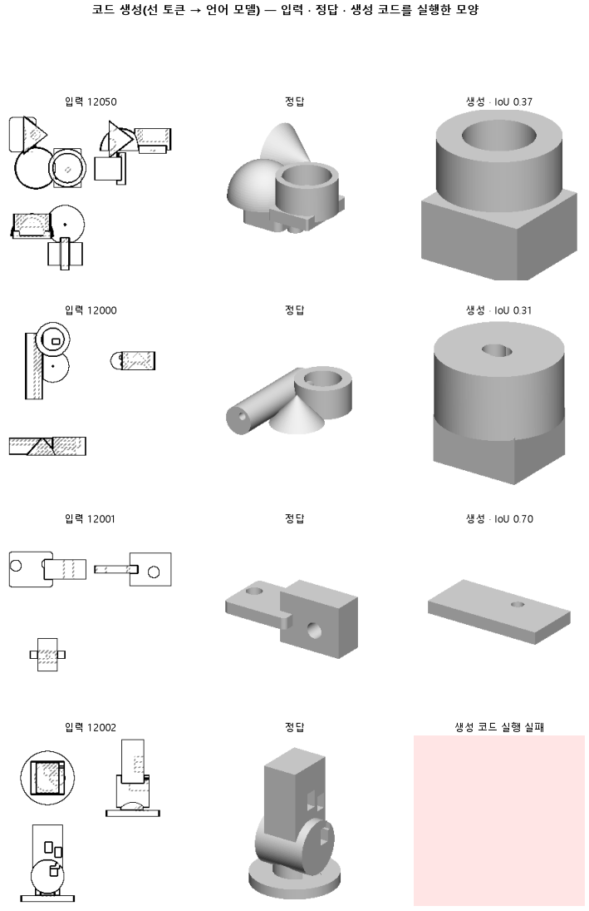

# 짧은 학습과 시험 일부로 155 를 다시 재, 다음 판들을 빨리 거를 기준값을 만든다

## 분석
<!-- 사람 칸: 하네스 분석 단계 초안(claude -p) · 고치면 다시 만들어도 남는다 -->
### 한 줄로

**물음**: 155를 3분의 1만 학습하고 시험 부품 100개로만 재도, 다음 판들을 거를 기준값을 얻을 만큼 코드가 돌아갈까?

**답**: 돌아간다. 모델이 쓴 코드 중 0.67이 실행돼 기준 0.50을 넘었다. 하지만 입체로 잰 겹침은 0.12로, 최종 목표 0.80에 한참 못 미친다. 이 판은 기준값을 얻으려고 돌린 탐색 판이라 승패 판정은 없다.

### 왜 이 판을 했나

우리 모델은 부품 도면 세 장(위·앞·옆)을 보고 CAD 코드를 쓴다. 코드는 상자나 원기둥 같은 덩어리, 즉 「몸」을 하나씩 짓고 합친다. 155는 정답 코드의 숫자를 도면과 같은 기준(가운데가 원점, 긴 변이 100)으로 적게 바꾼 판이다.

한 판을 9,000스텝 학습시키고 299개로 재면 오래 걸린다. 그래서 짧게 돌려 가망 없는 설정부터 거르기로 했다. 그러려면 같은 짧은 조건에서 잰 비교값이 있어야 한다.

### 바꾼 것 하나

155 설정은 그대로 두고 **길이만 줄였다**. 학습은 9,000스텝에서 3,000스텝으로, 시험은 299개에서 앞쪽 100개로 줄였다. 학습 부품 3,000개는 같다. 학습에 4,649초가 걸렸다.

### 결과

| | 이 판 (161) | 대조 (155) | 목표 | 넘었나 |
|---|---|---|---|---|
| 쓴 코드가 실행됨 | 0.67 | 0.94 | 0.50 이상 | ✓ |
| 입체 겹침 (최종 목표) | 0.12 | — | 0.80 이상 | ✗ |
| 도면 윤곽 겹침 (중앙값) | 0.43 | 0.52 | — | — |
| 도면 윤곽 겹침 (실행된 것만) | 0.54 | 0.54 | — | — |
| 몸을 첫 몸 옆으로 놓음 | 0.19 | 0.39 | — | — |
| 몸 개수를 맞힘 | 0.28 | 0.37 | — | — |

*윤곽 겹침은 세 방향에서 본 모양이 정답과 겹치는 정도이고, 입체 겹침은 덩어리 자체가 겹치는 정도다. 윤곽이 맞아도 속이 다르면 입체 겹침은 낮다. 우리가 원하는 것은 결국 입체라서 목표는 입체 쪽에 두었다. 정답 부품은 대부분 몸을 옆에 나란히 붙여 짓기 때문에, 위로만 쌓으면 모양이 틀어진다.*

### 왜 이렇게 나왔나

**확인한 것**

- 윤곽 겹침 중앙값이 0.52에서 0.43으로 내린 것은 실행률이 0.94에서 0.67로 떨어진 탓이 크다. 실행된 코드만 보면 둘 다 0.54다.
- 학습이 덜 끝났다. 시험 손실이 2,000스텝에서 0.45, 3,000스텝에서 0.44로 아직 내려가는 중이다. 155는 0.39다.
- 원뿔을 쓰는지 보는 검사에서 155는 1, 이 판은 0이다.
- 채점은 깨끗했다. 정답을 못 그린 부품도, 메모리가 넘친 부품도 없었다.

**짐작 (아직 확인 안 함)**

- 실행된 67 %에 쉬운 부품만 남았을 수 있다. 그렇다면 0.54가 같다는 것은 「끝까지 학습한 만큼 잘한다」는 뜻이 아니다.
- 3,000스텝은 코드 문법을 익히기에 짧아서 실행이 깨지는 것으로 본다. 깨진 코드를 세지는 않았다.

### 한계

- 시험 부품 100개로 한 번만 돌렸다.
- 옆으로 놓는 비율 차이 0.20은 155를 세 번 돌렸을 때의 폭 0.22 안에 있다. 짧은 학습 때문에 줄었다고 말할 수 없다.
- 155 기록에는 입체 겹침이 없어 0.12를 견줄 값이 없다. 표의 대조는 시험 수·학습 길이·돌린 횟수가 다 다르다.

### 배운 것과 다음

**짧게 돌려도 코드는 돌아간다. 그래서 거르기 판의 기준값은 얻었다.** 다만 실행된 코드가 155만큼 잘한다고는 아직 말할 수 없다. 거르기 판들은 155가 아니라 이 판 값하고만 견준다.

1. 실행된 부품과 실패한 부품을 나눠, 쉬운 부품만 남았는지 본다.
2. 다음 설정들을 같은 3,000스텝·100개로 돌리고, 차이가 보이는 것만 9,000스텝·299개로 다시 잰다.
3. 이 판을 시드만 바꿔 한 번 더 돌려 흔들림 폭을 잰다.

명제: 155 설정을 3,000 스텝 · 시험 100 개로 줄여도 코드가 돈다 — 실행률 0.5 이상(거르기 판들의 대조값을 얻는 판)

| 가지 | 종류 | 바탕 | 바꾼 손잡이 | 에폭 | git | 날짜 |
|---|---|---|---|---|---|---|
| B1 | 탐색 | 127 (하네스/conf/바탕.yaml) | 코드.시험수: None → 100, 학습.스텝: 9000 → 3000 | 10 | `c79f3df` | 2026-11-04 17:09 |

## 1. 판정: **탐색 — 이김 판정 없음 · 기준 넘음 · 목표선 0/1**

| 지표 | 식 | 문턱 | 이 판 | 대조(155도면좌표) | 통과 |
|---|---|---|---|---|---|
| 코드_실행률 | >= | 0.5 | 0.670 | — | ✓ |
| 코드_부피IoU | >= | 0.8 | 0.118 | 0.172 | ✗ |

## 2. 숫자 — 이 판 대 대조

| 지표 | 이 판 | 대조 |
|---|---|---|
| 코드_실행률 | 0.670 | — |
| 코드_IoU | 0.426 | — |
| 코드_IoU평균 | 0.364 | — |
| 코드_부피IoU | 0.118 | 0.172 |
| 코드_부피바닥 | 0.149 | — |
| 코드_IoU실행 | 0.543 | — |
| 코드_OOM | 0.000 | — |
| 코드_정답실패 | 0.000 | — |
| 코드_원뿔배움 | 0.000 | — |
| 코드_옆옮김 | 0.185 | 0.390 |
| 코드_옆옮김정답 | 0.787 | — |
| 코드_몸개수맞음 | 0.280 | — |
| 코드_학습loss | 0.428 | — |
| 코드_시험loss | 0.442 | — |
| 시험loss | 0.442 | — |
| 학습loss | 0.428 | — |

## 모델 구조
(이 판은 구조를 안 잼)

## 3. 학습 곡선

| 에폭 | 학습 loss | 시험 loss | 맞음(CAD 덩어리 수 · 선지도 선 종류) |
|---|---|---|---|
| 250 | 5.219 | 2.267 | 0.000 |
| 500 | 1.194 | 0.742 | 0.000 |
| 750 | 0.609 | 0.582 | 0.000 |
| 1000 | 0.521 | 0.520 | 0.000 |
| 1250 | 0.499 | 0.489 | 0.000 |
| 1500 | 0.469 | 0.483 | 0.000 |
| 1750 | 0.448 | 0.464 | 0.000 |
| 2000 | 0.438 | 0.455 | 0.000 |
| 2250 | 0.453 | 0.450 | 0.000 |
| 2500 | 0.435 | 0.445 | 0.000 |
| 2750 | 0.431 | 0.442 | 0.000 |
| 3000 | 0.428 | 0.442 | 0.000 |

## 4. 점검

### 4.1 연기 판
첫 loss — → 배치 하나 40 걸음 — · VRAM — GB

### 4.2 층보기 (시험 64 · 4 층)
칸끼리 닮음 — (1 = 6 칸 같음) · 빈 조각 주의 몫 — (빈 조각 비율 0.54) · 주의 엔트로피 — · 출력 자리 퍼짐 — (정답 0.148)

### 4.3 탐침 — 합성 그림 (블록 4 · 128)
구조 6 종 — · 곡률 R² — · (블록 3: — · —)

### 4.4 특징 — 실제 도면 (조각 라벨 · 하네스/특징.py)
(이 판은 특징 점검을 안 함)

## 쇼츠
편 120_판161거르기대조 · 50.6 초 · 14 줄 · 서재용 업로드 대기

[쇼츠 영상](쇼츠.mp4)

| 누구 | 말 |
|---|---|
| AI | 모델이 만든 부품이 탑처럼 위로 쌓였어요. |
| AI | 이 모델은 도면을 보고 입체를 짓는 코드를 써요. |
| AI | 왼쪽이 정답, 오른쪽이 모델이 지은 거예요. |
| AI | 정답은 덩어리 여러 개를 옆에 나란히 붙였어요. |
| 나 | 옆에 붙을 게 위로 올라갔네. |
| 나 | 도면에서 옆에 붙은 게 안 보였나 보다. |
| AI | 이게 모델에 넣은 도면이에요. 정면에서 본 그림이에요. |
| AI | 여기 봐요. 덩어리 둘이 옆으로 나란히 있어요. |
| 나 | 도면엔 다 있었네. |
| 나 | 이 부품만 그런지, 다른 부품도 전부 넣어 봐. |
| AI | 부품마다 옆에 붙였나, 위에 쌓았나 셌어요. |
| AI | 정답은 10개 중 8개가 옆인데, 모델은 2개뿐이에요. |
| 나 | 도면엔 있는데 거의 다 위로 쌓는구나. |
| AI | 이번엔 실패예요. 도면에 그려진 자리를 못 따라갔어요. |

## 5. 해석
<!-- 사람 칸: 아래를 채운다 · 보고서를 다시 만들어도 남는다 -->
(비어 있음)

## 6. 다음 가지 (사람이 고름 · claudedocs/문제트리.md)
<!-- 사람 칸: 아래를 채운다 · 보고서를 다시 만들어도 남는다 -->
(비어 있음)

## 7. 재현
`python 하네스/하네스.py --config-name 판_161거르기대조` · 설정 [설정.yaml](설정.yaml) · 판정 [판정.json](판정.json) · 산출 `G:/art2real/out/하네스/161거르기대조/`

## 링크
- 쇼츠: 서재용 업로드 대기
- GitHub 이슈: https://github.com/sigongjoa/art2real/issues/31
