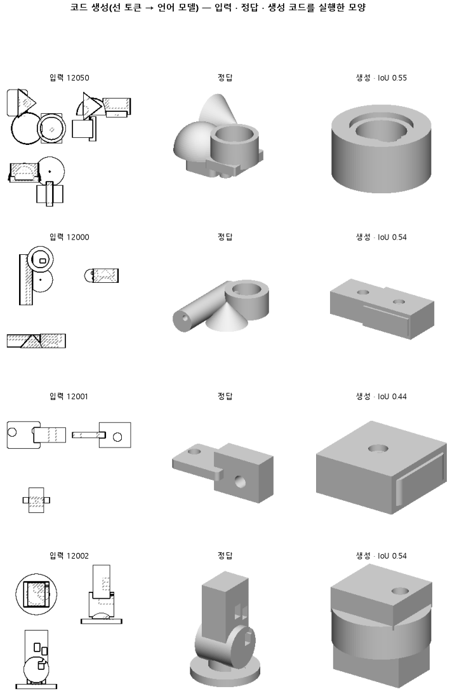

# 학습률을 올려, 같은 스텝 안에 부품마다 다른 코드를 배우기 시작하는지 본다

## 분석
<!-- 사람 칸: 하네스 분석 단계 초안(claude -p) · 고치면 다시 만들어도 남는다 -->
### 한 줄로

**물음**: 짧은 학습에서 학습률만 세 배로 올리면, 모델이 부품마다 다른 코드를 쓰기 시작할까?

**답**: 코드는 훨씬 잘 돌아가고, 입체 겹침도 0.12에서 0.20으로 올랐다. 하지만 덩어리를 옆에 나란히 놓는 비율은 늘지 않았다(0.19 → 0.11). 미리 정한 기준 둘 중 하나를 못 넘었고 최종 목표에도 못 미쳤다. 판정은 실패다.

### 왜 이 판을 했나

우리 모델은 부품 도면 세 장(위·앞·옆)을 보고 CAD 코드를 쓴다. 코드는 상자나 원기둥 같은 덩어리를 하나씩 짓고 붙여서 부품을 만든다. 이 덩어리를 「몸」이라고 부른다.

155는 학습 부품도 시험 부품보다 더 잘 맞히지 못했다. 외울 만큼도 배우지 못한 것이다. 그래서 덜 배운 것으로 읽었다. 이번에는 더 빨리 배우게 해 보기로 했다. 161의 짧은 조건(3,000스텝 · 시험 100개)에서 걸러 보면 오래 돌리지 않아도 된다.

### 바꾼 것 하나

**학습률을 0.0001에서 0.0003으로** 올렸다. 학습률은 한 스텝에 모델을 얼마나 크게 고치는지 정하는 값이다. 학습 부품 3,000개와 3,000스텝, 시험 100개는 161과 같다. 학습에는 4,234초가 걸렸다.

### 결과

| | 이 판 (163) | 대조 (161) | 목표 | 넘었나 |
|---|---|---|---|---|
| 입체 겹침 (기준 1) | **0.20** | 0.12 | 0.17 이상 | ✓ |
| 몸을 첫 몸 옆에 놓음 (기준 2) | 0.11 | 0.19 | 0.34 이상 | ✗ |
| 입체 겹침 (최종 목표) | 0.20 | 0.12 | 0.80 이상 | ✗ |
| 쓴 코드가 실행됨 | 0.96 | 0.67 | — | — |
| 도면 윤곽 겹침 (중앙값) | 0.54 | 0.43 | — | — |
| 도면 윤곽 겹침 (실행된 것만) | 0.54 | 0.54 | — | — |
| 몸 개수를 맞힘 | 0.38 | 0.28 | — | — |

### 왜 이렇게 나왔나

**확인한 것**

- 실행되는 코드가 0.67에서 0.96으로 늘었다. 그런데 실행된 코드만 보면 도면 윤곽 겹침은 둘 다 0.54다. 윤곽으로 보면 모양을 더 잘 맞힌 게 아니다.
- 정답 부품은 0.79가 몸을 옆에 붙인다. 이 판은 0.11만 그렇게 했다.
- 처음 250스텝에서 학습 손실이 3.65까지 튀었다가 500스텝에 0.60으로 내려왔다. 시험 손실은 2,000스텝에 0.41, 3,000스텝에 0.40으로 거의 멈춰 간다.
- 채점은 깨끗했다. 정답을 못 그린 부품도, 메모리가 넘친 부품도 없었다.

**짐작 (아직 확인 안 함)**

- 입체 겹침이 오른 것도 대부분 실행률 덕으로 본다. 윤곽에서 그랬기 때문이다. 다만 실행된 것만 따로 잰 입체 겹침은 없다.
- 학습률을 올리자 코드 문법은 빨리 익혔다. 하지만 「어디에 놓을지」는 도면을 읽어야 하는 일이라서, 학습률만으로는 안 풀리는 것 같다.

### 한계

- 시험 부품 100개로 한 번만 돌렸다.
- 옆 배치 차이 0.08은 155를 세 번 돌렸을 때 나온 폭 0.22 안에 있다. 줄었다고도, 그대로라고도 말할 수 없다. 확실한 것은 기준 0.34에 못 미쳤다는 것뿐이다.
- 시험 손실이 멈춰 간다. 학습률을 높여서 일찍 평평해진 것인지, 원래 그 근처가 바닥인지는 모른다.

### 배운 것과 다음

**학습률을 올리자 코드는 돌아가게 됐지만, 몸을 옆에 놓는 법은 배우지 못했다.** 덜 배운 문제 가운데 실행 쪽은 풀렸고, 자리 쪽은 그대로다.

1. 실행된 부품만 골라 입체 겹침을 다시 잰다. 실행률 몫과 모양 몫을 나눠 보려는 것이다.
2. 학습률 0.0003은 그대로 둔다. 그 위에서 162의 방법을 걸러 본다. 몸의 위치 숫자를 맞힐 때, 바로 옆 숫자도 조금은 맞은 것으로 쳐 주는 학습이다.
3. 161과 이 판을 무작위 시작값만 바꿔 한 번 더 돌린다. 옆 배치가 얼마나 흔들리는지 재기 위해서다.

명제: 161 과 같은 짧은 학습에서 학습률만 세 배로 올리면, 시험 100 개에서 부피 IoU 중앙이 161 의 0.118 보다 높은 0.17 이상이고 옆옮김이 0.34 이상이다

| 가지 | 종류 | 바탕 | 바꾼 손잡이 | 에폭 | git | 날짜 |
|---|---|---|---|---|---|---|
| B1 | 비교 | 127 (하네스/conf/바탕.yaml) | 학습.학습률: 0.0001 → 0.0003 | 10 | `12a0fba` | 2026-11-05 12:12 |

## 1. 판정: **실패 · 목표선 0/1**

| 지표 | 식 | 문턱 | 이 판 | 대조(161거르기대조) | 통과 |
|---|---|---|---|---|---|
| 코드_부피IoU | >= | 0.17 | 0.197 | 0.118 | ✓ |
| 코드_옆옮김 | >= | 0.34 | 0.112 | 0.185 | ✗ |
| 코드_부피IoU | >= | 0.8 | 0.197 | 0.118 | ✗ |

## 2. 숫자 — 이 판 대 대조

| 지표 | 이 판 | 대조 |
|---|---|---|
| 코드_실행률 | 0.960 | — |
| 코드_IoU | 0.538 | — |
| 코드_IoU평균 | 0.525 | — |
| 코드_부피IoU | 0.197 | 0.118 |
| 코드_부피바닥 | 0.149 | — |
| 코드_IoU실행 | 0.541 | — |
| 코드_OOM | 0.000 | — |
| 코드_정답실패 | 0.000 | — |
| 코드_원뿔배움 | 1.000 | — |
| 코드_옆옮김 | 0.112 | 0.185 |
| 코드_옆옮김정답 | 0.787 | — |
| 코드_몸개수맞음 | 0.380 | — |
| 코드_학습loss | 0.377 | — |
| 코드_시험loss | 0.402 | — |
| 시험loss | 0.402 | — |
| 학습loss | 0.377 | — |

## 모델 구조
(이 판은 구조를 안 잼)

## 3. 학습 곡선

| 에폭 | 학습 loss | 시험 loss | 맞음(CAD 덩어리 수 · 선지도 선 종류) |
|---|---|---|---|
| 250 | 3.648 | 0.848 | 0.000 |
| 500 | 0.598 | 0.506 | 0.000 |
| 750 | 0.458 | 0.462 | 0.000 |
| 1000 | 0.426 | 0.446 | 0.000 |
| 1250 | 0.413 | 0.430 | 0.000 |
| 1500 | 0.403 | 0.424 | 0.000 |
| 1750 | 0.391 | 0.415 | 0.000 |
| 2000 | 0.383 | 0.409 | 0.000 |
| 2250 | 0.387 | 0.411 | 0.000 |
| 2500 | 0.379 | 0.404 | 0.000 |
| 2750 | 0.383 | 0.403 | 0.000 |
| 3000 | 0.377 | 0.402 | 0.000 |

## 4. 점검

### 4.1 연기 판
첫 loss — → 배치 하나 40 걸음 — · VRAM — GB

### 4.2 층보기 (시험 64 · 4 층)
칸끼리 닮음 — (1 = 6 칸 같음) · 빈 조각 주의 몫 — (빈 조각 비율 0.54) · 주의 엔트로피 — · 출력 자리 퍼짐 — (정답 0.148)

### 4.3 탐침 — 합성 그림 (블록 4 · 128)
구조 6 종 — · 곡률 R² — · (블록 3: — · —)

### 4.4 특징 — 실제 도면 (조각 라벨 · 하네스/특징.py)
(이 판은 특징 점검을 안 함)

## 쇼츠
편 121_판163학습률 · 52.8 초 · 14 줄 · 서재용 업로드 대기

[쇼츠 영상](쇼츠.mp4)

| 누구 | 말 |
|---|---|
| AI | 오른쪽이 모델이 만든 부품이에요. |
| AI | 덩어리가 한곳에 쌓였어요. |
| AI | 모델은 이 도면을 보고, 덩어리를 짓는 코드를 써요. |
| AI | 그런데 그 코드가 자주 멈춰서 부품이 안 나왔어요. |
| AI | 왼쪽 정답은 덩어리를 옆에 나란히 붙였어요. |
| 나 | 덜 배워서 그래. 코드도 멈추고 덩어리도 쌓이고. |
| 나 | 한 번에 더 크게 고치게 해서 빨리 배우게 하자. |
| AI | 이제 코드는 거의 안 멈추고 부품이 다 나와요. |
| AI | 그런데 여기 봐요. 덩어리는 아직 첫 덩어리 위에 쌓여요. |
| 나 | 코드 쓰는 법만 늘었네. |
| 나 | 옆에 놓은 개수를 정답이랑 비교해 봐. |
| AI | 부품 100개 중 정답은 79개, 모델은 11개만 옆에 놓아요. |
| AI | 이번 학습은 실패예요. 덩어리 놓을 자리는 못 배웠어요. |
| AI | 멈춘 코드를 빼고 봐도 모양은 그대로예요. |

## 5. 해석
<!-- 사람 칸: 아래를 채운다 · 보고서를 다시 만들어도 남는다 -->
(비어 있음)

## 6. 다음 가지 (사람이 고름 · claudedocs/문제트리.md)
<!-- 사람 칸: 아래를 채운다 · 보고서를 다시 만들어도 남는다 -->
(비어 있음)

## 7. 재현
`python 하네스/하네스.py --config-name 판_163학습률` · 설정 [설정.yaml](설정.yaml) · 판정 [판정.json](판정.json) · 산출 `G:/art2real/out/하네스/163학습률/`

## 링크
- 쇼츠: 서재용 업로드 대기
- GitHub 이슈: https://github.com/sigongjoa/art2real/issues/32
