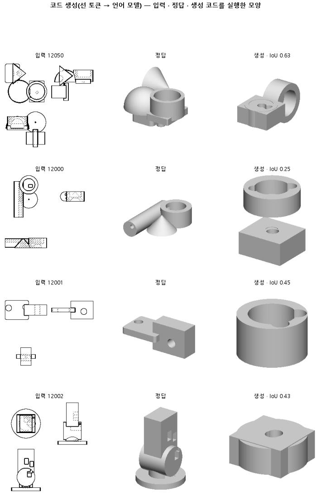

# 한 번에 하나씩 보고 바로 고치게 해, 같은 스텝 안에 갱신을 네 배로 늘린다

## 분석
<!-- 사람 칸: 하네스 분석 단계 초안(claude -p) · 고치면 다시 만들어도 남는다 -->
### 한 줄로

**물음**: 짧은 학습은 그대로 두고 가중치만 더 자주 고치게 하면, 입체 겹침과 「몸을 옆에 놓기」가 미리 정한 선을 넘을까?

**답**: 둘 다 조금씩 모자라서 판정은 실패다. 입체 겹침은 0.16으로 선 0.17에 못 미쳤고, 옆에 놓기는 0.33으로 선 0.34에 못 미쳤다. 대신 실행되는 코드는 0.67에서 0.93으로 늘었다.

### 왜 이 판을 했나

우리 모델은 부품 도면 세 장(위·앞·옆)을 보고 CAD 코드를 쓴다. 코드는 상자나 원기둥 같은 덩어리를 하나씩 짓고 합친다. 이 덩어리 하나를 「몸」이라고 부른다. 앞 판들에서 모델은 학습한 부품도 처음 보는 부품만큼만 맞혔다. 그래서 덜 배웠다고 봤다. 163에서 학습률을 올려 봤지만 실패했다.

이번에는 다른 손잡이를 골랐다. 지금까지 모델은 예시 묶음 네 개를 다 보고 나서야 가중치를 한 번 고쳤다. 그러니 스텝 수가 같아도 실제로 고친 횟수는 4분의 1이었다.

### 바꾼 것 하나

**묶음을 하나 볼 때마다 바로 고치게 했다.** 그만큼 고치는 횟수가 네 배로 는다. 나머지 설정은 짧은 학습의 기준 판인 161과 같다. 학습은 3,000스텝, 학습 부품은 3,000개, 시험 부품은 100개다. 163에서 올린 학습률은 가져오지 않았다. 그래서 대조는 161이다.

### 결과

| | 이 판 (164) | 대조 (161) | 목표 | 넘었나 |
|---|---|---|---|---|
| 입체 겹침 (중앙값) | 0.16 | 0.12 | 0.17 이상 | ✗ |
| 몸을 첫 몸 옆에 놓음 | 0.33 | 0.19 | 0.34 이상 | ✗ |
| 입체 겹침 (최종 목표) | 0.16 | 0.12 | 0.80 이상 | ✗ |
| 쓴 코드가 실행됨 | 0.93 | 0.67 | — | — |
| 도면 윤곽 겹침 (실행된 것만) | 0.54 | 0.54 | — | — |
| 몸 개수를 맞힘 | 0.44 | 0.28 | — | — |

*입체 겹침은 지은 덩어리가 정답 덩어리와 얼마나 겹치는지를 잰다. 윤곽 겹침은 세 방향에서 본 모양이 얼마나 겹치는지를 잰다. 실행이 안 된 코드는 0점이다. 「옆에 놓음」은 다음 몸을 첫 몸 위에 쌓지 않고 옆으로 옮겨 놓은 비율이다. 정답 코드에서는 이 비율이 0.79다. 위로만 쌓으면 모양이 틀어진다. 선 0.17과 0.34는 161보다 확실히 높다고 말할 만한 값으로 미리 정했다. 0.80은 연구 전체의 최종 목표다.*

### 왜 이렇게 나왔나

**확인한 것**

- 겹침이 오른 것은 대부분 실행되는 코드가 늘어난 덕이다. 깨진 코드는 0점이라서 실행률만 올라도 중앙값이 오른다. 실행된 코드만 보면 윤곽 겹침은 두 판 모두 0.54다.
- 더 많이 배우긴 했다. 마지막 시험 손실(틀린 정도)은 0.44에서 0.40으로, 학습 손실은 0.43에서 0.38로 내렸다.
- 원뿔을 쓰는지 보는 검사가 0에서 1이 됐다. 쓰면 1, 못 쓰면 0이다.

**짐작 (아직 확인 안 함)**

- 옆에 놓는 비율 0.33은 정답 0.79의 절반에도 못 미친다. 윤곽은 맞아도 덩어리 배치가 틀려서 입체 겹침이 낮은 것으로 본다.
- 시험 손실은 2,500스텝에서 0.41, 3,000스텝에서 0.40으로 아직 내려가는 중이다. 더 길게 학습하면 더 오를 수 있다.

### 한계

- 시험 부품 100개로 두 판을 한 번씩만 돌렸다. 위의 차이는 모두 그 한 번에서 나온 값이다.
- 155를 세 번 돌렸을 때 옆에 놓기는 0.22만큼 흔들렸다. 이번 차이 0.15는 그 폭 안에 든다. 실행률과 입체 겹침은 흔들림 폭을 재지 않았다. 그래서 0.26과 0.04의 차이도 진짜인지 아직 모른다.
- 두 선은 0.01 차이로 놓쳤다. 이 정도도 흔들림 안일 수 있다.

### 배운 것과 다음

**가중치를 자주 고치게 하자 코드가 덜 깨졌다. 하지만 실행된 코드의 질은 그대로였다.** 이번 변화는 「더 잘 짓는」 쪽이 아니라 「덜 망가지는」 쪽으로 보인다. 다만 이것도 한 번 돌린 값이다.

1. 161과 이 판을 시드만 바꿔 한 번씩 더 돌리고 흔들림 폭을 잰다.
2. 실행률 차이가 흔들림보다 크면 이 설정을 9,000스텝·299개로 다시 잰다.
3. 옆에 놓는 비율이 왜 정답의 절반에도 못 미치는지 틀린 부품을 모아 본다.

명제: 161 과 같은 짧은 학습에서 기울기 누적만 4 에서 1 로 줄이면, 시험 100 개에서 부피 IoU 중앙이 161 의 0.118 보다 높은 0.17 이상이고 옆옮김이 0.34 이상이다

| 가지 | 종류 | 바탕 | 바꾼 손잡이 | 에폭 | git | 날짜 |
|---|---|---|---|---|---|---|
| B1 | 비교 | 127 (하네스/conf/바탕.yaml) | 학습.누적: None → 1 | 10 | `8743577` | 2026-11-05 13:57 |

## 1. 판정: **실패 · 목표선 0/1**

| 지표 | 식 | 문턱 | 이 판 | 대조(161거르기대조) | 통과 |
|---|---|---|---|---|---|
| 코드_부피IoU | >= | 0.17 | 0.159 | 0.118 | ✗ |
| 코드_옆옮김 | >= | 0.34 | 0.331 | 0.185 | ✗ |
| 코드_부피IoU | >= | 0.8 | 0.159 | 0.118 | ✗ |

## 2. 숫자 — 이 판 대 대조

| 지표 | 이 판 | 대조 |
|---|---|---|
| 코드_실행률 | 0.930 | — |
| 코드_IoU | 0.516 | — |
| 코드_IoU평균 | 0.497 | — |
| 코드_부피IoU | 0.159 | 0.118 |
| 코드_부피바닥 | 0.149 | — |
| 코드_IoU실행 | 0.536 | — |
| 코드_OOM | 0.000 | — |
| 코드_정답실패 | 0.000 | — |
| 코드_원뿔배움 | 1.000 | — |
| 코드_옆옮김 | 0.331 | 0.185 |
| 코드_옆옮김정답 | 0.787 | — |
| 코드_몸개수맞음 | 0.440 | — |
| 코드_학습loss | 0.380 | — |
| 코드_시험loss | 0.403 | — |
| 시험loss | 0.403 | — |
| 학습loss | 0.380 | — |

## 모델 구조
(이 판은 구조를 안 잼)

## 3. 학습 곡선

| 에폭 | 학습 loss | 시험 loss | 맞음(CAD 덩어리 수 · 선지도 선 종류) |
|---|---|---|---|
| 250 | 2.085 | 0.626 | 0.000 |
| 500 | 0.523 | 0.499 | 0.000 |
| 750 | 0.445 | 0.458 | 0.000 |
| 1000 | 0.426 | 0.441 | 0.000 |
| 1250 | 0.414 | 0.433 | 0.000 |
| 1500 | 0.405 | 0.429 | 0.000 |
| 1750 | 0.394 | 0.416 | 0.000 |
| 2000 | 0.387 | 0.413 | 0.000 |
| 2250 | 0.390 | 0.413 | 0.000 |
| 2500 | 0.381 | 0.405 | 0.000 |
| 2750 | 0.386 | 0.403 | 0.000 |
| 3000 | 0.379 | 0.403 | 0.000 |

## 4. 점검

### 4.1 연기 판
첫 loss — → 배치 하나 40 걸음 — · VRAM — GB

### 4.2 층보기 (시험 64 · 4 층)
칸끼리 닮음 — (1 = 6 칸 같음) · 빈 조각 주의 몫 — (빈 조각 비율 0.54) · 주의 엔트로피 — · 출력 자리 퍼짐 — (정답 0.148)

### 4.3 탐침 — 합성 그림 (블록 4 · 128)
구조 6 종 — · 곡률 R² — · (블록 3: — · —)

### 4.4 특징 — 실제 도면 (조각 라벨 · 하네스/특징.py)
(이 판은 특징 점검을 안 함)

## 쇼츠
편 122_판164누적 · 44.7 초 · 12 줄 · 서재용 업로드 대기

[쇼츠 영상](쇼츠.mp4)

| 누구 | 말 |
|---|---|
| AI | 왼쪽은 정답, 오른쪽은 모델이 지은 모양이에요. |
| AI | 모델은 이런 도면을 보고 모양을 짓는 코드를 써요. |
| AI | 전엔 코드가 멈춰서 모양이 안 나온 게 많았어요. |
| AI | 그래서 예시를 하나 볼 때마다 바로 배우게 했어요. |
| AI | 그랬더니 거의 다 끝까지 지어져요. |
| 나 | 다 지어지니까 모양도 좋아진 거네. |
| AI | 그런데 오른쪽 모양은 정답이랑 여전히 달라요. |
| 나 | 전에도 지어지던 것끼리만 비교해 봐. |
| AI | 지어진 것만 놓고 정답과 겹치는 정도를 쟀어요. |
| AI | 지어진 건 67개→93개, 겹침은 그대로 0.54. |
| 나 | 덜 멈추게 된 거지, 잘 짓게 된 건 아니네. |
| AI | 모양을 더 잘 짓게 하는 데는 실패했어요. |

## 5. 해석
<!-- 사람 칸: 아래를 채운다 · 보고서를 다시 만들어도 남는다 -->
(비어 있음)

## 6. 다음 가지 (사람이 고름 · claudedocs/문제트리.md)
<!-- 사람 칸: 아래를 채운다 · 보고서를 다시 만들어도 남는다 -->
(비어 있음)

## 7. 재현
`python 하네스/하네스.py --config-name 판_164누적` · 설정 [설정.yaml](설정.yaml) · 판정 [판정.json](판정.json) · 산출 `G:/art2real/out/하네스/164누적/`

## 링크
- 쇼츠: 서재용 업로드 대기
- GitHub 이슈: https://github.com/sigongjoa/art2real/issues/33
