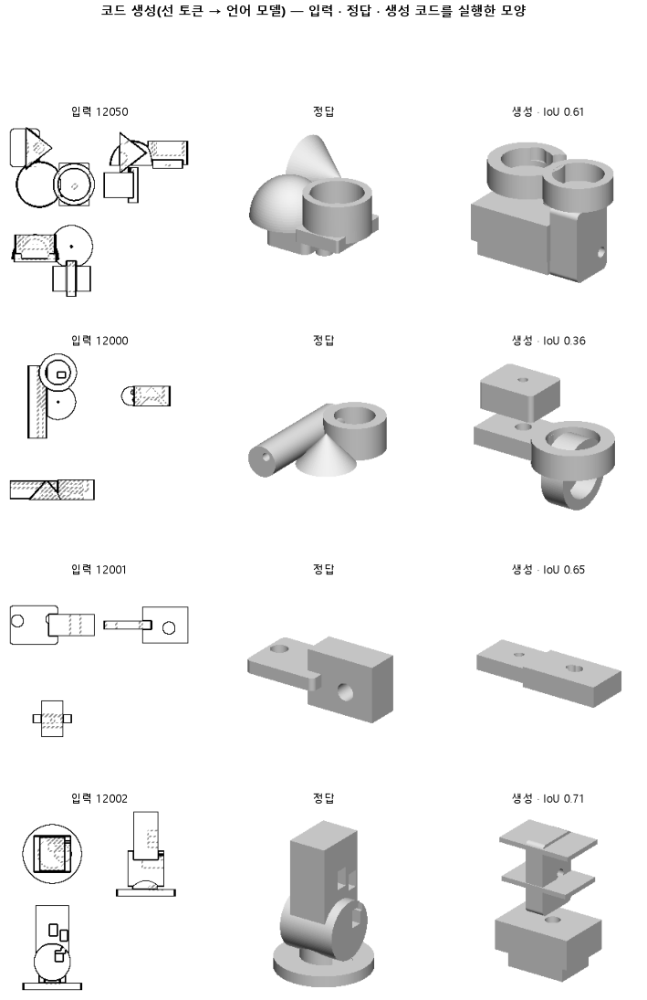

# 같은 부품을 다섯 바퀴 보게 해, 바퀴마다 처음 보는 부품이 나아지는지 본다

## 분석
<!-- 사람 칸: 하네스 분석 단계 초안(claude -p) · 고치면 다시 만들어도 남는다 -->
### 한 줄로

**물음**: 164와 같은 설정에서 학습만 다섯 배로 늘리면, 처음 보는 부품의 입체 겹침이 0.25를 넘을까?

**답**: 0.16에서 0.20으로 올랐지만 0.25에는 못 미쳐 판정은 실패다. 실행률은 거의 그대로였는데 겹침이 올랐다.

### 왜 이 판을 했나

우리 모델은 부품 도면 세 장(위·앞·옆)을 보고 CAD 코드를 쓴다. 코드는 상자나 원기둥 같은 덩어리, 즉 「몸」을 하나씩 짓고 합친다. 164에서는 예시 묶음 넷을 다 본 뒤에야 가중치를 한 번 고치던 것을, 묶음 하나마다 고치게 했다. 그러자 코드가 덜 깨졌다. 하지만 3,000스텝에서 학습이 끝날 때도 처음 보는 부품의 손실(틀린 정도)은 아직 내려가고 있었다. 덜 배운 채로 멈췄을 수 있다.

### 바꾼 것 하나

**학습을 3,000스텝에서 15,000스텝으로 늘렸다.** 학습 부품 3,000개를 다섯 바퀴 도는 길이로 잡았다. 나머지는 164와 같다. 시험 부품은 100개다.

### 결과

| | 이 판 (165) | 대조 (164) | 목표 | 넘었나 |
|---|---|---|---|---|
| 입체 겹침 (중앙값) | 0.20 | 0.16 | 0.25 이상 | ✗ |
| 입체 겹침 (최종 목표) | 0.20 | 0.16 | 0.80 이상 | ✗ |
| 쓴 코드가 실행됨 | 0.95 | 0.93 | — | — |
| 도면 윤곽 겹침 (실행된 것만) | 0.59 | 0.54 | — | — |
| 몸을 첫 몸 옆에 놓음 | 0.50 | 0.33 | — | — |
| 몸 개수를 맞힘 | 0.50 | 0.44 | — | — |

*실행이 안 된 코드는 입체 겹침 0점으로 넣어 셌다. 「옆에 놓음」은 두 번째 몸부터 첫 몸 위에 쌓지 않고 옆으로 옮겨 놓은 비율이다. 위로만 쌓으면 모양이 틀어진다. 정답 코드에서는 이 비율이 0.79다.*

### 왜 이렇게 나왔나

**확인한 것**

- 실행률은 0.93에서 0.95로 0.02만 올랐다. 겹침이 오른 걸 이것만으로 설명하기는 어렵다. 실행된 코드만 본 윤곽 겹침은 0.54에서 0.59로 올랐다.
- 처음 보는 부품의 손실은 250스텝마다 쟀다. 3,000스텝에 0.40, 6,000에 0.38, 9,000에 0.38, 12,000에 0.37, 15,000에 0.37이었다. 뒤쪽 6,000스텝 동안은 거의 줄지 않았다.
- 같은 동안 학습 부품의 손실은 0.38에서 0.32로 내려갔다. 두 손실의 차이는 0.02에서 0.05로 벌어졌다.

**짐작 (아직 확인 안 함)**

- 실행된 코드의 질이 나아졌을 수 있다. 하지만 실행된 것만 따로 잰 입체 겹침은 없다.
- 뒤쪽 바퀴는 학습 부품을 외우는 데 쓰였을 수 있다. 학습 부품의 입체 겹침은 재지 않았다.
- 손실이 거의 멈췄으니, 길이만 더 늘려서는 0.25에 닿기 어려워 보인다.

### 한계

- 시험 부품 100개로 한 번만 돌렸다.
- 155는 같은 설정을 세 번 돌려 흔들림을 잰 판이다. 거기서 옆에 놓기는 0.22만큼 흔들렸다. 이번 차이 0.17은 그 폭 안이다. 입체 겹침의 흔들림은 아직 안 쟀다. 그래서 0.04 차이가 진짜인지 모른다.
- 판 기록에는 데이터를 10바퀴 돈 것으로 적혀 있다. 우리가 잡은 다섯 바퀴와 다르고, 원인은 확인하지 않았다.

### 배운 것과 다음

**길게 배우자 윤곽과 몸 배치가 나아졌지만, 처음 보는 부품의 손실은 9,000스텝 무렵부터 거의 멈췄다.** 학습 길이는 더 당길 손잡이가 아니다.

1. 학습 부품 100개로도 입체 겹침을 재서 외운 것인지 확인한다.
2. 164와 이 판을 시드만 바꿔 다시 돌려 흔들림 폭을 잰다.
3. 몸을 옆에 놓지 못한 부품을 모아서 본다.

명제: 164 와 같은 설정에서 스텝만 다섯 배로 늘리면, 시험 100 개에서 부피 IoU 중앙이 164 의 0.159 보다 높은 0.25 이상이다

| 가지 | 종류 | 바탕 | 바꾼 손잡이 | 에폭 | git | 날짜 |
|---|---|---|---|---|---|---|
| B1 | 비교 | 127 (하네스/conf/바탕.yaml) | 학습.스텝: 3000 → 15000 | 10 | `3bee185` | 2026-11-06 15:10 |

## 1. 판정: **실패 · 목표선 0/1**

| 지표 | 식 | 문턱 | 이 판 | 대조(164누적) | 통과 |
|---|---|---|---|---|---|
| 코드_부피IoU | >= | 0.25 | 0.197 | 0.159 | ✗ |
| 코드_부피IoU | >= | 0.8 | 0.197 | 0.159 | ✗ |

## 2. 숫자 — 이 판 대 대조

| 지표 | 이 판 | 대조 |
|---|---|---|
| 코드_실행률 | 0.950 | — |
| 코드_IoU | 0.579 | — |
| 코드_IoU평균 | 0.566 | — |
| 코드_부피IoU | 0.197 | 0.159 |
| 코드_부피바닥 | 0.149 | — |
| 코드_IoU실행 | 0.588 | — |
| 코드_OOM | 0.000 | — |
| 코드_정답실패 | 0.000 | — |
| 코드_원뿔배움 | 1.000 | — |
| 코드_옆옮김 | 0.500 | 0.331 |
| 코드_옆옮김정답 | 0.787 | — |
| 코드_몸개수맞음 | 0.500 | — |
| 코드_학습loss | 0.320 | — |
| 코드_시험loss | 0.373 | — |
| 시험loss | 0.373 | — |
| 학습loss | 0.320 | — |

## 모델 구조
(이 판은 구조를 안 잼)

## 3. 학습 곡선

| 에폭 | 학습 loss | 시험 loss | 맞음(CAD 덩어리 수 · 선지도 선 종류) |
|---|---|---|---|
| 250 | 2.079 | 0.625 | 0.000 |
| 500 | 0.525 | 0.500 | 0.000 |
| 750 | 0.445 | 0.456 | 0.000 |
| 1000 | 0.429 | 0.446 | 0.000 |
| 1250 | 0.416 | 0.439 | 0.000 |
| 1500 | 0.409 | 0.429 | 0.000 |
| 1750 | 0.397 | 0.418 | 0.000 |
| 2000 | 0.390 | 0.423 | 0.000 |
| 2250 | 0.395 | 0.413 | 0.000 |
| 2500 | 0.385 | 0.406 | 0.000 |
| 2750 | 0.389 | 0.403 | 0.000 |
| 3000 | 0.379 | 0.398 | 0.000 |
| 3250 | 0.375 | 0.397 | 0.000 |
| 3500 | 0.369 | 0.396 | 0.000 |
| 3750 | 0.369 | 0.395 | 0.000 |
| 4000 | 0.365 | 0.400 | 0.000 |
| 4250 | 0.364 | 0.388 | 0.000 |
| 4500 | 0.363 | 0.390 | 0.000 |
| 4750 | 0.364 | 0.390 | 0.000 |
| 5000 | 0.357 | 0.394 | 0.000 |
| 5250 | 0.360 | 0.384 | 0.000 |
| 5500 | 0.356 | 0.387 | 0.000 |
| 5750 | 0.355 | 0.383 | 0.000 |
| 6000 | 0.341 | 0.381 | 0.000 |
| 6250 | 0.349 | 0.382 | 0.000 |
| 6500 | 0.351 | 0.381 | 0.000 |
| 6750 | 0.351 | 0.379 | 0.000 |
| 7000 | 0.350 | 0.380 | 0.000 |
| 7250 | 0.344 | 0.378 | 0.000 |
| 7500 | 0.353 | 0.376 | 0.000 |
| 7750 | 0.334 | 0.379 | 0.000 |
| 8000 | 0.345 | 0.379 | 0.000 |
| 8250 | 0.345 | 0.381 | 0.000 |
| 8500 | 0.338 | 0.378 | 0.000 |
| 8750 | 0.330 | 0.377 | 0.000 |
| 9000 | 0.329 | 0.380 | 0.000 |
| 9250 | 0.325 | 0.376 | 0.000 |
| 9500 | 0.329 | 0.375 | 0.000 |
| 9750 | 0.337 | 0.377 | 0.000 |
| 10000 | 0.334 | 0.375 | 0.000 |
| 10250 | 0.332 | 0.378 | 0.000 |
| 10500 | 0.334 | 0.371 | 0.000 |
| 10750 | 0.329 | 0.375 | 0.000 |
| 11000 | 0.325 | 0.373 | 0.000 |
| 11250 | 0.320 | 0.372 | 0.000 |
| 11500 | 0.319 | 0.372 | 0.000 |
| 11750 | 0.334 | 0.374 | 0.000 |
| 12000 | 0.321 | 0.373 | 0.000 |
| 12250 | 0.321 | 0.373 | 0.000 |
| 12500 | 0.327 | 0.373 | 0.000 |
| 12750 | 0.312 | 0.375 | 0.000 |
| 13000 | 0.313 | 0.374 | 0.000 |
| 13250 | 0.319 | 0.374 | 0.000 |
| 13500 | 0.317 | 0.374 | 0.000 |
| 13750 | 0.318 | 0.373 | 0.000 |
| 14000 | 0.320 | 0.373 | 0.000 |
| 14250 | 0.318 | 0.372 | 0.000 |
| 14500 | 0.322 | 0.372 | 0.000 |
| 14750 | 0.312 | 0.372 | 0.000 |
| 15000 | 0.320 | 0.373 | 0.000 |

## 4. 점검

### 4.1 연기 판
첫 loss — → 배치 하나 40 걸음 — · VRAM — GB

### 4.2 층보기 (시험 64 · 4 층)
칸끼리 닮음 — (1 = 6 칸 같음) · 빈 조각 주의 몫 — (빈 조각 비율 0.54) · 주의 엔트로피 — · 출력 자리 퍼짐 — (정답 0.148)

### 4.3 탐침 — 합성 그림 (블록 4 · 128)
구조 6 종 — · 곡률 R² — · (블록 3: — · —)

### 4.4 특징 — 실제 도면 (조각 라벨 · 하네스/특징.py)
(이 판은 특징 점검을 안 함)

## 쇼츠
편 124_판165바퀴 · 53.9 초 · 14 줄 · 서재용 업로드 대기

[쇼츠 영상](쇼츠.mp4)

| 누구 | 말 |
|---|---|
| AI | 왼쪽이 정답, 오른쪽이 모델이 만든 부품이에요. |
| AI | 정답은 상자를 옆에 붙였는데, 모델은 위로만 쌓았어요. |
| AI | 모델은 앞 · 옆 · 위에서 본 도면 세 장으로 부품 설계를 짜요. |
| AI | 이 도면은 연습 때 한 번도 안 본 시험 부품이에요. |
| 나 | 연습이 모자라서 그래. 연습 부품을 한 번씩만 봤잖아. |
| 나 | 연습 부품을 다섯 번씩 보게 해 봐. |
| AI | 연습 부품을 다섯 번씩 보고 다시 만들었어요. |
| AI | 오른쪽 봐요. 상자를 옆에 놓은 게 늘었어요. |
| 나 | 거봐, 연습이 모자랐던 거야. |
| AI | 그런데 시험 부품은 세 번째 볼 때부터 더 늘지 않았어요. |
| AI | 그 뒤로는 연습 부품만 계속 잘 맞혔어요. |
| 나 | 더 오래 연습시킨다고 되는 게 아니었네. |
| AI | 이번 학습은 실패예요. 학습 시간만 길어졌어요. |
| AI | 1이 만점인데 0.16에서 0.20, 목표 0.25엔 못 닿았어요. |

## 5. 해석
<!-- 사람 칸: 아래를 채운다 · 보고서를 다시 만들어도 남는다 -->
(비어 있음)

## 6. 다음 가지 (사람이 고름 · claudedocs/문제트리.md)
<!-- 사람 칸: 아래를 채운다 · 보고서를 다시 만들어도 남는다 -->
(비어 있음)

## 7. 재현
`python 하네스/하네스.py --config-name 판_165바퀴` · 설정 [설정.yaml](설정.yaml) · 판정 [판정.json](판정.json) · 산출 `G:/art2real/out/하네스/165바퀴/`

## 링크
- 쇼츠: 서재용 업로드 대기
- GitHub 이슈: https://github.com/sigongjoa/art2real/issues/35
