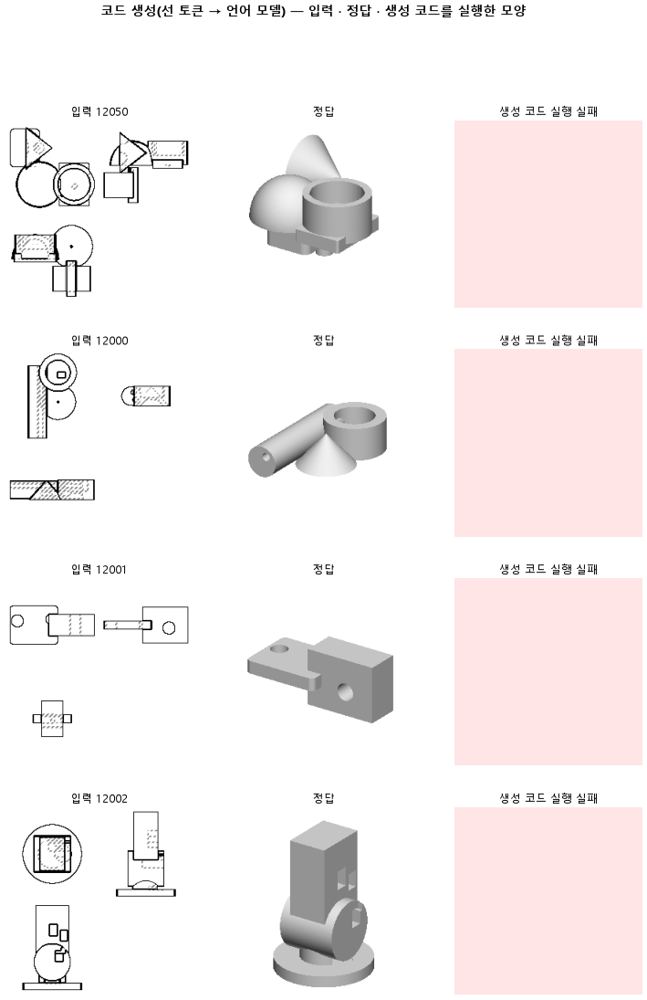

# 부품 열여섯 개를 보고 한 번 고치게 해, 방금 본 부품 쪽으로 출렁이지 않는지 본다

## 분석
<!-- 사람 칸: 하네스 분석 단계 초안(claude -p) · 고치면 다시 만들어도 남는다 -->
### 한 줄로

**물음**: 가중치를 매번 고치지 않고 열여섯 번 본 것을 모아 한 번 고치게 하면, 입체 겹침이 0.20을 넘을까?

**답**: 오히려 무너졌다. 시험 부품 100개 중 실행되는 코드가 2개뿐이라 입체 겹침 중앙값은 0이다. 판정은 실패다.

### 왜 이 판을 했나

우리 모델은 부품 도면 세 장(위·앞·옆)을 보고 CAD 코드를 쓴다. 164에서는 예시를 한 번 볼 때마다 가중치를 고치게 했다. 그러자 실행되는 코드가 그 전 판(161)보다 크게 늘었다. 하지만 입체 겹침은 0.16에 머물렀다.

우리는 모델이 방금 본 부품 쪽으로 매번 출렁인다고 의심했다. 그래서 여러 번 본 것을 평균 내서 한 번에 고치면 더 차분하게 배울지 보기로 했다.

### 바꾼 것 하나

학습은 「스텝」 단위로 센다. 한 스텝은 모델이 예시를 한 번 보는 것이다. 164는 스텝마다 가중치를 고쳤다. **이 판은 열여섯 스텝을 모아 한 번 고친다.** 나머지는 164와 같다. 3,000스텝, 학습 부품 3,000개, 시험 부품 100개다. 스텝 수가 같으니 실제로 고친 횟수는 164의 16분의 1이다.

### 결과

| | 이 판 (166) | 대조 (164) | 목표 | 넘었나 |
|---|---|---|---|---|
| 입체 겹침 (중앙값) | 0.00 | 0.16 | 0.20 이상 | ✗ |
| 입체 겹침 (최종 목표) | 0.00 | 0.16 | 0.80 이상 | ✗ |
| 쓴 코드가 실행됨 | 0.02 | 0.93 | — | — |
| 마지막 시험 손실 | 0.71 | 0.40 | — | — |
| 몸 개수를 맞힘 | 0.26 | 0.44 | — | — |

*코드가 짓는 상자나 원기둥 하나를 「몸」이라고 부른다. 손실은 모델이 틀린 정도이고, 낮을수록 좋다.*

### 왜 이렇게 나왔나

**확인한 것**

- 덜 배웠다. 마지막 시험 손실은 0.71로, 164의 0.40보다 한참 높다. 학습 손실도 0.70 대 0.38이다.
- 끝에서는 거의 멈춰 있었다. 시험 손실은 2,500스텝에 0.72, 2,750스텝과 3,000스텝에 0.71이었다.
- 겹침이 0인 것은 거의 전부 코드가 실행되지 않아서다. 깨진 코드는 0점이다. 세 방향에서 본 윤곽이 얼마나 겹치는지를 실행된 2개만 놓고 보면 0.49다. 164의 0.54와 크게 다르지 않다.

**짐작 (아직 확인 안 함)**

- 고친 횟수가 16분의 1로 준 것이 주된 원인으로 본다. 출렁임이 줄었는지는 이 판으로 알 수 없다. 출렁임은 따로 잰 적이 없다.
- 열여섯 번을 평균 내도 한 번 고치는 크기는 전과 비슷하다. 그러니 전체로 움직인 거리가 16분의 1이 된다. 보통 묶음을 키우면 학습률도 같이 키우는데, 우리는 그대로 뒀다.
- 다음 몸을 첫 몸 위에 쌓지 않고 옆에 놓은 비율은 0.50으로, 164의 0.33보다 높다. 정답 코드에서는 0.79다. 하지만 실행된 코드가 2개뿐이라 이 숫자는 믿지 않는다.

### 한계

- 시험 부품 100개로 한 번만 돌렸다.
- 이 판은 「모아서 고치기」와 「고친 횟수 줄어듦」을 떼어 보지 못한다. 실패 원인이 어느 쪽인지 모른다.
- 실행된 코드가 2개뿐이라, 실행된 것만 보는 숫자는 비교할 근거가 못 된다.

### 배운 것과 다음

**스텝 수를 묶어 둔 채 모아서 고치면 덜 배운다.** 출렁임이 줄었더라도, 고친 횟수가 줄어든 손해에 묻혔다. 지금은 164처럼 자주 고치는 쪽이 낫다.

1. 고친 횟수를 164와 맞춘다. 스텝을 16배로 늘리거나 학습률을 키워서 「모아서 고치기」만의 효과를 다시 잰다.
2. 164를 무작위 시작값(시드)만 바꿔 한 번 더 돌린다. 출렁임이 진짜인지, 흔들림 폭부터 잰다.

명제: 164 와 같은 3,000 스텝에서 기울기 누적만 16 으로 늘리면, 시험 100 개에서 부피 IoU 중앙이 164 의 0.159 보다 높은 0.20 이상이다

| 가지 | 종류 | 바탕 | 바꾼 손잡이 | 에폭 | git | 날짜 |
|---|---|---|---|---|---|---|
| B1 | 비교 | 127 (하네스/conf/바탕.yaml) | 학습.누적: 1 → 16 | 10 | `f1c88a8` | 2026-11-05 20:53 |

## 1. 판정: **실패 · 목표선 0/1**

| 지표 | 식 | 문턱 | 이 판 | 대조(164누적) | 통과 |
|---|---|---|---|---|---|
| 코드_부피IoU | >= | 0.2 | 0.000 | 0.159 | ✗ |
| 코드_부피IoU | >= | 0.8 | 0.000 | 0.159 | ✗ |

## 2. 숫자 — 이 판 대 대조

| 지표 | 이 판 | 대조 |
|---|---|---|
| 코드_실행률 | 0.020 | — |
| 코드_IoU | 0.000 | — |
| 코드_IoU평균 | 0.010 | — |
| 코드_부피IoU | 0.000 | 0.159 |
| 코드_부피바닥 | 0.149 | — |
| 코드_IoU실행 | 0.494 | — |
| 코드_OOM | 0.000 | — |
| 코드_정답실패 | 0.000 | — |
| 코드_원뿔배움 | 0.000 | — |
| 코드_옆옮김 | 0.500 | 0.331 |
| 코드_옆옮김정답 | 0.787 | — |
| 코드_몸개수맞음 | 0.260 | — |
| 코드_학습loss | 0.705 | — |
| 코드_시험loss | 0.712 | — |
| 시험loss | 0.712 | — |
| 학습loss | 0.705 | — |

## 모델 구조
(이 판은 구조를 안 잼)

## 3. 학습 곡선

| 에폭 | 학습 loss | 시험 loss | 맞음(CAD 덩어리 수 · 선지도 선 종류) |
|---|---|---|---|
| 250 | 9.814 | 8.069 | 0.000 |
| 500 | 4.934 | 3.789 | 0.000 |
| 750 | 3.139 | 2.961 | 0.000 |
| 1000 | 2.335 | 2.206 | 0.000 |
| 1250 | 1.770 | 1.596 | 0.000 |
| 1500 | 1.246 | 1.167 | 0.000 |
| 1750 | 0.947 | 0.920 | 0.000 |
| 2000 | 0.808 | 0.801 | 0.000 |
| 2250 | 0.775 | 0.754 | 0.000 |
| 2500 | 0.735 | 0.721 | 0.000 |
| 2750 | 0.692 | 0.713 | 0.000 |
| 3000 | 0.704 | 0.712 | 0.000 |

## 4. 점검

### 4.1 연기 판
첫 loss — → 배치 하나 40 걸음 — · VRAM — GB

### 4.2 층보기 (시험 64 · 4 층)
칸끼리 닮음 — (1 = 6 칸 같음) · 빈 조각 주의 몫 — (빈 조각 비율 0.54) · 주의 엔트로피 — · 출력 자리 퍼짐 — (정답 0.148)

### 4.3 탐침 — 합성 그림 (블록 4 · 128)
구조 6 종 — · 곡률 R² — · (블록 3: — · —)

### 4.4 특징 — 실제 도면 (조각 라벨 · 하네스/특징.py)
(이 판은 특징 점검을 안 함)

## 쇼츠
편 123_판166배치16 · 56.6 초 · 14 줄 · 서재용 업로드 대기

[쇼츠 영상](쇼츠.mp4)

| 누구 | 말 |
|---|---|
| AI | 이 도면을 보고 모델이 CAD 코드를 썼는데 안 돌아가요. |
| AI | 모델은 도면을 보고 CAD 코드를 쓰도록 가르친 프로그램이에요. |
| AI | 모델은 정답과 견줘 틀린 만큼 자기를 고치면서 배워요. |
| AI | 원래는 도면을 한 장 볼 때마다 고쳤어요. |
| AI | 이번엔 여러 장을 모아 보고 한 번에 고치게 했어요. |
| 나 | 한 장 한 장에 휘둘리지 않으니 차분히 배웠겠네. |
| 나 | 그럼 이 도면이 유난히 까다로운 거야. |
| AI | 그런데 학습이 끝날 때까지 정답과 차이가 잘 안 줄었어요. |
| AI | 모아 고치니 같은 장수를 봐도 고친 횟수는 확 줄었어요. |
| 나 | 차분한 게 아니라 덜 배운 거였네. |
| 나 | 처음 보는 도면을 전부 넣어 봐. |
| AI | 100개 중 2개만 코드가 돌아갔어요. |
| AI | 모아서 고치기는 이번엔 실패예요. |
| AI | 전에는 돌던 코드까지 거의 다 깨졌어요. |

## 5. 해석
<!-- 사람 칸: 아래를 채운다 · 보고서를 다시 만들어도 남는다 -->
(비어 있음)

## 6. 다음 가지 (사람이 고름 · claudedocs/문제트리.md)
<!-- 사람 칸: 아래를 채운다 · 보고서를 다시 만들어도 남는다 -->
(비어 있음)

## 7. 재현
`python 하네스/하네스.py --config-name 판_166배치16` · 설정 [설정.yaml](설정.yaml) · 판정 [판정.json](판정.json) · 산출 `G:/art2real/out/하네스/166배치16/`

## 링크
- 쇼츠: 서재용 업로드 대기
- GitHub 이슈: https://github.com/sigongjoa/art2real/issues/34
