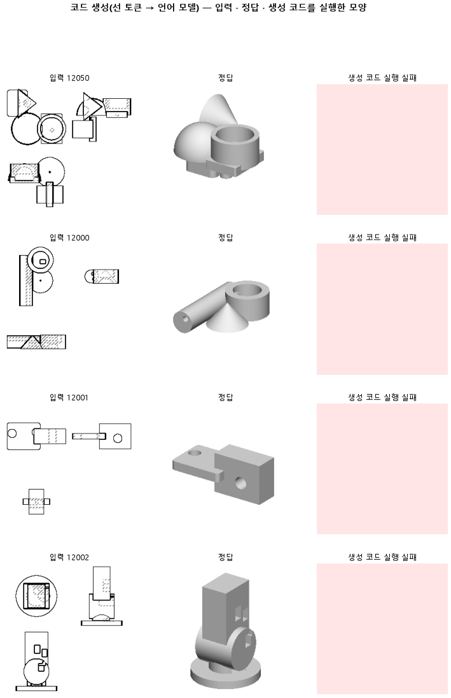

# 정답을 함수 18 개 낱말로 써도 학습 부품 서른 개를 외우는지 본다

## 분석
<!-- 사람 칸: 하네스 분석 단계 초안(claude -p) · 고치면 다시 만들어도 남는다 -->
### 한 줄로

**물음**: 정답 코드를 정해 둔 함수 18개짜리 짧은 서식으로 바꿔 쓰면, 처음 보는 부품에서도 코드가 돌아갈까?

**답**: 아니다. 학습 부품에는 거의 완벽하게 맞췄지만, 처음 보는 부품은 100개 중 4개만 실행됐다. 판정 기준 둘을 다 못 넘었다. 실패다.

### 왜 이 판을 했나

우리 모델은 부품 도면 세 장(위 · 앞 · 옆)을 보고 CAD 코드를 쓴다. 앞 판(158)에서는 원뿔 하나만 이름으로 바꿨는데, 외운 부품 30개 중 28개가 실행됐다. 그래서 이번에는 코드 전체를 정해 둔 단어 몇 개로만 쓰게 했다. 고를 단어가 적으면 처음 보는 도면에서도 문법이 덜 무너질 거라고 봤다.

### 바꾼 것 하나

정답 코드의 **서식**만 바꿨다. 예전에는 CadQuery 코드를 그대로 썼다.

`b1 = place(cq.Workplane("XY").circle(r).extrude(h), "z", (x, y, z))`

이번에는 한 줄에 덩어리(몸) 하나를 쓰고, 정해 둔 단어와 숫자만 쓴다. 괄호와 쉼표는 변환기가 채운다.

`<b1><Workplane><XY><circle> r<extrude> h<z> x y z`

학습 부품 30개, 시험 부품 100개, 학습 2,400스텝은 158과 같다.

### 결과

| | 이 판 (167) | 대조 (158) | 목표 | 넘었나 |
|---|---|---|---|---|
| 쓴 코드가 실행됨 (시험) | 0.04 | 0.02 | 0.50 이상 | ✗ |
| 모양 겹침 (시험 · 가운데 값) | 0.00 | 0.00 | 0.80 이상 | ✗ |
| 모양 겹침 (시험 · 평균) | 0.02 | 0.01 | — | — |
| 실행된 4개의 모양 겹침 | 0.57 | — | — | — |
| 학습 손실 | 0.00 | 0.01 | — | — |
| 시험 손실 | 3.12 | 1.41 | — | — |

*실행이 안 된 코드는 겹침을 0으로 친다. 100개 중 96개가 0이라 가운데 값은 0.00이고, 평균은 0.02다.*

### 왜 이렇게 나왔나

**확인한 것**

- 학습 부품을 외우는 쪽으로 너무 치우쳤다. 시험 손실은 500스텝에서 1.12로 가장 낮았다. 그 뒤로 학습 손실이 내려가는 동안 시험 손실은 3.12까지 올랐다.
- 시험에서 쓴 코드의 짜임새는 「모든 부품에 똑같은 코드 하나를 내는」 경우보다 못하다. 덩어리 종류(상자인지 원통인지)를 맞힌 점수는 0.03이다. 똑같은 코드 하나를 내면 0.59가 나온다. 어느 덩어리의 어느 면에 붙였는지는 0.17로, 똑같은 코드(0.30)보다 낮다. 덩어리 개수만 0.30으로 똑같은 코드(0.20)보다 낫다.

**짐작 (아직 확인 안 함)**

- 시험 손실이 158의 두 배인 것은 서식이 바뀌어 토큰 수가 달라졌기 때문일 수 있다. 두 판의 손실을 그대로 견줘도 되는지는 따지지 않았다.

### 한계

- 학습 부품 30개, 시험 부품 100개로 한 번만 돌렸다. 실행 4개 대 2개는 흔들림 안쪽일 수 있다.
- 판 전에 「학습 부품 겹침 0.95 이상으로 외운다」고 적어 뒀지만, 이 숫자는 재지 않았다. 외웠다는 말은 학습 손실만 보고 한 짐작이다.

### 배운 것과 다음

**서식을 짧게 바꿔도 처음 보는 부품은 못 쓴다.** 158과 똑같이, 500스텝 뒤로는 30개를 외우기만 하고 새 부품은 더 못 쓰게 된다. 이번에 바꾼 건 서식 하나뿐이라, 부품 수가 원인인지는 이 판으로 알 수 없다.

1. 학습 부품 30개의 겹침을 재서 외우기가 됐는지 확인한다.
2. 시험 손실이 가장 낮은 500스텝 근처에서 멈춘 결과를 잰다.
3. 그다음에 학습 부품 수를 늘려, 이 벽이 움직이는지 본다.

명제: 158 과 같은 부품 30 개 외우기에서 정답 서식만 함수18 로 바꿔도, 시험 부품 코드 실행률이 0.5 이상이고 학습 부품은 부피 IoU 0.95 이상으로 외운다

| 가지 | 종류 | 바탕 | 바꾼 손잡이 | 에폭 | git | 날짜 |
|---|---|---|---|---|---|---|
| B1 | 탐색 | 127 (하네스/conf/바탕.yaml) | 코드.서식: 원뿔이름 → 함수18 | 10 | `a52c628` | 2026-11-06 18:25 |

## 1. 판정: **탐색 — 이김 판정 없음 · 기준 못 넘음 · 목표선 0/1**

| 지표 | 식 | 문턱 | 이 판 | 대조(158원뿔이름) | 통과 |
|---|---|---|---|---|---|
| 코드_실행률 | >= | 0.5 | 0.040 | 0.017 | ✗ |
| 코드_부피IoU | >= | 0.8 | 0.000 | — | ✗ |

## 2. 숫자 — 이 판 대 대조

| 지표 | 이 판 | 대조 |
|---|---|---|
| 코드_실행률 | 0.040 | 0.017 |
| 코드_IoU | 0.000 | — |
| 코드_IoU평균 | 0.022 | — |
| 코드_부피IoU | 0.000 | — |
| 코드_부피바닥 | 0.149 | — |
| 코드_IoU실행 | 0.570 | — |
| 코드_OOM | 0.000 | — |
| 코드_정답실패 | 0.000 | — |
| 코드_원뿔배움 | — | — |
| 코드_옆옮김 | 1.000 | — |
| 코드_옆옮김정답 | 0.787 | — |
| 코드_몸개수맞음 | 0.300 | — |
| 구조_몸수맞음 | 0.300 | — |
| 구조_몸수차 | 1.320 | — |
| 구조_종류F1 | 0.031 | — |
| 구조_종류순서 | 0.027 | — |
| 구조_붙임맞음 | 0.170 | — |
| 구조_몸겹침 | 0.011 | — |
| 구조바닥_몸수맞음 | 0.200 | — |
| 구조바닥_몸수차 | 1.490 | — |
| 구조바닥_종류F1 | 0.586 | — |
| 구조바닥_종류순서 | 0.396 | — |
| 구조바닥_붙임맞음 | 0.304 | — |
| 구조바닥_몸겹침 | 0.104 | — |
| 코드_학습loss | 0.003 | — |
| 코드_시험loss | 3.117 | — |
| 시험loss | 3.117 | — |
| 학습loss | 0.003 | — |

## 모델 구조
(이 판은 구조를 안 잼)

## 3. 학습 곡선

| 에폭 | 학습 loss | 시험 loss | 맞음(CAD 덩어리 수 · 선지도 선 종류) |
|---|---|---|---|
| 250 | 2.716 | 1.243 | 0.000 |
| 500 | 0.828 | 1.115 | 0.000 |
| 750 | 0.515 | 1.383 | 0.000 |
| 1000 | 0.217 | 1.887 | 0.000 |
| 1250 | 0.082 | 2.473 | 0.000 |
| 1500 | 0.023 | 2.820 | 0.000 |
| 1750 | 0.008 | 3.024 | 0.000 |
| 2000 | 0.004 | 3.102 | 0.000 |
| 2250 | 0.003 | 3.114 | 0.000 |
| 2400 | 0.003 | 3.117 | 0.000 |

## 4. 점검

### 4.1 연기 판
첫 loss — → 배치 하나 40 걸음 — · VRAM — GB

### 4.2 층보기 (시험 64 · 4 층)
칸끼리 닮음 — (1 = 6 칸 같음) · 빈 조각 주의 몫 — (빈 조각 비율 0.54) · 주의 엔트로피 — · 출력 자리 퍼짐 — (정답 0.148)

### 4.3 탐침 — 합성 그림 (블록 4 · 128)
구조 6 종 — · 곡률 R² — · (블록 3: — · —)

### 4.4 특징 — 실제 도면 (조각 라벨 · 하네스/특징.py)
(이 판은 특징 점검을 안 함)

## 쇼츠
편 125_판167외우기 · 47.5 초 · 12 줄 · 서재용 업로드 대기

[쇼츠 영상](쇼츠.mp4)

| 누구 | 말 |
|---|---|
| AI | 이 도면을 보고 모델이 쓴 코드가 실행이 안 돼요. |
| AI | 모델은 도면을 보고 입체 부품 모양을 짓는 코드를 써요. |
| AI | 이 도면은 학습 때 한 번도 안 보여 준 거예요. |
| 나 | 코드에 쓸 말이 너무 많아서 헷갈린 거야. |
| 나 | 상자, 원통 같은 낱말 몇 개로만 쓰게 바꿔. |
| AI | 이제 한 줄에 모양 하나, 상자나 원통이라고만 써요. |
| AI | 괄호 같은 기호는 나중에 프로그램이 붙여 줘요. |
| AI | 그런데 바꿨는데도 이게 상자인지 원통인지부터 틀려요. |
| AI | 모든 도면에 똑같은 답 하나를 찍어도 이것보단 잘 맞혀요. |
| 나 | 쓸 말이 많아서가 아니었네. |
| AI | 처음 보는 도면 100개 중 4개만 실행됐어요. 전엔 2개였어요. |
| AI | 낱말 몇 개로만 써도, 처음 보는 도면은 못 읽어요. |

## 5. 해석
<!-- 사람 칸: 아래를 채운다 · 보고서를 다시 만들어도 남는다 -->
(비어 있음)

## 6. 다음 가지 (사람이 고름 · claudedocs/문제트리.md)
<!-- 사람 칸: 아래를 채운다 · 보고서를 다시 만들어도 남는다 -->
(비어 있음)

## 7. 재현
`python 하네스/하네스.py --config-name 판_167외우기` · 설정 [설정.yaml](설정.yaml) · 판정 [판정.json](판정.json) · 산출 `G:/art2real/out/하네스/167외우기/`

## 링크
- 쇼츠: 서재용 업로드 대기
- GitHub 이슈: https://github.com/sigongjoa/art2real/issues/36
