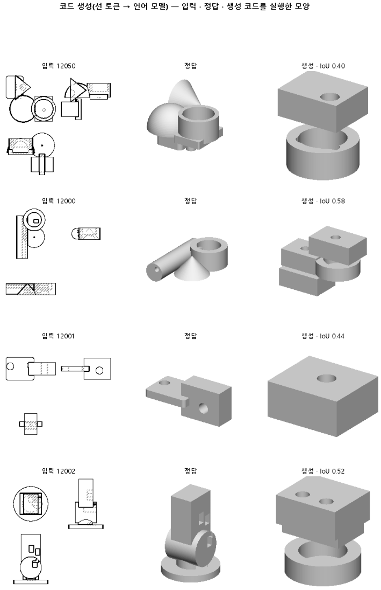

# 정답을 함수 18 개 낱말로만 쓰게 해, 처음 보는 부품의 몸과 붙임을 더 맞히는지 본다

## 분석
<!-- 사람 칸: 하네스 분석 단계 초안(claude -p) · 고치면 다시 만들어도 남는다 -->
### 한 줄로

**물음**: 정답 코드를 함수 18개로 줄인 낱말로만 쓰게 하면, 처음 보는 부품에서 몸을 더 맞게 붙일까?

**답**: 아니다. 이 판에 정한 선 둘(입체 겹침 0.20 · 붙임 0.35)을 다 못 넘었다. 최종 목표선(0.80) 하나도 0개 넘었다. 판정은 실패다.

### 왜 이 판을 했나

우리 모델은 부품 도면 세 장(위·앞·옆)을 보고 CAD 코드를 쓴다. 코드는 상자나 원기둥 같은 덩어리를 하나씩 짓는다. 이 덩어리 하나가 「몸」이다. 지금까지 모델은 자기가 아는 낱말 전체에서 다음 낱말을 골랐다. 그런데 정답 코드에 나오는 함수는 18개뿐이다. 고를 것이 적으면 배우기도 쉬울 거라고 봤다.

### 바꾼 것 하나

**정답 코드를 쓰는 방식만 바꿨다.** 함수 이름은 18개 낱말로 쓰고, 크기와 자리는 숫자로 쓴다. 숫자를 고르는 일은 그대로 남는다. 나머지는 164와 같다. 학습 3,000스텝, 학습 부품 3,000개, 시험 부품 100개다.

### 결과

| | 이 판 (167) | 대조 (164) | 목표 | 넘었나 |
|---|---|---|---|---|
| 입체 겹침 (중앙값) | 0.16 | 0.16 | 0.20 이상 | ✗ |
| 몸이 정답과 같은 면에 붙음 | 0.26 | — | 0.35 이상 | ✗ |
| 입체 겹침 (최종 목표) | 0.16 | 0.16 | 0.80 이상 | ✗ |
| 쓴 코드가 실행됨 | 0.97 | 0.93 | — | — |
| 윤곽 겹침 (실행된 것만) | 0.50 | 0.54 | — | — |
| 몸 개수를 맞힘 | 0.32 | 0.44 | — | — |
| 몸을 첫 몸 옆에 놓음 | 0.21 | 0.33 | — | — |

*「붙음」은 각 몸이 정답과 같은 몸의 같은 면(위, 옆 등)에 붙었는지 본다. 「바닥」은 모든 부품에 똑같은 정답 코드 하나를 냈을 때 얻는 가장 좋은 점수다. 붙임의 바닥은 0.30이다. 164 때는 붙임을 재지 않았다. 몸 개수와 옆에 놓기는 깨진 코드까지 포함한 100개 전체에서 쟀다.*

### 왜 이렇게 나왔나

**확인한 것**

- 코드는 덜 깨졌다. 실행되는 코드가 0.93에서 0.97로 늘었다.
- 몸 배치는 오히려 나빠졌다. 몸 개수 맞힘은 0.44에서 0.32로, 옆에 놓기는 0.33에서 0.21로 내려갔다. 둘 다 100개 전체에서 잰 값이다. 새로 실행된 부품은 4개뿐인데, 몸 개수를 맞힌 부품은 12개 줄었다. 그러니 점수를 매긴 부품이 바뀐 탓만은 아니다.
- 몸끼리 붙는 면(0.26 대 바닥 0.30)과 몸 종류(0.50 대 0.59), 종류의 차례(0.29 대 0.40)는 모두 바닥보다 낮다. 같은 답 하나를 늘 내는 것보다 못하다는 뜻이다. 바닥을 넘은 것은 몸 개수(0.32 대 0.20)뿐이다.

**짐작 (아직 확인 안 함)**

- 낱말이 줄어서 코드의 꼴은 맞추기 쉬워졌다. 하지만 숫자와 배치는 그대로 어려워서 실행률만 오른 것으로 본다.
- 시험 손실(틀린 정도)은 0.65로 164의 0.40보다 높다. 서식이 다르면 낱말 수도 달라서 바로 견줄 수는 없다.

### 한계

- 시험 부품 100개로 한 번만 돌렸다. 164도 한 번이다.
- 164와의 차이(0.04~0.12)가 흔들림 안인지는 재지 않았다.
- 164에는 붙임 점수가 없어서, 붙임이 나빠진 것인지 원래 그랬는지 모른다.

### 배운 것과 다음

**고를 낱말을 줄이자 코드는 덜 깨졌다. 하지만 몸을 어디에 붙일지는 더 못 맞혔다.** 서식만 바꿔서는 배치 문제가 풀리지 않는다.

1. 164를 구조 점수까지 다시 재서, 붙임이 처음부터 바닥이었는지 본다.
2. 옆에 놓아야 할 몸을 위로 쌓은 부품을 모아 본다.
3. 손실이 아직 내려가는 중이다. 차이가 흔들림보다 클 때만 9,000스텝으로 다시 잰다.

명제: 164 와 같은 짧은 학습에서 정답 서식만 함수18 로 바꾸면, 시험 100 개에서 부피 IoU 중앙이 0.20 이상이고 붙임 맞음이 바닥 0.30 을 넘어 0.35 이상이다

| 가지 | 종류 | 바탕 | 바꾼 손잡이 | 에폭 | git | 날짜 |
|---|---|---|---|---|---|---|
| B1 | 비교 | 127 (하네스/conf/바탕.yaml) | 코드.서식: None → 함수18 | 10 | `7322826` | 2026-11-06 21:36 |

## 1. 판정: **실패 · 목표선 0/1**

| 지표 | 식 | 문턱 | 이 판 | 대조(164누적) | 통과 |
|---|---|---|---|---|---|
| 코드_부피IoU | >= | 0.2 | 0.156 | 0.159 | ✗ |
| 구조_붙임맞음 | >= | 0.35 | 0.261 | 0.234 | ✗ |
| 코드_부피IoU | >= | 0.8 | 0.156 | 0.159 | ✗ |

## 2. 숫자 — 이 판 대 대조

| 지표 | 이 판 | 대조 |
|---|---|---|
| 코드_실행률 | 0.970 | — |
| 코드_IoU | 0.497 | — |
| 코드_IoU평균 | 0.489 | — |
| 코드_부피IoU | 0.156 | 0.159 |
| 코드_부피바닥 | 0.149 | — |
| 코드_IoU실행 | 0.504 | — |
| 코드_OOM | 0.000 | — |
| 코드_정답실패 | 0.000 | — |
| 코드_원뿔배움 | — | — |
| 코드_옆옮김 | 0.212 | — |
| 코드_옆옮김정답 | 0.787 | — |
| 코드_몸개수맞음 | 0.320 | — |
| 구조_몸수맞음 | 0.320 | — |
| 구조_몸수차 | 1.110 | — |
| 구조_종류F1 | 0.503 | — |
| 구조_종류순서 | 0.287 | — |
| 구조_붙임맞음 | 0.261 | 0.234 |
| 구조_몸겹침 | 0.118 | — |
| 구조바닥_몸수맞음 | 0.200 | — |
| 구조바닥_몸수차 | 1.490 | — |
| 구조바닥_종류F1 | 0.586 | — |
| 구조바닥_종류순서 | 0.396 | — |
| 구조바닥_붙임맞음 | 0.304 | — |
| 구조바닥_몸겹침 | 0.104 | — |
| 코드_학습loss | 0.612 | — |
| 코드_시험loss | 0.654 | — |
| 시험loss | 0.654 | — |
| 학습loss | 0.612 | — |

## 모델 구조
(이 판은 구조를 안 잼)

## 3. 학습 곡선

| 에폭 | 학습 loss | 시험 loss | 맞음(CAD 덩어리 수 · 선지도 선 종류) |
|---|---|---|---|
| 250 | 1.495 | 0.850 | 0.000 |
| 500 | 0.738 | 0.756 | 0.000 |
| 750 | 0.686 | 0.735 | 0.000 |
| 1000 | 0.676 | 0.712 | 0.000 |
| 1250 | 0.663 | 0.695 | 0.000 |
| 1500 | 0.647 | 0.688 | 0.000 |
| 1750 | 0.632 | 0.672 | 0.000 |
| 2000 | 0.619 | 0.669 | 0.000 |
| 2250 | 0.628 | 0.666 | 0.000 |
| 2500 | 0.617 | 0.659 | 0.000 |
| 2750 | 0.623 | 0.655 | 0.000 |
| 3000 | 0.612 | 0.654 | 0.000 |

## 4. 점검

### 4.1 연기 판
첫 loss — → 배치 하나 40 걸음 — · VRAM — GB

### 4.2 층보기 (시험 64 · 4 층)
칸끼리 닮음 — (1 = 6 칸 같음) · 빈 조각 주의 몫 — (빈 조각 비율 0.54) · 주의 엔트로피 — · 출력 자리 퍼짐 — (정답 0.148)

### 4.3 탐침 — 합성 그림 (블록 4 · 128)
구조 6 종 — · 곡률 R² — · (블록 3: — · —)

### 4.4 특징 — 실제 도면 (조각 라벨 · 하네스/특징.py)
(이 판은 특징 점검을 안 함)

## 쇼츠
편 126_판167함수18 · 54.7 초 · 14 줄 · 서재용 업로드 대기

[쇼츠 영상](쇼츠.mp4)

| 누구 | 말 |
|---|---|
| AI | 오른쪽 부품, 덩어리가 엉뚱한 데 붙었어요. |
| AI | 우리가 가르친 모델은 이 도면을 보고 설계를 글로 써요. |
| AI | 상자, 원통 같은 덩어리를 하나씩 붙이라는 글이에요. |
| AI | 왼쪽이 정답, 오른쪽이 모델 글대로 지은 거예요. |
| AI | 모델은 아는 낱말 전부에서 하나씩 골라 글을 써요. |
| 나 | 고를 낱말이 너무 많아서 헷갈린 거야. |
| AI | 정답 글에 나오는 명령 이름은 몇 개 안 돼요. |
| 나 | 그럼 그 명령 이름만 고르게 바꿔. |
| AI | 바꾸니까 글이 틀려서 안 지어지는 건 줄었어요. |
| AI | 그런데 오른쪽 봐요, 옆에 붙을 덩어리가 딴 데 가 있어요. |
| AI | 옆에 맞게 붙인 건 100개 중 33개에서 21개로 줄었어요. |
| 나 | 낱말을 줄여도 자리는 정해 주지 않았네. |
| AI | 글은 덜 틀리는데, 덩어리 자리는 더 틀렸어요. |
| AI | 이번 학습은 실패예요. |

## 5. 해석
<!-- 사람 칸: 아래를 채운다 · 보고서를 다시 만들어도 남는다 -->
(비어 있음)

## 6. 다음 가지 (사람이 고름 · claudedocs/문제트리.md)
<!-- 사람 칸: 아래를 채운다 · 보고서를 다시 만들어도 남는다 -->
(비어 있음)

## 7. 재현
`python 하네스/하네스.py --config-name 판_167함수18` · 설정 [설정.yaml](설정.yaml) · 판정 [판정.json](판정.json) · 산출 `G:/art2real/out/하네스/167함수18/`

## 링크
- 쇼츠: 서재용 업로드 대기
- GitHub 이슈: https://github.com/sigongjoa/art2real/issues/37
