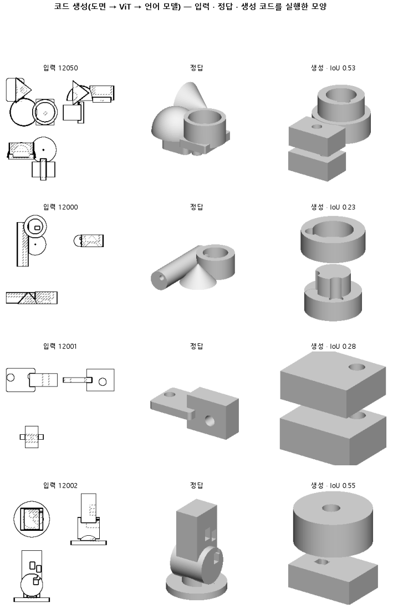

# 선 좌표 글 대신 도면 그림을 넣어, 처음 보는 부품의 몸 종류와 붙임을 더 맞히는지 본다

## 분석
<!-- 사람 칸: 하네스 분석 단계 초안(claude -p) · 고치면 다시 만들어도 남는다 -->
### 한 줄로

**물음**: 선 좌표를 글로 넣던 자리에 도면 그림을 그대로 넣으면, 처음 보는 부품에서 몸 종류와 붙임을 더 맞힐까?

**답**: 몸 종류는 더 맞혀서 이 판의 선(0.62)을 겨우 넘었다. 붙임은 오히려 떨어져 선(0.35)에 못 미쳤다. 최종 목표선(입체 겹침 0.80)도 넘지 못했다. 판정은 실패다.

### 왜 이 판을 했나

우리 모델은 부품 도면 세 장(위·앞·옆)을 보고 CAD 코드를 쓴다. 코드는 상자나 원기둥 같은 덩어리를 하나씩 짓고 서로 붙인다. 이 덩어리 하나가 「몸」이다.

지금까지는 도면에서 뽑은 선 좌표를 글로 바꿔 넣었다. 167은 이 입력으로 몸 종류(0.50)와 붙임(0.26)이 둘 다 바닥보다 낮았다. 글로 바꾸는 사이에 모양 정보가 빠졌을 수 있다고 봤다. 그래서 이 판의 선은 바닥(0.59 · 0.30)보다 조금 위로 미리 정했다.

### 바꾼 것 하나

**입력만 바꿨다.** 선 좌표 글을 빼고 128×128 도면 그림 세 장을 넣었다. 나머지는 167과 같다. 정답 코드는 함수 이름 18개 낱말과 숫자로만 쓴다. 학습은 3,000스텝이고, 학습 부품은 3,000개, 시험 부품은 100개다.

### 결과

| | 이 판 (168) | 대조 (167) | 목표 | 넘었나 |
|---|---|---|---|---|
| 몸 종류를 맞힘 (차례는 안 봄) | **0.63** | 0.50 | 0.62 이상 | ✓ |
| 몸이 정답과 같은 면에 붙음 | 0.23 | 0.26 | 0.35 이상 | ✗ |
| 입체 겹침 (최종 목표) | 0.15 | 0.16 | 0.80 이상 | ✗ |
| 몸 종류를 차례까지 맞힘 | 0.39 | 0.29 | — | — |
| 몸을 첫 몸 옆에 놓음 | 0.40 | 0.21 | — | — |
| 몸 개수를 맞힘 | 0.28 | 0.32 | — | — |
| 쓴 코드가 실행됨 | 0.96 | 0.97 | — | — |

*「옆에 놓음」은 몸을 첫 몸의 옆에 두었는지, 방향만 본다. 정답 코드에서는 0.79다. 「붙음」은 어느 몸의 어느 면(위, 옆 등)에 붙었는지까지 본다. 「바닥」은 모든 부품에 같은 정답 코드 하나를 냈을 때의 점수다. 종류 0.59, 차례 0.40, 붙임 0.30, 입체 겹침 0.15다.*

### 왜 이렇게 나왔나

**확인한 것**

- 몸 종류는 0.50에서 0.63으로 올라 처음으로 바닥(0.59)을 넘었다. 차례까지 맞히는 점수도 0.29에서 0.39로 올랐지만 바닥 0.40에는 못 미친다. 무엇이 들었는지는 더 알아도, 어떤 순서로 짓는지는 아직 못 맞힌다.
- 옆에 놓기는 0.21에서 0.40으로 늘었다. 정답(0.79)의 절반쯤이다. 그런데 붙임은 0.26에서 0.23으로 떨어져 바닥 아래에 있다.
- 몸 개수 맞힘은 0.32에서 0.28로 줄었다. 입체 겹침은 0.15로 바닥과 같다.
- 시험 손실(틀린 정도)은 마지막 1,000스텝 동안 0.66에서 0.64로 아직 내려가는 중이다. 다 배운 상태가 아니다.

**짐작 (아직 확인 안 함)**

- 둥근지 각졌는지는 그림에서 바로 보이니 종류가 올랐을 것이다. 다만 167의 선 좌표 글에 곡선 정보가 얼마나 들어 있었는지는 확인하지 않았다.
- 옆이라는 방향은 맞혀도, 어느 몸의 어느 면인지는 틀리는 것으로 본다. 그걸 알려면 세 장 사이에서 같은 몸을 짝지어야 한다.

### 한계

- 시험 부품 100개로 한 번만 돌렸다. 167도 한 번이다.
- 167과의 차이(0.03~0.19)가 흔들림 안인지 재지 않았다.
- 옆에 놓기는 늘고 붙임은 준 것을 부품 하나하나로 확인하지 않았다.

### 배운 것과 다음

**그림을 넣자 몸이 무엇인지는 더 맞혔다. 하지만 몸을 어디에 붙일지는 그대로 못 맞혔다.** 입력만 바꿔서는 배치 문제가 풀리지 않는다.

1. 옆에 놓기는 맞았는데 붙임이 틀린 부품을 모아, 어느 면을 틀렸는지 본다.
2. 167과 168을 시드를 바꿔 다시 돌려 흔들림을 잰다.
3. 손실이 아직 내려가니, 더 오래, 더 많은 부품으로 배우는 판에서 붙임이 바닥을 넘는지 본다.

명제: 167 과 같은 함수18 서식 · 짧은 학습에서 입력만 도면 그림으로 바꾸면, 시험 100 개에서 몸 종류 F1 이 바닥 0.59 를 넘어 0.62 이상이고 붙임 맞음이 0.35 이상이다

| 가지 | 종류 | 바탕 | 바꾼 손잡이 | 에폭 | git | 날짜 |
|---|---|---|---|---|---|---|
| B1 | 비교 | 127 (하네스/conf/바탕.yaml) | 코드.입력: 선글 → 도면 | 10 | `a59a8df` | 2026-11-07 00:19 |

## 1. 판정: **실패 · 목표선 0/1**

| 지표 | 식 | 문턱 | 이 판 | 대조(167함수18) | 통과 |
|---|---|---|---|---|---|
| 구조_종류F1 | >= | 0.62 | 0.628 | 0.503 | ✓ |
| 구조_붙임맞음 | >= | 0.35 | 0.227 | 0.261 | ✗ |
| 코드_부피IoU | >= | 0.8 | 0.152 | — | ✗ |

## 2. 숫자 — 이 판 대 대조

| 지표 | 이 판 | 대조 |
|---|---|---|
| 코드_실행률 | 0.960 | — |
| 코드_IoU | 0.508 | — |
| 코드_IoU평균 | 0.487 | — |
| 코드_부피IoU | 0.152 | — |
| 코드_부피바닥 | 0.149 | — |
| 코드_IoU실행 | 0.512 | — |
| 코드_OOM | 0.000 | — |
| 코드_정답실패 | 0.000 | — |
| 코드_원뿔배움 | — | — |
| 코드_옆옮김 | 0.397 | — |
| 코드_옆옮김정답 | 0.787 | — |
| 코드_몸개수맞음 | 0.280 | — |
| 구조_몸수맞음 | 0.280 | — |
| 구조_몸수차 | 1.280 | — |
| 구조_종류F1 | 0.628 | 0.503 |
| 구조_종류순서 | 0.389 | — |
| 구조_붙임맞음 | 0.227 | 0.261 |
| 구조_몸겹침 | 0.126 | — |
| 구조바닥_몸수맞음 | 0.200 | — |
| 구조바닥_몸수차 | 1.490 | — |
| 구조바닥_종류F1 | 0.586 | — |
| 구조바닥_종류순서 | 0.396 | — |
| 구조바닥_붙임맞음 | 0.304 | — |
| 구조바닥_몸겹침 | 0.104 | — |
| 코드_학습loss | 0.604 | — |
| 코드_시험loss | 0.645 | — |
| 시험loss | 0.645 | — |
| 학습loss | 0.604 | — |

## 모델 구조
(이 판은 구조를 안 잼)

## 3. 학습 곡선

| 에폭 | 학습 loss | 시험 loss | 맞음(CAD 덩어리 수 · 선지도 선 종류) |
|---|---|---|---|
| 250 | 1.483 | 0.840 | 0.000 |
| 500 | 0.728 | 0.738 | 0.000 |
| 750 | 0.678 | 0.728 | 0.000 |
| 1000 | 0.666 | 0.702 | 0.000 |
| 1250 | 0.650 | 0.685 | 0.000 |
| 1500 | 0.637 | 0.674 | 0.000 |
| 1750 | 0.621 | 0.661 | 0.000 |
| 2000 | 0.608 | 0.658 | 0.000 |
| 2250 | 0.620 | 0.657 | 0.000 |
| 2500 | 0.606 | 0.648 | 0.000 |
| 2750 | 0.615 | 0.645 | 0.000 |
| 3000 | 0.604 | 0.645 | 0.000 |

## 4. 점검

### 4.1 연기 판
첫 loss — → 배치 하나 40 걸음 — · VRAM — GB

### 4.2 층보기 (시험 64 · 4 층)
칸끼리 닮음 — (1 = 6 칸 같음) · 빈 조각 주의 몫 — (빈 조각 비율 0.54) · 주의 엔트로피 — · 출력 자리 퍼짐 — (정답 0.148)

### 4.3 탐침 — 합성 그림 (블록 4 · 128)
구조 6 종 — · 곡률 R² — · (블록 3: — · —)

### 4.4 특징 — 실제 도면 (조각 라벨 · 하네스/특징.py)
(이 판은 특징 점검을 안 함)

## 쇼츠
편 127_판168그림입력 · 54.2 초 · 14 줄 · 서재용 업로드 대기

[쇼츠 영상](쇼츠.mp4)

| 누구 | 말 |
|---|---|
| AI | 오른쪽이 모델이 만든 부품인데, 덩어리가 엉뚱한 데 붙었어요. |
| AI | 이 모델은 도면을 보고, 상자랑 원기둥을 쌓는 코드를 써요. |
| AI | 전에는 도면 선을 글로 바꿔 넣었어요. |
| AI | 이번엔 도면 그림을 그대로 넣었어요. |
| 나 | 그림을 봤으면 거의 맞혔겠지. 저건 몇 개만 그런 거야. |
| 나 | 덩어리마다 어느 면에 붙었는지 하나씩 확인해 봐. |
| AI | 왼쪽 정답과 오른쪽을 덩어리마다 맞대 봤어요. |
| AI | 모델이 둥근 데는 원기둥, 각진 데는 상자로 잘 골랐어요. |
| AI | 옆에 붙인다는 방향도 글로 넣던 때보다 자주 맞혔어요. |
| AI | 그런데 어느 덩어리의 어느 면에 붙는지는 자주 틀려요. |
| AI | 만점이 1인데 종류는 0.63, 붙는 면은 0.23이에요. |
| 나 | 몇 개만 틀린 게 아니었네. |
| AI | 그림으로 바꾼 이번 시도는 실패예요. |
| AI | 그림을 보고 무슨 덩어리인지는 알아도, 어디 붙일지는 못 봐요. |

## 5. 해석
<!-- 사람 칸: 아래를 채운다 · 보고서를 다시 만들어도 남는다 -->
(비어 있음)

## 6. 다음 가지 (사람이 고름 · claudedocs/문제트리.md)
<!-- 사람 칸: 아래를 채운다 · 보고서를 다시 만들어도 남는다 -->
(비어 있음)

## 7. 재현
`python 하네스/하네스.py --config-name 판_168그림입력` · 설정 [설정.yaml](설정.yaml) · 판정 [판정.json](판정.json) · 산출 `G:/art2real/out/하네스/168그림입력/`

## 링크
- 쇼츠: 서재용 업로드 대기
- GitHub 이슈: https://github.com/sigongjoa/art2real/issues/38
